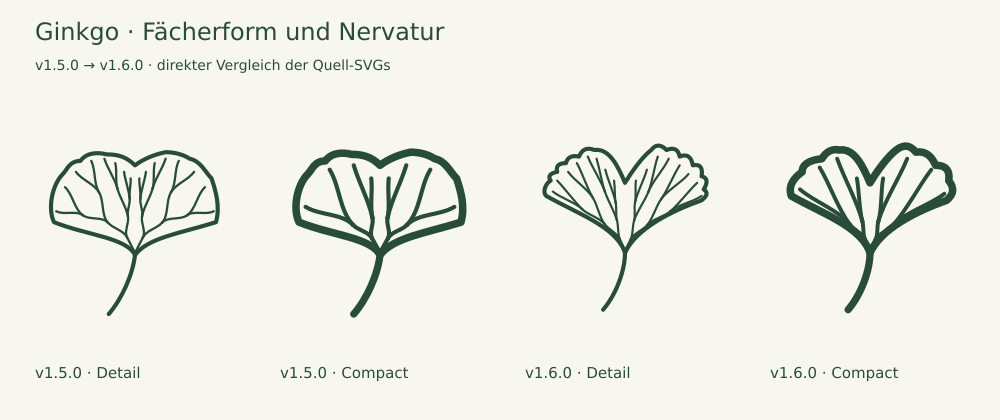

# Full collection review — 1.6.0

13 October 2026 · **117 species / 234 source SVGs** · baseline: canonical v1.5.0 ZIP

All 100 existing species were viewed again in both variants beside the retained foliage photographs and at Compact 24/32 px and Detail 48/64 px on light and dark backgrounds. Existing source descriptions and their documented limitations were reused; this is not a claim that all 100 botanical web pages were freshly researched again. Sixteen additions received new description-and-photograph research in [two consecutive groups](EXPANSION-1.6.md), followed by their own optical and geometry checks. A seventeenth addition, European plum, received a separate source, photograph, neighboring-species and optical review after the user identified the gap.

## Ginkgo: the repeated failure and correction

The first re-review still accepted the v1.5 Ginkgo too readily. User feedback prompted another direct close-up comparison. Its vertical outer sides and shallow, regular crown made the whole leaf box-like. Correct vein branching and a passing SVG test had not established a convincing silhouette. That earlier acceptance was insufficient.

The new drawing has oblique spreading flanks, a tapering wedge-shaped base, two slightly unequal lobes, a more explicit selected cleft and spreading dichotomous nerves. Compact has its own reduced margin and eight terminal nerves; Detail has sixteen. The [Flora of North America](https://floranorthamerica.org/Ginkgo_biloba) supports a fan commonly about 1.5 times wider than long, variable cleft and dichotomous venation; [OSU foliage photographs](https://landscapeplants.oregonstate.edu/plants/ginkgo-biloba) supplied the whole-leaf comparison. The chosen cleft is one natural form, not mandatory for every Ginkgo leaf.

Future review must include an enlarged side-by-side foliage comparison and a written silhouette finding before feature counts are accepted. Previously criticized icons require a before/after comparison. A new lower-fan taper regression catches this particular old contour; it cannot replace the visual judgement or certify botanical accuracy.

## Preserved work

SHA-256 comparison confirms **198 existing SVGs unchanged**, including Pedunculate oak, Wych elm, Black poplar, Scots pine and the five other v1.5 redraws. Only the two Ginkgo variants changed; 34 files were added. Original historical audits remain intact. [audit-1.6.json](audit-1.6.json) records the baseline/current hashes, measured blade bounds, path roles, exact photo URLs and per-species findings.

## Review findings

First-draft issues corrected before release: sparse Calluna scales, too-thin Erica needles, Clematis veins outside the narrowing leaflet tips and Compact leaflet overlap, lower veins entering Ribes/Vitis petiole sinuses, and slight Ginkgo lower-right vein excursions. Both variants now pass the complete geometry and painted-stroke checks. Similar taxa remain similar where their forms overlap; no artificial identifying trait was added.

| Species                                                 | Result   | Selected form and omissions                                                                                                                                                                                                                                                                                                                                                                                                                                                           |
| ------------------------------------------------------- | -------- | ------------------------------------------------------------------------------------------------------------------------------------------------------------------------------------------------------------------------------------------------------------------------------------------------------------------------------------------------------------------------------------------------------------------------------------------------------------------------------------- |
| Fichte · _Picea abies_                                  | Retained | Both retain individual sharp needles and front/side projections. Counts and widths are optical choices; the quadrangular cross-section is not shown. [Source](https://www.infoflora.ch/de/flora/picea-abies.html)                                                                                                                                                                                                                                                                     |
| Waldkiefer · _Pinus sylvestris_                         | Retained | Both retain exactly two needles per shared sheath, grouped as three visibly separate pairs. Only three short shoots are shown. Axial twisting, cross-section and stomata are omitted. [Source](https://www.infoflora.ch/de/flora/pinus-sylvestris.html)                                                                                                                                                                                                                               |
| Europäische Lärche · _Larix decidua_                    | Retained | Fan layout and 11 / 7 visible needles abbreviate natural bundles of 20–40; not a natural needle count or a complete shoot. [Source](https://www.infoflora.ch/de/flora/larix-decidua.html)                                                                                                                                                                                                                                                                                             |
| Weißtanne · _Abies alba_                                | Retained | Compact omits the tip notch. Both select a flat shade shoot; neither shows the underside’s stomatal bands. [Source](https://www.infoflora.ch/de/flora/abies-alba.html)                                                                                                                                                                                                                                                                                                                |
| Douglasie · _Pseudotsuga menziesii_                     | Retained | Both retain projected front/side needles and a pointed terminal bud. Needle counts and projected angles are drawing choices; stomatal bands, scent and bud scales are omitted. [Source](https://www.infoflora.ch/de/flora/pseudotsuga-menziesii.html)                                                                                                                                                                                                                                 |
| Eibe · _Taxus baccata_                                  | Retained | Both retain flat-looking, pointed, laterally directed needles. Needle numbers and spacing are reduced; underside colour is absent. [Source](https://www.infoflora.ch/de/flora/taxus-baccata.html)                                                                                                                                                                                                                                                                                     |
| Wacholder · _Juniperus communis_                        | Retained | Each depicted whorl contains exactly three needles: 18 in Detail, 12 in Compact. Foreshortening and alternating projection indicate positions around the twig; the pale stomatal band is absent. [Source](https://www.infoflora.ch/de/flora/juniperus-communis.html)                                                                                                                                                                                                                  |
| Stieleiche · _Quercus robur_                            | Retained | Both retain basal auricles and the very short petiole. Compact omits intercalary veins and reduces secondary veins. [Source](https://www.infoflora.ch/de/flora/quercus-robur.html)                                                                                                                                                                                                                                                                                                    |
| Traubeneiche · _Quercus petraea_                        | Retained | Both retain a tapering base without auricles and a longer petiole. Compact reduces lateral veins; underside hairs are absent. [Source](https://www.infoflora.ch/de/flora/quercus-petraea.html)                                                                                                                                                                                                                                                                                        |
| Rotbuche · _Fagus sylvatica_                            | Retained | Both retain an ovate blade and almost entire margin. Compact reduces venation; marginal hairs are not depicted. [Source](https://www.infoflora.ch/de/flora/fagus-sylvatica.html)                                                                                                                                                                                                                                                                                                      |
| Hängebirke · _Betula pendula_                           | Retained | Both retain the triangular/rhombic outline, long apex and visible petiole. Compact merges fine secondary teeth. [Source](https://www.infoflora.ch/de/flora/betula-pendula.html)                                                                                                                                                                                                                                                                                                       |
| Schwarzpappel · _Populus nigra_                         | Retained | Both retain curved flanks, a broad base and long petiole. Detail has four lateral veins per side; Compact has three and coarsens the margin. Lateral petiole flattening is not demonstrated by this frontal view. [Source](https://www.infoflora.ch/de/flora/populus-nigra.html)                                                                                                                                                                                                      |
| Espe · Zitterpappel · _Populus tremula_                 | Retained | Both select a rounded short-shoot leaf with coarse crenations and a long petiole. The petiole’s lateral flattening is a source fact, not visible anatomy. [Source](https://www.infoflora.ch/de/flora/populus-tremula.html)                                                                                                                                                                                                                                                            |
| Schwarzerle · _Alnus glutinosa_                         | Retained | Both select an obovate blade with a shallow apical notch and tapering base. Natural leaves also include more rounded forms. Compact reduces teeth and veins; underside hair tufts are absent. [Source](https://www.infoflora.ch/de/flora/alnus-glutinosa.html)                                                                                                                                                                                                                        |
| Hainbuche · _Carpinus betulus_                          | Retained | Both retain an elongated blade and toothed outline. Twelve vein pairs in Detail, six in Compact; fine double teeth are reduced. [Source](https://www.infoflora.ch/de/flora/carpinus-betulus.html)                                                                                                                                                                                                                                                                                     |
| Winterlinde · _Tilia cordata_                           | Retained | Both retain a cordate, slightly unequal base, pointed apex and conspicuous petiole. Compact coarsens teeth; underside hair tufts are absent. [Source](https://www.infoflora.ch/de/flora/tilia-cordata.html)                                                                                                                                                                                                                                                                           |
| Hasel · _Corylus avellana_                              | Retained | Both retain a broad, cordate blade and short pointed apex. Seven lateral vein pairs in Detail, four in Compact; secondary teeth merge in Compact. Surface hairs and fine reticulation are omitted. [Source](https://www.infoflora.ch/de/flora/corylus-avellana.html)                                                                                                                                                                                                                  |
| Bergahorn · _Acer pseudoplatanus_                       | Retained | Five broad lobes, short tips and acute sinuses. Compact omits secondary vein branches; both simplify the coarse irregular teeth. The source supports acute sinuses, not universally rounded ones. [Source](https://www.infoflora.ch/de/flora/acer-pseudoplatanus.html)                                                                                                                                                                                                                |
| Spitzahorn · _Acer platanoides_                         | Retained | Both retain long lobe tips, broad sinuses and a long petiole. Compact reduces individual marginal points. [Source](https://www.infoflora.ch/de/flora/acer-platanoides.html)                                                                                                                                                                                                                                                                                                           |
| Feldahorn · _Acer campestre_                            | Retained | Selected five-lobed entire-margined form with blunt lobes and a conspicuous petiole. Compact keeps the main palmate veins and omits two secondary branches. Lobe depth and number vary naturally. [Source](https://www.infoflora.ch/de/flora/acer-campestre.html)                                                                                                                                                                                                                     |
| Gemeine Esche · _Fraxinus excelsior_                    | Retained | Both retain nine pointed leaflets, four opposite pairs and one terminal leaflet. Compact simplifies the serrations and omits fine venation. [Source](https://www.infoflora.ch/de/flora/fraxinus-excelsior.html)                                                                                                                                                                                                                                                                       |
| Bergulme · _Ulmus glabra_                               | Retained | Both retain the very short petiole, mildly unequal base, broadest region above the middle and two lateral apex points. Compact merges secondary teeth and reduces 13 lateral veins per side to five, without forks. [Source](https://www.infoflora.ch/de/flora/ulmus-glabra.html)                                                                                                                                                                                                     |
| Salweide · _Salix caprea_                               | Retained | Both select a broad oval blade and a weakly wavy, nearly entire margin. Reticulate veins and underside felt are absent. [Source](https://www.infoflora.ch/de/flora/salix-caprea.html)                                                                                                                                                                                                                                                                                                 |
| Silberweide · _Salix alba_                              | Retained | Both retain a balanced lanceolate blade, about 5.4:1 in Detail and 5.2:1 in Compact. Compact omits fine teeth and lateral veins; silky hairs are absent in both. [Source](https://www.infoflora.ch/de/flora/salix-alba.html)                                                                                                                                                                                                                                                          |
| Rosskastanie · _Aesculus hippocastanum_                 | Retained | Both retain seven palmate leaflets, unequal leaflet sizes and a long petiole. Compact smooths the small teeth and omits leaflet midribs. [Source](https://www.infoflora.ch/de/flora/aesculus-hippocastanum.html)                                                                                                                                                                                                                                                                      |
| Edelkastanie · _Castanea sativa_                        | Retained | Selected lanceolate outline, approximately 3.1:1 blade height/width including teeth. Eighteen vein-tooth pairs in Detail, nine in Compact; pointed teeth remain but their depth is reduced. Counts are selected drawing values. [Source](https://www.infoflora.ch/de/flora/castanea-sativa.html)                                                                                                                                                                                      |
| Vogelbeere · _Sorbus aucuparia_                         | Retained | Both retain eleven slender leaflets, five pairs and a terminal leaflet. Compact simplifies serrations and omits leaflet midribs. [Source](https://www.infoflora.ch/de/flora/sorbus-aucuparia.html)                                                                                                                                                                                                                                                                                    |
| Robinie · _Robinia pseudoacacia_                        | Retained | Both retain nine oval, entire leaflets and a terminal leaflet. Compact omits leaflet midribs. Nine is a selected natural count, not a fixed species count. [Source](https://www.infoflora.ch/de/flora/robinia-pseudoacacia.html)                                                                                                                                                                                                                                                      |
| Schwarzer Holunder · _Sambucus nigra_                   | Retained | Five leaflets in both variants. Detail retains secondary veins; Compact omits them and reduces marginal teeth. Opposite whole-leaf insertion is not visible in a detached leaf. [Source](https://www.infoflora.ch/de/flora/sambucus-nigra.html)                                                                                                                                                                                                                                       |
| Eingriffeliger Weißdorn · _Crataegus monogyna_          | Retained | Five major lobes and deep incisions in both sizes; teeth are concentrated toward lobe ends. Compact omits minor vein branches and merges teeth. Lobe number varies naturally. [Source](https://www.infoflora.ch/de/flora/crataegus-monogyna.html)                                                                                                                                                                                                                                     |
| Schlehe · _Prunus spinosa_                              | Retained | Both retain a narrow toothed blade and short petiole. Seven vein pairs in Detail, three in Compact; small teeth are optically enlarged. Shoot thorns are not part of this isolated leaf. [Source](https://www.infoflora.ch/de/flora/prunus-spinosa.html)                                                                                                                                                                                                                              |
| Roter Hartriegel · _Cornus sanguinea_                   | Retained | Four arcuate vein pairs in Detail, three in Compact. The entire margin and broad outline remain. Hair orientation and opposite leaf insertion on the twig are omitted. [Source](https://www.infoflora.ch/de/flora/cornus-sanguinea.html)                                                                                                                                                                                                                                              |
| Gewöhnlicher Schneeball · _Viburnum opulus_             | Retained | Three lobes, coarse teeth and palmate primary veins in both sizes. Detail includes two petiolar glands; Compact omits the glands and secondary veins. The stipular appendages are not shown. [Source](https://www.infoflora.ch/de/flora/viburnum-opulus.html)                                                                                                                                                                                                                         |
| Stechpalme · _Ilex aquifolium_                          | Retained | A selected prickly leaf, not the entire range of adult foliage. Compact reduces the spine count. Leathery texture and the three-dimensional undulation of the margin are not represented. [Source](https://www.infoflora.ch/de/flora/ilex-aquifolium.html)                                                                                                                                                                                                                            |
| Faulbaum · _Frangula alnus_                             | Retained | Eight lateral vein pairs in Detail, four in Compact; an entire oval blade and short apex remain. Fine vein connections and surface features are omitted. [Source](https://www.infoflora.ch/de/flora/frangula-alnus.html)                                                                                                                                                                                                                                                              |
| Pfaffenhütchen · _Euonymus europaeus_                   | Retained | Both retain a broad-lanceolate blade with fine teeth and short petiole. Six vein pairs in Detail, three in Compact. Opposite insertion and shoot anatomy are not shown. [Source](https://www.infoflora.ch/de/flora/euonymus-europaeus.html)                                                                                                                                                                                                                                           |
| Hundsrose · _Rosa canina_                               | Retained | Seven serrate leaflets and two adnate stipules remain in both sizes. Compact reduces tooth density and omits secondary veins. Natural leaves may have five leaflets; hairs, glands and petiole prickles are not shown. [Source](https://www.infoflora.ch/de/flora/rosa-canina.html)                                                                                                                                                                                                   |
| Kornelkirsche · _Cornus mas_                            | Retained | Four arcuate vein pairs in Detail, three in Compact. A narrower selected blade than the dogwood drawing, with an entire margin. Natural shape ranges overlap; underside axillary hair tufts are omitted. [Source](https://www.infoflora.ch/de/flora/cornus-mas.html)                                                                                                                                                                                                                  |
| Vogelkirsche · _Prunus avium_                           | Retained | Long petiole, pointed blade and unequal serration. Detail shows two petiolar glands and eight vein pairs; Compact omits glands, merges fine teeth and uses four vein pairs. [Source](https://www.infoflora.ch/de/flora/prunus-avium.html)                                                                                                                                                                                                                                             |
| Sommerlinde · _Tilia platyphyllos_                      | Retained | Broad cordate outline, unequal basal shoulders and a visible petiole. Compact reduces teeth and veins. Hair colour, density and axillary tufts are omitted; this silhouette alone cannot reliably distinguish it from Small-leaved lime. [Source](https://www.infoflora.ch/de/flora/tilia-platyphyllos.html)                                                                                                                                                                          |
| Walnuss · _Juglans regia_                               | Retained | Seven entire, broad leaflets, with a smaller lowest pair. Compact omits secondary veins and adjusts widths for clear gaps. Natural leaflet numbers vary; young leaves may have teeth. [Source](https://www.infoflora.ch/de/flora/juglans-regia.html)                                                                                                                                                                                                                                  |
| Moorbirke · _Betula pubescens_                          | Retained | A selected ovate blade with rounded base and a less elongated apex than Silver birch. Compact merges double teeth and reduces veins. Hair characters are absent and the two birches overlap in shape. [Source](https://www.infoflora.ch/de/flora/betula-pubescens.html)                                                                                                                                                                                                               |
| Flatterulme · _Ulmus laevis_                            | Retained | One apex, strong basal asymmetry and a short petiole. Detail has fourteen unbranched veins on each side; Compact has six and simplified forward teeth. Very fine nerve-tooth connections and hairs are omitted. [Source](https://www.infoflora.ch/de/flora/ulmus-laevis.html)                                                                                                                                                                                                         |
| Elsbeere · _Sorbus torminalis_                          | Retained | Three unequal pointed lateral lobes per side; the lowest pair spreads widest. Lateral nerves leave the midrib at different levels. Compact merges small teeth and omits vein branches. Natural leaves may have a fourth lobe pair. [Source](https://www.infoflora.ch/de/flora/sorbus-torminalis.html)                                                                                                                                                                                 |
| Französischer Ahorn · _Acer monspessulanum_             | Retained | Three entire lobes, rounded flanks, a shallow cordate base and long petiole. Compact retains the three main nerves; Detail adds small branches. Gloss, texture and natural lobe variation are omitted. [Source](https://landscapeplants.oregonstate.edu/plants/acer-monspessulanum)                                                                                                                                                                                                   |
| Eschenahorn · _Acer negundo_                            | Retained | A selected three-leaflet form, with coarse teeth and a lobed terminal leaflet on a longer petiolule. Compact reduces teeth and lateral venation. Other natural leaves carry five or seven leaflets; this is one compound leaf, not a shoot. [Source](https://www.infoflora.ch/de/flora/acer-negundo.html)                                                                                                                                                                             |
| Liguster · _Ligustrum vulgare_                          | Retained | Entire, narrow blade with short petiole; four vein pairs in Detail, three in Compact. Leathery texture, persistence and opposite leaf insertion are not encoded. [Source](https://www.infoflora.ch/de/flora/ligustrum-vulgare.html)                                                                                                                                                                                                                                                   |
| Berberitze · _Berberis vulgaris_                        | Retained | Obovate blade, rounded apex, tapering base, short petiole and sharp fine teeth. Compact coarsens teeth and reduces veins. The leaf fascicle and three-part stem spines are omitted. [Source](https://www.infoflora.ch/de/flora/berberis-vulgaris.html)                                                                                                                                                                                                                                |
| Rote Heckenkirsche · _Lonicera xylosteum_               | Retained | Entire broadly ovate blade, short apex and short petiole; five vein pairs in Detail, three in Compact. Both omit the soft hairs and opposite insertion, so the leaf alone is not a complete identification. [Source](https://www.infoflora.ch/de/flora/lonicera-xylosteum.html)                                                                                                                                                                                                       |
| Kreuzdorn · _Rhamnus cathartica_                        | Retained | Broad oval blade with a short apical point and fine teeth. Four arcuate vein pairs in Detail, three in Compact. Opposite insertion and thorn-tipped shoots are not shown. [Source](https://www.infoflora.ch/de/flora/rhamnus-cathartica.html)                                                                                                                                                                                                                                         |
| Felsenbirne · _Amelanchier ovalis_                      | Retained | A selected broad oval, finely toothed blade with rounded base and short apex. Seven vein pairs in Detail, four in Compact. Transient juvenile felt and fruit characters are omitted. [Source](https://www.infoflora.ch/de/flora/amelanchier-ovalis.html)                                                                                                                                                                                                                              |
| Traubenkirsche · _Prunus padus_                         | Retained | A selected rounded-base blade with regular fine teeth, an acuminate apex and short petiole. Detail shows ten vein pairs and two glands; Compact has four pairs and omits glands. Vein relief and axillary hairs are absent. [Source](https://www.infoflora.ch/de/flora/prunus-padus.html)                                                                                                                                                                                             |
| Feldulme · _Ulmus minor_                                | Retained | Detail: twelve main vein pairs plus four branches in the upper half. Compact: six pairs, no forks and simplified teeth. The single apex, unequal base and relatively longer petiole remain; hairs and the finest tooth connections are omitted. [Source](https://www.infoflora.ch/de/flora/ulmus-minor.html)                                                                                                                                                                          |
| Grauerle · _Alnus incana_                               | Retained | Detail: twelve vein pairs and double teeth. Compact: six pairs and coarser single teeth. The widest part stays below mid-blade; leaf-surface hairs are omitted. [Source](https://www.infoflora.ch/de/flora/alnus-incana.html)                                                                                                                                                                                                                                                         |
| Mehlbeere · _Sorbus aria_                               | Retained | Detail: twelve vein pairs and double teeth. Compact: six pairs and reduced teeth. The blade remains unlobed; the diagnostic white felt below cannot be conveyed in this monochrome outline. [Source](https://www.infoflora.ch/de/flora/sorbus-aria.html)                                                                                                                                                                                                                              |
| Wildapfel · _Malus sylvestris_                          | Retained | Broad ovate blade and a conspicuously long petiole in both sizes. Six drawn vein pairs in Detail, three in Compact. Leaf-surface relief and mature hairlessness are omitted; the outline alone cannot establish wild rather than cultivated origin. [Source](https://www.infoflora.ch/de/flora/malus-sylvestris.html)                                                                                                                                                                 |
| Wildbirne · _Pyrus pyraster_                            | Retained | A selected finely toothed, broadly oval form with a short apical point and long petiole. Five drawn vein pairs in Detail, three in Compact. Entire-margined leaves also occur. Surface relief and cultivated pear comparisons are outside this icon. [Source](https://www.infoflora.ch/de/flora/pyrus-pyraster.html)                                                                                                                                                                  |
| Wolliger Schneeball · _Viburnum lantana_                | Retained | Unlobed, broad ovate blade with fine regular teeth. Seven drawn vein pairs in Detail, four in Compact. Both omit the wrinkled surface and stellate felt, so this is not a complete diagnostic illustration. [Source](https://www.infoflora.ch/de/flora/viburnum-lantana.html)                                                                                                                                                                                                         |
| Silberpappel · _Populus alba_                           | Retained | A selected five-lobed vigorous-shoot leaf, not a claim about all leaves. Both retain the main palmate veins; Compact merges secondary teeth and omits vein branches. Short-shoot leaves can be weakly lobed or unlobed; white underside felt is absent. [Source](https://www.infoflora.ch/de/flora/populus-alba.html)                                                                                                                                                                 |
| Speierling · _Sorbus domestica_                         | Retained | Thirteen leaflets in both variants, with the lower third of each margin entire. Detail retains leaflet midribs; Compact omits them. Both omit the numerous fine secondary veins of each leaflet. The chosen count is within the natural range, not a species-wide constant. [Source](https://www.infoflora.ch/de/flora/sorbus-domestica.html)                                                                                                                                         |
| Ginkgo · _Ginkgo biloba_                                | Redrawn  | Selected two-lobed fan, approximately 1.5 times wider than high, with a clearer cleft, spreading oblique flanks and long petiole. Detail has sixteen terminal nerves, Compact eight, in connected bifurcating trees without a midrib. The outline is optically simplified separately in Compact. Real leaves have much denser apparently parallel venation; cleft depth and lobe shape vary greatly. [Source](https://floranorthamerica.org/Ginkgo_biloba)                            |
| Ahornblättrige Platane · _Platanus × hispanica_         | Retained | Selected five-lobed blade with a broad central lobe, coarse teeth and a nearly truncate to shallow cordate base. Compact omits secondary veins. Hybrid variation and alternate leaf insertion are not conveyed; it is not an Acer species. [Source](https://www.infoflora.ch/de/flora/platanus-%C3%97hispanica.html)                                                                                                                                                                  |
| Tulpenbaum · _Liriodendron tulipifera_                  | Retained | Four lobes, entire margins, a shallow apical notch and a long petiole. The four main lateral veins leave a distinct midrib at two levels; Compact omits the smaller branches. No apical point or palmate vein hub is substituted. [Source](https://www.infoflora.ch/de/flora/liriodendron-tulipifera.html)                                                                                                                                                                            |
| Amberbaum · _Liquidambar styraciflua_                   | Retained | Selected five-lobed star with acuminate tips, fine serration and long petiole. Compact reduces teeth and omits secondary veins. Alternate insertion, which helps separate it from maples on a shoot, is absent. [Source](https://botanischer-garten-hoexter.de/pflanze-liquidambar_styraciflua.html)                                                                                                                                                                                  |
| Fächerahorn · _Acer palmatum_                           | Retained | Selected seven-lobed form with lanceolate lobes and prolonged tips. Detail indicates double serration; Compact uses fewer single teeth and retains seven main veins. Cultivar diversity and dissected Dissectum foliage are not represented. [Source](https://www.iplant.cn/foc/pdf/Acer.pdf)                                                                                                                                                                                         |
| Schneeballblättriger Ahorn · _Acer opalus_              | Retained | Selected five-lobed blade, with incisions restricted approximately to the outer third, broad lobes and a few wavy teeth. Compact retains primary veins but omits branches. Three-lobed and more weakly lobed leaves also occur. [Source](https://www.infoflora.ch/de/flora/acer-opalus.html)                                                                                                                                                                                          |
| Efeu · _Hedera helix_                                   | Retained | Selected five-lobed juvenile climbing-shoot leaf, with entire margins and palmate veins. Compact omits vein branches. Adult flowering-shoot leaves are unlobed; juvenile and adult phases are not combined in one drawing. [Source](https://www.infoflora.ch/de/flora/hedera-helix.html)                                                                                                                                                                                              |
| Baumhasel · _Corylus colurna_                           | Retained | Cordate base, broad ovate blade, prolonged tip and double teeth. Detail: six vein pairs; Compact: three pairs and reduced teeth. Vein hairs and fruit involucres are omitted. Similarity to Common hazel is natural. [Source](https://www.infoflora.ch/de/flora/corylus-colurna.html)                                                                                                                                                                                                 |
| Roteiche · _Quercus rubra_                              | Retained | Both retain four main lobe pairs, forward-facing pointed teeth and a cuneate base. Compact omits the minor vein branches. Bristle tips are shortened; actual leaf and lobe proportions vary. [Source](https://www.infoflora.ch/de/flora/quercus-rubra.html)                                                                                                                                                                                                                           |
| Flaumeiche · _Quercus pubescens_                        | Retained | Both retain rounded, unequal lobes, a short petiole and a short cuneate base. Compact reduces lateral veins. The diagnostic hairs are omitted; the silhouette cannot reliably separate this oak from Sessile oak or hybrids. [Source](https://www.infoflora.ch/de/flora/quercus-pubescens.html)                                                                                                                                                                                       |
| Zerreiche · _Quercus cerris_                            | Retained | Both retain unequal, pointed lobes and a short petiole. Detail has two thin, persistent stipules; Compact omits them and the smaller vein branches. Hair cover and cartilage at lobe tips are not encoded. [Source](https://www.infoflora.ch/de/flora/quercus-cerris.html)                                                                                                                                                                                                            |
| Silberlinde · _Tilia tomentosa_                         | Retained | Both retain the cordate base, prolonged apex, serration and basal palmate veins. Compact uses fewer teeth and four primary lateral veins. Underside felt, not a unique upper-surface outline, is a major natural distinction from other limes. [Source](https://www.infoflora.ch/de/flora/tilia-tomentosa.html)                                                                                                                                                                       |
| Roter Holunder · _Sambucus racemosa_                    | Retained | Selected five-leaflet form in both sizes; each pointed leaflet has a serrate margin. Compact omits secondary leaflet veins. Pith, inflorescences, berries and stipular glands are absent; leaf shape alone does not securely separate it from Black elder. [Source](https://www.infoflora.ch/de/flora/sambucus-racemosa.html)                                                                                                                                                         |
| Zweigriffeliger Weißdorn · _Crataegus laevigata_        | Retained | Selected shallow three-lobed blade with narrow sinuses, rounded shoulders, short teeth and inward-curving veins. Compact omits minor branches. Flowers, fruits and toothed stipules are not shown; hybrid forms can overlap. [Source](https://www.infoflora.ch/de/flora/crataegus-laevigata.html)                                                                                                                                                                                     |
| Himbeere · _Rubus idaeus_                               | Retained | A three-leaflet form with a larger, visibly stalked terminal leaflet. Detail indicates double teeth; Compact reduces the serration and omits secondary veins. Five- and seven-leaflet cane leaves and white underside felt are not shown. [Source](https://www.infoflora.ch/de/flora/rubus-idaeus.html)                                                                                                                                                                               |
| Sanddorn · _Hippophae rhamnoides_                       | Retained | Both keep a narrow, entire blade and short petiole. Detail has three reduced vein pairs; Compact omits these and uses a thinner internal midrib to retain a clear gap. Scales, colour and rolled leaf edges are not resolved. [Source](https://www.infoflora.ch/de/flora/hippopha%C3%AB-rhamnoides.html)                                                                                                                                                                              |
| Zirbelkiefer · Arve · _Pinus cembra_                    | Retained | Exactly five needles at each of three visible short-shoot origins in both sizes. Selected mature fascicles omit the deciduous basal sheath. Compact broadens the needles optically. Cross-sections, stomatal bands and full shoot density are omitted. [Source](https://www.infoflora.ch/de/flora/pinus-cembra.html)                                                                                                                                                                  |
| Bergkiefer · _Pinus mugo_                               | Retained | Exactly two needles per shared sheath at four visible short shoots in both sizes. Compact broadens needles and sheaths. The drawing represents Pinus mugo broadly; it does not distinguish its subspecies or every two-needle pine. [Source](https://www.infoflora.ch/de/flora/pinus-mugo.html)                                                                                                                                                                                       |
| Urweltmammutbaum · _Metasequoia glyptostroboides_       | Retained | One deciduous lateral branchlet, not a compound leaf. Detail has fourteen opposite needle pairs; Compact has nine. Blunt flat needles and opposite insertion are retained. Pair count, spacing and projection are selected; whole-tree branching and underside bands are omitted. [Source](https://plantdatabase.kpu.ca/PlantPrint/megl)                                                                                                                                              |
| Götterbaum · _Ailanthus altissima_                      | Retained | Selected nine-leaflet form; each largely entire, pointed leaflet retains two conspicuous basal teeth. Detail includes reduced veins; Compact omits them. Underside gland surfaces are not drawn as upper-surface dots. The terminal leaflet is reduced to fit the icon. [Source](https://www.infoflora.ch/de/flora/ailanthus-altissima.html)                                                                                                                                          |
| Essigbaum · _Rhus typhina_                              | Retained | Selected eleven-leaflet form with narrow pointed, serrate leaflets and an unwinged rachis. Detail includes midribs and reduced side veins; Compact retains serration but omits internal leaflet veins. Hairs and natural count variation are omitted. [Source](https://www.infoflora.ch/de/flora/rhus-typhina.html)                                                                                                                                                                   |
| Silberahorn · _Acer saccharinum_                        | Retained | Five lobes, deep narrow sinuses rounded at their bases and a central lobe narrowed toward its base. Coarse teeth concentrate toward the lobe ends. Compact omits small vein branches. Silver underside colour and cultivar variation are absent. [Source](https://www.infoflora.ch/de/flora/acer-saccharinum.html)                                                                                                                                                                    |
| Rotahorn · _Acer rubrum_                                | Retained | Selected three-lobed form with broad acute sinuses and a central lobe broadest at its base. Both retain serrate margins and a long petiole; Compact reduces teeth and omits secondary veins. Five-lobed and hybrid forms are not represented. [Source](https://www.infoflora.ch/de/flora/acer-rubrum.html)                                                                                                                                                                            |
| Kirschlorbeer · _Prunus laurocerasus_                   | Retained | An elongated obovate-lanceolate blade with a short tip and short stalk. Detail retains a very fine margin and eight drawn vein pairs; Compact reduces these to four. Gloss, leathery texture, rolled margins and underside glands are omitted. [Source](https://www.infoflora.ch/de/flora/prunus-laurocerasus.html)                                                                                                                                                                   |
| Buchsbaum · _Buxus sempervirens_                        | Retained | Selected oval, entire blade with rounded apex and short petiole. Detail has four vein pairs, Compact two; veins are emphasized for this line system, whereas they can be faint on a real leathery leaf. Opposite insertion, rolled edge and texture are not shown. [Source](https://www.infoflora.ch/de/flora/buxus-sempervirens.html)                                                                                                                                                |
| Flieder · _Syringa vulgaris_                            | Retained | Cordate entire blade, prolonged apex and long petiole. Detail retains four lateral pairs, Compact the basal pair. Opposite insertion, leaf thickness and fine venation are omitted. [Source](https://www.infoflora.ch/de/flora/syringa-vulgaris.html)                                                                                                                                                                                                                                 |
| Echter Seidelbast · _Daphne mezereum_                   | Retained | Oblanceolate blade, upper maximum width, tapering base and short stalk. Detail has six lateral pairs; Compact keeps two upper pairs with lighter strokes to avoid filling the narrow base. No flower or terminal leaf cluster is depicted. [Source](https://www.infoflora.ch/de/flora/daphne-mezereum.html)                                                                                                                                                                           |
| Purpurweide · _Salix purpurea_                          | Retained | Selected narrow oblanceolate form with upper maximum width. Teeth are restricted to the upper two thirds; Detail has five vein pairs, Compact only the midrib. Opposite/subopposite shoot insertion, glaucous colour and minute teeth at small sizes are not diagnostic here. [Source](https://www.infoflora.ch/de/flora/salix-purpurea.html)                                                                                                                                         |
| Korbweide · _Salix viminalis_                           | Retained | Long narrow lanceolate blade with maximum width below the middle, long taper and weakly wavy edge. Detail has four reduced vein pairs, Compact only a fine midrib. Rolled margin, silky lower surface and rare glandular teeth are omitted. [Source](https://www.floraweb.de/php/artenhome.php?suchnr=5206)                                                                                                                                                                           |
| Mahonie · _Mahonia aquifolium_                          | Retained | Seven selected broad prickly leaflets in three pairs plus a terminal leaflet. Compact omits secondary veins. Lateral leaflet bases are nearly sessile in nature; tiny connectors and separated outlines are optical spacing, not long petiolules. Fine spine density and texture are reduced. [Source](https://www.infoflora.ch/de/flora/mahonia-aquifolium.html)                                                                                                                     |
| Kratzbeere · _Rubus caesius_                            | Retained | Three broad leaflets, visibly stalked terminal leaflet and nearly sessile lateral leaflets. Detail has double teeth and paired broad stipules; Compact merges teeth and omits stipules and secondary veins. Tiny lateral connectors allow optical separation. This depicts Rubus caesius, not a generic blackberry aggregate. [Source](https://www.infoflora.ch/de/flora/rubus-caesius.html)                                                                                          |
| Schwarze Johannisbeere · _Ribes nigrum_                 | Retained | Selected broad three-lobed blade with a cordate base, toothed margin and basal main nerves. Compact reduces the serration and minor branches. Five-lobed leaves also occur; yellow glands on the underside and aroma cannot be conveyed by this upper-view icon. [Source](https://www.infoflora.ch/de/flora/ribes-nigrum.html)                                                                                                                                                        |
| Heidelbeere · _Vaccinium myrtillus_                     | Retained | Ovate-lanceolate pointed blade, very short stalk and fine serration. Detail has six vein pairs, Compact three. Twig ridges, deciduous habit and surface colour are not encoded. [Source](https://www.infoflora.ch/de/flora/vaccinium-myrtillus.html)                                                                                                                                                                                                                                  |
| Preiselbeere · _Vaccinium vitis-idaea_                  | Retained | Selected obovate entire blade with a rounded, slightly notched apex and short petiole. Detail has four vein pairs, Compact two. Natural margins may be finely toothed; rolled edges, leathery texture and underside gland dots are omitted. [Source](https://www.infoflora.ch/de/flora/vaccinium-vitis-idaea.html)                                                                                                                                                                    |
| Rostblättrige Alpenrose · _Rhododendron ferrugineum_    | Retained | Entire elliptic-lanceolate blade, short apical point and short petiole. Detail has five lateral pairs, Compact two. The diagnostically important rusty underside scales and rolled margin are omitted; do not infer them from this upper-view outline. [Source](https://www.infoflora.ch/de/flora/rhododendron-ferrugineum.html)                                                                                                                                                      |
| Stachelbeere · _Ribes uva-crispa_                       | Retained | Selected five-lobed leaf with rounded lobes, curved crenations, cordate base and conspicuous petiole. Compact coarsens the crenations and retains the main veins. Three-lobed forms also occur; shoot spines, glands and hairs are not shown. [Source](https://www.infoflora.ch/de/flora/ribes-uva-crispa.html)                                                                                                                                                                       |
| Europäischer Zürgelbaum · _Celtis australis_            | Retained | Broad lanceolate blade with unequal base, prolonged apex, fine teeth and three strong basal nerves. Detail retains additional lateral branches; Compact keeps the basal pair and one upper pair. Serration is reduced at the extreme base; rough texture and hairs are omitted. [Source](https://www.infoflora.ch/de/flora/celtis-australis.html)                                                                                                                                     |
| Hopfenbuche · _Ostrya carpinifolia_                     | Retained | Ovate pointed blade with short stalk. Detail has sixteen primary lateral veins per side coordinated with double marginal teeth. Compact reduces these to seven and merges secondary teeth. The dense venation is a selected diagnostic emphasis, not a universal fixed count. [Source](https://www.infoflora.ch/de/flora/ostrya-carpinifolia.html)                                                                                                                                    |
| Schwarzkiefer · _Pinus nigra_                           | Retained | Three separated short shoots, each with exactly two long stiff needles and a common sheath. Compact broadens the needles. Relative needle length is selected; it cannot alone distinguish every two-needle pine. Cross-section, surface bands and natural shoot density are omitted. [Source](https://www.infoflora.ch/de/flora/pinus-nigra.html)                                                                                                                                     |
| Sumpfzypresse · _Taxodium distichum_                    | Retained | One deciduous side branchlet of the flat-leaved Taxodium distichum form. Thirty individually alternate, pointed needles in Detail, twenty in Compact. Needles project into two ranks but do not share opposite insertion levels. Counts are reduced; this is not pond-cypress appressed foliage. [Source](https://landscapeplants.oregonstate.edu/plants/taxodium-distichum)                                                                                                          |
| Besenheide · _Calluna vulgaris_                         | Added    | Three selected shoot axes. Opposite scale pairs alternate broad and foreshortened projections, representing four-ranked decussate insertion. Detail depicts 18 pairs per axis, Compact 12, with thicker scales. Numbers and angles are illustrative; naturally overlapping scales legitimately overlap in projection. Microscopic margins and flowers are absent. This is an angiosperm heath shoot, not a conifer. [Source](https://www.infoflora.ch/de/flora/calluna-vulgaris.html) |
| Schneeheide · _Erica carnea_                            | Added    | Selected shoot with seven four-leaf whorls in Detail and five in Compact. All four needles share each node; angles project three-dimensional whorls onto the page. Compact broadens needles. Actual leaf number along a shoot, lower-surface grooves, colour and flowers are omitted. This is an angiosperm, not a conifer. [Source](https://www.infoflora.ch/de/flora/erica-carnea.html)                                                                                             |
| Besenginster · _Cytisus scoparius_                      | Added    | Selected trifoliolate mature lower leaf with a larger obovate terminal leaflet and two smaller lateral leaflets. Leaflets are apetiolulate in the botanical description; very short junction connectors separate their outlines optically, not long petiolules. Detail has secondary veins; Compact only midribs. Simple upper leaves and stem ridges are not represented. [Source](https://www.infoflora.ch/de/flora/cytisus-scoparius.html)                                         |
| Färber-Ginster · _Genista tinctoria_                    | Added    | Selected simple entire lanceolate blade with a short petiole. Five lateral vein pairs in Detail, two in Compact. Minute stipules, hairs, shoot insertion and the complete venation network are omitted. Vein contrast is emphasized for this drawing system. [Source](https://www.infoflora.ch/de/flora/genista-tinctoria.html)                                                                                                                                                       |
| Gewöhnliche Waldrebe · _Clematis vitalba_               | Added    | Selected five-leaflet leaf with distinct petiolules, ovate pointed leaflets and shallow cordate bases. Detail shows a few coarse teeth and two secondary vein pairs per leaflet; Compact narrows leaflets optically, reduces teeth and retains only midribs. Three-leaflet and entire-margined forms also occur; the climbing action of the petiole is not represented. [Source](https://www.infoflora.ch/de/flora/clematis-vitalba.html)                                             |
| Weinrebe · _Vitis vinifera_                             | Added    | Selected five-lobed cultivated leaf with an open narrow petiole sinus, toothed margin and five main palmate veins. Detail adds six secondary branches; Compact reduces teeth and omits those branches. Cultivars and wild vines differ greatly in incision depth and sinus closure. This is not a cultivar diagnostic. [Source](https://www.infoflora.ch/de/flora/vitis-vinifera.html)                                                                                                |
| Rote Johannisbeere · _Ribes rubrum_                     | Added    | Selected broadly cordate five-lobed leaf with comparatively rounded lobes, teeth and a long petiole. Compact merges fine teeth and retains four lateral primary veins. Three-lobed forms also occur. The silhouette overlaps Blackcurrant and other Ribes; absence of aromatic underside glands cannot be inferred from an upper-view line icon. [Source](https://www.infoflora.ch/de/flora/ribes-rubrum.html)                                                                        |
| Alpen-Johannisbeere · _Ribes alpinum_                   | Added    | Selected broad three-lobed form with relatively deep upper incisions, toothed lobes and a shallow cordate base. Detail has four secondary vein branches; Compact retains only the three main nerves. Five-lobed forms also occur. Absolute leaf size, shoot characters and gland/hair details are not shown. [Source](https://www.infoflora.ch/de/flora/ribes-alpinum.html)                                                                                                           |
| Sommerflieder · _Buddleja davidii_                      | Added    | Selected long-acuminate lanceolate blade with fine serration and a short petiole. Detail has seven lateral pairs; Compact three with fewer teeth. Opposite leaf insertion and the grey felted underside, important in recognition, are absent in this single upper-view leaf. [Source](https://www.infoflora.ch/de/flora/buddleja-davidii.html)                                                                                                                                       |
| Gewöhnlicher Pfeifenstrauch · _Philadelphus coronarius_ | Added    | Selected broadly lanceolate-ovate leaf with a short petiole and sparse marginal teeth. Detail has five lateral vein pairs, Compact three. The documented range includes more ovate and almost entire leaves; opposite insertion, hairs and flowers are not represented. [Source](https://www.infoflora.ch/de/flora/philadelphus-coronarius.html)                                                                                                                                      |
| Gewöhnlicher Trompetenbaum · _Catalpa bignonioides_     | Added    | Selected unlobed entire ovate blade with an abruptly prolonged tip, shallow cordate base and long petiole. Detail adds four minor branches; Compact retains two lateral vein pairs. Opposite or whorled insertion, texture and odour are absent. The silhouette alone does not distinguish all Catalpa or Paulownia forms. [Source](https://landscapeplants.oregonstate.edu/plants/catalpa-bignonioides)                                                                              |
| Blauglockenbaum · _Paulownia tomentosa_                 | Added    | Selected unlobed broad cordate entire blade with strong basal nerves and a long petiole. Compact omits four minor branches. Shallowly three-lobed leaves also occur, especially in vigorous growth; tomentose underside, absolute size and opposite insertion are not shown. [Source](https://www.infoflora.ch/de/flora/paulownia-tomentosa.html)                                                                                                                                     |
| Weiße Maulbeere · _Morus alba_                          | Added    | Selected unlobed ovate leaf with a shallow cordate base, serration and a relatively long petiole. Compact reduces teeth and secondary branches. Lobed leaves may occur on the same tree. Surface smoothness and sheen are omitted; the selected silhouette is not a reliable separation from every Black mulberry leaf. [Source](https://www.infoflora.ch/de/flora/morus-alba.html)                                                                                                   |
| Schwarze Maulbeere · _Morus nigra_                      | Added    | Selected unlobed broadly ovate leaf with a deeper cordate base and shorter petiole than the selected White mulberry form. Compact reduces teeth and secondary branches. Rough upper-surface hairs and thickness are absent. Shape ranges overlap; these two icons must remain paired with names. [Source](https://www.infoflora.ch/de/flora/morus-nigra.html)                                                                                                                         |
| Gleditschie · _Gleditsia triacanthos_                   | Added    | Selected once, evenly pinnate leaf with eight pairs (16 leaflets) and no terminal leaflet. Detail indicates very fine sparse teeth and leaflet midribs; Compact smooths the margins, omits midribs and adjusts outline weight and gaps. Bipinnate leaves and greater leaflet counts also occur. Tiny stalk connections are enlarged for separation; stem thorns are absent. [Source](https://www.infoflora.ch/de/flora/gleditsia-triacanthos.html)                                    |
| Pfirsich · _Prunus persica_                             | Added    | Selected lanceolate acuminate blade with a short petiole, fine teeth and two distal petiolar glands in Detail. Detail suggests secondary teeth and has eight vein pairs; Compact has three pairs and omits glands. Floras describe variable sharp/double or crenulate-serrulate margins; this is one reduced form. Glands can differ in shape or be absent, and are not universal. [Source](https://www.infoflora.ch/de/flora/prunus-persica.html)                                    |
| Pflaume · _Prunus domestica_                            | Added    | Selected elliptic-obovate leaf with a cuneate base, short acute tip, fine blunt crenate-serrate teeth and a short petiole. Detail has eight drawn lateral vein pairs; Compact has three and coarser teeth. This is a selected form of the variable cultivated species, not a cultivar or subspecies diagnostic. Hairs, tooth glands, optional petiolar glands and the fine vein network are omitted. [Source](https://floranorthamerica.org/Prunus_domestica)                         |

## Interpretation

The accepted result is the explicitly documented selected icon form. Needle counts, vein density and most serration counts are optical choices. Absolute size, hairs, texture, scent, cross-sections and many underside characters are missing. This review does not make the icons a specimen-based scientific plate series or a reliable standalone identification key. See [technical results and limits](QUALITY.md).
