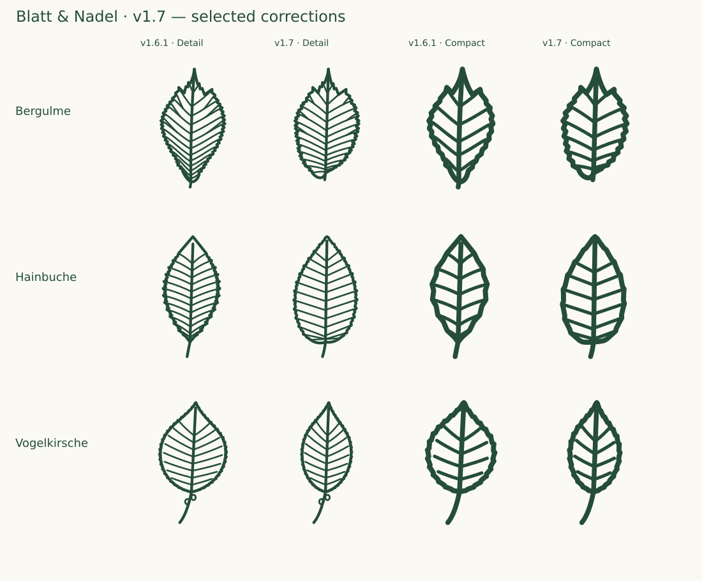

# Full collection review — 1.7.0

13 October 2026 · **126 taxa / 252 source SVGs** · baseline: canonical v1.6.1 ZIP

All 118 existing primary catalog descriptions were retrieved and reread, and both variants of every existing taxon were inspected enlarged alongside foliage references. Eight additions were developed through [two reviewed groups](EXPANSION-1.7.md). The final optical pass covered all 252 SVGs at Compact 24/32 px and Detail 48/64 px, on light and dark backgrounds. Revised and added drawings also received a final enlarged photo comparison. This is a fresh internal design review, not a claim of independent botanical certification.

## Findings and corrections

- **Bergulme:** replaced the long tapered base with an unequal rounded basal lobe and a very short, partly concealed stalk. The three-point upper blade, double teeth and branched Detail nerves remain.
- **Hainbuche:** retained the elongated ovate blade but replaced the acute basal wedge with a rounded, slightly unequal base. Detail has twelve vein pairs; Compact has six.
- **Vogelkirsche:** selected a more elongated representative blade (about 1.77:1 instead of 1.33:1). The rounded base, petiole and two Detail glands remain. Natural leaf proportions vary; this refinement does not make all broader leaves incorrect.
- **Eight Detail drawings:** reconnected 14 detached vein origins in Gewöhnlicher Schneeball, Elsbeere, Zerreiche, Silberahorn, Rotahorn, Schwarze Johannisbeere, Weinrebe and Rote Johannisbeere. A new permanent attachment check catches visible origin gaps that containment alone cannot detect.

The corrections affect **14 existing SVGs**. The other **222 SVGs are byte-identical to v1.6.1**, including Stieleiche, Ginkgo, Schwarzpappel and every conifer. Sixteen new SVGs bring the total to 252. The [machine-readable audit](audit-1.7.json) records every current and baseline hash, drawing role count, blade bounds, source, photo URL, selected form, limitation and fresh finding.

## Reference decisions

Primary descriptions are linked per taxon below. InfoFlora / Flora Helvetica is the main regional source; FNA, university botanical resources and the International Dendrology Society resolve specific questions. Descriptions and photographs were compared, not traced or redistributed. Photo references depict different seasonal states: whole-leaf or leafy-shoot views, rather than flowers alone, support the shape review. Juvenile lobed ivy was checked separately from flowering shoots. Cultivated pear and Wild pear use overlapping taxonomic concepts across sources; their silhouettes are not a wild-ancestry test.

## Per-taxon final findings

Every row covers **both Detail and Compact**; exact variant hashes and reductions are in the JSON record. “Retained” means reviewed and unchanged, not skipped.

| Taxon / primary description                                                                                                | Artwork action | Fresh finding                                                                                                                                                                                                                                                                                                                                               |
| -------------------------------------------------------------------------------------------------------------------------- | -------------- | ----------------------------------------------------------------------------------------------------------------------------------------------------------------------------------------------------------------------------------------------------------------------------------------------------------------------------------------------------------- |
| [Fichte · _Picea abies_](https://www.infoflora.ch/de/flora/picea-abies.html)                                               | Retained       | Stiff individually pointed needles; front and lateral projections preserve a twig bearing needles around its axis. Sparse projected needle count and absent quadrangular cross-section remain explicit reductions.                                                                                                                                          |
| [Waldkiefer · _Pinus sylvestris_](https://www.infoflora.ch/de/flora/pinus-sylvestris.html)                                 | Retained       | Three separate two-needle fascicles with sheaths remain clear in both variants; long narrow pairs agree with the photographs. Twisting and cross-section are not depicted.                                                                                                                                                                                  |
| [Europäische Lärche · _Larix decidua_](https://www.infoflora.ch/de/flora/larix-decidua.html)                               | Retained       | Two short-shoot needle fans retained; each fan has fewer needles than a real 20–40-needle cluster. This is a declared density reduction, not a literal fascicle count.                                                                                                                                                                                      |
| [Weißtanne · _Abies alba_](https://www.infoflora.ch/de/flora/abies-alba.html)                                              | Retained       | Flat, blunt/emarginate needles and two-ranked appearance agree with the selected vegetative shoot. Path inspection disproved exact opposite insertion: left/right origins are offset by 2 viewBox units. Compact omits minute tip notches.                                                                                                                  |
| [Douglasie · _Pseudotsuga menziesii_](https://www.infoflora.ch/de/flora/pseudotsuga-menziesii.html)                        | Retained       | Individual curved needles project around the twig and a pointed terminal bud is present. Arrangement remains distinct from both spruce and a strictly planar fern; density is reduced.                                                                                                                                                                      |
| [Eibe · _Taxus baccata_](https://www.infoflora.ch/de/flora/taxus-baccata.html)                                             | Retained       | Pointed flat needles in two apparent ranks. Path inspection confirms 3-unit staggered origins rather than opposite insertion. Needle thickness and density are optical reductions.                                                                                                                                                                          |
| [Wacholder · _Juniperus communis_](https://www.infoflora.ch/de/flora/juniperus-communis.html)                              | Retained       | Stiff spreading needles remain in explicit groups of three, with successive whorls rotated. Stomatal bands and full shoot density are omitted.                                                                                                                                                                                                              |
| [Stieleiche · _Quercus robur_](https://www.infoflora.ch/de/flora/quercus-robur.html)                                       | Retained       | Rounded uneven lobes, basal auricles and very short petiole agree with the selected mature leaf. The previously refined organic silhouette is retained without regeneration.                                                                                                                                                                                |
| [Traubeneiche · _Quercus petraea_](https://www.infoflora.ch/de/flora/quercus-petraea.html)                                 | Retained       | Rounded lobes, cuneate non-auriculate base and longer petiole remain consistent; lateral veins lead towards lobes. Leaf shape overlaps other oaks in nature.                                                                                                                                                                                                |
| [Rotbuche · _Fagus sylvatica_](https://www.infoflora.ch/de/flora/fagus-sylvatica.html)                                     | Retained       | Ovate blade, almost entire undulate edge, ascending lateral veins and short stalk agree. Marginal hairs are omitted.                                                                                                                                                                                                                                        |
| [Hängebirke · _Betula pendula_](https://www.infoflora.ch/de/flora/betula-pendula.html)                                     | Retained       | Rhomboid-triangular blade, elongated apex, double teeth in Detail and substantial petiole remain clear. Compact reduces tooth order.                                                                                                                                                                                                                        |
| [Schwarzpappel · _Populus nigra_](https://www.infoflora.ch/de/flora/populus-nigra.html)                                    | Retained       | Broad deltoid-rhombic blade with convex rather than rigidly triangular sides, fine teeth and long petiole agrees with reference variation. Flattened petiole cross-section cannot be inferred from the line.                                                                                                                                                |
| [Espe · Zitterpappel · _Populus tremula_](https://www.infoflora.ch/de/flora/populus-tremula.html)                          | Retained       | Rounded short-shoot blade with coarse crenations and a long petiole is retained. Juvenile long-shoot leaves and petiole cross-section are not represented.                                                                                                                                                                                                  |
| [Schwarzerle · _Alnus glutinosa_](https://www.infoflora.ch/de/flora/alnus-glutinosa.html)                                  | Retained       | Broad obovate blade, shallow apical notch/truncation and cuneate base match the chosen mature form, rather than a cordate linden. Lateral-vein density is reduced in Compact.                                                                                                                                                                               |
| [Hainbuche · _Carpinus betulus_](https://www.infoflora.ch/de/flora/carpinus-betulus.html)                                  | Revised        | Replaced the acute basal wedge with a rounded slightly unequal base while retaining an elongated ovate blade. Twelve Detail vein pairs lead to marginal teeth; Compact uses six. Compared again against InfoFlora photographs and IDS morphology.                                                                                                           |
| [Winterlinde · _Tilia cordata_](https://www.infoflora.ch/de/flora/tilia-cordata.html)                                      | Retained       | Broad asymmetrically cordate blade, pointed apex, serration, basal venation and long stalk are coherent. Rust-coloured underside axillary hairs are outside the monochrome upper-surface view.                                                                                                                                                              |
| [Hasel · _Corylus avellana_](https://www.infoflora.ch/de/flora/corylus-avellana.html)                                      | Retained       | Broad rounded/cor­date blade with abruptly pointed apex, double teeth and short stalk agrees. Compact keeps the diagnostic broad basal lobes while reducing serration.                                                                                                                                                                                      |
| [Bergahorn · _Acer pseudoplatanus_](https://www.infoflora.ch/de/flora/acer-pseudoplatanus.html)                            | Retained       | Five principal lobes with short apices and coarse teeth remain distinct from Norway maple. Flora Helvetica specifies acute sinuses, so an indiscriminate change to rounded sinuses would be unsupported.                                                                                                                                                    |
| [Spitzahorn · _Acer platanoides_](https://www.infoflora.ch/de/flora/acer-platanoides.html)                                 | Retained       | Long pointed lobes and projecting sharp teeth, broad sinuses and long stalk agree with photographs. Primary palmate venation retained in both variants.                                                                                                                                                                                                     |
| [Feldahorn · _Acer campestre_](https://www.infoflora.ch/de/flora/acer-campestre.html)                                      | Retained       | Broad blunt lobes with few large secondary lobules and unarmed margin now read as maple, not oak. Natural three- versus five-lobe variation is represented by the selected five-lobe form.                                                                                                                                                                  |
| [Gemeine Esche · _Fraxinus excelsior_](https://www.infoflora.ch/de/flora/fraxinus-excelsior.html)                          | Retained       | Nine narrowly lanceolate leaflets in four pairs plus terminal leaflet match the lower end of the source range. Short attachments retained; Compact reduces serration and leaflet veins.                                                                                                                                                                     |
| [Bergulme · _Ulmus glabra_](https://www.infoflora.ch/de/flora/ulmus-glabra.html)                                           | Revised        | Replaced the long basal wedge with a rounded unequal basal lobe; the longer side partly conceals a very short stalk. Preserved the three-point upper blade, double teeth and six fork branches in Detail. Both new bases and petioles rechecked against the foliage close-up and IDS description.                                                           |
| [Salweide · _Salix caprea_](https://www.infoflora.ch/de/flora/salix-caprea.html)                                           | Retained       | Broad elliptic blade, slightly undulate near-entire margin, short stalk and short apex match the selected form. Hair and impressed tertiary network are omitted.                                                                                                                                                                                            |
| [Silberweide · _Salix alba_](https://www.infoflora.ch/de/flora/salix-alba.html)                                            | Retained       | Both sides of the narrow lanceolate blade remain open; no collapsed half-leaf. Detail shows fine teeth and reduced oblique veins. Compact deliberately omits tiny lateral veins to preserve interior space.                                                                                                                                                 |
| [Rosskastanie · _Aesculus hippocastanum_](https://www.infoflora.ch/de/flora/aesculus-hippocastanum.html)                   | Retained       | Seven obovate-lanceolate leaflets share one junction, central and upper leaflets exceed the lower pair, and petiole is substantial. Compact omits leaflet midribs and fine teeth; outline hierarchy remains legible.                                                                                                                                        |
| [Edelkastanie · _Castanea sativa_](https://www.infoflora.ch/de/flora/castanea-sativa.html)                                 | Retained       | Long narrow lanceolate blade with pointed marginal teeth; Detail side veins connect to the large tooth ends. Compact reduces both veins and teeth together. No longer an oval duplicate of hornbeam.                                                                                                                                                        |
| [Vogelbeere · _Sorbus aucuparia_](https://www.infoflora.ch/de/flora/sorbus-aucuparia.html)                                 | Retained       | Eleven narrow pointed leaflets in five pairs plus terminal leaflet meet the source count. Fine teeth retained in Detail; basal edge reduction and venation in Compact remain declared simplifications.                                                                                                                                                      |
| [Robinie · _Robinia pseudoacacia_](https://www.infoflora.ch/de/flora/robinia-pseudoacacia.html)                            | Retained       | Nine entire oval leaflets and terminal leaflet retained; little variation of tip shape is within photographed forms. Compact omits leaflet midribs.                                                                                                                                                                                                         |
| [Schwarzer Holunder · _Sambucus nigra_](https://www.infoflora.ch/de/flora/sambucus-nigra.html)                             | Retained       | Five pointed, slightly asymmetric toothed leaflets and stalked terminal leaflet match the source. Opposite pairs are legible in both variants.                                                                                                                                                                                                              |
| [Eingriffeliger Weißdorn · _Crataegus monogyna_](https://www.infoflora.ch/de/flora/crataegus-monogyna.html)                | Retained       | Deep divisions, largely entire lobe flanks and teeth concentrated on lobe ends retained. Basal lateral veins curve outward, unlike shallow-lobed C. laevigata.                                                                                                                                                                                              |
| [Schlehe · _Prunus spinosa_](https://www.infoflora.ch/de/flora/prunus-spinosa.html)                                        | Retained       | Small-leaf lanceolate/elliptic selected outline, acute apex, fine teeth and short petiole agree with photographs. Absolute blade size is not encoded in the viewBox.                                                                                                                                                                                        |
| [Roter Hartriegel · _Cornus sanguinea_](https://www.infoflora.ch/de/flora/cornus-sanguinea.html)                           | Retained       | Broad ovate entire blade and four pairs of strongly ascending arcuate veins agree. Opposite phyllotaxy and hairs cannot be shown by one detached leaf.                                                                                                                                                                                                      |
| [Gewöhnlicher Schneeball · _Viburnum opulus_](https://www.infoflora.ch/de/flora/viburnum-opulus.html)                      | Revised        | Three main lobes with coarse teeth and basal palmate veins agree; Detail includes two petiole glands. Compact omits the small glands and lateral vein subdivisions. Visible detached vein origins were reconnected to their parent curves; the blade contour and Compact SVG remain unchanged.                                                              |
| [Stechpalme · _Ilex aquifolium_](https://www.infoflora.ch/de/flora/ilex-aquifolium.html)                                   | Retained       | Spinose teeth on a broad leathery-looking outline agree with the selected lower-shoot leaf. Entire upper-canopy leaves are a real alternative, not represented.                                                                                                                                                                                             |
| [Faulbaum · _Frangula alnus_](https://www.infoflora.ch/de/flora/frangula-alnus.html)                                       | Retained       | Oval entire blade and dense lateral-vein series match the photographs and 7–12-pair source range in Detail. Compact reduces that count.                                                                                                                                                                                                                     |
| [Pfaffenhütchen · _Euonymus europaeus_](https://www.infoflora.ch/de/flora/euonymus-europaeus.html)                         | Retained       | Narrow elliptic/lanceolate blade, fine serration, acute apex and very short petiole agree. Twig wings are not represented.                                                                                                                                                                                                                                  |
| [Hundsrose · _Rosa canina_](https://www.infoflora.ch/de/flora/rosa-canina.html)                                            | Retained       | Seven toothed leaflets with terminal leaflet, short petiolules and adnate stipules retained. Hairs, glands and variable rachis prickles are not fully encoded.                                                                                                                                                                                              |
| [Kornelkirsche · _Cornus mas_](https://www.infoflora.ch/de/flora/cornus-mas.html)                                          | Retained       | Entire narrower blade with four arcuate side-vein pairs agrees with the selected photographed leaves. Arcuate venation is retained in Compact at reduced density.                                                                                                                                                                                           |
| [Vogelkirsche · _Prunus avium_](https://www.infoflora.ch/de/flora/prunus-avium.html)                                       | Revised        | Refined the selected blade from about 1.33:1 to 1.77:1 height/width after comparison with the FNA treatment and foliage photographs. The rounded base, serration, existing petiole and two Detail glands remain. Broad natural leaves still occur; this is a representative-form refinement, not a claim that the earlier ratio was universally impossible. |
| [Sommerlinde · _Tilia platyphyllos_](https://www.infoflora.ch/de/flora/tilia-platyphyllos.html)                            | Retained       | Asymmetric cordate blade, fine teeth and pointed apex retained. Shape overlaps T. cordata; white versus rust axillary hairs are not conveyed by a silhouette.                                                                                                                                                                                               |
| [Walnuss · _Juglans regia_](https://www.infoflora.ch/de/flora/juglans-regia.html)                                          | Retained       | Seven broad near-entire leaflets with larger terminal and reduced basal pair agree with source and photographs. Fine venation is omitted in Compact.                                                                                                                                                                                                        |
| [Moorbirke · _Betula pubescens_](https://www.infoflora.ch/de/flora/betula-pubescens.html)                                  | Retained       | Ovate rather than deltoid outline, broader rounded base, less drawn-out apex and tooth form agree with photographs. Leaf hair is not shown.                                                                                                                                                                                                                 |
| [Flatterulme · _Ulmus laevis_](https://www.infoflora.ch/de/flora/ulmus-laevis.html)                                        | Retained       | Unequal rounded versus abbreviated basal halves, single pointed apex and double teeth agree. Vein count is reduced in Compact; samara hairs are not a leaf character.                                                                                                                                                                                       |
| [Elsbeere · _Sorbus torminalis_](https://www.infoflora.ch/de/flora/sorbus-torminalis.html)                                 | Revised        | Unequal pointed lateral lobes, deepest lower sinuses and pinnate rather than truly palmate vein origins match the chosen leaf. Lobes remain broad in both variants. Visible detached vein origins were reconnected to their parent curves; the blade contour and Compact SVG remain unchanged.                                                              |
| [Französischer Ahorn · _Acer monspessulanum_](https://landscapeplants.oregonstate.edu/plants/acer-monspessulanum)          | Retained       | Three entire lobes, shallow cordate base and long stalk agree with OSU. The photographed species shows blunt and acute lobe-tip variation; selected moderately pointed tips retained.                                                                                                                                                                       |
| [Eschenahorn · _Acer negundo_](https://www.infoflora.ch/de/flora/acer-negundo.html)                                        | Retained       | Three leaflets, toothed lateral blades and somewhat lobed terminal leaflet match the selected end of the 3–7-leaflet range. Not drawn as a simple maple leaf.                                                                                                                                                                                               |
| [Liguster · _Ligustrum vulgare_](https://www.infoflora.ch/de/flora/ligustrum-vulgare.html)                                 | Retained       | Entire lanceolate blade, short stalk and acute tip agree with photographs. Evergreen habit and opposite twig arrangement are not encoded.                                                                                                                                                                                                                   |
| [Berberitze · _Berberis vulgaris_](https://www.infoflora.ch/de/flora/berberis-vulgaris.html)                               | Retained       | Obovate blade with rounded tip, narrowed base and fine sharp marginal teeth matches the selected form. Spine-bearing twig is not part of a detached leaf icon.                                                                                                                                                                                              |
| [Rote Heckenkirsche · _Lonicera xylosteum_](https://www.infoflora.ch/de/flora/lonicera-xylosteum.html)                     | Retained       | Broad ovate entire blade, short point and rounded base retained. Soft surface hairs and paired flowers are omitted.                                                                                                                                                                                                                                         |
| [Kreuzdorn · _Rhamnus cathartica_](https://www.infoflora.ch/de/flora/rhamnus-cathartica.html)                              | Retained       | Broad oval blade, short point, fine teeth and ascending arcuate veins agree. Three to four principal vein pairs are emphasized rather than straight hornbeam-like venation.                                                                                                                                                                                 |
| [Felsenbirne · _Amelanchier ovalis_](https://www.infoflora.ch/de/flora/amelanchier-ovalis.html)                            | Retained       | Oval finely toothed blade with short tip and rounded base matches photos. Young felted undersides and their later loss are not depicted.                                                                                                                                                                                                                    |
| [Traubenkirsche · _Prunus padus_](https://www.infoflora.ch/de/flora/prunus-padus.html)                                     | Retained       | Broad elliptic blade with rounded base, fine regular teeth, short stalk and petiole glands in Detail agrees. Contrast with P. avium must rely on subtle leaf traits, not artificial separation.                                                                                                                                                             |
| [Feldulme · _Ulmus minor_](https://www.infoflora.ch/de/flora/ulmus-minor.html)                                             | Retained       | Asymmetric oblique base, longer petiole than U. glabra, single apex and double teeth retained. Detail includes some forked veins; leaflet surface texture is omitted.                                                                                                                                                                                       |
| [Grauerle · _Alnus incana_](https://www.infoflora.ch/de/flora/alnus-incana.html)                                           | Retained       | Pointed ovate blade, broad rounded lower half and numerous lateral veins contrast with the notched obovate black alder. Compact reduces vein count.                                                                                                                                                                                                         |
| [Mehlbeere · _Sorbus aria_](https://www.infoflora.ch/de/flora/sorbus-aria.html)                                            | Retained       | Oval double-toothed unlobed blade and regular side veins agree. White felted undersurface, the strongest field character, is not encoded in an upper-surface monochrome icon.                                                                                                                                                                               |
| [Wildapfel · _Malus sylvestris_](https://www.infoflora.ch/de/flora/malus-sylvestris.html)                                  | Retained       | Broad ovate finely toothed blade with rounded base and long petiole agrees with InfoFlora. Distinction from cultivated apple remains probabilistic because hybridization and cultivar variation overlap.                                                                                                                                                    |
| [Wildbirne · _Pyrus pyraster_](https://www.infoflora.ch/de/flora/pyrus-pyraster.html)                                      | Retained       | Broad round-ovate leaf with short apical point, fine teeth and long petiole matches the reference. Upper-surface gloss and twig thorns omitted.                                                                                                                                                                                                             |
| [Wolliger Schneeball · _Viburnum lantana_](https://www.infoflora.ch/de/flora/viburnum-lantana.html)                        | Retained       | Broad oval finely toothed blade with short petiole agrees. Wrinkled texture and underside stellate felt are omitted rather than replaced by decorative hatching.                                                                                                                                                                                            |
| [Silberpappel · _Populus alba_](https://www.infoflora.ch/de/flora/populus-alba.html)                                       | Retained       | Five-lobed long-shoot leaf selected, consistent with the source's 3–9-lobed vigorous-shoot form; not presented as the universal mature short-shoot outline. White underside omitted.                                                                                                                                                                        |
| [Speierling · _Sorbus domestica_](https://www.infoflora.ch/de/flora/sorbus-domestica.html)                                 | Retained       | Thirteen leaflets with proximal margins largely entire retained. Dense true leaflet venation cannot be drawn at icon scale; this omission is explicit, not an accurate literal vein count.                                                                                                                                                                  |
| [Ginkgo · _Ginkgo biloba_](https://floranorthamerica.org/Ginkgo_biloba)                                                    | Retained       | Broad fan with spreading flanks, narrowed basal wedge, unequal shallowly divided lobes and dichotomous veins without a midrib agrees with the selected FNA-described form and photographs. Previous fan correction retained; cleft depth varies naturally.                                                                                                  |
| [Ahornblättrige Platane · _Platanus × hispanica_](https://www.infoflora.ch/de/flora/platanus-%C3%97hispanica.html)         | Retained       | Broad palmate blade, five lobes, moderately deep sinuses and truncate to slightly cordate base agree with the hybrid taxon. Narrow-lobed P. orientalis form is not substituted.                                                                                                                                                                             |
| [Tulpenbaum · _Liriodendron tulipifera_](https://www.infoflora.ch/de/flora/liriodendron-tulipifera.html)                   | Retained       | Four principal lobes, truncate/shallowly notched apex, basal breadth and long petiole agree. Pinnate vein origins retained; no fabricated central apical point.                                                                                                                                                                                             |
| [Amberbaum · _Liquidambar styraciflua_](https://botanischer-garten-hoexter.de/pflanze-liquidambar_styraciflua.html)        | Retained       | Five narrow pointed lobes and fine serration retained. Palmate star outline agrees with TH OWL and photographs; glossy texture and alternate phyllotaxy are not represented.                                                                                                                                                                                |
| [Fächerahorn · _Acer palmatum_](https://www.iplant.cn/foc/pdf/Acer.pdf)                                                    | Retained       | Flora of China PDF confirms 5 or 7 lanceolate lobes to midblade, long tips and double serration. Selected seven-lobe form retained; tiny double tooth hierarchy is simplified at optical size.                                                                                                                                                              |
| [Schneeballblättriger Ahorn · _Acer opalus_](https://www.infoflora.ch/de/flora/acer-opalus.html)                           | Retained       | Shallow blunt to shortly pointed lobes, broad lower blade and few wavy teeth agree. Does not gain the sharp long tips of Norway maple.                                                                                                                                                                                                                      |
| [Efeu · _Hedera helix_](https://www.infoflora.ch/de/flora/hedera-helix.html)                                               | Retained       | Selected sterile climbing-shoot leaf has five entire lobes; flowering-shoot leaves are correctly acknowledged as unlobed. A supplementary OSU juvenile-leaf photograph was added and checked because the earlier reference selection emphasized flowering shoots; the lobed form is confirmed.                                                              |
| [Baumhasel · _Corylus colurna_](https://www.infoflora.ch/de/flora/corylus-colurna.html)                                    | Retained       | Cordate ovate blade, double teeth, drawn-out tip and longer stalk than C. avellana agree. Shape overlap with hazel remains real.                                                                                                                                                                                                                            |
| [Roteiche · _Quercus rubra_](https://www.infoflora.ch/de/flora/quercus-rubra.html)                                         | Retained       | Forward pointed lobes with pointed subsidiary teeth retained. Minute bristle tips are exaggerated only enough to be legible; lobe count represents one leaf, not a species constant.                                                                                                                                                                        |
| [Flaumeiche · _Quercus pubescens_](https://www.infoflora.ch/de/flora/quercus-pubescens.html)                               | Retained       | Rounded lobes, shorter stalk and narrowed/rounded basal transition agree with photographed variation. Underside stellate hairs are omitted; no unique silhouette diagnosis is claimed.                                                                                                                                                                      |
| [Zerreiche · _Quercus cerris_](https://www.infoflora.ch/de/flora/quercus-cerris.html)                                      | Revised        | Unequal sharp-tipped lobes and irregular secondary teeth retained. Detail includes two schematic persistent stipules; they and hair textures are reduced in Compact. Visible detached vein origins were reconnected to their parent curves; the blade contour and Compact SVG remain unchanged.                                                             |
| [Silberlinde · _Tilia tomentosa_](https://www.infoflora.ch/de/flora/tilia-tomentosa.html)                                  | Retained       | Cordate serrate blade retained; differences from other lindens are not forced into an invented contour. Dense pale underside felt remains a stated omission.                                                                                                                                                                                                |
| [Roter Holunder · _Sambucus racemosa_](https://www.infoflora.ch/de/flora/sambucus-racemosa.html)                           | Retained       | Five lanceolate serrate leaflets match the selected leaf. Narrower leaflets than the illustrated black elder are a representative choice, not a reliable species boundary.                                                                                                                                                                                  |
| [Zweigriffeliger Weißdorn · _Crataegus laevigata_](https://www.infoflora.ch/de/flora/crataegus-laevigata.html)             | Retained       | Shallow rounded terminal lobes, mostly unlobed basal blade and inward-curving veins agree and contrast with C. monogyna. Compact keeps the shallow division.                                                                                                                                                                                                |
| [Himbeere · _Rubus idaeus_](https://www.infoflora.ch/de/flora/rubus-idaeus.html)                                           | Retained       | Three toothed leaflets with distinctly stalked terminal leaflet agree with the flowering-shoot form. Five/seven-leaflet first-year shoots and white underside felt are not shown.                                                                                                                                                                           |
| [Sanddorn · _Hippophae rhamnoides_](https://www.infoflora.ch/de/flora/hippopha%C3%AB-rhamnoides.html)                      | Retained       | Very narrow entire lanceolate blade, tiny stalk and little lateral venation agree. Silver scale hairs and copper underside are omitted.                                                                                                                                                                                                                     |
| [Zirbelkiefer · Arve · _Pinus cembra_](https://www.infoflora.ch/de/flora/pinus-cembra.html)                                | Retained       | Five needles per common short-shoot origin in three clear fascicles retained. No persistent sheath is invented for the selected mature fascicles; full shoot density omitted.                                                                                                                                                                               |
| [Bergkiefer · _Pinus mugo_](https://www.infoflora.ch/de/flora/pinus-mugo.html)                                             | Retained       | Shorter paired needles at separate fascicles agree with P. mugo; both variants retain two per sheath. Absolute length and subspecific variation are not encoded.                                                                                                                                                                                            |
| [Urweltmammutbaum · _Metasequoia glyptostroboides_](https://plantdatabase.kpu.ca/PlantPrint/megl)                          | Retained       | Opposite flat blunt needles and paired nodes match KPU and the comparison photograph. This true opposite arrangement remains distinct from Taxodium's alternate insertion.                                                                                                                                                                                  |
| [Götterbaum · _Ailanthus altissima_](https://www.infoflora.ch/de/flora/ailanthus-altissima.html)                           | Retained       | Nine lanceolate leaflets, mostly entire margins and basal gland-bearing teeth agree with the source's lower-count range. Glands are signalled by basal teeth rather than fully rendered on the underside.                                                                                                                                                   |
| [Essigbaum · _Rhus typhina_](https://www.infoflora.ch/de/flora/rhus-typhina.html)                                          | Retained       | Eleven serrate lanceolate leaflets distinguish the selected compound leaf from Ailanthus's basal-only teeth. Reduced leaflet venation is explicit.                                                                                                                                                                                                          |
| [Silberahorn · _Acer saccharinum_](https://www.infoflora.ch/de/flora/acer-saccharinum.html)                                | Revised        | Five narrow lobes separated by deep rounded sinuses, irregular sharp teeth and broad basal lobes agree with reference photographs. Underside colour omitted. Visible detached vein origins were reconnected to their parent curves; the blade contour and Compact SVG remain unchanged.                                                                     |
| [Rotahorn · _Acer rubrum_](https://www.infoflora.ch/de/flora/acer-rubrum.html)                                             | Revised        | Selected three-lobed blade with shallow sinuses and serrate margin agrees with photographed three-to-five-lobe variation. Red stalk colour is not depicted. Visible detached vein origins were reconnected to their parent curves; the blade contour and Compact SVG remain unchanged.                                                                      |
| [Kirschlorbeer · _Prunus laurocerasus_](https://www.infoflora.ch/de/flora/prunus-laurocerasus.html)                        | Retained       | Obovate-lanceolate blade with short apical point, narrow basal transition and near-entire margin agrees. Revolute edge and underside glands are not shown as false upper-surface marks.                                                                                                                                                                     |
| [Buchsbaum · _Buxus sempervirens_](https://www.infoflora.ch/de/flora/buxus-sempervirens.html)                              | Retained       | Small oval entire blade, rounded apex and short stalk retained. Evergreen leathery surface and paired twig arrangement are not encoded.                                                                                                                                                                                                                     |
| [Flieder · _Syringa vulgaris_](https://www.infoflora.ch/de/flora/syringa-vulgaris.html)                                    | Retained       | Broad cordate entire leaf, long point and substantial petiole agree. Pinnate secondary venation and low basal branches retained.                                                                                                                                                                                                                            |
| [Echter Seidelbast · _Daphne mezereum_](https://www.infoflora.ch/de/flora/daphne-mezereum.html)                            | Retained       | Entire oblanceolate blade, broad distal half, narrowed base and short stalk agree with photographed leaves. Flowering leafless shoots are outside the icon scope.                                                                                                                                                                                           |
| [Purpurweide · _Salix purpurea_](https://www.infoflora.ch/de/flora/salix-purpurea.html)                                    | Retained       | Oblanceolate blade widest above the middle, gradual basal taper and teeth limited distally agree. Compact simplifies teeth; opposite/subopposite shoot positions are not represented.                                                                                                                                                                       |
| [Korbweide · _Salix viminalis_](https://www.floraweb.de/php/artenhome.php?suchnr=5206)                                     | Retained       | Very long narrow blade with widest region below middle, tapering ends and subdued edge matches FloraWeb. Compact omits lateral veins; minute glandular teeth and revolute edge are unresolved.                                                                                                                                                              |
| [Mahonie · _Mahonia aquifolium_](https://www.infoflora.ch/de/flora/mahonia-aquifolium.html)                                | Retained       | Seven spinose-toothed leaflets with a longer terminal attachment agree. Detail fine veins are reduced in Compact; the compound architecture remains visible.                                                                                                                                                                                                |
| [Kratzbeere · _Rubus caesius_](https://www.infoflora.ch/de/flora/rubus-caesius.html)                                       | Retained       | Three broad irregularly toothed leaflets, sessile lateral blades and stalked terminal blade agree. Detail stipules retained; wax bloom and prickles omitted.                                                                                                                                                                                                |
| [Schwarze Johannisbeere · _Ribes nigrum_](https://www.infoflora.ch/de/flora/ribes-nigrum.html)                             | Revised        | Broad three-lobed selected leaf, palmate veins and toothed edge agree. Underside resin glands and odour cannot be encoded; overlap with red currant is explicit. Visible detached vein origins were reconnected to their parent curves; the blade contour and Compact SVG remain unchanged.                                                                 |
| [Heidelbeere · _Vaccinium myrtillus_](https://www.infoflora.ch/de/flora/vaccinium-myrtillus.html)                          | Retained       | Ovate to ovate-lanceolate blade with acute tip, fine teeth and tiny stalk agrees. Green angled twig and deciduous habit are omitted.                                                                                                                                                                                                                        |
| [Preiselbeere · _Vaccinium vitis-idaea_](https://www.infoflora.ch/de/flora/vaccinium-vitis-idaea.html)                     | Retained       | Broad oval/obovate near-entire leaf with rounded slightly notched tip and tiny petiole agrees. Rolled margin and underside gland dots are not drawn as upper-surface features.                                                                                                                                                                              |
| [Rostblättrige Alpenrose · _Rhododendron ferrugineum_](https://www.infoflora.ch/de/flora/rhododendron-ferrugineum.html)    | Retained       | Entire oval-lanceolate blade and short stalk retained. Rusty underside scales and rolled margin are outside the chosen projection.                                                                                                                                                                                                                          |
| [Stachelbeere · _Ribes uva-crispa_](https://www.infoflora.ch/de/flora/ribes-uva-crispa.html)                               | Retained       | Rounded three-to-five lobes, broad crenate teeth, cordate base and stalk agree. Twig spines are omitted from the detached leaf.                                                                                                                                                                                                                             |
| [Europäischer Zürgelbaum · _Celtis australis_](https://www.infoflora.ch/de/flora/celtis-australis.html)                    | Retained       | Unequal blade base, three strong basal veins, elongated apex and serrate upper margins agree. Rough hairy surface omitted.                                                                                                                                                                                                                                  |
| [Hopfenbuche · _Ostrya carpinifolia_](https://www.infoflora.ch/de/flora/ostrya-carpinifolia.html)                          | Retained       | Ovate pointed blade, rounded basal transition, double serration and dense side veins agree. Compact reduces vein count; hairs and hop-like fruit cannot be used as leaf geometry.                                                                                                                                                                           |
| [Schwarzkiefer · _Pinus nigra_](https://www.infoflora.ch/de/flora/pinus-nigra.html)                                        | Retained       | Three fascicles of two long stiff needles with shared sheaths remain clear. Length contrast with P. mugo is a design choice within source ranges; cross-section omitted.                                                                                                                                                                                    |
| [Sumpfzypresse · _Taxodium distichum_](https://landscapeplants.oregonstate.edu/plants/taxodium-distichum)                  | Retained       | Alternate insertion and individually pointed needles confirmed against OSU's Taxodium/Metasequoia comparison. Needlelike deciduous lateral shoot is selected, not scale-like foliage.                                                                                                                                                                       |
| [Besenheide · _Calluna vulgaris_](https://www.infoflora.ch/de/flora/calluna-vulgaris.html)                                 | Retained       | Overlapping small scale leaves on branching axes represent opposite decussate pairs projected from four ranks. Both variants preserve pairs; full scale density reduced in Compact.                                                                                                                                                                         |
| [Schneeheide · _Erica carnea_](https://www.infoflora.ch/de/flora/erica-carnea.html)                                        | Retained       | Explicit four-needle whorls with narrow stiff spreading blades agree with source and shoot photograph. Compact reduces number of whorls but not needles per node.                                                                                                                                                                                           |
| [Besenginster · _Cytisus scoparius_](https://www.infoflora.ch/de/flora/cytisus-scoparius.html)                             | Retained       | Stalked trifoliolate lower-shoot leaf with larger terminal leaflet and entire edges agrees. Simple nearly sessile upper leaves are acknowledged as an alternative.                                                                                                                                                                                          |
| [Färber-Ginster · _Genista tinctoria_](https://www.infoflora.ch/de/flora/genista-tinctoria.html)                           | Retained       | Simple entire lanceolate leaf and very short attachment agree; source photos support the narrow selected blade. No trifoliate broom leaf substituted.                                                                                                                                                                                                       |
| [Gewöhnliche Waldrebe · _Clematis vitalba_](https://www.infoflora.ch/de/flora/clematis-vitalba.html)                       | Retained       | Five separately stalked ovate leaflets, few coarse teeth and curved main petiole match the selected leaf. Twining behaviour and entire alternative leaflet margins are not fully depicted.                                                                                                                                                                  |
| [Weinrebe · _Vitis vinifera_](https://www.infoflora.ch/de/flora/vitis-vinifera.html)                                       | Revised        | Five lobes, open petiolar sinus and major palmate venation agree. Two formerly detached basal vein origins in Detail now join their parent veins. Visible detached vein origins were reconnected to their parent curves; the blade contour and Compact SVG remain unchanged.                                                                                |
| [Rote Johannisbeere · _Ribes rubrum_](https://www.infoflora.ch/de/flora/ribes-rubrum.html)                                 | Revised        | Five-lobed selected leaf with broad toothed lobes and shallow cordate base agrees. Leaf outline alone does not reliably distinguish black/red currants; underside glands omitted. Visible detached vein origins were reconnected to their parent curves; the blade contour and Compact SVG remain unchanged.                                                |
| [Alpen-Johannisbeere · _Ribes alpinum_](https://www.infoflora.ch/de/flora/ribes-alpinum.html)                              | Retained       | Smaller three-lobed selected blade with incised teeth and short stalk agrees. Physical size differences from other currants are not encoded in a normalized viewBox.                                                                                                                                                                                        |
| [Sommerflieder · _Buddleja davidii_](https://www.infoflora.ch/de/flora/buddleja-davidii.html)                              | Retained       | Lanceolate finely serrate leaf with elongated point and short stalk agrees. Gray underside felt omitted; opposing shoot arrangement not represented.                                                                                                                                                                                                        |
| [Gewöhnlicher Pfeifenstrauch · _Philadelphus coronarius_](https://www.infoflora.ch/de/flora/philadelphus-coronarius.html)  | Retained       | Broad lanceolate blade, sparse large teeth and very short stalk agree. Main veins rise toward the apex; flowers and scent are out of scope.                                                                                                                                                                                                                 |
| [Gewöhnlicher Trompetenbaum · _Catalpa bignonioides_](https://landscapeplants.oregonstate.edu/plants/catalpa-bignonioides) | Retained       | Broad ovate entire blade with abrupt narrow apex and shallow cordate base agrees with OSU. Mature leaf selected; no assumption of universal deep heart shape.                                                                                                                                                                                               |
| [Blauglockenbaum · _Paulownia tomentosa_](https://www.infoflora.ch/de/flora/paulownia-tomentosa.html)                      | Retained       | Broad cordate entire blade with pointed apex and long stalk agrees. Large juvenile lobed leaves are not the selected form; dense underside felt omitted.                                                                                                                                                                                                    |
| [Weiße Maulbeere · _Morus alba_](https://www.infoflora.ch/de/flora/morus-alba.html)                                        | Retained       | Selected unlobed ovate blade, shallow cordate base, coarse serration and longer stalk agree. Strong within-tree lobing variation acknowledged.                                                                                                                                                                                                              |
| [Schwarze Maulbeere · _Morus nigra_](https://www.infoflora.ch/de/flora/morus-nigra.html)                                   | Retained       | Broad blade with deeper cordate base and short petiole agrees. Rough surface omitted; no fruit colour proxy used to distinguish leaf forms.                                                                                                                                                                                                                 |
| [Gleditschie · _Gleditsia triacanthos_](https://www.infoflora.ch/de/flora/gleditsia-triacanthos.html)                      | Retained       | Sixteen small narrow leaflets in an even-pinnate leaf, no terminal leaflet, retained. Bipinnate leaves also occur; fine tooth/mucro details reduced at this scale.                                                                                                                                                                                          |
| [Pfirsich · _Prunus persica_](https://www.infoflora.ch/de/flora/prunus-persica.html)                                       | Retained       | Long lanceolate toothed leaf with gradually pointed apex, very short stalk and two optional petiole glands in Detail agrees. Gland variation and doubled teeth reduced in Compact.                                                                                                                                                                          |
| [Pflaume · _Prunus domestica_](https://floranorthamerica.org/Prunus_domestica)                                             | Retained       | Elliptic-obovate blade with narrowed base, short acute apex and blunt crenate-serrate edge agrees with FNA and mature-leaf photographs. Broad domestica treatment including variable cultivated forms retained.                                                                                                                                             |
| [Kulturapfel · _Malus domestica_](https://floranorthamerica.org/Malus_domestica)                                           | Retained       | Broad ovate blade with rounded base, obtuse serration, ascending veins and moderate petiole agrees with FNA and close leaf photos. Hair, gloss and cultivar-specific variation omitted; no unsupported separation from wild apple claimed.                                                                                                                  |
| [Ölbaum · _Olea europaea_](https://www.infoflora.ch/de/flora/olea-europaea.html)                                           | Added          | Selected narrow entire mature Mediterranean olive leaf with short petiole; compared with InfoFlora foliage. Rejected a supplementary New Zealand treatment centered on subsp. africana as a basis for this form. Compact omits side nerves to keep the narrow interior open.                                                                                |
| [Echte Feige · _Ficus carica_](https://www.infoflora.ch/de/flora/ficus-carica.html)                                        | Added          | Selected five-lobed fig leaf compared with InfoFlora foliage and FNA. Broad blunt lobes, rounded deep bays, basal sinus and long stalk retained. Two draft basal vein branches crossing the petiolar sinus were rerouted onto their parent nerves before acceptance.                                                                                        |
| [Quitte · _Cydonia oblonga_](https://www.infoflora.ch/de/flora/cydonia-oblonga.html)                                       | Added          | Entire broad oval blade, rounded base, short stalk and small abrupt apex compared with InfoFlora and FNA. Upper shoulders were broadened in the final pass to shorten the drawn apex. Ascending side veins and the entire margin separate the selected form from toothed apple/pear leaves.                                                                 |
| [Kulturbirne · _Pyrus communis_](https://floranorthamerica.org/Pyrus_communis)                                             | Added          | Ovate leaf with rounded base, fine blunt teeth and long stalk compared with FNA, InfoFlora and NCSU foliage close-ups. Kept natural overlap with Wild pear rather than inventing a diagnostic silhouette. FNA includes P. pyraster in its broad species concept; the catalog keeps the existing InfoFlora Wild pear label as a usage distinction.           |
| [Aprikose · _Prunus armeniaca_](https://www.infoflora.ch/de/flora/prunus-armeniaca.html)                                   | Added          | Broad suborbicular-ovate blade, slightly cordate base, abrupt short point, fine crenate-serrate edge and long petiole compared with FNA and NCSU mature-leaf photographs. Two distal stalk glands shown in Detail. Compact vein positions were adjusted inward after small-size review.                                                                     |
| [Mandelbaum · _Prunus dulcis_](https://www.infoflora.ch/de/flora/prunus-dulcis.html)                                       | Added          | Lanceolate long-pointed blade, obtuse basal transition, fine blunt teeth and a relatively long glandular stalk compared with FNA, InfoFlora and the Bochum mature-leaf photograph. Compact side veins were moved away from the narrow tip to reduce merging.                                                                                                |
| [Mispel · _Mespilus germanica_](https://www.infoflora.ch/de/flora/mespilus-germanica.html)                                 | Added          | Elliptic blade with narrowed base and short stalk compared with InfoFlora and the IDS treatment. Teeth are restricted to the distal half; lateral nerves ascend and turn toward the margin rather than being forced into every tooth.                                                                                                                       |
| [Echter Lorbeer · _Laurus nobilis_](https://www.infoflora.ch/de/flora/laurus-nobilis.html)                                 | Added          | Entire oblong-lanceolate blade, gently undulate edge and short stalk compared with InfoFlora foliage and OSU. Compact retains broad waves, with fewer inward-adjusted side veins. No serration borrowed from cherry laurel.                                                                                                                                 |

## Technical checks and limits

All 26 regression tests, XML/metadata checks, geometric containment, blade separation, contour checks, visible vein-origin attachment checks, 16× painted-stroke checks and generated-file freshness checks pass. Both browser engines test all 252 external sprite/inline pairs and the gallery at 320–1440 CSS px. See [QUALITY.md](QUALITY.md) for exact methods and limits.

The leaf drawings intentionally omit fine texture, most hairs, cross-sections and complete venation. Several species naturally overlap in outline; one monochrome selected leaf cannot determine every species, hybrid or cultivar. Small-scale tooth/nerve counts are optical choices unless a source explicitly supports the stated natural count. No remaining contradiction was identified for the selected forms within this review scope; that statement is not a guarantee of error-free taxonomy or anatomy.
