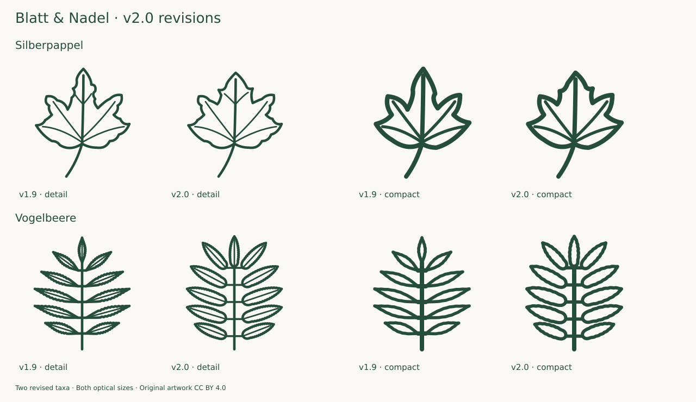

# Complete collection review · v2.0.0

13 October 2026 · **150 taxa / 300 source SVGs** · baseline v1.9.0

Internal source-guided review of all 150 taxa and both optical variants. The 142 existing primary descriptions and reference photographs retrieved for v1.9 earlier on the same day were reread and compared anew; they were not all downloaded again. Supplementary sources were freshly consulted for named uncertainties and revisions. Eight additions underwent two sequential research/drawing/review rounds and neighboring-species comparisons. All 300 SVGs received enlarged and target-size review. This is not independent botanical certification.

## Evidence and review

All 142 previous taxa were revisited on 36 enlarged comparison boards with both drawings and foliage photographs. Every existing icon was inspected at Compact 24/32 px and Detail 48/64 px on light and dark backgrounds. Primary descriptions were read individually, including the relevant treatment within the Acer palmatum Flora of China PDF. The same-day v1.9 source retrieval was reused transparently; this release does not claim 142 additional downloads.

Eight additions were selected, researched, drawn and checked in two groups. Both groups received enlarged, small-size and neighboring-species review before acceptance. The second round followed the accepted first round. See [EXPANSION-2.0.md](EXPANSION-2.0.md). Photographs were consulted without tracing or redistributing their pixels.

Checks covered silhouette, blade proportions and maximum-width position, apex, base, relative petiole length, margin, vein course, compound-leaf insertion and needle/fascicle origins. Natural overlap and optical omissions are explicit. For example, Acer pseudoplatanus retains acute sinuses, and the new Quercus ilex selects an essentially entire adult form rather than implying all leaves are entire.

## Revisions and corrections

- **Silberpappel:** broadened the transition into the central lobe, reduced the constricted impression and adjusted adjoining veins in both variants. Oregon State's short-/long-shoot distinction was checked alongside InfoFlora.
- **Vogelbeere:** the old leaflets were overly slender (some approximately 5.3:1 along their own axis). Redrawn as oblong-lanceolate blades, approximately 3.1–3.4:1, with rounded slightly unequal bases, entire basal margins and a larger terminal leaflet. FNA proportions and the Curtis's Botanical Magazine treatment supplemented InfoFlora. Direct eFloras loading failed; indexed treatment text was consulted, alongside the Burke Herbarium description.
- **New Fingerstrauch:** widened the upper leaflets after oriented measurement; upper three remain closely grouped. Exact decurrency, hairs, stipules and revolute edges are documented omissions.
- **New Korkeiche:** moved three draft vein ends inward to prevent crossing the indented margin, then repeated complete stroke-footprint checks and visual review.
- **280 previous SVGs remain byte-identical.** Only Silberpappel and Vogelbeere change in both sizes; 16 files are new. Stieleiche, Bergulme, Ginkgo and the other prior corrections are preserved.

## Measurements and verification

Adaptive Bezier flattening in scripts/geometry.mjs. Blade bounds exclude petioles and stroke widths. Axis-aligned extents are recorded separately from oriented dimensions: scripts/measure.mjs estimates length from the farthest contour-point pair and width from the projection perpendicular to that chord. This is an approximation for unlobed blades, not specimen measurement, curved midrib length or a reliable biological ratio for palmate/lobed leaves. No physical scale is implied.

The [JSON record](audit-2.0.json) binds each variant to its actual SHA-256 and baseline hash. It includes selected forms, omissions, findings, source/photo URLs, role counts and measured drawing bounds. The validator rejects incomplete coverage or changed artwork after review. A new Rowan regression catches the over-narrow leaflet proportions found in this round. These checks establish evidence consistency and drawing properties, not botanical truth.

All 300 SVGs and 3,100 internal paths passed the geometry and complete-stroke checks. See [QUALITY.md](QUALITY.md) for reproducible tests and final results. **Fresh browser integration QA was not run in the v2.0 environment because the prescribed browser-control capability was unavailable.** The Chromium/Firefox suite is included for reproduction and CI; previous browser results are not presented as a v2.0 pass. The release is source-reviewed and raster/geometry-checked, with that integration verification outstanding.

This is a referenced icon collection, not an independently reviewed scientific atlas. It does not encode every natural variation or microscopic diagnostic character.

## Per-taxon findings

Both optical variants were reviewed for every row. “Retained” means byte-identical to v1.9.0.

| Taxon                                                   | Finding                                                                                                                                                                                                                                                                                                                     | Artwork        | Primary source                                                                          |
| ------------------------------------------------------- | --------------------------------------------------------------------------------------------------------------------------------------------------------------------------------------------------------------------------------------------------------------------------------------------------------------------------- | -------------- | --------------------------------------------------------------------------------------- |
| Fichte · _Picea abies_                                  | Retained: pointed individual needles and front/side projections fit the all-sided arrangement; neither variant is treated as a literal needle count or cross-section.                                                                                                                                                       | Retained D + C | [Treatment](https://www.infoflora.ch/de/flora/picea-abies.html)                         |
| Waldkiefer · _Pinus sylvestris_                         | Retained: three separate sheathed pairs remain legible; the very sparse selected twig is an explicit icon reduction, not natural shoot density.                                                                                                                                                                             | Retained D + C | [Treatment](https://www.infoflora.ch/de/flora/pinus-sylvestris.html)                    |
| Europäische Lärche · _Larix decidua_                    | Retained: two short-shoot clusters remain correctly distinct; 11/7 drawn needles intentionally stand for much fuller natural fascicles.                                                                                                                                                                                     | Retained D + C | [Treatment](https://www.infoflora.ch/de/flora/larix-decidua.html)                       |
| Weißtanne · _Abies alba_                                | Retained: flattened lateral needles and the Detail tip notches are visible; Compact deliberately omits the tiny notch and surface bands.                                                                                                                                                                                    | Retained D + C | [Treatment](https://www.infoflora.ch/de/flora/abies-alba.html)                          |
| Douglasie · _Pseudotsuga menziesii_                     | Retained: front and lateral needles plus the terminal spindle bud separate this shoot from a flat fern-like scheme; needle-tip variability remains documented.                                                                                                                                                              | Retained D + C | [Treatment](https://www.infoflora.ch/de/flora/pseudotsuga-menziesii.html)               |
| Eibe · _Taxus baccata_                                  | Retained: pointed, narrow, two-ranked needles show the selected lateral shoot; underside colour is outside monochrome scope.                                                                                                                                                                                                | Retained D + C | [Treatment](https://www.infoflora.ch/de/flora/taxus-baccata.html)                       |
| Wacholder · _Juniperus communis_                        | Retained: the three insertions at each whorl are preserved in both sizes; limited whorl number is deliberate.                                                                                                                                                                                                               | Retained D + C | [Treatment](https://www.infoflora.ch/de/flora/juniperus-communis.html)                  |
| Stieleiche · _Quercus robur_                            | Retained: unequal rounded ascending lobes, auricles and very short petiole are intact; the old corrected silhouette has not reverted.                                                                                                                                                                                       | Retained D + C | [Treatment](https://www.infoflora.ch/de/flora/quercus-robur.html)                       |
| Traubeneiche · _Quercus petraea_                        | Retained: cuneate non-auriculate base and longer petiole remain distinct from the selected Stieleiche; veins end toward lobes rather than sinuses.                                                                                                                                                                          | Retained D + C | [Treatment](https://www.infoflora.ch/de/flora/quercus-petraea.html)                     |
| Rotbuche · _Fagus sylvatica_                            | Retained: the ovate elliptic blade remains nearly entire with an open vein hierarchy; fine juvenile marginal hairs are omitted.                                                                                                                                                                                             | Retained D + C | [Treatment](https://www.infoflora.ch/de/flora/fagus-sylvatica.html)                     |
| Hängebirke · _Betula pendula_                           | Retained: drawn-out triangular/rhombic apex, two-order Detail teeth and a developed curved petiole survive in both optical sizes.                                                                                                                                                                                           | Retained D + C | [Treatment](https://www.infoflora.ch/de/flora/betula-pendula.html)                      |
| Schwarzpappel · _Populus nigra_                         | Retained: convex broad shoulders and the long petiole preserve the rounded deltoid form, without reverting to straight triangular flanks.                                                                                                                                                                                   | Retained D + C | [Treatment](https://www.infoflora.ch/de/flora/populus-nigra.html)                       |
| Espe · Zitterpappel · _Populus tremula_                 | Retained: the long petiole and round crenate blade remain coherent; the flattened stalk section cannot be inferred from this frontal line.                                                                                                                                                                                  | Retained D + C | [Treatment](https://www.infoflora.ch/de/flora/populus-tremula.html)                     |
| Schwarzerle · _Alnus glutinosa_                         | Retained: the broad blunt/slightly notched top and narrowing base read as obovate, not cordate; six Detail vein pairs fit the source range.                                                                                                                                                                                 | Retained D + C | [Treatment](https://www.infoflora.ch/de/flora/alnus-glutinosa.html)                     |
| Hainbuche · _Carpinus betulus_                          | Retained: elongated ovate outline, slightly unequal rounded base and dense lateral venation remain; Compact reduces tooth/vein density visibly.                                                                                                                                                                             | Retained D + C | [Treatment](https://www.infoflora.ch/de/flora/carpinus-betulus.html)                    |
| Winterlinde · _Tilia cordata_                           | Retained: asymmetric cordate base, acute apex and long petiole agree with the selected foliage; no unsupported leaf-only distinction from Sommerlinde is added.                                                                                                                                                             | Retained D + C | [Treatment](https://www.infoflora.ch/de/flora/tilia-cordata.html)                       |
| Hasel · _Corylus avellana_                              | Retained: broad rounded cordate blade, short acute apex and double Detail teeth agree with the references.                                                                                                                                                                                                                  | Retained D + C | [Treatment](https://www.infoflora.ch/de/flora/corylus-avellana.html)                    |
| Bergahorn · _Acer pseudoplatanus_                       | Retained: coarse blunter teeth and acute sinuses match Flora Helvetica; do not replace all sinuses with the rounded form of Spitzahorn.                                                                                                                                                                                     | Retained D + C | [Treatment](https://www.infoflora.ch/de/flora/acer-pseudoplatanus.html)                 |
| Spitzahorn · _Acer platanoides_                         | Retained: long lobe points and broad blunt sinuses remain distinct; secondary projections are reduced in Compact.                                                                                                                                                                                                           | Retained D + C | [Treatment](https://www.infoflora.ch/de/flora/acer-platanoides.html)                    |
| Feldahorn · _Acer campestre_                            | Retained: rounded broad lobes and limited secondary lobing preserve the existing revision without an oak-like central axis.                                                                                                                                                                                                 | Retained D + C | [Treatment](https://www.infoflora.ch/de/flora/acer-campestre.html)                      |
| Gemeine Esche · _Fraxinus excelsior_                    | Retained: nine pointed leaflets with oriented aspect ratios about 3.1–3.7; separate blade outlines and terminal leaflet remain coherent.                                                                                                                                                                                    | Retained D + C | [Treatment](https://www.infoflora.ch/de/flora/fraxinus-excelsior.html)                  |
| Bergulme · _Ulmus glabra_                               | Retained: very short petiole, unequal rounded base, elongated blade and forked lateral veins remain intact; selected three-point apex is not universal.                                                                                                                                                                     | Retained D + C | [Treatment](https://www.infoflora.ch/de/flora/ulmus-glabra.html)                        |
| Salweide · _Salix caprea_                               | Retained: broad elliptic blade, short apex and slightly undulate edge match the foliage; reticulation and underside hairs omitted.                                                                                                                                                                                          | Retained D + C | [Treatment](https://www.infoflora.ch/de/flora/salix-caprea.html)                        |
| Silberweide · _Salix alba_                              | Retained: both lanceolate flanks remain clearly present, with fine Detail teeth and open Compact silhouette.                                                                                                                                                                                                                | Retained D + C | [Treatment](https://www.infoflora.ch/de/flora/salix-alba.html)                          |
| Rosskastanie · _Aesculus hippocastanum_                 | Retained: seven radiating obovate leaflets, central size hierarchy and long petiole fit the source; oriented leaflet ratios approximately 2.4–2.8.                                                                                                                                                                          | Retained D + C | [Treatment](https://www.infoflora.ch/de/flora/aesculus-hippocastanum.html)              |
| Edelkastanie · _Castanea sativa_                        | Retained: elongated blade and vein-tooth correspondence remain; Compact tooth count is a documented reduction.                                                                                                                                                                                                              | Retained D + C | [Treatment](https://www.infoflora.ch/de/flora/castanea-sativa.html)                     |
| Vogelbeere · _Sorbus aucuparia_                         | Revised: formerly over-slender lateral leaflets, up to about 5.3:1, changed to oblong-lanceolate blades with rounded slightly unequal bases and more similar terminal size; basal margins are entire. FNA quantitative proportions and Curtis's Botanical Magazine treatment were consulted in addition to Flora Helvetica. | Revised D + C  | [Treatment](https://www.infoflora.ch/de/flora/sorbus-aucuparia.html)                    |
| Robinie · _Robinia pseudoacacia_                        | Retained: nine entire oval leaflets with rounded tips and a terminal leaflet; oriented proportions fit the selected form.                                                                                                                                                                                                   | Retained D + C | [Treatment](https://www.infoflora.ch/de/flora/robinia-pseudoacacia.html)                |
| Schwarzer Holunder · _Sambucus nigra_                   | Retained: five broad lanceolate toothed leaflets, slight basal asymmetry and stalked terminal leaflet remain visible.                                                                                                                                                                                                       | Retained D + C | [Treatment](https://www.infoflora.ch/de/flora/sambucus-nigra.html)                      |
| Eingriffeliger Weißdorn · _Crataegus monogyna_          | Retained: deep lobing, wedge-shaped base, outer-directed lower veins and distal teeth remain; selected leaf form does not stand for all shoot types.                                                                                                                                                                        | Retained D + C | [Treatment](https://www.infoflora.ch/de/flora/crataegus-monogyna.html)                  |
| Schlehe · _Prunus spinosa_                              | Retained: narrow obovate-lanceolate toothed blade with a short stalk; natural leaf size is not encoded by canvas size.                                                                                                                                                                                                      | Retained D + C | [Treatment](https://www.infoflora.ch/de/flora/prunus-spinosa.html)                      |
| Roter Hartriegel · _Cornus sanguinea_                   | Retained: entire broad blade and four arched vein pairs; Compact keeps three pairs, not an invented species distinction.                                                                                                                                                                                                    | Retained D + C | [Treatment](https://www.infoflora.ch/de/flora/cornus-sanguinea.html)                    |
| Gewöhnlicher Schneeball · _Viburnum opulus_             | Retained: three principal toothed lobes and two Detail petiole glands; Compact omits glands explicitly.                                                                                                                                                                                                                     | Retained D + C | [Treatment](https://www.infoflora.ch/de/flora/viburnum-opulus.html)                     |
| Stechpalme · _Ilex aquifolium_                          | Retained: selected spinose evergreen leaf; entire adult upper-crown leaves also occur and are not implied absent.                                                                                                                                                                                                           | Retained D + C | [Treatment](https://www.infoflora.ch/de/flora/ilex-aquifolium.html)                     |
| Faulbaum · _Frangula alnus_                             | Retained: oval entire blade with eight Detail lateral vein pairs; short drawn apex is within leaf variation.                                                                                                                                                                                                                | Retained D + C | [Treatment](https://www.infoflora.ch/de/flora/frangula-alnus.html)                      |
| Pfaffenhütchen · _Euonymus europaeus_                   | Retained: lanceolate acute fine-toothed blade and short petiole; future broad-leaved spindle must be compared directly.                                                                                                                                                                                                     | Retained D + C | [Treatment](https://www.infoflora.ch/de/flora/euonymus-europaeus.html)                  |
| Hundsrose · _Rosa canina_                               | Retained: seven toothed leaflets and paired stipules; gland/hair characters cannot be read from this line icon.                                                                                                                                                                                                             | Retained D + C | [Treatment](https://www.infoflora.ch/de/flora/rosa-canina.html)                         |
| Kornelkirsche · _Cornus mas_                            | Retained: lanceolate entire blade with four arched vein pairs; shape overlaps Cornus sanguinea naturally.                                                                                                                                                                                                                   | Retained D + C | [Treatment](https://www.infoflora.ch/de/flora/cornus-mas.html)                          |
| Vogelkirsche · _Prunus avium_                           | Retained: unequal fine teeth and Detail petiole glands; leaf-only outline cannot establish cultivar identity.                                                                                                                                                                                                               | Retained D + C | [Treatment](https://www.infoflora.ch/de/flora/prunus-avium.html)                        |
| Sommerlinde · _Tilia platyphyllos_                      | Retained: broad cordate asymmetric leaf and palmate basal nerves; species distinction from Winterlinde requires omitted hair characters.                                                                                                                                                                                    | Retained D + C | [Treatment](https://www.infoflora.ch/de/flora/tilia-platyphyllos.html)                  |
| Walnuss · _Juglans regia_                               | Retained: seven oval entire leaflets and larger terminal leaflet; no serration imported from Juglans nigra.                                                                                                                                                                                                                 | Retained D + C | [Treatment](https://www.infoflora.ch/de/flora/juglans-regia.html)                       |
| Moorbirke · _Betula pubescens_                          | Retained: ovate fuller base and less extended apex than selected Hängebirke; hair characters omitted.                                                                                                                                                                                                                       | Retained D + C | [Treatment](https://www.infoflora.ch/de/flora/betula-pubescens.html)                    |
| Flatterulme · _Ulmus laevis_                            | Retained: strongly unequal base, single apical point and dense Detail lateral veins; Compact reduces venation without lateral apex points.                                                                                                                                                                                  | Retained D + C | [Treatment](https://www.infoflora.ch/de/flora/ulmus-laevis.html)                        |
| Elsbeere · _Sorbus torminalis_                          | Retained: unequal pointed lateral lobes with large basal pair and dentate margins; broad ovate overall outline is distinct from rounded maples.                                                                                                                                                                             | Retained D + C | [Treatment](https://www.infoflora.ch/de/flora/sorbus-torminalis.html)                   |
| Französischer Ahorn · _Acer monspessulanum_             | Retained: three entire lobes, shallow cordate base and long stalk agree with OSU; no serration added for visual differentiation.                                                                                                                                                                                            | Retained D + C | [Treatment](https://landscapeplants.oregonstate.edu/plants/acer-monspessulanum)         |
| Eschenahorn · _Acer negundo_                            | Retained: three compound leaflets with irregular coarse teeth and lobed terminal blade, one of the documented 3–7 leaflet forms.                                                                                                                                                                                            | Retained D + C | [Treatment](https://www.infoflora.ch/de/flora/acer-negundo.html)                        |
| Liguster · _Ligustrum vulgare_                          | Retained: entire narrow lanceolate blade and short stalk; selected form is narrower than some naturally obovate leaves.                                                                                                                                                                                                     | Retained D + C | [Treatment](https://www.infoflora.ch/de/flora/ligustrum-vulgare.html)                   |
| Berberitze · _Berberis vulgaris_                        | Retained: obovate blunt upper blade, narrowed base and sharp small Detail marginal teeth; leaf-bundle phyllotaxis is outside isolated-leaf scope.                                                                                                                                                                           | Retained D + C | [Treatment](https://www.infoflora.ch/de/flora/berberis-vulgaris.html)                   |
| Rote Heckenkirsche · _Lonicera xylosteum_               | Retained: broadly ovate entire blade with brief point and rounded base; fine hairs are omitted.                                                                                                                                                                                                                             | Retained D + C | [Treatment](https://www.infoflora.ch/de/flora/lonicera-xylosteum.html)                  |
| Kreuzdorn · _Rhamnus cathartica_                        | Retained: round-oval blade, fine serration and four strongly curved vein pairs; distinguish from the newly planned straight-nerved alpine species.                                                                                                                                                                          | Retained D + C | [Treatment](https://www.infoflora.ch/de/flora/rhamnus-cathartica.html)                  |
| Felsenbirne · _Amelanchier ovalis_                      | Retained: oval fine-toothed blade with short point; young underside tomentum is not drawn.                                                                                                                                                                                                                                  | Retained D + C | [Treatment](https://www.infoflora.ch/de/flora/amelanchier-ovalis.html)                  |
| Traubenkirsche · _Prunus padus_                         | Retained: rounded base, even fine teeth and dense straight secondary venation; two Detail petiole glands retained.                                                                                                                                                                                                          | Retained D + C | [Treatment](https://www.infoflora.ch/de/flora/prunus-padus.html)                        |
| Feldulme · _Ulmus minor_                                | Retained: unequal base, developed stalk and twelve vein pairs with selected forks; the apex is single.                                                                                                                                                                                                                      | Retained D + C | [Treatment](https://www.infoflora.ch/de/flora/ulmus-minor.html)                         |
| Grauerle · _Alnus incana_                               | Retained: pointed ovate blade, lower-half width and twelve vein pairs remain distinct from the notched Schwarzerle.                                                                                                                                                                                                         | Retained D + C | [Treatment](https://www.infoflora.ch/de/flora/alnus-incana.html)                        |
| Mehlbeere · _Sorbus aria_                               | Retained: oval blade with double teeth and dense venation; white underside is documented, not simulated as extra outline marks.                                                                                                                                                                                             | Retained D + C | [Treatment](https://www.infoflora.ch/de/flora/sorbus-aria.html)                         |
| Wildapfel · _Malus sylvestris_                          | Retained: broad oval fine-toothed blade with long curving stalk; the natural hair distinction from domestic apple is omitted.                                                                                                                                                                                               | Retained D + C | [Treatment](https://www.infoflora.ch/de/flora/malus-sylvestris.html)                    |
| Wildbirne · _Pyrus pyraster_                            | Retained: almost round blade, fine edge and developed petiole; no false shape-only cultivar or species guarantee.                                                                                                                                                                                                           | Retained D + C | [Treatment](https://www.infoflora.ch/de/flora/pyrus-pyraster.html)                      |
| Wolliger Schneeball · _Viburnum lantana_                | Retained: broad ovate pointed leaf and even fine teeth; rugosity and hair texture cannot be resolved in this line system.                                                                                                                                                                                                   | Retained D + C | [Treatment](https://www.infoflora.ch/de/flora/viburnum-lantana.html)                    |
| Silberpappel · _Populus alba_                           | Revised: selected five-lobed vigorous-shoot leaf now has a broader central-lobe transition, shallower adjacent sinuses and a slightly shorter apex; major basal veins and long stalk retained. InfoFlora and OSU support lobed and unlobed shoot-dependent variation.                                                       | Revised D + C  | [Treatment](https://www.infoflora.ch/de/flora/populus-alba.html)                        |
| Speierling · _Sorbus domestica_                         | Retained: thirteen oblong leaflets with tooth-free basal portions; overall proportions do not repeat the overly slender former Vogelbeere. Colour, vein density and fruit are needed for secure species comparison.                                                                                                         | Retained D + C | [Treatment](https://www.infoflora.ch/de/flora/sorbus-domestica.html)                    |
| Ginkgo · _Ginkgo biloba_                                | Retained: broad fan, tapering wedge base, single cleft and connected dichotomous vein hierarchy agree with FNA; lobing and marginal waviness vary naturally. No dicot midrib is present.                                                                                                                                    | Retained D + C | [Treatment](https://floranorthamerica.org/Ginkgo_biloba)                                |
| Ahornblättrige Platane · _Platanus × hispanica_         | Retained: broad palmate blade with shallow cordate base, wide central lobe and coarse teeth; lower lobes remain connected without contour glitches.                                                                                                                                                                         | Retained D + C | [Treatment](https://www.infoflora.ch/de/flora/platanus-%C3%97hispanica.html)            |
| Tulpenbaum · _Liriodendron tulipifera_                  | Retained: four main lobes, shallow truncate/notched apex, midrib and long stalk; upper outline does not acquire a spurious central point.                                                                                                                                                                                   | Retained D + C | [Treatment](https://www.infoflora.ch/de/flora/liriodendron-tulipifera.html)             |
| Amberbaum · _Liquidambar styraciflua_                   | Retained: five pointed serrate star lobes and long petiole; lower basal lobes remain separate from the stalk.                                                                                                                                                                                                               | Retained D + C | [Treatment](https://botanischer-garten-hoexter.de/pflanze-liquidambar_styraciflua.html) |
| Fächerahorn · _Acer palmatum_                           | Retained: seven lanceolate acute lobes, cordate base and fine marginal teeth agree with the Acer palmatum treatment in Flora of China; cultivar-specific dissection is not claimed.                                                                                                                                         | Retained D + C | [Treatment](https://www.iplant.cn/foc/pdf/Acer.pdf)                                     |
| Schneeballblättriger Ahorn · _Acer opalus_              | Retained: shallow blunt five-lobed blade and coarse wavy teeth; unlike the long points of Spitzahorn.                                                                                                                                                                                                                       | Retained D + C | [Treatment](https://www.infoflora.ch/de/flora/acer-opalus.html)                         |
| Efeu · _Hedera helix_                                   | Retained: selected five-lobed sterile-shoot leaf; unlobed flowering-shoot leaves are documented separately.                                                                                                                                                                                                                 | Retained D + C | [Treatment](https://www.infoflora.ch/de/flora/hedera-helix.html)                        |
| Baumhasel · _Corylus colurna_                           | Retained: broad cordate blade, drawn-out point and six lateral vein pairs; double Detail serration remains visible.                                                                                                                                                                                                         | Retained D + C | [Treatment](https://www.infoflora.ch/de/flora/corylus-colurna.html)                     |
| Roteiche · _Quercus rubra_                              | Retained: forward pointed lobes with bristle-like projections and rounded sinuses; Compact consolidates fine tip structure.                                                                                                                                                                                                 | Retained D + C | [Treatment](https://www.infoflora.ch/de/flora/quercus-rubra.html)                       |
| Flaumeiche · _Quercus pubescens_                        | Retained: rounded irregular lobes and developed short petiole; underside pubescence, essential for identification, remains outside the line depiction.                                                                                                                                                                      | Retained D + C | [Treatment](https://www.infoflora.ch/de/flora/quercus-pubescens.html)                   |
| Zerreiche · _Quercus cerris_                            | Retained: irregular angular toothed lobes and Detail persistent stipule strokes; fine hairs and stipules are omitted in Compact.                                                                                                                                                                                            | Retained D + C | [Treatment](https://www.infoflora.ch/de/flora/quercus-cerris.html)                      |
| Silberlinde · _Tilia tomentosa_                         | Retained: broad cordate serrate blade; underside felt cannot be represented by this monochrome contour.                                                                                                                                                                                                                     | Retained D + C | [Treatment](https://www.infoflora.ch/de/flora/tilia-tomentosa.html)                     |
| Roter Holunder · _Sambucus racemosa_                    | Retained: five serrate acute leaflets; the inflorescence and pith differences from black elder are not invented as leaf distinctions.                                                                                                                                                                                       | Retained D + C | [Treatment](https://www.infoflora.ch/de/flora/sambucus-racemosa.html)                   |
| Zweigriffeliger Weißdorn · _Crataegus laevigata_        | Retained: shallow upper lobes and incurving veins agree with the source, unlike deeply divided C. monogyna.                                                                                                                                                                                                                 | Retained D + C | [Treatment](https://www.infoflora.ch/de/flora/crataegus-laevigata.html)                 |
| Himbeere · _Rubus idaeus_                               | Retained: three double-toothed leaflets and stalked terminal leaflet, a selected flowering-shoot form rather than the full shoot-leaf range.                                                                                                                                                                                | Retained D + C | [Treatment](https://www.infoflora.ch/de/flora/rubus-idaeus.html)                        |
| Sanddorn · _Hippophae rhamnoides_                       | Retained: narrow entire lanceolate blade, tapering ends and short petiole; no fake silver texture added.                                                                                                                                                                                                                    | Retained D + C | [Treatment](https://www.infoflora.ch/de/flora/hippopha%C3%AB-rhamnoides.html)           |
| Zirbelkiefer · Arve · _Pinus cembra_                    | Retained: three distinct five-needle clusters preserve their insertion nodes; absent sheaths represent mature fascicles.                                                                                                                                                                                                    | Retained D + C | [Treatment](https://www.infoflora.ch/de/flora/pinus-cembra.html)                        |
| Bergkiefer · _Pinus mugo_                               | Retained: four sheathed two-needle fascicles, with a sparse selected twig rather than realistic whole-shoot density.                                                                                                                                                                                                        | Retained D + C | [Treatment](https://www.infoflora.ch/de/flora/pinus-mugo.html)                          |
| Urweltmammutbaum · _Metasequoia glyptostroboides_       | Retained: opposite paired blunt needles agree with KPU and the comparative photograph; reduced Compact count remains paired.                                                                                                                                                                                                | Retained D + C | [Treatment](https://plantdatabase.kpu.ca/PlantPrint/megl)                               |
| Götterbaum · _Ailanthus altissima_                      | Retained: nine leaflets with predominantly entire margins and basal gland-bearing teeth; a selected reduced terminal leaflet is shown.                                                                                                                                                                                      | Retained D + C | [Treatment](https://www.infoflora.ch/de/flora/ailanthus-altissima.html)                 |
| Essigbaum · _Rhus typhina_                              | Retained: eleven consistently toothed lanceolate leaflets; basal-only teeth are not substituted from Ailanthus.                                                                                                                                                                                                             | Retained D + C | [Treatment](https://www.infoflora.ch/de/flora/rhus-typhina.html)                        |
| Silberahorn · _Acer saccharinum_                        | Retained: deep palmate sinuses, narrow toothed lobes and long petiole; lower lobes remain broad enough for a continuous blade.                                                                                                                                                                                              | Retained D + C | [Treatment](https://www.infoflora.ch/de/flora/acer-saccharinum.html)                    |
| Rotahorn · _Acer rubrum_                                | Retained: selected three-lobed blade with serration and broader sinuses; not all leaves have the same three-lobe form.                                                                                                                                                                                                      | Retained D + C | [Treatment](https://www.infoflora.ch/de/flora/acer-rubrum.html)                         |
| Kirschlorbeer · _Prunus laurocerasus_                   | Retained: oblanceolate entire-looking blade with short apex and stalk; minute teeth, revolute edge and abaxial glands omitted.                                                                                                                                                                                              | Retained D + C | [Treatment](https://www.infoflora.ch/de/flora/prunus-laurocerasus.html)                 |
| Buchsbaum · _Buxus sempervirens_                        | Retained: blunt oval entire blade and minimal stalk; leaf arrangement and size relative to other species are not encoded.                                                                                                                                                                                                   | Retained D + C | [Treatment](https://www.infoflora.ch/de/flora/buxus-sempervirens.html)                  |
| Flieder · _Syringa vulgaris_                            | Retained: broad cordate entire leaf with extended apex and long stalk; smooth edge remains distinct from lindens.                                                                                                                                                                                                           | Retained D + C | [Treatment](https://www.infoflora.ch/de/flora/syringa-vulgaris.html)                    |
| Echter Seidelbast · _Daphne mezereum_                   | Retained: narrow oblanceolate entire leaf tapering strongly to its short petiole.                                                                                                                                                                                                                                           | Retained D + C | [Treatment](https://www.infoflora.ch/de/flora/daphne-mezereum.html)                     |
| Purpurweide · _Salix purpurea_                          | Retained: largest width above the middle, fine teeth confined to upper part and a narrow base; Compact preserves this silhouette.                                                                                                                                                                                           | Retained D + C | [Treatment](https://www.infoflora.ch/de/flora/salix-purpurea.html)                      |
| Korbweide · _Salix viminalis_                           | Retained: linear-lanceolate blade with greatest width in lower third and drawn-out apex agrees with FloraWeb; reduced narrow-blade stroke keeps the interior open.                                                                                                                                                          | Retained D + C | [Treatment](https://www.floraweb.de/php/artenhome.php?suchnr=5206)                      |
| Mahonie · _Mahonia aquifolium_                          | Retained: seven spinose leaflets, paired lateral insertions and stalked terminal leaflet; fewer marginal spines in Compact.                                                                                                                                                                                                 | Retained D + C | [Treatment](https://www.infoflora.ch/de/flora/mahonia-aquifolium.html)                  |
| Kratzbeere · _Rubus caesius_                            | Retained: three toothed leaflets, lateral blades nearly sessile and terminal stalked; Detail stipules remain.                                                                                                                                                                                                               | Retained D + C | [Treatment](https://www.infoflora.ch/de/flora/rubus-caesius.html)                       |
| Schwarze Johannisbeere · _Ribes nigrum_                 | Retained: three main serrate lobes and cordate base; lower glands and scent are explicitly outside icon scope.                                                                                                                                                                                                              | Retained D + C | [Treatment](https://www.infoflora.ch/de/flora/ribes-nigrum.html)                        |
| Heidelbeere · _Vaccinium myrtillus_                     | Retained: pointed ovate fine-toothed blade and short stalk; unlike the entire blunt Rauschbeere form.                                                                                                                                                                                                                       | Retained D + C | [Treatment](https://www.infoflora.ch/de/flora/vaccinium-myrtillus.html)                 |
| Preiselbeere · _Vaccinium vitis-idaea_                  | Retained: blunt to slightly notched oval entire blade; revolute edge and lower gland dots omitted.                                                                                                                                                                                                                          | Retained D + C | [Treatment](https://www.infoflora.ch/de/flora/vaccinium-vitis-idaea.html)               |
| Rostblättrige Alpenrose · _Rhododendron ferrugineum_    | Retained: narrow oval entire blade and short stalk; rusty scales and edge rolling are not encoded as teeth.                                                                                                                                                                                                                 | Retained D + C | [Treatment](https://www.infoflora.ch/de/flora/rhododendron-ferrugineum.html)            |
| Stachelbeere · _Ribes uva-crispa_                       | Retained: rounded five-lobed blade with bluntly toothed lobes and distinct sinuses; plant armature is outside the isolated leaf.                                                                                                                                                                                            | Retained D + C | [Treatment](https://www.infoflora.ch/de/flora/ribes-uva-crispa.html)                    |
| Europäischer Zürgelbaum · _Celtis australis_            | Retained: asymmetrical base, elongated point, fine teeth and three stronger basal nerves; surface roughness omitted.                                                                                                                                                                                                        | Retained D + C | [Treatment](https://www.infoflora.ch/de/flora/celtis-australis.html)                    |
| Hopfenbuche · _Ostrya carpinifolia_                     | Retained: elongated ovate blade, dense secondary veins and veins ending at major teeth; Compact deliberately has fewer teeth and veins.                                                                                                                                                                                     | Retained D + C | [Treatment](https://www.infoflora.ch/de/flora/ostrya-carpinifolia.html)                 |
| Schwarzkiefer · _Pinus nigra_                           | Retained: long stiff pointed needles in three shared sheathed pairs; colour distinction from Waldkiefer omitted.                                                                                                                                                                                                            | Retained D + C | [Treatment](https://www.infoflora.ch/de/flora/pinus-nigra.html)                         |
| Sumpfzypresse · _Taxodium distichum_                    | Retained: alternating individual needle insertions and sharp ribbon tips agree with OSU and the comparison photograph; no opposite-pair substitution.                                                                                                                                                                       | Retained D + C | [Treatment](https://landscapeplants.oregonstate.edu/plants/taxodium-distichum)          |
| Besenheide · _Calluna vulgaris_                         | Retained: closely appressed opposite scale pairs in successive rows form a branched shoot; overlap is intentional phyllotactic structure.                                                                                                                                                                                   | Retained D + C | [Treatment](https://www.infoflora.ch/de/flora/calluna-vulgaris.html)                    |
| Schneeheide · _Erica carnea_                            | Retained: four-needle whorls with individual spreading blades remain visible, unlike paired appressed Calluna scales.                                                                                                                                                                                                       | Retained D + C | [Treatment](https://www.infoflora.ch/de/flora/erica-carnea.html)                        |
| Besenginster · _Cytisus scoparius_                      | Retained: selected stalked trifoliolate lower leaf with rounded entire leaflets; simple upper leaves are not denied.                                                                                                                                                                                                        | Retained D + C | [Treatment](https://www.infoflora.ch/de/flora/cytisus-scoparius.html)                   |
| Färber-Ginster · _Genista tinctoria_                    | Retained: simple lanceolate entire almost sessile leaf; unlike the selected compound Cytisus leaf.                                                                                                                                                                                                                          | Retained D + C | [Treatment](https://www.infoflora.ch/de/flora/genista-tinctoria.html)                   |
| Gewöhnliche Waldrebe · _Clematis vitalba_               | Retained: five long-stalked coarse-toothed leaflets with open separations; petiole curvature hints at climbing without simulating a separate tendril.                                                                                                                                                                       | Retained D + C | [Treatment](https://www.infoflora.ch/de/flora/clematis-vitalba.html)                    |
| Weinrebe · _Vitis vinifera_                             | Retained: five palmate lobes, toothed margins and a basal petiole sinus; cultivated variation is broader than one depicted form.                                                                                                                                                                                            | Retained D + C | [Treatment](https://www.infoflora.ch/de/flora/vitis-vinifera.html)                      |
| Rote Johannisbeere · _Ribes rubrum_                     | Retained: five rounded serrate lobes with a shallow basal sinus; outline alone does not distinguish all currants.                                                                                                                                                                                                           | Retained D + C | [Treatment](https://www.infoflora.ch/de/flora/ribes-rubrum.html)                        |
| Alpen-Johannisbeere · _Ribes alpinum_                   | Retained: selected three-lobed toothed blade and shorter stalk; natural small leaf dimensions are documented rather than inferred from canvas size.                                                                                                                                                                         | Retained D + C | [Treatment](https://www.infoflora.ch/de/flora/ribes-alpinum.html)                       |
| Sommerflieder · _Buddleja davidii_                      | Retained: narrow lanceolate fine-toothed blade with prolonged point; underside felt omitted.                                                                                                                                                                                                                                | Retained D + C | [Treatment](https://www.infoflora.ch/de/flora/buddleja-davidii.html)                    |
| Gewöhnlicher Pfeifenstrauch · _Philadelphus coronarius_ | Retained: broad lanceolate blade with sparse pointed marginal teeth and very short stalk; differs from densely serrate species.                                                                                                                                                                                             | Retained D + C | [Treatment](https://www.infoflora.ch/de/flora/philadelphus-coronarius.html)             |
| Gewöhnlicher Trompetenbaum · _Catalpa bignonioides_     | Retained: entire broad blade, abrupt apex and cordate base agree with OSU; tip and vein hierarchy remain clean.                                                                                                                                                                                                             | Retained D + C | [Treatment](https://landscapeplants.oregonstate.edu/plants/catalpa-bignonioides)        |
| Blauglockenbaum · _Paulownia tomentosa_                 | Retained: large broad cordate entire selected adult leaf; vigorous shoots can have differently lobed leaves.                                                                                                                                                                                                                | Retained D + C | [Treatment](https://www.infoflora.ch/de/flora/paulownia-tomentosa.html)                 |
| Weiße Maulbeere · _Morus alba_                          | Retained: selected unlobed ovate toothed form with shallow cordate base and developed stalk; lobed juvenile leaves also occur.                                                                                                                                                                                              | Retained D + C | [Treatment](https://www.infoflora.ch/de/flora/morus-alba.html)                          |
| Schwarze Maulbeere · _Morus nigra_                      | Retained: deeper cordate base and shorter stalk than the selected white mulberry; rough hairs are omitted.                                                                                                                                                                                                                  | Retained D + C | [Treatment](https://www.infoflora.ch/de/flora/morus-nigra.html)                         |
| Gleditschie · _Gleditsia triacanthos_                   | Retained: sixteen small leaflet blades arranged evenly pinnate without terminal blade; one-pinnate selected form, not the whole 1–2-pinnate range.                                                                                                                                                                          | Retained D + C | [Treatment](https://www.infoflora.ch/de/flora/gleditsia-triacanthos.html)               |
| Pfirsich · _Prunus persica_                             | Retained: narrow tapering blade, fine teeth and short gland-bearing Detail stalk; Compact drops glands.                                                                                                                                                                                                                     | Retained D + C | [Treatment](https://www.infoflora.ch/de/flora/prunus-persica.html)                      |
| Pflaume · _Prunus domestica_                            | Retained: elliptic-obovate blade with blunt crenate teeth and abrupt tip agrees with FNA; domestic plum is a variable cultivated complex.                                                                                                                                                                                   | Retained D + C | [Treatment](https://floranorthamerica.org/Prunus_domestica)                             |
| Kulturapfel · _Malus domestica_                         | Retained: broad ovate blade, blunt serration, acute apex and developed stalk; no claim to distinguish apple cultivars.                                                                                                                                                                                                      | Retained D + C | [Treatment](https://floranorthamerica.org/Malus_domestica)                              |
| Ölbaum · _Olea europaea_                                | Retained: narrow entire lanceolate blade; silver underside and rolled edge omitted.                                                                                                                                                                                                                                         | Retained D + C | [Treatment](https://www.infoflora.ch/de/flora/olea-europaea.html)                       |
| Echte Feige · _Ficus carica_                            | Retained: five blunt lobes, rounded sinuses and wavy coarse marginal detail; selected lobed rather than unlobed leaf form.                                                                                                                                                                                                  | Retained D + C | [Treatment](https://www.infoflora.ch/de/flora/ficus-carica.html)                        |
| Quitte · _Cydonia oblonga_                              | Retained: entire oval blade with short applied point; smooth margin contrasts with apples despite similar outline.                                                                                                                                                                                                          | Retained D + C | [Treatment](https://www.infoflora.ch/de/flora/cydonia-oblonga.html)                     |
| Kulturbirne · _Pyrus communis_                          | Retained: broad ovate fine-toothed blade and long stalk agree with FNA variability; shape cannot establish cultivar identity.                                                                                                                                                                                               | Retained D + C | [Treatment](https://floranorthamerica.org/Pyrus_communis)                               |
| Aprikose · _Prunus armeniaca_                           | Retained: round slightly cordate blade with short point and developed Detail gland-bearing stalk.                                                                                                                                                                                                                           | Retained D + C | [Treatment](https://www.infoflora.ch/de/flora/prunus-armeniaca.html)                    |
| Mandelbaum · _Prunus dulcis_                            | Retained: narrow lanceolate blunt-serrate blade and petiole approximately blade-width scale; Detail glands remain.                                                                                                                                                                                                          | Retained D + C | [Treatment](https://www.infoflora.ch/de/flora/prunus-dulcis.html)                       |
| Mispel · _Mespilus germanica_                           | Retained: broad lanceolate blade with teeth concentrated distally and short stalk; basal edge remains entire.                                                                                                                                                                                                               | Retained D + C | [Treatment](https://www.infoflora.ch/de/flora/mespilus-germanica.html)                  |
| Echter Lorbeer · _Laurus nobilis_                       | Retained: elongated entire but gently wavy blade and short stalk; waviness is not serration.                                                                                                                                                                                                                                | Retained D + C | [Treatment](https://www.infoflora.ch/de/flora/laurus-nobilis.html)                      |
| Ohrweide · _Salix aurita_                               | Retained: broad obovate blade, uneven wavy teeth, slightly oblique tip and paired ear-like stipules; strong reticulation reduced in Compact.                                                                                                                                                                                | Retained D + C | [Treatment](https://www.infoflora.ch/de/flora/salix-aurita.html)                        |
| Grauweide · _Salix cinerea_                             | Retained: narrower obovate blade with greatest width above the middle; stipules omitted only in Compact as documented.                                                                                                                                                                                                      | Retained D + C | [Treatment](https://www.infoflora.ch/de/flora/salix-cinerea.html)                       |
| Mandelweide · _Salix triandra_                          | Retained: narrow regular-serrate blade with Detail stipules and gland indications; Compact preserves continuous narrow blade.                                                                                                                                                                                               | Retained D + C | [Treatment](https://www.infoflora.ch/de/flora/salix-triandra.html)                      |
| Lorbeerweide · _Salix pentandra_                        | Retained: broad lanceolate fine-serrate leaf with a drawn-out tip; Detail stalk glands, no invented glossy texture.                                                                                                                                                                                                         | Retained D + C | [Treatment](https://www.infoflora.ch/de/flora/salix-pentandra.html)                     |
| Zwergbirke · _Betula nana_                              | Retained: broad round blade, blunt scalloped teeth and short stalk; independent icon scaling does not imply a large natural leaf.                                                                                                                                                                                           | Retained D + C | [Treatment](https://www.infoflora.ch/de/flora/betula-nana.html)                         |
| Rauschbeere · _Vaccinium uliginosum_                    | Retained: blunt entire oval leaf, narrow base and very short stalk agree with foliage; fine vein mesh omitted. Regional narrow taxon concept retained.                                                                                                                                                                      | Retained D + C | [Treatment](https://www.infoflora.ch/de/flora/vaccinium-uliginosum.html)                |
| Netzweide · _Salix reticulata_                          | Retained: entire broadly oval blade with blunt apex and visible secondary network in Detail; Compact deliberately retains only major arcs.                                                                                                                                                                                  | Retained D + C | [Treatment](https://www.infoflora.ch/de/flora/salix-reticulata.html)                    |
| Krautweide · _Salix herbacea_                           | Retained: round fine-serrate blade with prominent curved major nerves and very short petiole; stem habit omitted.                                                                                                                                                                                                           | Retained D + C | [Treatment](https://www.infoflora.ch/de/flora/salix-herbacea.html)                      |
| Grünerle · _Alnus viridis_                              | Retained: broad ovate acute blade with double teeth and six main vein pairs; old v1.9 correction remains intact.                                                                                                                                                                                                            | Retained D + C | [Treatment](https://www.infoflora.ch/de/flora/alnus-viridis.html)                       |
| Steinweichsel · _Prunus mahaleb_                        | Retained: broad rounded leaf with short applied apex and fine blunt teeth; Detail stalk glands are retained.                                                                                                                                                                                                                | Retained D + C | [Treatment](https://www.infoflora.ch/de/flora/prunus-mahaleb.html)                      |
| Pimpernuss · _Staphylea pinnata_                        | Retained: five finely toothed pointed leaflets and stalked terminal blade; oriented ratios fit ovate-lanceolate form.                                                                                                                                                                                                       | Retained D + C | [Treatment](https://www.infoflora.ch/de/flora/staphylea-pinnata.html)                   |
| Gewöhnliche Zwergmispel · _Cotoneaster integerrimus_    | Retained: broad elliptic entire blade, short point and very short petiole; underside felt omitted.                                                                                                                                                                                                                          | Retained D + C | [Treatment](https://www.infoflora.ch/de/flora/cotoneaster-integerrimus.html)            |
| Schwarznuss · _Juglans nigra_                           | Retained: fifteen serrate lanceolate leaflets with unequal bases and a reduced terminal leaflet; comparison with entire Juglans regia remains clear.                                                                                                                                                                        | Retained D + C | [Treatment](https://www.infoflora.ch/de/flora/juglans-nigra.html)                       |
| Schwedische Mehlbeere · _Sorbus intermedia_             | Retained: simple broad oval blade with coarse blunt lobes decreasing toward apex; no detached basal leaflets.                                                                                                                                                                                                               | Retained D + C | [Treatment](https://www.floraweb.de/php/artenhome.php?suchnr=5705)                      |
| Perückenstrauch · _Cotinus coggygria_                   | Retained: oval-rounded entire leaf, blunt apex and developed stalk; red cultivars do not determine geometry.                                                                                                                                                                                                                | Retained D + C | [Treatment](https://www.infoflora.ch/de/flora/cotinus-coggygria.html)                   |
| Blumenesche · _Fraxinus ornus_                          | Retained: seven ovate-lanceolate finely toothed stalked leaflets, terminal on longer stalk; broader than the selected common ash.                                                                                                                                                                                           | Retained D + C | [Treatment](https://www.infoflora.ch/de/flora/fraxinus-ornus.html)                      |
| Schwarze Heckenkirsche · _Lonicera nigra_               | Entire elongate blade and short petiole agree with Flora Helvetica and the photographed foliage; compared with the broader L. xylosteum and narrower selected Ligustrum.                                                                                                                                                    | Added D + C    | [Treatment](https://www.infoflora.ch/de/flora/lonicera-nigra.html)                      |
| Alpen-Kreuzdorn · _Rhamnus alpina_                      | Broad oval blade, brief point, fine teeth and dense nearly straight venation agree with Flora Helvetica; does not reuse the strongly arched few veins of R. cathartica.                                                                                                                                                     | Added D + C    | [Treatment](https://www.infoflora.ch/de/flora/rhamnus-alpina.html)                      |
| Breitblättriges Pfaffenhütchen · _Euonymus latifolius_  | Broad oblong-ovate blade, rounded base, acute to acuminate apex and short petiole agree with InfoFlora foliage and the supplementary Kew account. Larger natural size is not simulated by scaling the canvas.                                                                                                               | Added D + C    | [Treatment](https://www.infoflora.ch/de/flora/euonymus-latifolius.html)                 |
| Fingerstrauch · _Potentilla fruticosa_                  | Five entire lanceolate leaflets in two pairs plus a terminal blade agree with Flora Helvetica and its foliage image. The upper pair was widened after axial measurement; venation reduces to midribs in Compact.                                                                                                            | Added D + C    | [Treatment](https://www.infoflora.ch/de/flora/potentilla-fruticosa.html)                |
| Steineiche · _Quercus ilex_                             | The undivided entire-to-wavy adult leaf agrees with InfoFlora and Oregon State foliage. Natural variability is retained explicitly; absence of teeth is not a universal identification character.                                                                                                                           | Added D + C    | [Treatment](https://www.infoflora.ch/de/flora/quercus-ilex.html)                        |
| Korkeiche · _Quercus suber_                             | Oval-oblong outline, short marginal teeth and developed short petiole agree with Oregon State description and foliage. Three draft vein ends crossed inward marginal bends; moved inward and rechecked in both sizes.                                                                                                       | Added D + C    | [Treatment](https://landscapeplants.oregonstate.edu/plants/quercus-suber)               |
| Westlicher Erdbeerbaum · _Arbutus unedo_                | Serrate elliptic blade, wedge base and very short petiole agree with Oregon State description and foliage. Compared with the entire Laurus and the broader selected Prunus laurocerasus.                                                                                                                                    | Added D + C    | [Treatment](https://landscapeplants.oregonstate.edu/plants/arbutus-unedo)               |
| Lorbeer-Schneeball · _Viburnum tinus_                   | Entire ovate outline and short apex agree with Flora Helvetica and Oregon State foliage. Leaf-only separation from other entire shrubs is not presented as reliable.                                                                                                                                                        | Added D + C    | [Treatment](https://www.infoflora.ch/de/flora/viburnum-tinus.html)                      |
