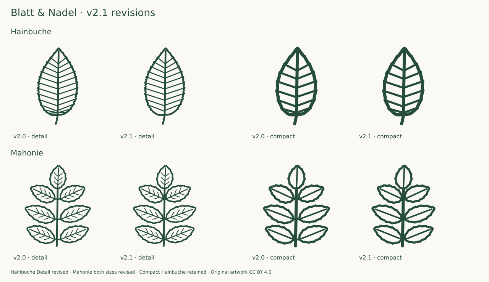

# Complete collection review · v2.1.0

13 October 2026 · **158 taxa / 316 source SVGs** · baseline v2.0.0

Internal source-guided review of all 158 taxa and both optical variants. The 149 existing HTML primary treatments were freshly retrieved; the Acer palmatum PDF treatment was reread from the same-day previous extraction. Existing reference photographs were reused and compared anew, not all redownloaded. Eight additions underwent two sequential primary-source, drawing and visual-review rounds. Every SVG was inspected enlarged and at target sizes. Not independent botanical certification.

## Evidence and decisions

All 150 previous taxa were checked individually on 38 enlarged boards showing Detail, Compact and reference foliage. Both optical variants were also inspected at Compact 24/32 px and Detail 48/64 px on light and dark backgrounds. Revised files were rendered and checked again. Descriptions, photographs and drawn forms were compared for blade proportions, widest point, base, apex, petiole, margin, venation and leaflet/needle insertion. The 149 refreshed HTML treatments are distinguished from the reused Acer palmatum PDF text and the reused existing photo references.

Eight Mediterranean additions were researched, drawn and reviewed in two groups; the first was accepted before the second was chosen. Each group received enlarged, target-size and neighboring-species comparison. The [expansion record](EXPANSION-2.1.md) records forms, optical reductions and references. Photographs are linked as references, not traced or redistributed.

- **Hainbuche:** removed four crowded basal Detail veins. Ten distinct ascending pairs remain; the contour and Compact drawing are unchanged.
- **Mahonie:** shortened the six lateral petiolules to near-sessile connections in both sizes. The longer terminal stalk and seven spiny-toothed blades remain.
- **Schwarzerle:** corrected the catalog's Detail vein count from five to six pairs; artwork was already correct and is unchanged.
- **Speierling:** retained after measurement. Approximate oriented leaflet ratios 2.34–3.44 fit the NSW treatment; an initial impression of excessive narrowness was not confirmed.
- **Götterbaum:** retained its reduced terminal leaflet, supported by the New Zealand flora. No artificial enlargement was made.
- **New pine drafts:** removed tiny gaps where needle bases meet sheaths before accepting round one.
- **New Schmalblättrige Steinlinde:** shortened the crowded upper veins and lightened Compact strokes before acceptance.
- **297 existing SVGs remain byte-identical.** Three are revised and sixteen are added. The corrected oaks, elms, Ginkgo, conifers, Silberpappel and Vogelbeere have not reverted.

## Verification and limits

Adaptive Bezier flattening in scripts/geometry.mjs. Blade bounds exclude petioles and stroke widths. Axis-aligned extents are recorded separately from oriented dimensions: scripts/measure.mjs estimates length from the farthest contour-point pair and width from the projection perpendicular to that chord. This is an approximation for unlobed blades, not specimen measurement, curved midrib length or a reliable biological ratio for palmate/lobed leaves. No physical scale is implied.

The [JSON record](audit-2.1.json) covers each taxon and optical variant, links references, states selected forms and omissions, and binds findings to exact SHA-256 hashes. Its validator rejects changed artwork or incomplete review coverage. Automated checks passed for all 316 source SVGs and 3,228 internal vein/midrib paths, including full painted strokes, closed-contour crossings, blade separation and conifer/heath connectivity. New regressions protect the revised basal veins, near-sessile Mahonie insertions, sessile rockroses and even-pinnate winged Mastixstrauch axis; existing pine tests include all three additions.

**Fresh browser integration QA was not run:** the prescribed browser-control capability is unavailable in this environment. The Chromium/Firefox suite is included for reproduction and CI. Geometry and raster review are not described as a browser pass. See [QUALITY.md](QUALITY.md).

This is a referenced icon system, not a measured specimen atlas or independently certified identification key. Natural variability, colour, hairs, microscopic teeth, needle cross-sections and some surface characters remain outside the drawings. Similar species are allowed to look similar.

## Per-taxon findings

Both optical variants were reviewed for every row. “Retained” means byte-identical to v2.0.0.

| Taxon                                                   | Finding                                                                                                                                                                                                                                                                                      | Artwork                  | Primary source                                                                          |
| ------------------------------------------------------- | -------------------------------------------------------------------------------------------------------------------------------------------------------------------------------------------------------------------------------------------------------------------------------------------- | ------------------------ | --------------------------------------------------------------------------------------- |
| Fichte · _Picea abies_                                  | Retained: pointed individual needles at distinct front/side angles support the all-sided shoot; needle density and quadrangular section remain explicit omissions in both sizes.                                                                                                             | D: Retained; C: Retained | [Treatment](https://www.infoflora.ch/de/flora/picea-abies.html)                         |
| Waldkiefer · _Pinus sylvestris_                         | Retained: three separate two-needle fascicles visibly emerge from common sheaths; sparse twig and projected twisting are optical reductions, not a literal natural needle density.                                                                                                           | D: Retained; C: Retained | [Treatment](https://www.infoflora.ch/de/flora/pinus-sylvestris.html)                    |
| Europäische Lärche · _Larix decidua_                    | Retained: separate short-shoot fascicles and soft radial needles match Larix; drawn 11/7 counts remain deliberately below the natural 20–40.                                                                                                                                                 | D: Retained; C: Retained | [Treatment](https://www.infoflora.ch/de/flora/larix-decidua.html)                       |
| Weißtanne · _Abies alba_                                | Retained: selected comb-like lateral shoot, flat needles and tiny Detail apical notches; Compact omits notches and neither variant represents underside bands.                                                                                                                               | D: Retained; C: Retained | [Treatment](https://www.infoflora.ch/de/flora/abies-alba.html)                          |
| Douglasie · _Pseudotsuga menziesii_                     | Retained: lateral and forward-projecting needles plus pointed terminal bud avoid a purely two-ranked scheme; smell and stomatal lines are not encoded.                                                                                                                                       | D: Retained; C: Retained | [Treatment](https://www.infoflora.ch/de/flora/pseudotsuga-menziesii.html)               |
| Eibe · _Taxus baccata_                                  | Retained: sharp narrow needles remain two-ranked on the selected lateral shoot; both lack surface/underside colours as documented.                                                                                                                                                           | D: Retained; C: Retained | [Treatment](https://www.infoflora.ch/de/flora/taxus-baccata.html)                       |
| Wacholder · _Juniperus communis_                        | Retained: three needles share each visible whorl; stiff projecting points retained, white adaxial band omitted.                                                                                                                                                                              | D: Retained; C: Retained | [Treatment](https://www.infoflora.ch/de/flora/juniperus-communis.html)                  |
| Stieleiche · _Quercus robur_                            | Retained: rounded unequal lobes, basal auricles and nearly absent petiole agree with the referenced foliage; earlier revised outline and sinus veins remain intact.                                                                                                                          | D: Retained; C: Retained | [Treatment](https://www.infoflora.ch/de/flora/quercus-robur.html)                       |
| Traubeneiche · _Quercus petraea_                        | Retained: tapering non-auriculate base and longer stalk agree with the described distinction from Q. robur; lateral veins point toward lobes.                                                                                                                                                | D: Retained; C: Retained | [Treatment](https://www.infoflora.ch/de/flora/quercus-petraea.html)                     |
| Rotbuche · _Fagus sylvatica_                            | Retained: ovate-elliptic nearly entire outline, short stalk and lateral vein hierarchy match the selected mature leaf; juvenile cilia omitted.                                                                                                                                               | D: Retained; C: Retained | [Treatment](https://www.infoflora.ch/de/flora/fagus-sylvatica.html)                     |
| Hängebirke · _Betula pendula_                           | Retained: rhombic-triangular blade and long attenuated apex survive in both sizes; developed stalk and reduced two-order teeth remain coherent.                                                                                                                                              | D: Retained; C: Retained | [Treatment](https://www.infoflora.ch/de/flora/betula-pendula.html)                      |
| Schwarzpappel · _Populus nigra_                         | Retained: broad convex deltoid shoulders and a drawn-out apex agree with the photographed blades; the earlier rounded-flank correction is preserved.                                                                                                                                         | D: Retained; C: Retained | [Treatment](https://www.infoflora.ch/de/flora/populus-nigra.html)                       |
| Espe · Zitterpappel · _Populus tremula_                 | Retained: rounded short-shoot blade with coarse crenations and a long stalk matches the selected form; flattened stalk section and alternate long-shoot blade are not drawn.                                                                                                                 | D: Retained; C: Retained | [Treatment](https://www.infoflora.ch/de/flora/populus-tremula.html)                     |
| Schwarzerle · _Alnus glutinosa_                         | Retained: broad blunt/notched apex and narrowing base remain obovate, without a heart-shaped basal sinus; six Detail lateral vein pairs fit the flora range.                                                                                                                                 | D: Retained; C: Retained | [Treatment](https://www.infoflora.ch/de/flora/alnus-glutinosa.html)                     |
| Hainbuche · _Carpinus betulus_                          | Revised Detail: removed four crowded basal veins sharing clamped origins, including a downward-pointing vein. Ten separate ascending vein pairs now follow the major teeth. Compact retains its six separated pairs; outline unchanged.                                                      | D: Revised; C: Retained  | [Treatment](https://www.infoflora.ch/de/flora/carpinus-betulus.html)                    |
| Winterlinde · _Tilia cordata_                           | Retained: asymmetrical cordate base, broad blade, fine teeth and developed stalk; underside vein-axil hair characters needed for species discrimination remain omitted.                                                                                                                      | D: Retained; C: Retained | [Treatment](https://www.infoflora.ch/de/flora/tilia-cordata.html)                       |
| Hasel · _Corylus avellana_                              | Retained: broad cordate blade, double teeth and short acuminate tip; basal arcuate veins follow the heart-shaped lobes.                                                                                                                                                                      | D: Retained; C: Retained | [Treatment](https://www.infoflora.ch/de/flora/corylus-avellana.html)                    |
| Bergahorn · _Acer pseudoplatanus_                       | Retained: five coarsely blunt-toothed lobes and acute sinuses match Flora Helvetica; blunt teeth are preserved in Compact with fewer points.                                                                                                                                                 | D: Retained; C: Retained | [Treatment](https://www.infoflora.ch/de/flora/acer-pseudoplatanus.html)                 |
| Spitzahorn · _Acer platanoides_                         | Retained: extended acute lobe tips and broad blunt sinuses remain distinct from sycamore maple; selected truncate basal outline.                                                                                                                                                             | D: Retained; C: Retained | [Treatment](https://www.infoflora.ch/de/flora/acer-platanoides.html)                    |
| Feldahorn · _Acer campestre_                            | Retained: rounded broad lobes and restrained secondary lobes maintain field-maple identity in both sizes.                                                                                                                                                                                    | D: Retained; C: Retained | [Treatment](https://www.infoflora.ch/de/flora/acer-campestre.html)                      |
| Gemeine Esche · _Fraxinus excelsior_                    | Retained: nine pointed serrate leaflets, four lateral pairs and terminal leaflet agree with the four-to-six pair treatment.                                                                                                                                                                  | D: Retained; C: Retained | [Treatment](https://www.infoflora.ch/de/flora/fraxinus-excelsior.html)                  |
| Bergulme · _Ulmus glabra_                               | Retained: thirteen paired forked veins, selected three-point tip, unequal base and very short stalk; no regression of the revised outline.                                                                                                                                                   | D: Retained; C: Retained | [Treatment](https://www.infoflora.ch/de/flora/ulmus-glabra.html)                        |
| Salweide · _Salix caprea_                               | Retained: broad oval pointed blade and weakly undulate margin match the reference leaf; underside hairs omitted.                                                                                                                                                                             | D: Retained; C: Retained | [Treatment](https://www.infoflora.ch/de/flora/salix-caprea.html)                        |
| Silberweide · _Salix alba_                              | Retained: narrow balanced lanceolate blade with two visible flanks and fine serrations; no collapsed side in either variant.                                                                                                                                                                 | D: Retained; C: Retained | [Treatment](https://www.infoflora.ch/de/flora/salix-alba.html)                          |
| Rosskastanie · _Aesculus hippocastanum_                 | Retained: seven obovate leaflets with dominant central leaflet and long petiole; Compact intentionally omits secondary venation and fine teeth.                                                                                                                                              | D: Retained; C: Retained | [Treatment](https://www.infoflora.ch/de/flora/aesculus-hippocastanum.html)              |
| Edelkastanie · _Castanea sativa_                        | Retained: long lanceolate blade and major sharp teeth connected to veins distinguish it from the broader elm and hornbeam.                                                                                                                                                                   | D: Retained; C: Retained | [Treatment](https://www.infoflora.ch/de/flora/castanea-sativa.html)                     |
| Vogelbeere · _Sorbus aucuparia_                         | Retained: eleven oblong-lanceolate leaflets with rounded unequal bases and entire basal portions preserve the v2.0 correction.                                                                                                                                                               | D: Retained; C: Retained | [Treatment](https://www.infoflora.ch/de/flora/sorbus-aucuparia.html)                    |
| Robinie · _Robinia pseudoacacia_                        | Retained: nine entire oval leaflets with rounded ends and terminal leaflet; hairs and small mucros are outside the optical vocabulary.                                                                                                                                                       | D: Retained; C: Retained | [Treatment](https://www.infoflora.ch/de/flora/robinia-pseudoacacia.html)                |
| Schwarzer Holunder · _Sambucus nigra_                   | Retained: five pointed serrate leaflets with unequal bases and two opposite pairs fit the selected elder leaf.                                                                                                                                                                               | D: Retained; C: Retained | [Treatment](https://www.infoflora.ch/de/flora/sambucus-nigra.html)                      |
| Eingriffeliger Weißdorn · _Crataegus monogyna_          | Retained: deeply divided lobes, wedge base and mostly distal teeth; lateral veins feed the lobes coherently.                                                                                                                                                                                 | D: Retained; C: Retained | [Treatment](https://www.infoflora.ch/de/flora/crataegus-monogyna.html)                  |
| Schlehe · _Prunus spinosa_                              | Retained: narrowly ovate blade, fine serrations and short petiole agree with the referenced blackthorn foliage.                                                                                                                                                                              | D: Retained; C: Retained | [Treatment](https://www.infoflora.ch/de/flora/prunus-spinosa.html)                      |
| Roter Hartriegel · _Cornus sanguinea_                   | Retained: entire ovate blade and four arcuate lateral vein pairs; Compact reduces the vein count to three explicitly.                                                                                                                                                                        | D: Retained; C: Retained | [Treatment](https://www.infoflora.ch/de/flora/cornus-sanguinea.html)                    |
| Gewöhnlicher Schneeball · _Viburnum opulus_             | Retained: three coarse forward-pointing lobes and two petiolar glands in Detail; Compact omits glands and fine venation.                                                                                                                                                                     | D: Retained; C: Retained | [Treatment](https://www.infoflora.ch/de/flora/viburnum-opulus.html)                     |
| Stechpalme · _Ilex aquifolium_                          | Retained: selected prickly evergreen leaf with strong alternating spines and rounded sinuses; entire upper-crown leaves not represented.                                                                                                                                                     | D: Retained; C: Retained | [Treatment](https://www.infoflora.ch/de/flora/ilex-aquifolium.html)                     |
| Faulbaum · _Frangula alnus_                             | Retained: entire oval blade with eight lateral vein pairs in Detail, within the reported seven-to-twelve; Compact reduced to four.                                                                                                                                                           | D: Retained; C: Retained | [Treatment](https://www.infoflora.ch/de/flora/frangula-alnus.html)                      |
| Pfaffenhütchen · _Euonymus europaeus_                   | Retained: broadly lanceolate finely serrate blade and short stalk; node arrangement cannot be inferred from an isolated leaf.                                                                                                                                                                | D: Retained; C: Retained | [Treatment](https://www.infoflora.ch/de/flora/euonymus-europaeus.html)                  |
| Hundsrose · _Rosa canina_                               | Retained: seven toothed leaflets with basal stipules; minor stalk prickles and gland characters omitted.                                                                                                                                                                                     | D: Retained; C: Retained | [Treatment](https://www.infoflora.ch/de/flora/rosa-canina.html)                         |
| Kornelkirsche · _Cornus mas_                            | Retained: broad lanceolate entire blade with four strongly arcuate vein pairs; Compact preserves the curved venation hierarchy.                                                                                                                                                              | D: Retained; C: Retained | [Treatment](https://www.infoflora.ch/de/flora/cornus-mas.html)                          |
| Vogelkirsche · _Prunus avium_                           | Retained: broad lanceolate toothed blade and paired petiolar glands in Detail; Compact omits gland dots to avoid false coarse structures.                                                                                                                                                    | D: Retained; C: Retained | [Treatment](https://www.infoflora.ch/de/flora/prunus-avium.html)                        |
| Sommerlinde · _Tilia platyphyllos_                      | Retained: broad cordate blade and long stalk; monochrome outline cannot encode the underside hairs separating lime species.                                                                                                                                                                  | D: Retained; C: Retained | [Treatment](https://www.infoflora.ch/de/flora/tilia-platyphyllos.html)                  |
| Walnuss · _Juglans regia_                               | Retained: seven entire oval leaflets, larger upper/terminal than basal blades; juvenile toothed forms not selected.                                                                                                                                                                          | D: Retained; C: Retained | [Treatment](https://www.infoflora.ch/de/flora/juglans-regia.html)                       |
| Moorbirke · _Betula pubescens_                          | Retained: ovate blade and simpler teeth than silver birch; hair characters omitted and hybrid overlap acknowledged.                                                                                                                                                                          | D: Retained; C: Retained | [Treatment](https://www.infoflora.ch/de/flora/betula-pubescens.html)                    |
| Flatterulme · _Ulmus laevis_                            | Retained: pronounced unequal base, single apex and densely pinnate veins; basal veins entering the lower lobe correctly angle basally.                                                                                                                                                       | D: Retained; C: Retained | [Treatment](https://www.infoflora.ch/de/flora/ulmus-laevis.html)                        |
| Elsbeere · _Sorbus torminalis_                          | Retained: broad ovate blade with three to four unequal pointed lobes on each side; major lateral veins terminate within corresponding lobes.                                                                                                                                                 | D: Retained; C: Retained | [Treatment](https://www.infoflora.ch/de/flora/sorbus-torminalis.html)                   |
| Französischer Ahorn · _Acer monspessulanum_             | Retained: three entire lobes and cordate base with developed petiole, matching OSU leaf photographs; no milky-sap character represented.                                                                                                                                                     | D: Retained; C: Retained | [Treatment](https://landscapeplants.oregonstate.edu/plants/acer-monspessulanum)         |
| Eschenahorn · _Acer negundo_                            | Retained: selected three-leaflet compound form with coarsely toothed/lobed terminal leaflet; five-to-seven leaflet alternatives documented.                                                                                                                                                  | D: Retained; C: Retained | [Treatment](https://www.infoflora.ch/de/flora/acer-negundo.html)                        |
| Liguster · _Ligustrum vulgare_                          | Retained: entire lanceolate blade and short stalk; no false marginal teeth or detached venation.                                                                                                                                                                                             | D: Retained; C: Retained | [Treatment](https://www.infoflora.ch/de/flora/ligustrum-vulgare.html)                   |
| Berberitze · _Berberis vulgaris_                        | Retained: obovate blunt blade tapering to a short stalk with fine sharp teeth; tuft arrangement and stem spines omitted.                                                                                                                                                                     | D: Retained; C: Retained | [Treatment](https://www.infoflora.ch/de/flora/berberis-vulgaris.html)                   |
| Rote Heckenkirsche · _Lonicera xylosteum_               | Retained: broad ovate entire blade with short stalk; soft pubescence cannot be expressed by this contour system.                                                                                                                                                                             | D: Retained; C: Retained | [Treatment](https://www.infoflora.ch/de/flora/lonicera-xylosteum.html)                  |
| Kreuzdorn · _Rhamnus cathartica_                        | Retained: rounded blade, fine teeth and four forward-curved vein pairs distinguish it from straight-veined alder buckthorn.                                                                                                                                                                  | D: Retained; C: Retained | [Treatment](https://www.infoflora.ch/de/flora/rhamnus-cathartica.html)                  |
| Felsenbirne · _Amelanchier ovalis_                      | Retained: oval finely toothed blade with small tip and rounded base; young underside tomentum omitted.                                                                                                                                                                                       | D: Retained; C: Retained | [Treatment](https://www.infoflora.ch/de/flora/amelanchier-ovalis.html)                  |
| Traubenkirsche · _Prunus padus_                         | Retained: broad lanceolate blade, fine regular teeth and rounded base; Detail petiole glands and evenly distributed veins retained.                                                                                                                                                          | D: Retained; C: Retained | [Treatment](https://www.infoflora.ch/de/flora/prunus-padus.html)                        |
| Feldulme · _Ulmus minor_                                | Retained: oblique base, single tip, longer stalk than wych elm and twelve lateral veins with selected forks; no false multiple apex.                                                                                                                                                         | D: Retained; C: Retained | [Treatment](https://www.infoflora.ch/de/flora/ulmus-minor.html)                         |
| Grauerle · _Alnus incana_                               | Retained: acute ovate blade widest below the middle with dense lateral veins, contrasting with blunt black alder.                                                                                                                                                                            | D: Retained; C: Retained | [Treatment](https://www.infoflora.ch/de/flora/alnus-incana.html)                        |
| Mehlbeere · _Sorbus aria_                               | Retained: unlobed oval finely double-toothed blade with dense lateral nerves; white felted underside deliberately not encoded.                                                                                                                                                               | D: Retained; C: Retained | [Treatment](https://www.infoflora.ch/de/flora/sorbus-aria.html)                         |
| Wildapfel · _Malus sylvestris_                          | Retained: broadly ovate fine-toothed blade and long petiole approaching blade length; cultivated-apple overlap remains explicit.                                                                                                                                                             | D: Retained; C: Retained | [Treatment](https://www.infoflora.ch/de/flora/malus-sylvestris.html)                    |
| Wildbirne · _Pyrus pyraster_                            | Retained: broad round-ovate finely toothed selected blade and stalk near blade length; some natural leaves are entire.                                                                                                                                                                       | D: Retained; C: Retained | [Treatment](https://www.infoflora.ch/de/flora/pyrus-pyraster.html)                      |
| Wolliger Schneeball · _Viburnum lantana_                | Retained: broad ovate blade, regular small teeth and pinnate nerves; wrinkle/hair microtexture omitted from both variants.                                                                                                                                                                   | D: Retained; C: Retained | [Treatment](https://www.infoflora.ch/de/flora/viburnum-lantana.html)                    |
| Silberpappel · _Populus alba_                           | Retained: five-lobed selected long-shoot blade; widened central lobe preserves the v2.0 fix and no longer appears detached at its base.                                                                                                                                                      | D: Retained; C: Retained | [Treatment](https://www.infoflora.ch/de/flora/populus-alba.html)                        |
| Speierling · _Sorbus domestica_                         | Retained: thirteen leaflets with basal third entire and distal teeth; Detail lateral nerves omitted at this optical scale as documented, no literal twelve-to-fifteen-pair claim.                                                                                                            | D: Retained; C: Retained | [Treatment](https://www.infoflora.ch/de/flora/sorbus-domestica.html)                    |
| Ginkgo · _Ginkgo biloba_                                | Retained: fan-shaped blade with broad variable scalloped upper edge, selected central cleft and branching dichotomous veins; no midrib or false reticulate venation.                                                                                                                         | D: Retained; C: Retained | [Treatment](https://floranorthamerica.org/Ginkgo_biloba)                                |
| Ahornblättrige Platane · _Platanus × hispanica_         | Retained: broad central and lateral lobes with shallow cordate/truncate base fit the hybrid's selected leaf; not the deeply dissected Oriental plane.                                                                                                                                        | D: Retained; C: Retained | [Treatment](https://www.infoflora.ch/de/flora/platanus-%C3%97hispanica.html)            |
| Tulpenbaum · _Liriodendron tulipifera_                  | Retained: four lobes and a truncate shallowly notched apex with long petiole; no invented pointed terminal lobe.                                                                                                                                                                             | D: Retained; C: Retained | [Treatment](https://www.infoflora.ch/de/flora/liriodendron-tulipifera.html)             |
| Amberbaum · _Liquidambar styraciflua_                   | Retained: five star-like pointed lobes and fine teeth; palmate main veins preserved, secondary nerves reduced in Compact.                                                                                                                                                                    | D: Retained; C: Retained | [Treatment](https://botanischer-garten-hoexter.de/pflanze-liquidambar_styraciflua.html) |
| Fächerahorn · _Acer palmatum_                           | Retained: seven narrow pointed lobes divided deeply toward the base; regular fine teeth and long stalk, representing the wild-type form rather than dissected cultivars.                                                                                                                     | D: Retained; C: Retained | [Treatment](https://www.iplant.cn/foc/pdf/Acer.pdf)                                     |
| Schneeballblättriger Ahorn · _Acer opalus_              | Retained: shallow three-to-five lobes and broad undulating teeth; blunt lower lobes retain the distinction from Norway maple.                                                                                                                                                                | D: Retained; C: Retained | [Treatment](https://www.infoflora.ch/de/flora/acer-opalus.html)                         |
| Efeu · _Hedera helix_                                   | Retained: selected juvenile five-lobed entire blade; undivided flowering-shoot leaves not represented and stated explicitly.                                                                                                                                                                 | D: Retained; C: Retained | [Treatment](https://www.infoflora.ch/de/flora/hedera-helix.html)                        |
| Baumhasel · _Corylus colurna_                           | Retained: broad cordate ovate blade, drawn-out apex and double serration; short basal lobe asymmetry matches photographed leaves.                                                                                                                                                            | D: Retained; C: Retained | [Treatment](https://www.infoflora.ch/de/flora/corylus-colurna.html)                     |
| Roteiche · _Quercus rubra_                              | Retained: four lateral pointed/bristle-tipped lobe groups, rounded sinuses and developed stalk match the red-oak treatment; minute bristles optically enlarged.                                                                                                                              | D: Retained; C: Retained | [Treatment](https://www.infoflora.ch/de/flora/quercus-rubra.html)                       |
| Flaumeiche · _Quercus pubescens_                        | Retained: irregular rounded lobes and short stalk; distinguishing stellate underside hairs are not encoded by the monochrome contour.                                                                                                                                                        | D: Retained; C: Retained | [Treatment](https://www.infoflora.ch/de/flora/quercus-pubescens.html)                   |
| Zerreiche · _Quercus cerris_                            | Retained: narrow irregular pointed lobes and persistent stipules in Detail; Compact omits stipules and minor teeth.                                                                                                                                                                          | D: Retained; C: Retained | [Treatment](https://www.infoflora.ch/de/flora/quercus-cerris.html)                      |
| Silberlinde · _Tilia tomentosa_                         | Retained: broad cordate toothed blade; the diagnostic silver underside and hair colour are explicitly absent, so outline alone cannot separate lindens reliably.                                                                                                                             | D: Retained; C: Retained | [Treatment](https://www.infoflora.ch/de/flora/tilia-tomentosa.html)                     |
| Roter Holunder · _Sambucus racemosa_                    | Retained: five serrate lanceolate leaflets; distinction from black elder depends mainly on flowers, fruit and pith absent from these leaf icons.                                                                                                                                             | D: Retained; C: Retained | [Treatment](https://www.infoflora.ch/de/flora/sambucus-racemosa.html)                   |
| Zweigriffeliger Weißdorn · _Crataegus laevigata_        | Retained: three shallow distal lobes with short teeth and inward-curving lateral veins, distinct from deeply divided common hawthorn.                                                                                                                                                        | D: Retained; C: Retained | [Treatment](https://www.infoflora.ch/de/flora/crataegus-laevigata.html)                 |
| Himbeere · _Rubus idaeus_                               | Retained: selected three-leaflet form with stalked terminal blade and double serration; five/seven leaflets and white underside are alternatives not drawn.                                                                                                                                  | D: Retained; C: Retained | [Treatment](https://www.infoflora.ch/de/flora/rubus-idaeus.html)                        |
| Sanddorn · _Hippophae rhamnoides_                       | Retained: very narrow entire lanceolate blade and short stalk; neither variant invents marginal serration or silvery hair markings.                                                                                                                                                          | D: Retained; C: Retained | [Treatment](https://www.infoflora.ch/de/flora/hippopha%C3%AB-rhamnoides.html)           |
| Zirbelkiefer · Arve · _Pinus cembra_                    | Retained: exactly five needles per visible fascicle, three clusters; thick three-sided anatomy is not shown in planar projection.                                                                                                                                                            | D: Retained; C: Retained | [Treatment](https://www.infoflora.ch/de/flora/pinus-cembra.html)                        |
| Bergkiefer · _Pinus mugo_                               | Retained: four clearly paired stiff needle fascicles; short-needle species identity additionally requires scale/context absent here.                                                                                                                                                         | D: Retained; C: Retained | [Treatment](https://www.infoflora.ch/de/flora/pinus-mugo.html)                          |
| Urweltmammutbaum · _Metasequoia glyptostroboides_       | Retained: opposite soft blunt needles on a selected short shoot; Compact preserves opposing attachment nodes and open gaps.                                                                                                                                                                  | D: Retained; C: Retained | [Treatment](https://plantdatabase.kpu.ca/PlantPrint/megl)                               |
| Götterbaum · _Ailanthus altissima_                      | Retained: nine leaflets in four pairs and terminal, basal teeth only and otherwise entire margin; gland tissue and full natural leaf size omitted.                                                                                                                                           | D: Retained; C: Retained | [Treatment](https://www.infoflora.ch/de/flora/ailanthus-altissima.html)                 |
| Essigbaum · _Rhus typhina_                              | Retained: eleven serrate lanceolate leaflets distinguish the margin from tree-of-heaven; Compact removes tiny leaflet nerves.                                                                                                                                                                | D: Retained; C: Retained | [Treatment](https://www.infoflora.ch/de/flora/rhus-typhina.html)                        |
| Silberahorn · _Acer saccharinum_                        | Retained: deeply incised five-lobed blade and pointed coarse teeth; wide basal sinuses preserve contrast to shallow red maple.                                                                                                                                                               | D: Retained; C: Retained | [Treatment](https://www.infoflora.ch/de/flora/acer-saccharinum.html)                    |
| Rotahorn · _Acer rubrum_                                | Retained: selected three-lobed blade with fine toothed flanks and long stalk; five-lobed natural forms not drawn.                                                                                                                                                                            | D: Retained; C: Retained | [Treatment](https://www.infoflora.ch/de/flora/acer-rubrum.html)                         |
| Kirschlorbeer · _Prunus laurocerasus_                   | Retained: leathery oblanceolate selected blade, short tip, nearly entire fine edge and short petiole; underside gland detail omitted.                                                                                                                                                        | D: Retained; C: Retained | [Treatment](https://www.infoflora.ch/de/flora/prunus-laurocerasus.html)                 |
| Buchsbaum · _Buxus sempervirens_                        | Retained: small oval entire blunt blade with tapering base and very short stalk; leaf scale and opposite arrangement need external context.                                                                                                                                                  | D: Retained; C: Retained | [Treatment](https://www.infoflora.ch/de/flora/buxus-sempervirens.html)                  |
| Flieder · _Syringa vulgaris_                            | Retained: entire broad cordate blade with acuminate tip and long stalk; no false serration introduced in Compact.                                                                                                                                                                            | D: Retained; C: Retained | [Treatment](https://www.infoflora.ch/de/flora/syringa-vulgaris.html)                    |
| Echter Seidelbast · _Daphne mezereum_                   | Retained: entire oblanceolate blade narrowed toward its very short stalk; shoot-tip clustering omitted by isolated-leaf scope.                                                                                                                                                               | D: Retained; C: Retained | [Treatment](https://www.infoflora.ch/de/flora/daphne-mezereum.html)                     |
| Purpurweide · _Salix purpurea_                          | Retained: narrow oblanceolate blade widest toward upper third with only distal fine teeth; Compact merges minor teeth optically.                                                                                                                                                             | D: Retained; C: Retained | [Treatment](https://www.infoflora.ch/de/flora/salix-purpurea.html)                      |
| Korbweide · _Salix viminalis_                           | Retained: very narrow linear-lanceolate blade widest in lower third and long tapering ends; revolute edges and sparse gland teeth remain below icon detail.                                                                                                                                  | D: Retained; C: Retained | [Treatment](https://www.floraweb.de/php/artenhome.php?suchnr=5206)                      |
| Mahonie · _Mahonia aquifolium_                          | Revised both sizes: halved lateral insertion connectors to 1.5 viewBox units, keeping the six lateral leaflets nearly sessile while retaining the distinctly stalked terminal leaflet. Remaining gap is an optical separation allowance; seven spiny blades retained.                        | D: Revised; C: Revised   | [Treatment](https://www.infoflora.ch/de/flora/mahonia-aquifolium.html)                  |
| Kratzbeere · _Rubus caesius_                            | Retained: three broad unevenly serrate leaflets, only terminal stalked and basal stipules in Detail; glaucous surface omitted.                                                                                                                                                               | D: Retained; C: Retained | [Treatment](https://www.infoflora.ch/de/flora/rubus-caesius.html)                       |
| Schwarze Johannisbeere · _Ribes nigrum_                 | Retained: broad three-to-five-lobed toothed blade; underside glands and scent are absent, so leaf outline is not a reliable species key.                                                                                                                                                     | D: Retained; C: Retained | [Treatment](https://www.infoflora.ch/de/flora/ribes-nigrum.html)                        |
| Heidelbeere · _Vaccinium myrtillus_                     | Retained: ovate-lanceolate finely serrate blade and short petiole; no false evergreen revolute rim is added.                                                                                                                                                                                 | D: Retained; C: Retained | [Treatment](https://www.infoflora.ch/de/flora/vaccinium-myrtillus.html)                 |
| Preiselbeere · _Vaccinium vitis-idaea_                  | Retained: blunt shallowly notched oval entire blade with very short stalk; underside dots omitted and bearberry overlap acknowledged.                                                                                                                                                        | D: Retained; C: Retained | [Treatment](https://www.infoflora.ch/de/flora/vaccinium-vitis-idaea.html)               |
| Rostblättrige Alpenrose · _Rhododendron ferrugineum_    | Retained: entire narrow oval evergreen blade; rolled margin and rusty underside cannot be read from a planar one-colour silhouette.                                                                                                                                                          | D: Retained; C: Retained | [Treatment](https://www.infoflora.ch/de/flora/rhododendron-ferrugineum.html)            |
| Stachelbeere · _Ribes uva-crispa_                       | Retained: rounded three-to-five lobes and scalloped toothed edges; stem thorns omitted from isolated-leaf scope.                                                                                                                                                                             | D: Retained; C: Retained | [Treatment](https://www.infoflora.ch/de/flora/ribes-uva-crispa.html)                    |
| Europäischer Zürgelbaum · _Celtis australis_            | Retained: asymmetric base and elongated apex with strong basal lateral veins; tiny hairs and full natural tooth count reduced in Compact.                                                                                                                                                    | D: Retained; C: Retained | [Treatment](https://www.infoflora.ch/de/flora/celtis-australis.html)                    |
| Hopfenbuche · _Ostrya carpinifolia_                     | Retained: ovate doubly serrate blade and dense lateral veins in Detail; Compact explicitly drops most veins and subordinate teeth.                                                                                                                                                           | D: Retained; C: Retained | [Treatment](https://www.infoflora.ch/de/flora/ostrya-carpinifolia.html)                 |
| Schwarzkiefer · _Pinus nigra_                           | Retained: three stiff two-needle fascicles on one axis; common basal sheaths visible, stomatal and sectional details omitted.                                                                                                                                                                | D: Retained; C: Retained | [Treatment](https://www.infoflora.ch/de/flora/pinus-nigra.html)                         |
| Sumpfzypresse · _Taxodium distichum_                    | Retained: alternate attachments and pointed soft needles contrast with opposite blunt dawn-redwood leaves; scale-like shoot foliage not represented.                                                                                                                                         | D: Retained; C: Retained | [Treatment](https://landscapeplants.oregonstate.edu/plants/taxodium-distichum)          |
| Besenheide · _Calluna vulgaris_                         | Retained: overlapping small scale leaves on branching shoot; four ranks compressed into planar projection with fewer leaves in Compact.                                                                                                                                                      | D: Retained; C: Retained | [Treatment](https://www.infoflora.ch/de/flora/calluna-vulgaris.html)                    |
| Schneeheide · _Erica carnea_                            | Retained: four needles at each selected whorl, with front/back directions projected apart; unbranched segment and reduced density are explicit.                                                                                                                                              | D: Retained; C: Retained | [Treatment](https://www.infoflora.ch/de/flora/erica-carnea.html)                        |
| Besenginster · _Cytisus scoparius_                      | Retained: selected stalked trifoliolate lower leaf with entire oval leaflets; simple upper leaves are an unillustrated alternative.                                                                                                                                                          | D: Retained; C: Retained | [Treatment](https://www.infoflora.ch/de/flora/cytisus-scoparius.html)                   |
| Färber-Ginster · _Genista tinctoria_                    | Retained: unlobed entire lanceolate blade and short stalk, contrasting with compound broom foliage.                                                                                                                                                                                          | D: Retained; C: Retained | [Treatment](https://www.infoflora.ch/de/flora/genista-tinctoria.html)                   |
| Gewöhnliche Waldrebe · _Clematis vitalba_               | Retained: five long-stalked coarsely toothed leaflets and rounded/truncate bases; curling petiole mechanics omitted.                                                                                                                                                                         | D: Retained; C: Retained | [Treatment](https://www.infoflora.ch/de/flora/clematis-vitalba.html)                    |
| Weinrebe · _Vitis vinifera_                             | Retained: five radiating lobes, open basal sinus and coarse teeth; cultivar-dependent lobe depth and hair variation stated.                                                                                                                                                                  | D: Retained; C: Retained | [Treatment](https://www.infoflora.ch/de/flora/vitis-vinifera.html)                      |
| Rote Johannisbeere · _Ribes rubrum_                     | Retained: five broad lobes and toothed margins; underside gland/scent differences from blackcurrant cannot be encoded here.                                                                                                                                                                  | D: Retained; C: Retained | [Treatment](https://www.infoflora.ch/de/flora/ribes-rubrum.html)                        |
| Alpen-Johannisbeere · _Ribes alpinum_                   | Retained: selected three-lobed small blade and proportionately shorter petiole; scale-normalized icon cannot communicate absolute leaf size.                                                                                                                                                 | D: Retained; C: Retained | [Treatment](https://www.infoflora.ch/de/flora/ribes-alpinum.html)                       |
| Sommerflieder · _Buddleja davidii_                      | Retained: lanceolate finely toothed blade with elongated acute tip; gray stellate underside indumentum omitted.                                                                                                                                                                              | D: Retained; C: Retained | [Treatment](https://www.infoflora.ch/de/flora/buddleja-davidii.html)                    |
| Gewöhnlicher Pfeifenstrauch · _Philadelphus coronarius_ | Retained: broad lanceolate blade with spaced sharp teeth and short petiole; some natural leaves are effectively sessile.                                                                                                                                                                     | D: Retained; C: Retained | [Treatment](https://www.infoflora.ch/de/flora/philadelphus-coronarius.html)             |
| Gewöhnlicher Trompetenbaum · _Catalpa bignonioides_     | Retained: broad entire subcordate blade with abruptly drawn-out apex; leaf arrangement and absolute large size need contextual labels.                                                                                                                                                       | D: Retained; C: Retained | [Treatment](https://landscapeplants.oregonstate.edu/plants/catalpa-bignonioides)        |
| Blauglockenbaum · _Paulownia tomentosa_                 | Retained: selected unlobed broad heart-shaped blade and long petiole; lobed vigorous-shoot forms and felted underside omitted.                                                                                                                                                               | D: Retained; C: Retained | [Treatment](https://www.infoflora.ch/de/flora/paulownia-tomentosa.html)                 |
| Weiße Maulbeere · _Morus alba_                          | Retained: selected unlobed ovate blade with shallow cordate base and longer petiole; lobed forms and cultivar variation acknowledged.                                                                                                                                                        | D: Retained; C: Retained | [Treatment](https://www.infoflora.ch/de/flora/morus-alba.html)                          |
| Schwarze Maulbeere · _Morus nigra_                      | Retained: broad deeply cordate toothed blade with short petiole; coarse surface hairs distinguishing it from white mulberry omitted.                                                                                                                                                         | D: Retained; C: Retained | [Treatment](https://www.infoflora.ch/de/flora/morus-nigra.html)                         |
| Gleditschie · _Gleditsia triacanthos_                   | Retained: selected once-pinnate leaf with sixteen small leaflets, no terminal leaflet; twice-pinnate natural foliage is a documented alternative.                                                                                                                                            | D: Retained; C: Retained | [Treatment](https://www.infoflora.ch/de/flora/gleditsia-triacanthos.html)               |
| Pfirsich · _Prunus persica_                             | Retained: narrow gradually pointed serrate blade and short petiole with Detail glands; Compact omits tiny glands.                                                                                                                                                                            | D: Retained; C: Retained | [Treatment](https://www.infoflora.ch/de/flora/prunus-persica.html)                      |
| Pflaume · _Prunus domestica_                            | Retained: elliptic-obovate blade, cuneate base, abruptly acute apex and crenate-serrate margin agree with FNA; cultivar variability remains explicit.                                                                                                                                        | D: Retained; C: Retained | [Treatment](https://floranorthamerica.org/Prunus_domestica)                             |
| Kulturapfel · _Malus domestica_                         | Retained: broad ovate blade, rounded base, blunt serrations and developed stalk match FNA; pubescence and cultivar identity omitted.                                                                                                                                                         | D: Retained; C: Retained | [Treatment](https://floranorthamerica.org/Malus_domestica)                              |
| Ölbaum · _Olea europaea_                                | Retained: narrow entire lanceolate leaf and short petiole; silver underside and opposite nodes are outside isolated-leaf drawing.                                                                                                                                                            | D: Retained; C: Retained | [Treatment](https://www.infoflora.ch/de/flora/olea-europaea.html)                       |
| Echte Feige · _Ficus carica_                            | Retained: selected five-lobed leaf with blunt undulating lobes and rounded sinuses; whole and differently lobed leaves also occur.                                                                                                                                                           | D: Retained; C: Retained | [Treatment](https://www.infoflora.ch/de/flora/ficus-carica.html)                        |
| Quitte · _Cydonia oblonga_                              | Retained: entire oval blade with small inserted tip and short stalk; underside felt omitted.                                                                                                                                                                                                 | D: Retained; C: Retained | [Treatment](https://www.infoflora.ch/de/flora/cydonia-oblonga.html)                     |
| Kulturbirne · _Pyrus communis_                          | Retained: ovate acute blade and long petiole with fine blunt serrations fit FNA; wild/cultivated pear taxon overlap explicitly documented.                                                                                                                                                   | D: Retained; C: Retained | [Treatment](https://floranorthamerica.org/Pyrus_communis)                               |
| Aprikose · _Prunus armeniaca_                           | Retained: roundish shallowly cordate blade, small pointed apex and fine teeth, with paired Detail petiole glands.                                                                                                                                                                            | D: Retained; C: Retained | [Treatment](https://www.infoflora.ch/de/flora/prunus-armeniaca.html)                    |
| Mandelbaum · _Prunus dulcis_                            | Retained: lanceolate fine blunt-toothed blade and stalk approximately blade width; Detail glands differentiate the selected feature emphasis.                                                                                                                                                | D: Retained; C: Retained | [Treatment](https://www.infoflora.ch/de/flora/prunus-dulcis.html)                       |
| Mispel · _Mespilus germanica_                           | Retained: broad lanceolate/oval blade with fine distal teeth only; no basal serration or invented lateral lobe.                                                                                                                                                                              | D: Retained; C: Retained | [Treatment](https://www.infoflora.ch/de/flora/mespilus-germanica.html)                  |
| Echter Lorbeer · _Laurus nobilis_                       | Retained: entire oblong-lanceolate blade with mild natural waviness and short stalk; no false serrations.                                                                                                                                                                                    | D: Retained; C: Retained | [Treatment](https://www.infoflora.ch/de/flora/laurus-nobilis.html)                      |
| Ohrweide · _Salix aurita_                               | Retained: broad obovate blade, wavy margin and characteristic ear-like stipules; vein net selectively indicated in Detail.                                                                                                                                                                   | D: Retained; C: Retained | [Treatment](https://www.infoflora.ch/de/flora/salix-aurita.html)                        |
| Grauweide · _Salix cinerea_                             | Retained: elongate blade widest around/above middle with short stalk; Detail stipules omitted from Compact and hair characters unrepresented.                                                                                                                                                | D: Retained; C: Retained | [Treatment](https://www.infoflora.ch/de/flora/salix-cinerea.html)                       |
| Mandelweide · _Salix triandra_                          | Retained: narrow lanceolate regular fine-toothed blade; Detail includes stalk glands and stipules, Compact preserves the blade and petiole only.                                                                                                                                             | D: Retained; C: Retained | [Treatment](https://www.infoflora.ch/de/flora/salix-triandra.html)                      |
| Lorbeerweide · _Salix pentandra_                        | Retained: broader lanceolate blade with dense fine teeth and Detail stalk glands; gloss and colour omitted.                                                                                                                                                                                  | D: Retained; C: Retained | [Treatment](https://www.infoflora.ch/de/flora/salix-pentandra.html)                     |
| Zwergbirke · _Betula nana_                              | Retained: rounded blade wider than long with blunt crenations and short petiole; distinctive lack of pointed apex survives both sizes.                                                                                                                                                       | D: Retained; C: Retained | [Treatment](https://www.infoflora.ch/de/flora/betula-nana.html)                         |
| Rauschbeere · _Vaccinium uliginosum_                    | Retained: entire oval-obovate blunt blade and short petiole match reference foliage; blue-green surface omitted, subspecies description alone is not a full leaf key.                                                                                                                        | D: Retained; C: Retained | [Treatment](https://www.infoflora.ch/de/flora/vaccinium-uliginosum.html)                |
| Netzweide · _Salix reticulata_                          | Retained: broad oval entire blade and prominent selected network; Compact keeps only main arcuate nerves and a few cross-links.                                                                                                                                                              | D: Retained; C: Retained | [Treatment](https://www.infoflora.ch/de/flora/salix-reticulata.html)                    |
| Krautweide · _Salix herbacea_                           | Retained: round finely toothed blade with short stalk; reduced internal venation retains broad rounded identity.                                                                                                                                                                             | D: Retained; C: Retained | [Treatment](https://www.infoflora.ch/de/flora/salix-herbacea.html)                      |
| Grünerle · _Alnus viridis_                              | Retained: pointed ovate blade with six lateral vein pairs in Detail, within five-to-seven typical range; Compact reduces to three.                                                                                                                                                           | D: Retained; C: Retained | [Treatment](https://www.infoflora.ch/de/flora/alnus-viridis.html)                       |
| Steinweichsel · _Prunus mahaleb_                        | Retained: broad round-ovate blade, small inserted point and fine rounded teeth; Detail glands shown, glossy surface omitted.                                                                                                                                                                 | D: Retained; C: Retained | [Treatment](https://www.infoflora.ch/de/flora/prunus-mahaleb.html)                      |
| Pimpernuss · _Staphylea pinnata_                        | Retained: five ovate-lanceolate toothed leaflets and longer terminal stalk; Compact removes subordinate nerves.                                                                                                                                                                              | D: Retained; C: Retained | [Treatment](https://www.infoflora.ch/de/flora/staphylea-pinnata.html)                   |
| Gewöhnliche Zwergmispel · _Cotoneaster integerrimus_    | Retained: entire broad oval blade with short stalk and small tip; felted underside absent in this monochrome scope.                                                                                                                                                                          | D: Retained; C: Retained | [Treatment](https://www.infoflora.ch/de/flora/cotoneaster-integerrimus.html)            |
| Schwarznuss · _Juglans nigra_                           | Retained: fifteen pointed serrate leaflets with unequal bases and distinctly reduced terminal leaflet, as described in the primary treatment.                                                                                                                                                | D: Retained; C: Retained | [Treatment](https://www.infoflora.ch/de/flora/juglans-nigra.html)                       |
| Schwedische Mehlbeere · _Sorbus intermedia_             | Retained: broad blunt shallow lateral lobes, coarse teeth and strongly pinnate venation; Compact omits secondary teeth without changing lobe arrangement.                                                                                                                                    | D: Retained; C: Retained | [Treatment](https://www.floraweb.de/php/artenhome.php?suchnr=5705)                      |
| Perückenstrauch · _Cotinus coggygria_                   | Retained: rounded entire blade and developed petiole with pinnate curved nerves; coloured foliage cultivars not encoded.                                                                                                                                                                     | D: Retained; C: Retained | [Treatment](https://www.infoflora.ch/de/flora/cotinus-coggygria.html)                   |
| Blumenesche · _Fraxinus ornus_                          | Retained: seven ovate-lanceolate finely toothed leaflets, all stalked with longest terminal connector, matching two-to-four lateral pairs.                                                                                                                                                   | D: Retained; C: Retained | [Treatment](https://www.infoflora.ch/de/flora/fraxinus-ornus.html)                      |
| Schwarze Heckenkirsche · _Lonicera nigra_               | Retained: entire lanceolate blade approximately two-to-three times long as wide, visibly narrower than red honeysuckle's selected leaf.                                                                                                                                                      | D: Retained; C: Retained | [Treatment](https://www.infoflora.ch/de/flora/lonicera-nigra.html)                      |
| Alpen-Kreuzdorn · _Rhamnus alpina_                      | Retained: broad finely serrate blade with thirteen lateral vein pairs in Detail, within nine-to-twenty range; Compact seven-pair optical reduction stated.                                                                                                                                   | D: Retained; C: Retained | [Treatment](https://www.infoflora.ch/de/flora/rhamnus-alpina.html)                      |
| Breitblättriges Pfaffenhütchen · _Euonymus latifolius_  | Retained: broad pointed finely toothed blade and short petiole; absolute leaf size and winter buds needed for confident separation from spindle.                                                                                                                                             | D: Retained; C: Retained | [Treatment](https://www.infoflora.ch/de/flora/euonymus-latifolius.html)                 |
| Fingerstrauch · _Potentilla fruticosa_                  | Retained: five entire lanceolate leaflets arranged pinnately, with two pairs at separate nodes; not misrepresented as a palmate leaf.                                                                                                                                                        | D: Retained; C: Retained | [Treatment](https://www.infoflora.ch/de/flora/potentilla-fruticosa.html)                |
| Steineiche · _Quercus ilex_                             | Retained: selected mature entire oval-lanceolate blade, slight waviness and short petiole; prickly juvenile forms remain an explicit alternative.                                                                                                                                            | D: Retained; C: Retained | [Treatment](https://www.infoflora.ch/de/flora/quercus-ilex.html)                        |
| Korkeiche · _Quercus suber_                             | Retained: oval acute blade with five short teeth each side and developed stalk; vein-tooth connections and rounded base agree with OSU treatment.                                                                                                                                            | D: Retained; C: Retained | [Treatment](https://landscapeplants.oregonstate.edu/plants/quercus-suber)               |
| Westlicher Erdbeerbaum · _Arbutus unedo_                | Retained: elliptic-oblong acute blade with wedge base, fine serration and short stalk; no coarse oak-like teeth added.                                                                                                                                                                       | D: Retained; C: Retained | [Treatment](https://landscapeplants.oregonstate.edu/plants/arbutus-unedo)               |
| Lorbeer-Schneeball · _Viburnum tinus_                   | Retained: entire ovate pointed blade with short petiole and curved pinnate veins; leatheriness, glands and opposite nodes omitted.                                                                                                                                                           | D: Retained; C: Retained | [Treatment](https://www.infoflora.ch/de/flora/viburnum-tinus.html)                      |
| Pinie · _Pinus pinea_                                   | Three clear pairs emerge from continuous sheaths. Draft hairline gaps were removed and both variants passed connectivity/stroke review. Stiffer broader needle ribbons contrast with the selected Aleppo form without claiming a diagnostic outline.                                         | D: Added; C: Added       | [Treatment](https://landscapeplants.oregonstate.edu/plants/pinus-pinea)                 |
| Aleppo-Kiefer · _Pinus halepensis_                      | Thin curved pairs remain distinct from the twig and share each sheath. Checked against OSU needle photographs after closing draft basal gaps, including small optical sizes.                                                                                                                 | D: Added; C: Added       | [Treatment](https://landscapeplants.oregonstate.edu/plants/pinus-halepensis)            |
| Salbeiblättrige Zistrose · _Cistus salviifolius_        | Entire broad oval blade and short stalk match the primary photograph. FNA one-veined-from-base description prevents confusing its pinnate venation with the three basal nerves of Montpellier rockrose.                                                                                      | D: Added; C: Added       | [Treatment](https://www.infoflora.ch/de/flora/cistus-salviifolius.html)                 |
| Montpellier-Zistrose · _Cistus monspeliensis_           | Three basal nerves and narrow entire sessile outline match Sorbonne photographs and indexed FNA text. Compact line weights reduced after a dense first draft; no collapsed flank or detached veins remains.                                                                                  | D: Added; C: Added       | [Treatment](https://www.snv.jussieu.fr/bmedia/arbres/ciste_montpellier.htm)             |
| Strandkiefer · _Pinus pinaster_                         | OSU description and needle photograph support two stiff needles per sheath and longer sheaths than the selected Pinie/Aleppo forms. Bases remain attached and all three pairs readable in both sizes.                                                                                        | D: Added; C: Added       | [Treatment](https://landscapeplants.oregonstate.edu/plants/pinus-pinaster)              |
| Weißliche Zistrose · _Cistus albidus_                   | Malaga and Valencia descriptions and photographs support the sessile broad-based entire form. The three main nerves are selected from the visible foliage; the monochrome drawing cannot encode the diagnostic whitish indumentum. Both silhouettes and small sizes reviewed.                | D: Added; C: Added       | [Treatment](https://jardinbotanico.uma.es/jb-e3-03/)                                    |
| Schmalblättrige Steinlinde · _Phillyrea angustifolia_   | Compared with University of Udine description (4–6 weak lateral veins) and Trieste leaf photograph. The initial top veins were crowded; shorter, less curved lateral veins and lighter Compact strokes restored open spaces without inventing teeth.                                         | D: Added; C: Added       | [Treatment](https://flora.uniud.it/scheda.php?id=1209)                                  |
| Mastixstrauch · _Pistacia lentiscus_                    | University of Evora confirms winged axis and even leaflet number; Arizona description gives 3–5 pairs. Trieste close-up leaves support the selected four pairs, rounded tips and oblique nearly sessile bases. Measured leaflet ratios 2.47–2.94; both optical sizes and separation checked. | D: Added; C: Added       | [Treatment](https://apps.cals.arizona.edu/arboretum/taxon.aspx?id=216)                  |
