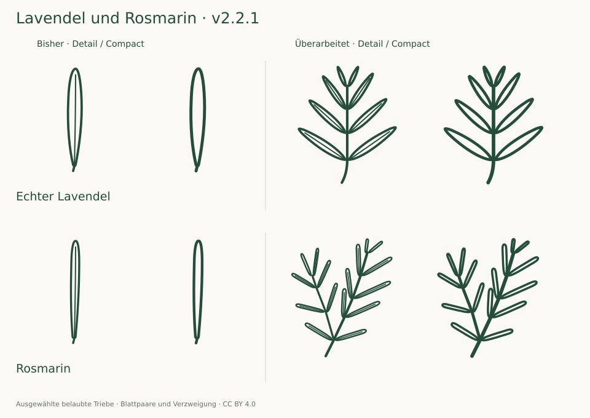

# Focused herb review · v2.2.1

13 October 2026 · 175 taxa / 350 SVGs · baseline v2.2.0

Focused correction of both variants of Lavandula angustifolia and Salvia rosmarinus after feedback about weak single-leaf character. New shoot drawings were compared with InfoFlora/Flora Helvetica and fresh NC State Extension descriptions and foliage photographs, enlarged and at 24/32 px Compact and 48/64 px Detail. The other 346 source SVGs are byte-identical and retain their v2.2 review; a new full botanical review is not claimed.

## What changed

The former single blades were too weak as icons: at small sizes their similar narrow silhouettes lost the recognizable foliage context. Passing geometry and proportion checks did not establish useful character. This feedback prompted a change of represented organ from an isolated leaf to a defined leafy shoot, while preserving IDs and the SVG interface.

- **Lavendel:** an upright shoot with four opposite pairs of narrow lanceolate leaves, smaller towards the tip. Six Detail midribs; open Compact interiors.
- **Rosmarin:** a main shoot with five opposite pairs and a lateral shoot with three. The branch begins at a leaf node. Blades are narrower and nearly parallel-sided with blunt ends. Thirteen Detail midribs; open Compact interiors.
- Both keep real opposite pairs; the projection flattens their three-dimensional arrangement. Density, posture and branch counts are selected forms. Both plants can branch; the chosen silhouettes are not exclusive identification characters.

## Evidence

| Taxon                  | Primary morphology                                                                                                         | Additional treatment and inspected photos                                                                                                       |
| ---------------------- | -------------------------------------------------------------------------------------------------------------------------- | ----------------------------------------------------------------------------------------------------------------------------------------------- |
| Lavandula angustifolia | [InfoFlora / Flora Helvetica](https://www.infoflora.ch/de/flora/lavandula-angustifolia.html)                               | [NC State Extension](https://plants.ces.ncsu.edu/plants/lavandula-angustifolia/): Opposite Leaves, Kathleen Moore; Leaves, Forest and Kim Starr |
| Salvia rosmarinus      | [InfoFlora / Flora Helvetica, under Rosmarinus officinalis](https://www.infoflora.ch/de/flora/rosmarinus-officinalis.html) | [NC State Extension](https://plants.ces.ncsu.edu/plants/salvia-rosmarinus/): Opposite needle-like leaves, Kathleen Moore; Leaves, Cathy Dewitt  |

Four additional photographs and the existing InfoFlora foliage were examined. No source photograph is traced or redistributed. Hairs, underside colour and the rolled margin in section remain omitted. A requested Flora Iberica PDF could not be opened and is not counted as reviewed evidence.

## Verification

Both new Detail and Compact drawings were inspected enlarged and at 24/32/48/64 px on light/dark backgrounds. The final global checker covers all 350 SVGs and 3,465 internal paths. All separate leaf contours stay clear; full strokes stay inside their blades, and both leafy shoots form connected painted components. The new explicit `leaf-twig` path role distinguishes the shoot from a compound-leaf rachis. The herb regression protects opposite insertion levels, selected leaf counts and proportions, Compact reductions and the axillary branch origin.

Four SVGs changed; the other 346 are byte-identical. The [complete hash record](audit-2.2.1.json) carries forward their existing [v2.2 review](AUDIT-2.2.md). The 37 regression tests and archive verification pass. Fresh browser execution remains unavailable; no independent botanical certification is claimed.
