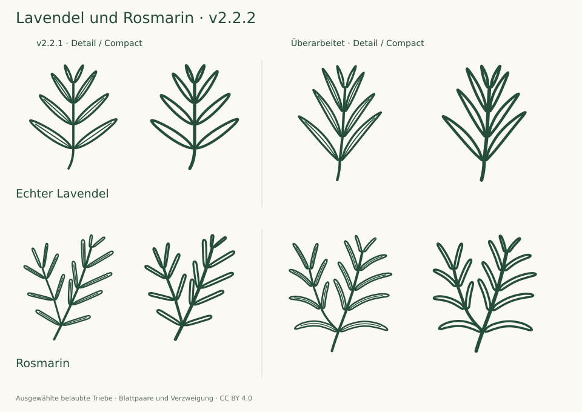

# Herb contour refinement · v2.2.2

13 October 2026 · 175 taxa / 350 SVGs · baseline v2.2.1

Focused comparison of both herb variants with the two user-supplied Koehler botanical plates, current InfoFlora/Flora Helvetica and NC State descriptions, and the photographed foliage in the existing source boards. Narrower ascending lavender blades and naturally curved rosemary blades replace overly schematic straight foliage. Both variants inspected enlarged and at target sizes. The other 346 SVGs are byte-identical to v2.2.1; their prior review is retained, not claimed as newly performed.

## Findings and corrections

The v2.2.1 drawings established opposite leaf pairs and shoot context, but looked too schematic beside the supplied botanical plates. A correct insertion pattern and a plausible bounding ratio did not establish convincing blade contours or posture.

- **Echter Lavendel:** longer, narrower, gently curved lanceolate blades; a more upright silhouette and less uniform angles. Four opposite pairs remain. Six curved Detail midribs; open Compact interiors.
- **Rosmarin:** nearly parallel-sided blades now curve, with rounded tips. Basal leaves spread in arcs; upper leaves ascend at varied angles. Five main-axis pairs and three pairs on an axillary branch remain. Detail midribs follow the blade curves; Compact omits them.
- Both variants were adjusted independently for clear blade separation. Counts, curvature and posture describe selected drawings, not diagnostic constants. Both taxa can branch; a selected silhouette must not be mistaken for an exclusive distinction.

## Evidence and limits

The two supplied Köhler plates were inspected directly: the Lavandula angustifolia plate numbered 087 in the supplied filename, and the Rosmarinus officinalis plate numbered 258. Their foliage supports the changed posture and curvature; it does not establish a universal leaf angle or length-to-width ratio. These references are not traced or redistributed.

Modern descriptions checked again:

- [Lavandula angustifolia, InfoFlora / Flora Helvetica](https://www.infoflora.ch/de/flora/lavandula-angustifolia.html) and [NC State Extension](https://plants.ces.ncsu.edu/plants/lavandula-angustifolia/).
- [Rosmarinus officinalis, InfoFlora / Flora Helvetica](https://www.infoflora.ch/de/flora/rosmarinus-officinalis.html) and [Salvia rosmarinus, NC State Extension](https://plants.ces.ncsu.edu/plants/salvia-rosmarinus/).

The drawings show foliage only. The projection flattens the three-dimensional leaf arrangement; hairs, underside colour and the revolute margin in section remain omitted. For curved leaves, the recorded endpoint-axis width includes the arch, so its ratio must not be reported as the width ratio of a flattened specimen. These are source-guided icons, not measured specimen plates or independently certified determinations.

## Verification

Both variants were viewed enlarged and at Compact 24/32 px and Detail 48/64 px on light and dark backgrounds. The geometry checks cover all 350 SVGs and 3,466 internal paths: closed contours, blade separation, full-stroke containment and connected shoots. The existing herb regression now protects curved Detail midribs and the revised silhouette ranges, as well as paired insertion and axillary branching.

Four SVGs changed; 346 are byte-identical to v2.2.1. The [exact hash record](audit-2.2.2.json) preserves the previous reviews. Historical [v2.2.1](AUDIT-2.2.1.md) and [v2.2](AUDIT-2.2.md) reports remain unchanged. The 37 regressions and exact ZIP byte verification pass. Fresh browser execution remains unavailable and is not claimed.
