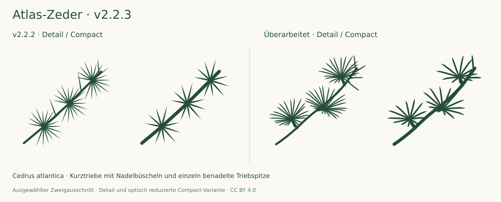

# Atlas cedar review · v2.2.3

13 October 2026 · 175 taxa / 350 SVGs · baseline v2.2.2

Focused Atlas cedar correction in both optical variants, following three supplied foliage photographs. OSU, NC State Extension and the TH OWL botanical garden descriptions checked; needle body, short-shoot origins, rosette projection and terminal solitary needles revised. Both final variants inspected enlarged and at target sizes on light/dark backgrounds. All other 348 source SVGs remain byte-identical to v2.2.2 and retain their previous review.

## What the previous drawing missed

The old SVGs showed clustered needles, but repeated the same flat star three times. Short shoots had no separately drawn axes. Each needle tapered over its full length, losing the linear needle body seen in the photographs. Passing connectivity and contour checks did not establish convincing morphology.

## Corrections

- Three short shoots now originate from the main twig and end at distinct, displaced rosette bases.
- The tufts have different orientations, lengths and foreshortening. Detail draws 22/24/21 visible needles; Compact reduces them to 12/13/11.
- Slender needle bodies retain nearly parallel margins, slight curvature and a short apical taper. These are closed filled ribbons, consistent with the existing conifer system.
- A short terminal extension has four solitary needles in Detail and two in Compact. Their bases are evaluated against the actual curved parent path.

## Evidence and limits

Three user-supplied photographs were examined: `1342_4_Cedrus-atlantica-Glauca-Blaue-Atlaszeder.jpg`, `images (1).jpeg` (bearing a Baumkunde watermark), and `atlas-zeder-cedrus-atlantica-glauca-526024.jpg` (bearing a Botanikfoto watermark). The photographed tufts and the existing OSU foliage board informed the drawing; no photograph is traced or redistributed.

Primary institutional treatments reread:

- [Oregon State University](https://landscapeplants.oregonstate.edu/plants/cedrus-atlantica): clustered spur needles and solitary leaves on leading shoots; approximately 2 cm, somewhat stiff; cluster count given as 10–20.
- [NC State Extension](https://plants.ces.ncsu.edu/plants/cedrus-atlantica/): short stiff needles in tufts, curved towards their tips, with solitary new needles on stems; count given as 10–30.
- [TH OWL, Botanischer Garten Höxter](https://botanischer-garten-hoexter.de/pflanze-cedrus_atlantica.html): short-shoot bundles, 10–30 (up to 45), and explicit acknowledgement that counts differ among descriptions.

Counts are not averaged into a universal diagnostic rule. The icon's visible needle counts are selected optical reductions. Rosette perspective and relative sizes vary naturally; the three chosen projections do not describe every twig. Blue wax colour, needle cross-section, stomata and twig hairs are not resolved. The monochrome drawing is an Atlas cedar foliage icon, not a colour-specific Glauca cultivar identification or a complete key to Cedrus.

The USDA Cedrus PDF appeared in search but could not be fetched consistently (403); it is not counted as reviewed evidence.

## Verification

Final Detail and Compact artwork inspected enlarged and at 24/32/48/64 px on light/dark backgrounds. All 350 SVGs pass XML, metadata, closed-contour, painted-connectivity, viewport, blade-separation and full-stroke checks; 3,466 internal paths remain contained. The cedar regression verifies real short-shoot connections, rosette origins, selected visible counts, solitary insertions on the curved extension and retained needle width before the terminal taper. This catches the old triangular-body failure in addition to connectivity errors.

The 38 regressions and exact ZIP byte verification pass. Only two source SVGs changed; the other 348, including Lavendel and Rosmarin, are byte-identical to v2.2.2. The [current hash record](audit-2.2.3.json) preserves prior evidence. Historical audit reports remain unchanged. Fresh browser execution remains unavailable; geometric checks are not botanical certification.
