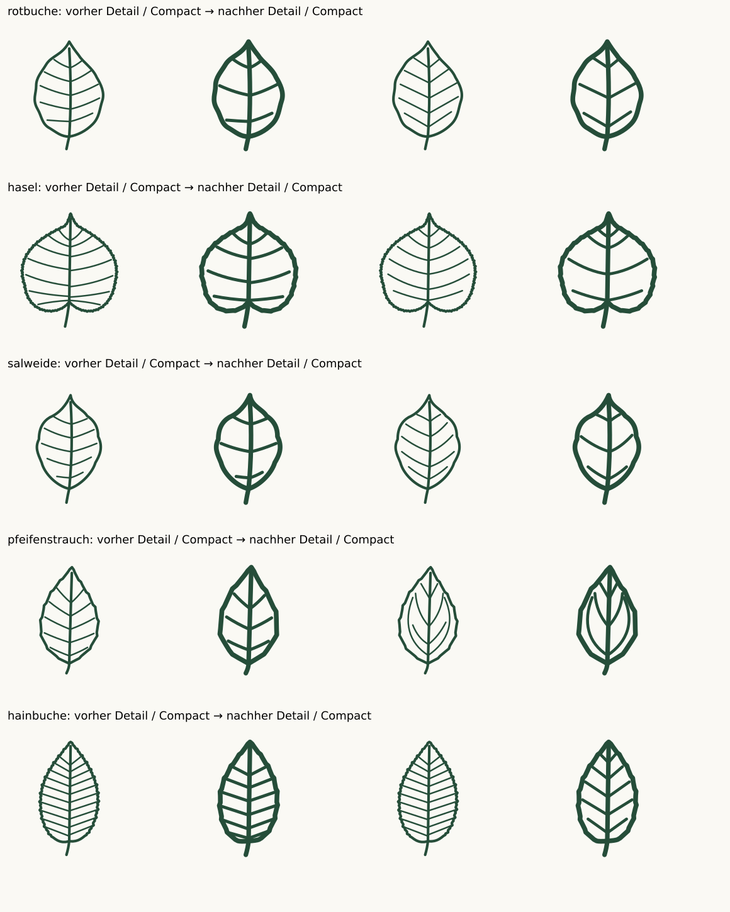

# Complete collection review · v2.2.0

13 October 2026 · **175 taxa / 350 source SVGs** · baseline v2.1.0

Internal source-guided review of every one of 175 taxa and both optical variants. The 158 baseline descriptions and foliage references from the same-day v2.1 research were reread and compared anew, not all refetched. Three ambiguous baseline taxa received fresh additional primary descriptions and photos. Seventeen additions were researched and drawn in two sequential groups of eight and nine, with photo, enlarged, target-size and neighbor review. Revised drawings were reviewed again after refinement. Not independent botanical certification.

## Evidence and decisions

Every previous taxon was examined on enlarged boards showing both variants beside foliage photographs and reread against its primary description. All 316 previous SVGs were also inspected at Compact 24/32 px and Detail 48/64 px on light and dark backgrounds. Reviews considered silhouette, proportion, widest point, base, apex, petiole, margin, venation and leaflet/needle insertion. Existing source retrievals were from the same day and were transparently reused. Newly fetched OSU descriptions/photos for Fagus and Corylus and the NC State Philadelphus treatment clarify the revised venation.

Seventeen additions were researched and drawn in two sequential groups. The first eight reached their technical and visual gates before the next nine were selected. All additions subsequently received a final comparison with two neighboring taxa each. The [expansion record](EXPANSION-2.2.md) states the selected forms and optical limits. Reference photos are linked, not traced or redistributed.

- **Rotbuche:** replace crowded repeated basal veins with five ascending pairs in Detail and three in Compact.
- **Hasel:** six ascending pairs in Detail and four in Compact, with distinct origins.
- **Salweide:** five curved ascending pairs in Detail and three in Compact.
- **Pfeifenstrauch:** emphasize the strong low ascending pair rather than an evenly spaced generic pinnate pattern; retain additional upper veins.
- **Hainbuche:** five more evenly spaced Compact pairs; its previously corrected ten-pair Detail drawing is unchanged.
- All five retain their existing outlines and petioles. **307 baseline SVGs remain byte-identical; nine are revised and 34 added.** Earlier oak, elm, Ginkgo, poplar and conifer corrections have not reverted.
- New Goldregen and Terpentin-Pistazie drafts received separated leaflet insertions after the geometry check caught touching outlines. Granatapfel Compact basal venation was spaced away from the narrow insertion.
- Scale shoots were redrawn from a bead-like draft into continuous lateral contours with overlapping facial scales. Atlas-Zeder was moved clear of the canvas edge.
- Compact Lavendel and Rosmarin omit the midrib after small-size review, retaining an open narrow blade. Use at least 32 px when that contour matters.

## Verification and limits

Adaptive Bezier flattening in scripts/geometry.mjs. Blade bounds exclude petioles and stroke widths. Axis-aligned extents are recorded separately from oriented dimensions: scripts/measure.mjs estimates length from the farthest contour-point pair and width from the projection perpendicular to that chord. This is an approximation for unlobed blades, not specimen measurement, curved midrib length or a reliable biological ratio for palmate/lobed leaves. No physical scale is implied.

The [JSON record](audit-2.2.json) covers every taxon and optical variant, sources, findings, reductions and exact SHA-256 artwork hashes. Validation rejects changed drawings, incomplete coverage or incorrect baseline classifications. Every SVG passed XML, rendering, contour-crossing, full stroke-containment, blade-separation and shoot-connectivity checks. The final report counts 3,448 internal paths. New regressions protect the two five-needle Weymouth fascicles, seven/three-leaflet additions, revised ascending veins and the open narrow Compact herbs.

**Fresh browser integration QA was unavailable:** the prescribed browser-control capability is absent in this environment. The Chromium/Firefox suite is included for reproduction and CI; raster and structural checks are not described as browser execution. Website publication does not change this limitation. See [QUALITY.md](QUALITY.md).

These are referenced, deliberately reduced icons, not measured specimen plates or an independently certified identification key. Scale insertion, dense conifer foliage, hairs, surface colour, cross-sections and natural variability cannot all be resolved at icon size. Similar taxa remain similar. All drawings should accompany taxon names or species accounts.

## Per-taxon findings

Both optical variants were reviewed for every row. Retained means byte-identical to v2.1.0.

| Taxon                                                   | Finding                                                                                                                                                                                                                                                                      | Artwork                  | Primary source                                                                                    |
| ------------------------------------------------------- | ---------------------------------------------------------------------------------------------------------------------------------------------------------------------------------------------------------------------------------------------------------------------------- | ------------------------ | ------------------------------------------------------------------------------------------------- |
| Fichte · _Picea abies_                                  | Retain both: sharp single needles around a sparse shoot; four-sided sections remain outside the icon's scope.                                                                                                                                                                | D: Retained; C: Retained | [Treatment](https://www.infoflora.ch/de/flora/picea-abies.html)                                   |
| Waldkiefer · _Pinus sylvestris_                         | Retain both: exactly two pointed needles per common sheath; sparse three-fascicle composition remains an explicit reduction.                                                                                                                                                 | D: Retained; C: Retained | [Treatment](https://www.infoflora.ch/de/flora/pinus-sylvestris.html)                              |
| Europäische Lärche · _Larix decidua_                    | Retain both with reduction: short-shoot fans are legible, but projected needle counts are below the botanical 20–40 and must not be described as literal counts.                                                                                                             | D: Retained; C: Retained | [Treatment](https://www.infoflora.ch/de/flora/larix-decidua.html)                                 |
| Weißtanne · _Abies alba_                                | Retain both: two-ranked flat needles with blunt Detail tips; minute apical notches and lower stomatal bands are not identification-grade at these sizes.                                                                                                                     | D: Retained; C: Retained | [Treatment](https://www.infoflora.ch/de/flora/abies-alba.html)                                    |
| Douglasie · _Pseudotsuga menziesii_                     | Retain both: radial/front-facing needle projections and spindle bud distinguish the selected shoot from two-ranked fir/yew.                                                                                                                                                  | D: Retained; C: Retained | [Treatment](https://www.infoflora.ch/de/flora/pseudotsuga-menziesii.html)                         |
| Eibe · _Taxus baccata_                                  | Retain both: linear flattened acute needles in two ranks match the selected foliage; lower leaf surface omitted.                                                                                                                                                             | D: Retained; C: Retained | [Treatment](https://www.infoflora.ch/de/flora/taxus-baccata.html)                                 |
| Wacholder · _Juniperus communis_                        | Retain both: stiff spreading needles show successive whorls of three; sparse whorl count is optical.                                                                                                                                                                         | D: Retained; C: Retained | [Treatment](https://www.infoflora.ch/de/flora/juniperus-communis.html)                            |
| Stieleiche · _Quercus robur_                            | Retain both: unequal rounded ascending lobes, auricles and minimal petiole agree with references; preserve the approved contour.                                                                                                                                             | D: Retained; C: Retained | [Treatment](https://www.infoflora.ch/de/flora/quercus-robur.html)                                 |
| Traubeneiche · _Quercus petraea_                        | Retain both: longer petiole and cuneate unlobed base distinguish the selected form from Stieleiche.                                                                                                                                                                          | D: Retained; C: Retained | [Treatment](https://www.infoflora.ch/de/flora/quercus-petraea.html)                               |
| Rotbuche · _Fagus sylvatica_                            | Nach zusätzlichem OSU-Blattfoto beide Varianten korrigiert: fünf ansteigende gerade Nervenpaare in Detail, drei in Compact; fast horizontalen untersten Ast entfernt. Unveränderte wellig-ganzrandige Kontur und kurzer Stiel passen zur Flora-Beschreibung.                 | D: Revised; C: Revised   | [Treatment](https://www.infoflora.ch/de/flora/fagus-sylvatica.html)                               |
| Hängebirke · _Betula pendula_                           | Retain both: rhombic-triangular blade with tapering apex, serration and long stalk; Compact reduces double serration.                                                                                                                                                        | D: Retained; C: Retained | [Treatment](https://www.infoflora.ch/de/flora/betula-pendula.html)                                |
| Schwarzpappel · _Populus nigra_                         | Retain both: convex deltoid blade, rounded shoulders, fine teeth and long stalk; no basal glands invented.                                                                                                                                                                   | D: Retained; C: Retained | [Treatment](https://www.infoflora.ch/de/flora/populus-nigra.html)                                 |
| Espe · Zitterpappel · _Populus tremula_                 | Retain both: rounded blunt-crenate blade and long petiole fit short-shoot leaves; flattened petiole cross-section cannot be represented.                                                                                                                                     | D: Retained; C: Retained | [Treatment](https://www.infoflora.ch/de/flora/populus-tremula.html)                               |
| Schwarzerle · _Alnus glutinosa_                         | Retain both: obovate blade, weakly notched apex, cuneate base and six Detail vein pairs fit the source.                                                                                                                                                                      | D: Retained; C: Retained | [Treatment](https://www.infoflora.ch/de/flora/alnus-glutinosa.html)                               |
| Hainbuche · _Carpinus betulus_                          | Detail behält zehn aufsteigende Nervenpaare und doppelte Zahnung; Compact auf fünf gleichmäßig verteilte Paare neu geordnet. Gedrängte unterste Adern entfernt; länglich-eiförmige Kontur und Blattstiel unverändert.                                                        | D: Retained; C: Revised  | [Treatment](https://www.infoflora.ch/de/flora/carpinus-betulus.html)                              |
| Winterlinde · _Tilia cordata_                           | Retain both: cordate asymmetric base, pointed apex and basal radiating veins; microscopic vein-axil hairs omitted.                                                                                                                                                           | D: Retained; C: Retained | [Treatment](https://www.infoflora.ch/de/flora/tilia-cordata.html)                                 |
| Hasel · _Corylus avellana_                              | Nach OSU-Blattunterseitenfoto die gedrängten, teils abwärts gerichteten unteren Nerven neu geordnet: sechs ansteigende Paare in Detail, vier in Compact. Herzgrund, kurze Endspitze und doppelte Zahnung bleiben unverändert; vollständiges Verzweigungsnetz vereinfacht.    | D: Revised; C: Revised   | [Treatment](https://www.infoflora.ch/de/flora/corylus-avellana.html)                              |
| Bergahorn · _Acer pseudoplatanus_                       | Retain both: five lobes with acute sinuses and coarsely blunt teeth; do not replace the source-supported acute sinuses with round ones.                                                                                                                                      | D: Retained; C: Retained | [Treatment](https://www.infoflora.ch/de/flora/acer-pseudoplatanus.html)                           |
| Spitzahorn · _Acer platanoides_                         | Retain both: prolonged lobe/large tooth tips and broad rounded sinuses; long petiole preserved.                                                                                                                                                                              | D: Retained; C: Retained | [Treatment](https://www.infoflora.ch/de/flora/acer-platanoides.html)                              |
| Feldahorn · _Acer campestre_                            | Retain both: blunt broad five-lobed form with smooth lobes and rounded sinuses is distinct from the two other native maples.                                                                                                                                                 | D: Retained; C: Retained | [Treatment](https://www.infoflora.ch/de/flora/acer-campestre.html)                                |
| Gemeine Esche · _Fraxinus excelsior_                    | Retain both: nine narrow serrate almost sessile leaflets and terminal leaflet fit the selected four-pair form.                                                                                                                                                               | D: Retained; C: Retained | [Treatment](https://www.infoflora.ch/de/flora/fraxinus-excelsior.html)                            |
| Bergulme · _Ulmus glabra_                               | Retain both: asymmetric rounded basal lobe and very short petiole, 13 paired Detail nerves with forks; three-point apex is a documented variable form.                                                                                                                       | D: Retained; C: Retained | [Treatment](https://www.infoflora.ch/de/flora/ulmus-glabra.html)                                  |
| Salweide · _Salix caprea_                               | Unterste fast horizontale Adern in beiden Varianten durch aufsteigende gebogene Äste ersetzt; Vergleich mit InfoFlora-Unterseitenfoto. Breite ovale Kontur, aufgesetzte Spitze und kurzer Stiel erhalten; feines Netz nicht vollständig gezeichnet.                          | D: Revised; C: Revised   | [Treatment](https://www.infoflora.ch/de/flora/salix-caprea.html)                                  |
| Silberweide · _Salix alba_                              | Retain both: bilaterally developed narrow lanceolate blade and fine Detail serration, Compact only midrib; no collapsed side.                                                                                                                                                | D: Retained; C: Retained | [Treatment](https://www.infoflora.ch/de/flora/salix-alba.html)                                    |
| Rosskastanie · _Aesculus hippocastanum_                 | Retain both: seven obovate-lanceolate leaflets with progressively smaller basal pair and long petiole; Compact omits serration and venation.                                                                                                                                 | D: Retained; C: Retained | [Treatment](https://www.infoflora.ch/de/flora/aesculus-hippocastanum.html)                        |
| Edelkastanie · _Castanea sativa_                        | Retain both: long narrow lanceolate blade and sharp vein-ending teeth; selected reduced Compact tooth/vein count stays linked.                                                                                                                                               | D: Retained; C: Retained | [Treatment](https://www.infoflora.ch/de/flora/castanea-sativa.html)                               |
| Vogelbeere · _Sorbus aucuparia_                         | Retain both: eleven leaflets, reduced uncut basal margins and short leaflet stalks preserved after v2.0 correction.                                                                                                                                                          | D: Retained; C: Retained | [Treatment](https://www.infoflora.ch/de/flora/sorbus-aucuparia.html)                              |
| Robinie · _Robinia pseudoacacia_                        | Retain both: nine rounded entire oval leaflets and odd-pinnate rachis; actual leaflets may number 7–21.                                                                                                                                                                      | D: Retained; C: Retained | [Treatment](https://www.infoflora.ch/de/flora/robinia-pseudoacacia.html)                          |
| Schwarzer Holunder · _Sambucus nigra_                   | Retain both: five asymmetric pointed serrate leaflets, two lateral pairs and a terminal leaflet.                                                                                                                                                                             | D: Retained; C: Retained | [Treatment](https://www.infoflora.ch/de/flora/sambucus-nigra.html)                                |
| Eingriffeliger Weißdorn · _Crataegus monogyna_          | Retain both: deeply incised lobes, largely entire lower flanks and toothed outer lobe ends; single style cannot be inferred from a leaf icon.                                                                                                                                | D: Retained; C: Retained | [Treatment](https://www.infoflora.ch/de/flora/crataegus-monogyna.html)                            |
| Schlehe · _Prunus spinosa_                              | Retain both: short petiole and narrow finely serrate blade; normalized size does not show the species' small absolute leaf size.                                                                                                                                             | D: Retained; C: Retained | [Treatment](https://www.infoflora.ch/de/flora/prunus-spinosa.html)                                |
| Roter Hartriegel · _Cornus sanguinea_                   | Retain both: four selected arcuate Detail vein pairs on an entire oval blade; Compact reduces the number but preserves the course.                                                                                                                                           | D: Retained; C: Retained | [Treatment](https://www.infoflora.ch/de/flora/cornus-sanguinea.html)                              |
| Gewöhnlicher Schneeball · _Viburnum opulus_             | Retain both: three forward lobes, coarse teeth and two Detail petiolar glands; Compact explicitly omits tiny glands.                                                                                                                                                         | D: Retained; C: Retained | [Treatment](https://www.infoflora.ch/de/flora/viburnum-opulus.html)                               |
| Stechpalme · _Ilex aquifolium_                          | Retain both: spiny wavy margin and leathery oval leaf select the toothed form; entire mature leaves are natural alternatives.                                                                                                                                                | D: Retained; C: Retained | [Treatment](https://www.infoflora.ch/de/flora/ilex-aquifolium.html)                               |
| Faulbaum · _Frangula alnus_                             | Retain both: entire oval blade and eight Detail lateral pairs fall within seven to twelve; Compact vein reduction explicit.                                                                                                                                                  | D: Retained; C: Retained | [Treatment](https://www.infoflora.ch/de/flora/frangula-alnus.html)                                |
| Pfaffenhütchen · _Euonymus europaeus_                   | Retain both: short stalk, narrowly oval-lanceolate blade, fine serration and pointed apex fit the primary description.                                                                                                                                                       | D: Retained; C: Retained | [Treatment](https://www.infoflora.ch/de/flora/euonymus-europaeus.html)                            |
| Hundsrose · _Rosa canina_                               | Retain both: seven serrate leaflets and paired basal stipules are preserved; leaflet/hair variation needs other characters.                                                                                                                                                  | D: Retained; C: Retained | [Treatment](https://www.infoflora.ch/de/flora/rosa-canina.html)                                   |
| Kornelkirsche · _Cornus mas_                            | Retain both: narrow pointed entire blade with four arcuate Detail vein pairs; not distinguishable from all Cornus by shape alone.                                                                                                                                            | D: Retained; C: Retained | [Treatment](https://www.infoflora.ch/de/flora/cornus-mas.html)                                    |
| Vogelkirsche · _Prunus avium_                           | Retain both: serrate broadly lanceolate blade and two Detail petiolar glands; gland omission in Compact is deliberate.                                                                                                                                                       | D: Retained; C: Retained | [Treatment](https://www.infoflora.ch/de/flora/prunus-avium.html)                                  |
| Sommerlinde · _Tilia platyphyllos_                      | Retain both: cordate asymmetry and basal fan, selected broad leaf; relative size, hair and colour differences from winter linden remain unencoded.                                                                                                                           | D: Retained; C: Retained | [Treatment](https://www.infoflora.ch/de/flora/tilia-platyphyllos.html)                            |
| Walnuss · _Juglans regia_                               | Retain both: seven mostly entire oval leaflets with larger terminal leaflet; tiny young-leaf teeth are not shown.                                                                                                                                                            | D: Retained; C: Retained | [Treatment](https://www.infoflora.ch/de/flora/juglans-regia.html)                                 |
| Moorbirke · _Betula pubescens_                          | Retain both: broader oval serrate blade than the selected Betula pendula leaf; hair characters omitted.                                                                                                                                                                      | D: Retained; C: Retained | [Treatment](https://www.infoflora.ch/de/flora/betula-pubescens.html)                              |
| Flatterulme · _Ulmus laevis_                            | Retain both: pronounced unequal base, simple apex and many tooth-directed nerves; no false three-point apex introduced.                                                                                                                                                      | D: Retained; C: Retained | [Treatment](https://www.infoflora.ch/de/flora/ulmus-laevis.html)                                  |
| Elsbeere · _Sorbus torminalis_                          | Retain both: broad ovate outline with three to four unequal acute lobes per side, lower pair divergent; Compact simplifies secondary teeth.                                                                                                                                  | D: Retained; C: Retained | [Treatment](https://www.infoflora.ch/de/flora/sorbus-torminalis.html)                             |
| Französischer Ahorn · _Acer monspessulanum_             | Retain both: three entire lobes, cordate base and long petiole; no additional lobes invented.                                                                                                                                                                                | D: Retained; C: Retained | [Treatment](https://landscapeplants.oregonstate.edu/plants/acer-monspessulanum)                   |
| Eschenahorn · _Acer negundo_                            | Retain both: three selected leaflets, coarsely toothed lateral blades and lobed terminal leaflet; variable 3–7 count documented.                                                                                                                                             | D: Retained; C: Retained | [Treatment](https://www.infoflora.ch/de/flora/acer-negundo.html)                                  |
| Liguster · _Ligustrum vulgare_                          | Retain both: entire lanceolate blade and short stalk; alternate obovate leaf form and opposite shoot position are not shown.                                                                                                                                                 | D: Retained; C: Retained | [Treatment](https://www.infoflora.ch/de/flora/ligustrum-vulgare.html)                             |
| Berberitze · _Berberis vulgaris_                        | Retain both: obovate blunt-tipped blade, tapering base and fine sharp teeth; shoot thorns absent from isolated-leaf view.                                                                                                                                                    | D: Retained; C: Retained | [Treatment](https://www.infoflora.ch/de/flora/berberis-vulgaris.html)                             |
| Rote Heckenkirsche · _Lonicera xylosteum_               | Retain both: broad entire ovate leaf with short petiole fits the reported 1–2:1 range; soft hairs omitted.                                                                                                                                                                   | D: Retained; C: Retained | [Treatment](https://www.infoflora.ch/de/flora/lonicera-xylosteum.html)                            |
| Kreuzdorn · _Rhamnus cathartica_                        | Retain both: broadly oval toothed blade and four arcuate Detail vein pairs; Compact reduces secondary veins.                                                                                                                                                                 | D: Retained; C: Retained | [Treatment](https://www.infoflora.ch/de/flora/rhamnus-cathartica.html)                            |
| Felsenbirne · _Amelanchier ovalis_                      | Retain both: oval finely serrate blade with short tip; spring felt and absolute size are not encoded.                                                                                                                                                                        | D: Retained; C: Retained | [Treatment](https://www.infoflora.ch/de/flora/amelanchier-ovalis.html)                            |
| Traubenkirsche · _Prunus padus_                         | Retain both: broad lanceolate blade with rounded base, many Detail nerves and fine even teeth; gland count is a selected visible form.                                                                                                                                       | D: Retained; C: Retained | [Treatment](https://www.infoflora.ch/de/flora/prunus-padus.html)                                  |
| Feldulme · _Ulmus minor_                                | Retain both: asymmetric toothed blade, ten Detail side-vein pairs and longer petiole than Bergulme; simple apex retained.                                                                                                                                                    | D: Retained; C: Retained | [Treatment](https://www.infoflora.ch/de/flora/ulmus-minor.html)                                   |
| Grauerle · _Alnus incana_                               | Retain both: acute oval doubly toothed blade with broad lower half and eleven Detail nerve pairs; verify lowest Compact pair remains optically separated.                                                                                                                    | D: Retained; C: Retained | [Treatment](https://www.infoflora.ch/de/flora/alnus-incana.html)                                  |
| Mehlbeere · _Sorbus aria_                               | Retain both: unlobed oval toothed leaf and dense ascending side nerves; white lower felt is documented, not represented.                                                                                                                                                     | D: Retained; C: Retained | [Treatment](https://www.infoflora.ch/de/flora/sorbus-aria.html)                                   |
| Wildapfel · _Malus sylvestris_                          | Retain both: broad oval pointed serrate blade and long stalk; cannot reliably distinguish cultivated introgressed apples by contour alone.                                                                                                                                   | D: Retained; C: Retained | [Treatment](https://www.infoflora.ch/de/flora/malus-sylvestris.html)                              |
| Wildbirne · _Pyrus pyraster_                            | Retain both: nearly round selected finely toothed blade and long stalk; broad-oval alternatives are documented.                                                                                                                                                              | D: Retained; C: Retained | [Treatment](https://www.infoflora.ch/de/flora/pyrus-pyraster.html)                                |
| Wolliger Schneeball · _Viburnum lantana_                | Retain both: broad ovate regularly toothed blade with prominent pinnate nerves; rugosity and stellate felt omitted.                                                                                                                                                          | D: Retained; C: Retained | [Treatment](https://www.infoflora.ch/de/flora/viburnum-lantana.html)                              |
| Silberpappel · _Populus alba_                           | Retain both: five-lobed shoot leaf with integrated tapering central apex; previously detached-looking tip correction preserved.                                                                                                                                              | D: Retained; C: Retained | [Treatment](https://www.infoflora.ch/de/flora/populus-alba.html)                                  |
| Speierling · _Sorbus domestica_                         | Retain both: thirteen leaflets with entire basal portions; no forced proportion change since measured ratios fit the supplementary treatment.                                                                                                                                | D: Retained; C: Retained | [Treatment](https://www.infoflora.ch/de/flora/sorbus-domestica.html)                              |
| Ginkgo · _Ginkgo biloba_                                | Retain both: wide fan, cuneate taper, central cleft and truly bifurcating veins without midrib; variable cleft depth and denser natural vein network noted.                                                                                                                  | D: Retained; C: Retained | [Treatment](https://floranorthamerica.org/Ginkgo_biloba)                                          |
| Ahornblättrige Platane · _Platanus × hispanica_         | Retain both: broad five-lobed hybrid leaf with coarse teeth and truncate/weakly cordate base; does not claim a fixed hybrid clone.                                                                                                                                           | D: Retained; C: Retained | [Treatment](https://www.infoflora.ch/de/flora/platanus-%C3%97hispanica.html)                      |
| Tulpenbaum · _Liriodendron tulipifera_                  | Retain both: truncate-notched apex, four main lobes, pinnate axis and long petiole; lower vein geometry follows the lateral lobes.                                                                                                                                           | D: Retained; C: Retained | [Treatment](https://www.infoflora.ch/de/flora/liriodendron-tulipifera.html)                       |
| Amberbaum · _Liquidambar styraciflua_                   | Retain both: star-shaped five-lobed toothed leaf with five basal nerves; secondary venation is strongly abbreviated even in Detail.                                                                                                                                          | D: Retained; C: Retained | [Treatment](https://botanischer-garten-hoexter.de/pflanze-liquidambar_styraciflua.html)           |
| Fächerahorn · _Acer palmatum_                           | Retain both pending exact PDF section check: seven finely serrate narrow acute lobes and deep sinuses match the reference foliage; cultivar forms are not generalized.                                                                                                       | D: Retained; C: Retained | [Treatment](https://www.iplant.cn/foc/pdf/Acer.pdf)                                               |
| Schneeballblättriger Ahorn · _Acer opalus_              | Retain both: shallow three-to-five lobes, blunt/wavy teeth and broad blade fit the outer-third division described.                                                                                                                                                           | D: Retained; C: Retained | [Treatment](https://www.infoflora.ch/de/flora/acer-opalus.html)                                   |
| Efeu · _Hedera helix_                                   | Retain both: five-lobed juvenile climbing-shoot leaf; entire flowering-shoot leaves are explicitly outside the selected form.                                                                                                                                                | D: Retained; C: Retained | [Treatment](https://www.infoflora.ch/de/flora/hedera-helix.html)                                  |
| Baumhasel · _Corylus colurna_                           | Retain both: cordate broadly ovate blade, doubly toothed edge and six primary Detail vein pairs; hair and absolute size omitted.                                                                                                                                             | D: Retained; C: Retained | [Treatment](https://www.infoflora.ch/de/flora/corylus-colurna.html)                               |
| Roteiche · _Quercus rubra_                              | Retain both: forward pointed bristle-ending lobes and long petiole; bristles are graphically shortened in Compact.                                                                                                                                                           | D: Retained; C: Retained | [Treatment](https://www.infoflora.ch/de/flora/quercus-rubra.html)                                 |
| Flaumeiche · _Quercus pubescens_                        | Retain both: rounded irregular lobes and short petiole; fine pubescence, the decisive character, remains omitted.                                                                                                                                                            | D: Retained; C: Retained | [Treatment](https://www.infoflora.ch/de/flora/quercus-pubescens.html)                             |
| Zerreiche · _Quercus cerris_                            | Retain both: irregular sharply tipped lobes and Detail filiform stipules; Compact intentionally omits stipules.                                                                                                                                                              | D: Retained; C: Retained | [Treatment](https://www.infoflora.ch/de/flora/quercus-cerris.html)                                |
| Silberlinde · _Tilia tomentosa_                         | Retain both: cordate toothed blade and radiating basal venation; white felt requires surface depiction beyond this outline system.                                                                                                                                           | D: Retained; C: Retained | [Treatment](https://www.infoflora.ch/de/flora/tilia-tomentosa.html)                               |
| Roter Holunder · _Sambucus racemosa_                    | Retain both: five sharply serrate leaflets on a pinnate axis; species identification also needs inflorescence and pith characters.                                                                                                                                           | D: Retained; C: Retained | [Treatment](https://www.infoflora.ch/de/flora/sambucus-racemosa.html)                             |
| Zweigriffeliger Weißdorn · _Crataegus laevigata_        | Retain both: shallow outer-third rounded lobes and inward-curving selected veins distinguish the chosen form from monogyna.                                                                                                                                                  | D: Retained; C: Retained | [Treatment](https://www.infoflora.ch/de/flora/crataegus-laevigata.html)                           |
| Himbeere · _Rubus idaeus_                               | Retain both: three selected toothed leaflets with stalked terminal leaflet; five/seven-leaflet shoot forms are documented alternatives.                                                                                                                                      | D: Retained; C: Retained | [Treatment](https://www.infoflora.ch/de/flora/rubus-idaeus.html)                                  |
| Sanddorn · _Hippophae rhamnoides_                       | Retain both: very narrow entire lanceolate blade with cuneate base; silvery shield hairs and branch thorns are not shown.                                                                                                                                                    | D: Retained; C: Retained | [Treatment](https://www.infoflora.ch/de/flora/hippopha%C3%AB-rhamnoides.html)                     |
| Zirbelkiefer · Arve · _Pinus cembra_                    | Retain both: five needles emerge at each shared origin and no persistent adult sheath is invented; stiff short-needle habit remains stylized.                                                                                                                                | D: Retained; C: Retained | [Treatment](https://www.infoflora.ch/de/flora/pinus-cembra.html)                                  |
| Bergkiefer · _Pinus mugo_                               | Retain both: four separate two-needle fascicles with sheaths; shorter natural needle length is not a calibrated scale in this normalized system.                                                                                                                             | D: Retained; C: Retained | [Treatment](https://www.infoflora.ch/de/flora/pinus-mugo.html)                                    |
| Urweltmammutbaum · _Metasequoia glyptostroboides_       | Retain both: opposite flat blunt leaves at matching levels on a tapered deciduous shoot; target-size spaces remain clear.                                                                                                                                                    | D: Retained; C: Retained | [Treatment](https://plantdatabase.kpu.ca/PlantPrint/megl)                                         |
| Götterbaum · _Ailanthus altissima_                      | Retain both: nine selected leaflets with near-basal glandular teeth; terminal leaflet is reduced, a documented natural option.                                                                                                                                               | D: Retained; C: Retained | [Treatment](https://www.infoflora.ch/de/flora/ailanthus-altissima.html)                           |
| Essigbaum · _Rhus typhina_                              | Retain both: eleven sharply toothed lanceolate leaflets; hair and natural larger leaflet counts remain omitted.                                                                                                                                                              | D: Retained; C: Retained | [Treatment](https://www.infoflora.ch/de/flora/rhus-typhina.html)                                  |
| Silberahorn · _Acer saccharinum_                        | Retain both: five deeply cut lobes with coarse teeth, broad sinuses and long stalk; deeply lobed habit is visible in both sizes.                                                                                                                                             | D: Retained; C: Retained | [Treatment](https://www.infoflora.ch/de/flora/acer-saccharinum.html)                              |
| Rotahorn · _Acer rubrum_                                | Retain both: three principal serrate lobes and long petiole; five-lobed forms remain natural alternatives.                                                                                                                                                                   | D: Retained; C: Retained | [Treatment](https://www.infoflora.ch/de/flora/acer-rubrum.html)                                   |
| Kirschlorbeer · _Prunus laurocerasus_                   | Retain both: short petiole, obovate-lanceolate blade, pointed apex and finely toothed margin; underside glands are not claimed to be shown.                                                                                                                                  | D: Retained; C: Retained | [Treatment](https://www.infoflora.ch/de/flora/prunus-laurocerasus.html)                           |
| Buchsbaum · _Buxus sempervirens_                        | Retain both: blunt entire oval blade with tapering base; some naturally notched leaves and very short absolute size not universalized.                                                                                                                                       | D: Retained; C: Retained | [Treatment](https://www.infoflora.ch/de/flora/buxus-sempervirens.html)                            |
| Flieder · _Syringa vulgaris_                            | Retain both: cordate entire leaf with drawn-out acute tip and long petiole; Compact preserves basal fan only.                                                                                                                                                                | D: Retained; C: Retained | [Treatment](https://www.infoflora.ch/de/flora/syringa-vulgaris.html)                              |
| Echter Seidelbast · _Daphne mezereum_                   | Retain both: entire oblanceolate leaf with widest part above the middle and narrow base; cluster arrangement omitted.                                                                                                                                                        | D: Retained; C: Retained | [Treatment](https://www.infoflora.ch/de/flora/daphne-mezereum.html)                               |
| Purpurweide · _Salix purpurea_                          | Retain both: upper-third maximum width, long tapering base and teeth limited to the upper portion; no false stipules.                                                                                                                                                        | D: Retained; C: Retained | [Treatment](https://www.infoflora.ch/de/flora/salix-purpurea.html)                                |
| Korbweide · _Salix viminalis_                           | Retain both: very narrow long-tapered blade, lower-third greatest width and almost entire outline; rolled edge/underside silk omitted.                                                                                                                                       | D: Retained; C: Retained | [Treatment](https://www.floraweb.de/php/artenhome.php?suchnr=5206)                                |
| Mahonie · _Mahonia aquifolium_                          | Retain both: seven spiny leaflets with near-sessile lateral bases and stalked terminal leaflet; v2.1 insertion correction preserved.                                                                                                                                         | D: Retained; C: Retained | [Treatment](https://www.infoflora.ch/de/flora/mahonia-aquifolium.html)                            |
| Kratzbeere · _Rubus caesius_                            | Retain both: three broad toothed leaflets, nearly sessile lateral pair, stalked terminal leaflet and stipules in Detail.                                                                                                                                                     | D: Retained; C: Retained | [Treatment](https://www.infoflora.ch/de/flora/rubus-caesius.html)                                 |
| Schwarze Johannisbeere · _Ribes nigrum_                 | Retain both: three main toothed lobes and basal fan; lower-surface gland dots are not reproduced.                                                                                                                                                                            | D: Retained; C: Retained | [Treatment](https://www.infoflora.ch/de/flora/ribes-nigrum.html)                                  |
| Heidelbeere · _Vaccinium myrtillus_                     | Retain both: small ovate-lanceolate finely toothed selected leaf; angular green twigs are outside isolated-leaf view.                                                                                                                                                        | D: Retained; C: Retained | [Treatment](https://www.infoflora.ch/de/flora/vaccinium-myrtillus.html)                           |
| Preiselbeere · _Vaccinium vitis-idaea_                  | Retain both: obovate entire leaf with blunt/minutely notched tip; rolled margin and gland-dotted underside are optical omissions.                                                                                                                                            | D: Retained; C: Retained | [Treatment](https://www.infoflora.ch/de/flora/vaccinium-vitis-idaea.html)                         |
| Rostblättrige Alpenrose · _Rhododendron ferrugineum_    | Retain both: entire elliptic-lanceolate leathery blade; rusty lower scales and revolute edge are not represented as false serration.                                                                                                                                         | D: Retained; C: Retained | [Treatment](https://www.infoflora.ch/de/flora/rhododendron-ferrugineum.html)                      |
| Stachelbeere · _Ribes uva-crispa_                       | Retain both: rounded five-lobed incised-toothed blade on a petiole; stem spines and absolute small size omitted.                                                                                                                                                             | D: Retained; C: Retained | [Treatment](https://www.infoflora.ch/de/flora/ribes-uva-crispa.html)                              |
| Europäischer Zürgelbaum · _Celtis australis_            | Retain both: asymmetric broadly lanceolate blade, elongated tip, serration and strong lower side nerves; Compact omits minor venation.                                                                                                                                       | D: Retained; C: Retained | [Treatment](https://www.infoflora.ch/de/flora/celtis-australis.html)                              |
| Hopfenbuche · _Ostrya carpinifolia_                     | Retain both: more than fourteen Detail vein pairs and tooth-linked endings; Compact reduces both tooth and nerve count together.                                                                                                                                             | D: Retained; C: Retained | [Treatment](https://www.infoflora.ch/de/flora/ostrya-carpinifolia.html)                           |
| Schwarzkiefer · _Pinus nigra_                           | Retain both: two long stiff needles per sheath, three selected fascicles; distinction from other paired pines needs cones/bark.                                                                                                                                              | D: Retained; C: Retained | [Treatment](https://www.infoflora.ch/de/flora/pinus-nigra.html)                                   |
| Sumpfzypresse · _Taxodium distichum_                    | Retain both: alternate pointed flat leaves on a tapered branchlet; never replace with opposite dawn-redwood pairs.                                                                                                                                                           | D: Retained; C: Retained | [Treatment](https://landscapeplants.oregonstate.edu/plants/taxodium-distichum)                    |
| Besenheide · _Calluna vulgaris_                         | Retain both: overlapping small opposite scale-like leaves in four ranks, represented as a projected branch system.                                                                                                                                                           | D: Retained; C: Retained | [Treatment](https://www.infoflora.ch/de/flora/calluna-vulgaris.html)                              |
| Schneeheide · _Erica carnea_                            | Retain both: needle leaves in four-member whorls; count reduced by number of whorls in Compact, not needles per whorl.                                                                                                                                                       | D: Retained; C: Retained | [Treatment](https://www.infoflora.ch/de/flora/erica-carnea.html)                                  |
| Besenginster · _Cytisus scoparius_                      | Retain both: three entire oval leaflets on the selected lower petiolate leaf; upper simple sessile leaves are documented alternatives.                                                                                                                                       | D: Retained; C: Retained | [Treatment](https://www.infoflora.ch/de/flora/cytisus-scoparius.html)                             |
| Färber-Ginster · _Genista tinctoria_                    | Retain both: entire narrow lanceolate simple leaf, contrasting with lower trifoliate Cytisus foliage.                                                                                                                                                                        | D: Retained; C: Retained | [Treatment](https://www.infoflora.ch/de/flora/genista-tinctoria.html)                             |
| Gewöhnliche Waldrebe · _Clematis vitalba_               | Retain both: five long-petiolulate coarsely toothed leaflets; climbing petiole motion is not depicted.                                                                                                                                                                       | D: Retained; C: Retained | [Treatment](https://www.infoflora.ch/de/flora/clematis-vitalba.html)                              |
| Weinrebe · _Vitis vinifera_                             | Retain both: five lobes, toothed margin and deep open petiolar sinus; cultivated leaf variability remains explicit.                                                                                                                                                          | D: Retained; C: Retained | [Treatment](https://www.infoflora.ch/de/flora/vitis-vinifera.html)                                |
| Rote Johannisbeere · _Ribes rubrum_                     | Retain both: five shallow coarsely toothed lobes; no surface glands added to force separation from Ribes nigrum.                                                                                                                                                             | D: Retained; C: Retained | [Treatment](https://www.infoflora.ch/de/flora/ribes-rubrum.html)                                  |
| Alpen-Johannisbeere · _Ribes alpinum_                   | Retain both: selected three-lobed incised-toothed small leaf; relative real-world size is normalized.                                                                                                                                                                        | D: Retained; C: Retained | [Treatment](https://www.infoflora.ch/de/flora/ribes-alpinum.html)                                 |
| Sommerflieder · _Buddleja davidii_                      | Retain both: long acute lanceolate finely serrate blade and short petiole; underside felt is not represented.                                                                                                                                                                | D: Retained; C: Retained | [Treatment](https://www.infoflora.ch/de/flora/buddleja-davidii.html)                              |
| Gewöhnlicher Pfeifenstrauch · _Philadelphus coronarius_ | Zusätzliches Blattnahfoto der NC State Extension zeigt kräftige untere bogenförmige Seitennerven. Beide Varianten daraufhin neu geadert; in Detail kleinere weitere Seitenäste. Pinnate Nervatur mit betontem unterstem Paar, keine Behauptung strikt handförmiger Nervatur. | D: Revised; C: Revised   | [Treatment](https://www.infoflora.ch/de/flora/philadelphus-coronarius.html)                       |
| Gewöhnlicher Trompetenbaum · _Catalpa bignonioides_     | Retain both: broad entire cordate leaf with abruptly drawn-out apex, long stalk and coarse primary venation.                                                                                                                                                                 | D: Retained; C: Retained | [Treatment](https://landscapeplants.oregonstate.edu/plants/catalpa-bignonioides)                  |
| Blauglockenbaum · _Paulownia tomentosa_                 | Retain both: very broad cordate leaf and basal radiating nerves; entire adult foliage selected, juvenile lobing/scale omitted.                                                                                                                                               | D: Retained; C: Retained | [Treatment](https://www.infoflora.ch/de/flora/paulownia-tomentosa.html)                           |
| Weiße Maulbeere · _Morus alba_                          | Ungeteiltes adultes Blatt mit seichtem Herzgrund, Spitze, basalen Nerven und längerem Stiel passt; variable gelappte Jugendformen ausdrücklich nicht repräsentiert. Beide Größen optisch getrennte Grundnerven.                                                              | D: Retained; C: Retained | [Treatment](https://www.infoflora.ch/de/flora/morus-alba.html)                                    |
| Schwarze Maulbeere · _Morus nigra_                      | Tieferer Herzgrund und kürzerer Stiel als M. alba bleiben in beiden Varianten erhalten; Rauhaarigkeit ohne Flächenschraffur nicht dargestellt, Silhouette allein keine sichere Arttrennung.                                                                                  | D: Retained; C: Retained | [Treatment](https://www.infoflora.ch/de/flora/morus-nigra.html)                                   |
| Gleditschie · _Gleditsia triacanthos_                   | Einfach paarig gefiedertes Blatt mit 16 kleinen Fiedern im Bereich 10–24; zweite mögliche doppelte Fiederung nicht dargestellt. Compact dicht, Fiederzwischenräume noch erkennbar.                                                                                           | D: Retained; C: Retained | [Treatment](https://www.infoflora.ch/de/flora/gleditsia-triacanthos.html)                         |
| Pfirsich · _Prunus persica_                             | Schmale lange, zugespitzte Spreite und kurzer Stiel; Detail feine Zahnfolge und Drüsen, Compact reduziert. Quelle und Blattfoto stimmen im gewählten Typ überein.                                                                                                            | D: Retained; C: Retained | [Treatment](https://www.infoflora.ch/de/flora/prunus-persica.html)                                |
| Pflaume · _Prunus domestica_                            | FNA-Treatment explizit gelesen: elliptisch bis verkehrt-eiförmig, stumpfe krenate Zähne und kurzer Stiel. Gezeichnete Form innerhalb variabler Kulturgruppe, beide Größen kohärent.                                                                                          | D: Retained; C: Retained | [Treatment](https://floranorthamerica.org/Prunus_domestica)                                       |
| Kulturapfel · _Malus domestica_                         | FNA-Treatment explizit gelesen: eiförmig, stumpf gesägt, gerundete Basis und mittellanger Stiel; Detailfoto bestätigt Randtyp. Keine sortenspezifische Darstellung.                                                                                                          | D: Retained; C: Retained | [Treatment](https://floranorthamerica.org/Malus_domestica)                                        |
| Ölbaum · _Olea europaea_                                | Lanzettliche ganzrandige Spreite und kurzer Stiel stimmen; silbrige Schuppenunterseite nicht über monochrome Kontur codiert. Compact ohne Seitenadern bleibt gut lesbar.                                                                                                     | D: Retained; C: Retained | [Treatment](https://www.infoflora.ch/de/flora/olea-europaea.html)                                 |
| Echte Feige · _Ficus carica_                            | Fünf stumpfe Lappen, runde tiefe Buchten, Herzgrund und langer Stiel; Fotos zeigen natürliche Variabilität. Keine universelle Feigenblattform behauptet; Detail und Compact ausgewogen.                                                                                      | D: Retained; C: Retained | [Treatment](https://www.infoflora.ch/de/flora/ficus-carica.html)                                  |
| Quitte · _Cydonia oblonga_                              | Breit-ovale ganzrandige Spreite, kurze Spitze und kurzer Stiel; die filzige Unterseite ist nicht abgebildet. Adern in kleinen Größen getrennt.                                                                                                                               | D: Retained; C: Retained | [Treatment](https://www.infoflora.ch/de/flora/cydonia-oblonga.html)                               |
| Kulturbirne · _Pyrus communis_                          | FNA-Treatment explizit gelesen: zugespitzt-eiförmige Form mit fein gekerbtem Rand, deutlich längerem Stiel als Apfel. Erfasst einen möglichen Kulturtyp, nicht alle Sorten.                                                                                                  | D: Retained; C: Retained | [Treatment](https://floranorthamerica.org/Pyrus_communis)                                         |
| Aprikose · _Prunus armeniaca_                           | Breit rundliche Spreite mit aufgesetzter Spitze, schwacher Herzbasis und feiner Zahnung passt; Drüsen nur in Detail. Kontur bleibt in Compact ausreichend offen.                                                                                                             | D: Retained; C: Retained | [Treatment](https://www.infoflora.ch/de/flora/prunus-armeniaca.html)                              |
| Mandelbaum · _Prunus dulcis_                            | Lanzettlich, fein stumpf gezähnt, Stiel ungefähr Spreitenbreite; Drüsen Detail. Verhältnis zum kurzstieligen Pfirsich auch in Compact erhalten.                                                                                                                              | D: Retained; C: Retained | [Treatment](https://www.infoflora.ch/de/flora/prunus-dulcis.html)                                 |
| Mispel · _Mespilus germanica_                           | Breit-lanzettlich, kurz gestielt; feine Zähne auf vordere Hälfte beschränkt. Filzige Unterseite unkodiert; keine Konturänderung aus dem Quellenvergleich nötig.                                                                                                              | D: Retained; C: Retained | [Treatment](https://www.infoflora.ch/de/flora/mespilus-germanica.html)                            |
| Echter Lorbeer · _Laurus nobilis_                       | Länglich-lanzettlich, ganzrandig mit leicht welligem Rand, kurzer Stiel; Foto und Beschreibung passen. Beide Varianten ohne übermäßige Randnähe der Adern.                                                                                                                   | D: Retained; C: Retained | [Treatment](https://www.infoflora.ch/de/flora/laurus-nobilis.html)                                |
| Ohrweide · _Salix aurita_                               | Breit verkehrt-eiförmig, wellig gezähnt, gebogene kurze Spitze und deutliche Nebenblätter; unter 2:1. Detail-Netz bewusst partiell; Compact Nebenblätter erkennbar.                                                                                                          | D: Retained; C: Retained | [Treatment](https://www.infoflora.ch/de/flora/salix-aurita.html)                                  |
| Grauweide · _Salix cinerea_                             | Länglicher als S. caprea, größte Breite leicht oberhalb Mitte, kurze Spitze und kurzes Stielchen. Detail zeigt kleine Nebenblätter; Compact lässt sie aus, dokumentierte Vereinfachung.                                                                                      | D: Retained; C: Retained | [Treatment](https://www.infoflora.ch/de/flora/salix-cinerea.html)                                 |
| Mandelweide · _Salix triandra_                          | Lanzettliche, 3–5fach längere Spreite mit regelmäßiger feiner Sägung. Detail mit Stieldrüsen und Nebenblättern; in Compact entfallen diese, ohne die Kontur zu verformen.                                                                                                    | D: Retained; C: Retained | [Treatment](https://www.infoflora.ch/de/flora/salix-triandra.html)                                |
| Lorbeerweide · _Salix pentandra_                        | Breiter lanzettlich als S. triandra, kurze Blattstiele und feine Zahnung; Drüsen nur angedeutet. Lackglanz nicht monochrom erfassbar, keine alleinige Artbestimmung versprochen.                                                                                             | D: Retained; C: Retained | [Treatment](https://www.infoflora.ch/de/flora/salix-pentandra.html)                               |
| Zwergbirke · _Betula nana_                              | Fast kreisrund, etwas breiter als lang, stumpf gekerbter Rand und sehr kurzer Stiel; Fotobelege bestätigen Kontur. Niedere Adern relativ flach, keine außerhalb laufenden Striche sichtbar.                                                                                  | D: Retained; C: Retained | [Treatment](https://www.infoflora.ch/de/flora/betula-nana.html)                                   |
| Rauschbeere · _Vaccinium uliginosum_                    | Oval-verkehrteiförmig, stumpf gerundet, ganzrandig und kurz gestielt; quellenbelegte größere Blattbreite gegenüber alpiner Kleinform. Foto bestätigt, Netz reduziert.                                                                                                        | D: Retained; C: Retained | [Treatment](https://www.infoflora.ch/de/flora/vaccinium-uliginosum.html)                          |
| Netzweide · _Salix reticulata_                          | Rundlich-oval, ungezähnt, Netz im Detail durch verbundene Queradern abgebildet; Compact erhält gebogene Hauptadern und einen Teil des Netzes, ohne bei 24 px zu schließen.                                                                                                   | D: Retained; C: Retained | [Treatment](https://www.infoflora.ch/de/flora/salix-reticulata.html)                              |
| Krautweide · _Salix herbacea_                           | Rundlich mit feiner Sägung und kräftig bogenförmig aufsteigenden Nerven; beide Formen passen zum Blattfoto, Compact weniger Verzweigungen.                                                                                                                                   | D: Retained; C: Retained | [Treatment](https://www.infoflora.ch/de/flora/salix-herbacea.html)                                |
| Grünerle · _Alnus viridis_                              | Eiförmige spitze Spreite mit doppelter Sägung und sieben Nervenpaaren im Detail innerhalb 5–7(–9); Compact reduziert. Keine Änderungen aus Vergleich erforderlich.                                                                                                           | D: Retained; C: Retained | [Treatment](https://www.infoflora.ch/de/flora/alnus-viridis.html)                                 |
| Steinweichsel · _Prunus mahaleb_                        | Breit-eiförmig bis rundlich mit kurzer aufgesetzter Spitze und rundlichen Zähnchen; Detail Drüsen am Stiel, Compact bewahrt Proportionen.                                                                                                                                    | D: Retained; C: Retained | [Treatment](https://www.infoflora.ch/de/flora/prunus-mahaleb.html)                                |
| Pimpernuss · _Staphylea pinnata_                        | Fünf fein gesägte eiförmig-lanzettliche Fiedern und gestielte Endfieder; 5/7 natürliche Variabilität in Dokumentation. Keine Blattüberlagerung im großen und kleinen Bild.                                                                                                   | D: Retained; C: Retained | [Treatment](https://www.infoflora.ch/de/flora/staphylea-pinnata.html)                             |
| Gewöhnliche Zwergmispel · _Cotoneaster integerrimus_    | Ungeteilte ovale ganze Spreite und kurzer Stiel; kurze Endspitze innerhalb Fotovariation. Unterseitenfilz nicht gezeichnet, Abgrenzung nicht allein durch Silhouette gesichert.                                                                                              | D: Retained; C: Retained | [Treatment](https://www.infoflora.ch/de/flora/cotoneaster-integerrimus.html)                      |
| Schwarznuss · _Juglans nigra_                           | 15 Fiedern mit stark verkleinerter Endfieder, zugespitzten gezähnten und asymmetrischen Seitenfiedern; unterscheidet sich von Walnuss. Compact bei 24 px dicht, getrennte Fiedern vorhanden.                                                                                 | D: Retained; C: Retained | [Treatment](https://www.infoflora.ch/de/flora/juglans-nigra.html)                                 |
| Schwedische Mehlbeere · _Sorbus intermedia_             | Flache stumpfe Seitenlappen mit groben Zähnen und ohne überlappende Lappen stimmen mit FloraWeb und Fotos; Compact erhält den gegenüber Mehlbeere gelappten Typ.                                                                                                             | D: Retained; C: Retained | [Treatment](https://www.floraweb.de/php/artenhome.php?suchnr=5705)                                |
| Perückenstrauch · _Cotinus coggygria_                   | Rundliche ganze Spreite ohne lange Endspitze, langer Stiel und bogenförmige Seitenadern; ältere Blätter gewählt. Blüten-/Fruchtmerkmal bewusst nicht Teil des Icons.                                                                                                         | D: Retained; C: Retained | [Treatment](https://www.infoflora.ch/de/flora/cotinus-coggygria.html)                             |
| Blumenesche · _Fraxinus ornus_                          | Sieben Fiedern in drei Paaren und längergestielter Endfieder; breitere gestielte Seitenfiedern gegenüber Gemeiner Esche stimmen. Teilblattzähne in Compact stark vereinfacht.                                                                                                | D: Retained; C: Retained | [Treatment](https://www.infoflora.ch/de/flora/fraxinus-ornus.html)                                |
| Schwarze Heckenkirsche · _Lonicera nigra_               | Ganzrandige 2–3fach längere Spreite mit kurzer Spitze und kurzem Stiel; ausgewachsenes Blatt repräsentiert. Beeren-/Blattstellungsmerkmale nicht im Einzelblatt behauptet.                                                                                                   | D: Retained; C: Retained | [Treatment](https://www.infoflora.ch/de/flora/lonicera-nigra.html)                                |
| Alpen-Kreuzdorn · _Rhamnus alpina_                      | Breit-ovale Spreite, feine Zähnchen und 13 nur schwach gebogene Nervenpaare im Detail innerhalb 9–20; Compact reduzierte Dichte, weiterhin klar anders als Kreuzdorn.                                                                                                        | D: Retained; C: Retained | [Treatment](https://www.infoflora.ch/de/flora/rhamnus-alpina.html)                                |
| Breitblättriges Pfaffenhütchen · _Euonymus latifolius_  | Breit-eiförmige bis elliptische, fein gezähnte Spreite mit langer Spitze und relativ kurzem Stiel. Typische Blattproportionen in beiden Größen, keine scheinbare vierkantige Zweigdiagnose im Blatticon.                                                                     | D: Retained; C: Retained | [Treatment](https://www.infoflora.ch/de/flora/euonymus-latifolius.html)                           |
| Fingerstrauch · _Potentilla fruticosa_                  | Fünf schmale ganzrandige Fiedern auf kurzem gefiedertem Blatt, obere drei nah beisammen; Einrollung und Haare unkodiert. Compact erhält Trennung der oberen Fiedern.                                                                                                         | D: Retained; C: Retained | [Treatment](https://www.infoflora.ch/de/flora/potentilla-fruticosa.html)                          |
| Steineiche · _Quercus ilex_                             | Ganzrandiges adultes Blatt als explizit gewählte Form: nicht mit Jugendblattzähnen vermischt. Wellig-ovale Kontur und kurzer Stiel passen; nicht alle natürlichen Blattformen dargestellt.                                                                                   | D: Retained; C: Retained | [Treatment](https://www.infoflora.ch/de/flora/quercus-ilex.html)                                  |
| Korkeiche · _Quercus suber_                             | Eiförmig-oval mit gerundetem Grund und fünf kurzen Zähnen je Seite; Foto von Blattober- und Unterseite bestätigt gewählten Typ. Compact erhält einzelne Zahnspitzen ohne Basalglitch.                                                                                        | D: Retained; C: Retained | [Treatment](https://landscapeplants.oregonstate.edu/plants/quercus-suber)                         |
| Westlicher Erdbeerbaum · _Arbutus unedo_                | Elliptisch-länglich, Keilgrund und spitze Endung, gesägter Rand und kurzer Stiel; Blattdetail bestätigt. Compact reduziert Randzähne, ganze Blattbreite bleibt offen.                                                                                                        | D: Retained; C: Retained | [Treatment](https://landscapeplants.oregonstate.edu/plants/arbutus-unedo)                         |
| Lorbeer-Schneeball · _Viburnum tinus_                   | Eiförmig, kurz zugespitzt, ungezähnt und kurz gestielt; Vergleich mit Blättern auf InfoFlora-Fotos passt. Nervatur Detail dichter als Compact ohne Außenlinien.                                                                                                              | D: Retained; C: Retained | [Treatment](https://www.infoflora.ch/de/flora/viburnum-tinus.html)                                |
| Pinie · _Pinus pinea_                                   | Drei Zweierfascikel aus gemeinsamen Scheiden; relativ kräftige, lange adulte Nadeln. 10–15 cm Länge nicht als absolute Icon-Skala abgebildet; Spitzen auch klein sichtbar, keine Artbestimmung ohne weitere Merkmale.                                                        | D: Retained; C: Retained | [Treatment](https://landscapeplants.oregonstate.edu/plants/pinus-pinea)                           |
| Aleppo-Kiefer · _Pinus halepensis_                      | Drei Paare feiner leicht gebogener Nadeln mit klaren Scheiden; gewöhnliche Zweizahl gewählt, seltene Dreizahl nicht gezeigt. Kleine Darstellung unterscheidet weichen Verlauf von P. pinaster, Feinsägung unkodiert.                                                         | D: Retained; C: Retained | [Treatment](https://landscapeplants.oregonstate.edu/plants/pinus-halepensis)                      |
| Salbeiblättrige Zistrose · _Cistus salviifolius_        | Ovale kurz gestielte ungezähnte Spreite mit vereinfachten netzigen Querverbindungen im Detail; ganze Kontur und bogenförmige Adern erhalten. Filzoberfläche aus Form allein nicht erkennbar.                                                                                 | D: Retained; C: Retained | [Treatment](https://www.infoflora.ch/de/flora/cistus-salviifolius.html)                           |
| Montpellier-Zistrose · _Cistus monspeliensis_           | Sehr schmale sitzende Spreite mit drei deutlichen Längsnerven, im Detail verbundenes reduziertes Netz. Compact reduziert ohne in eine halbe Blattkontur zusammenzufallen.                                                                                                    | D: Retained; C: Retained | [Treatment](https://www.snv.jussieu.fr/bmedia/arbres/ciste_montpellier.htm)                       |
| Strandkiefer · _Pinus pinaster_                         | Drei Zweierfascikel, robuste lange Nadeln und gegenüber Pinie längere Scheiden; anatomische Stomatalinien und Randzähnchen ausdrücklich nicht skaliert gezeichnet. Keine Änderungen an freigegebenen Paaransätzen.                                                           | D: Retained; C: Retained | [Treatment](https://landscapeplants.oregonstate.edu/plants/pinus-pinaster)                        |
| Weißliche Zistrose · _Cistus albidus_                   | Sitzende breit elliptische Spreite, drei Basalnerven und in Detail verbundenes Quernetz; keine künstliche Zahnung. Sternhaarfilz und Farbe nicht im Monochromsymbol behauptet.                                                                                               | D: Retained; C: Retained | [Treatment](https://jardinbotanico.uma.es/jb-e3-03/)                                              |
| Schmalblättrige Steinlinde · _Phillyrea angustifolia_   | Schmal lanzettlich, ganzrandig, sechs Seitennerven je Seite im Detail entsprechend 4–6; Compact reduziert. Universitätsfotos bestätigen schmale adulte Form, Variabilität dokumentiert.                                                                                      | D: Retained; C: Retained | [Treatment](https://flora.uniud.it/scheda.php?id=1209)                                            |
| Mastixstrauch · _Pistacia lentiscus_                    | Paarig gefiedert mit vier Paaren ganzrandiger Fiedern und geflügelter Achse; keine Endfieder. Gegen Referenzfotos in beiden Größen passende breitere asymmetrische Blättchen.                                                                                                | D: Retained; C: Retained | [Treatment](https://apps.cals.arizona.edu/arboretum/taxon.aspx?id=216)                            |
| Judasbaum · _Cercis siliquastrum_                       | Rundlicher, an der Spitze sehr flach ausgerandeter Scheitel und Herzgrund gegenüber dem auf der OSU-Seite dokumentierten Blatt; handförmige Basalnerven. Detail sieben Hauptstränge, Compact fünf; keine lange Linden-/Cercis-canadensis-Spitze.                             | D: Added; C: Added       | [Treatment](https://landscapeplants.oregonstate.edu/plants/cercis-siliquastrum)                   |
| Terpentin-Pistazie · _Pistacia terebinthus_             | Sieben ganzrandige elliptische Fiedern mit Endfieder und ungeflügelter Achse, passend zur Uni-Udine-Beschreibung 3–9 und Blattfoto. Ansätze nach Erstprüfung mit kurzen Stielchen getrennt; keine Fiederüberlagerungen mehr.                                                 | D: Added; C: Added       | [Treatment](https://flora.uniud.it/scheda.php?id=504)                                             |
| Breitblättrige Steinlinde · _Phillyrea latifolia_       | Breit-ovale adulte Form mit schwacher Sägung und gebogenen Seitennerven; Triester Blattfotos zeigen die Variabilität der Ränder, OSU bestätigt Zahnung. Deutlich breiter als P. angustifolia; Compact reduziert Zahnzahl.                                                    | D: Added; C: Added       | [Treatment](https://dryades.units.it/stagnisardi/index.php?id=3987&num=3501&procedure=taxon_page) |
| Myrte · _Myrtus communis_                               | Eiförmig-lanzettliche, zugespitzte ganzrandige Form nach OSU. Detail mit randnaher Sammelader und anliegenden Seitenadern, Compact ohne feine Nerven und Öldrüsen. Transparente Ölpunktierung nicht als willkürliche Flecken gezeichnet.                                     | D: Added; C: Added       | [Treatment](https://landscapeplants.oregonstate.edu/plants/myrtus-communis)                       |
| Granatapfel · _Punica granatum_                         | Länglich-verkehrteiförmige, abgerundete ganze Spreite mit schmalem Grund und kurzem Stiel; OSU-Blattvergleich mit Maßstab als Formreferenz. Seitennerven nach erster Sichtung natürlicher ansteigend; Compact drei gleichmäßig verteilte Paare.                              | D: Added; C: Added       | [Treatment](https://landscapeplants.oregonstate.edu/plants/punica-granatum)                       |
| Oleander · _Nerium oleander_                            | Sehr schmale lanzettliche ganze Spreite und kurzer Stiel; OSU-Foto plus Flora of New Zealand für zahlreiche nahezu parallele Queradern. Detail zeigt repräsentative reduzierte Dichte, Compact nur Mittelrippe zur Lesbarkeit.                                               | D: Added; C: Added       | [Treatment](https://landscapeplants.oregonstate.edu/plants/nerium-oleander)                       |
| Gewöhnlicher Goldregen · _Laburnum anagyroides_         | Drei breit-lanzettliche ganze Fiedern und langer Stiel nach Flora Helvetica. Blattstielchen nach Erstprüfung so getrennt, dass kein Konturkreuzen entsteht. Behaarung nicht monochrom codiert.                                                                               | D: Added; C: Added       | [Treatment](https://www.infoflora.ch/de/flora/laburnum-anagyroides.html)                          |
| Gewöhnliche Schneebeere · _Symphoricarpos albus_        | Breit-ovale, ganzrandige und kurz gestielte adulte Form aus dem InfoFlora-Foto-/Beschreibungsspektrum; mögliche gelappte Triebblätter nicht mit dieser Form vermischt. Compact erhält drei ansteigende Nervenpaare.                                                          | D: Added; C: Added       | [Treatment](https://www.infoflora.ch/de/flora/symphoricarpos-albus.html)                          |
| Abendländischer Lebensbaum · _Thuja occidentalis_       | Flachen adulten Schuppenzweig mit Makroaufnahmen verglichen. Zusammenhängende Randschuppen und überlappende Gesichtsschuppen ersetzen die erste perlenartige Skizze; Drüsen und exakte räumliche Schuppenstellung bleiben reduziert.                                         | D: Added; C: Added       | [Treatment](https://landscapeplants.oregonstate.edu/plants/thuja-occidentalis)                    |
| Lawsons Scheinzypresse · _Chamaecyparis lawsoniana_     | Spitze anliegende Schuppen und flache Verzweigung mit OSU-Makrofotos verglichen. Oberseitenansicht ohne erfundene weiße Unterseitenzeichen; Nähe zum Lebensbaum ist natürlich und ausdrücklich dokumentiert.                                                                 | D: Added; C: Added       | [Treatment](https://landscapeplants.oregonstate.edu/plants/chamaecyparis-lawsoniana)              |
| Mittelmeer-Zypresse · _Cupressus sempervirens_          | Rundliche schmale Schuppentriebe mit unregelmäßiger räumlicher Verzweigung als Projektion ausgewählt. Keine flache Thuja-Silhouette; Schuppenanzahl und Umfang bleiben schematisch.                                                                                          | D: Added; C: Added       | [Treatment](https://landscapeplants.oregonstate.edu/plants/cupressus-sempervirens)                |
| Atlas-Zeder · _Cedrus atlantica_                        | Steife spitze Nadeln an drei Kurztrieben: 16 je Rosette in Detail, zehn in Compact; Detail zusätzlich Einzelnadeln am Langtrieb. Referenz nennt 10–20. Zeichnung vom Rand eingerückt und erneut geprüft; Kew bestätigt den verwendeten Artnamen.                             | D: Added; C: Added       | [Treatment](https://landscapeplants.oregonstate.edu/plants/cedrus-atlantica)                      |
| Weymouth-Kiefer · _Pinus strobus_                       | Zwei klar getrennte Fünferbündel an gemeinsamen Ursprüngen; reife Nadeln ohne dauerhafte Scheide. Mit Zirbel- und Waldkiefer verglichen; absolute Nadellängen sind durch die Normierung nicht ablesbar.                                                                      | D: Added; C: Added       | [Treatment](https://landscapeplants.oregonstate.edu/plants/pinus-strobus)                         |
| Nordmanntanne · _Abies nordmanniana_                    | Nach vorn gerichtete flache stumpf eingekerbte Nadeln mit seitlichen und frontal projizierten Ansätzen. Dichte reduziert, keine wörtlich zweizeilige Blattstellung behauptet; Abgleich mit Weißtanne und Douglasie.                                                          | D: Added; C: Added       | [Treatment](https://landscapeplants.oregonstate.edu/plants/abies-nordmanniana)                    |
| Garten-Forsythie · _Forsythia × intermedia_             | Einfaches eiförmig-lanzettliches Blatt der Gartenhybride, untere Hälfte ganzrandig und obere gesägt. Form und gebogene Nerven mit Blattaufnahmen verglichen; zusammengesetzte Varianten nicht dargestellt.                                                                   | D: Added; C: Added       | [Treatment](https://landscapeplants.oregonstate.edu/plants/forsythia-intermedia)                  |
| Echter Lavendel · _Lavandula angustifolia_              | Ganzrandige schmale lanzettliche Spreite mit stumpfem Scheitel; echter verholzender Halbstrauch. Compact-Mittelrippe nach Kleinansicht entfernt; eingerollter Rand im Querschnitt und Sternhaare sind nicht darstellbar.                                                     | D: Added; C: Added       | [Treatment](https://www.infoflora.ch/de/flora/lavandula-angustifolia.html)                        |
| Rosmarin · _Salvia rosmarinus_                          | Sehr schmale fast parallele Spreite mit stumpfem Scheitel; verholzender immergrüner Strauch. Compact-Mittelrippe entfernt; umgerollter Rand und weiße Unterseite bleiben außerhalb der Frontalansicht. Kew bestätigt Salvia rosmarinus.                                      | D: Added; C: Added       | [Treatment](https://www.infoflora.ch/de/flora/rosmarinus-officinalis.html)                        |
