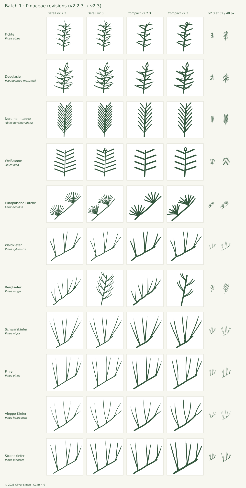
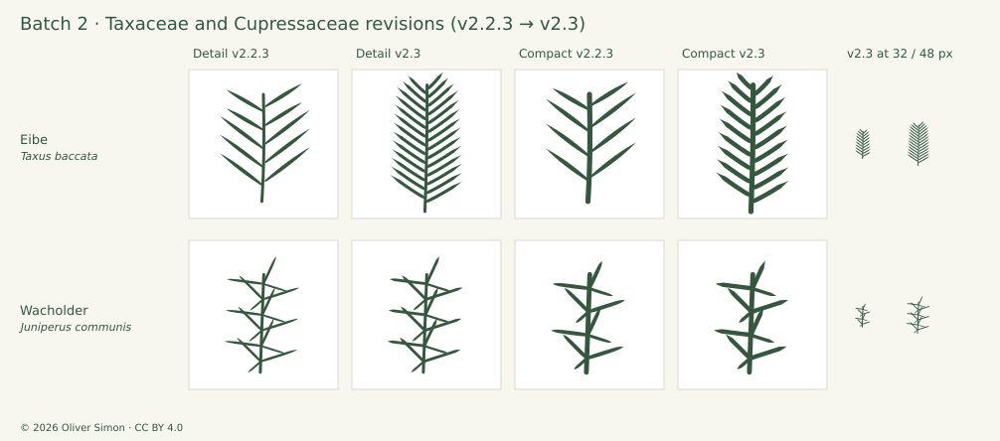

# Botanical review and revision · v2.3.0

2026-10-14 · 22 of 175 existing taxa re-reviewed (all gymnosperms) · 26 SVGs revised · 25 taxa added · baseline v2.2.3

v2.3.0 starts a source-guided re-review of the collection in family batches, with the findings implemented in the artwork. This release completes the gymnosperms (batches 1–2: 22 taxa, both optical variants). The other 153 existing taxa are flowering plants; their artwork is byte-identical to v2.2.3 and they keep their v2.2.3 record, marked `carried-over (v2.3 review pending)`, until a later batch reaches them. The 25 additions are recorded in [EXPANSION-2.3.md](EXPANSION-2.3.md). Each reviewed taxon is compared with at least three foliage photographs inspected at full size, the primary treatment and independent botanical descriptions. Revisions are checked with the full geometry and raster suite, enlarged and at target sizes on light and dark grounds, against their neighbors and in a final before/after comparison. All records, including carried-over ones, are in [audit-2.3.json](audit-2.3.json). Not independent botanical certification.

## Method

- **Photographs:** at least three close-ups of leaf, needle or shoot per taxon, from Wikimedia Commons, Oregon State University Landscape Plants, iNaturalist (research-grade or curated taxon photos, exact-name lookup) and Info Flora. Only photos inspected at full size are listed; habit, bark and cone-only images are not counted. Photos are linked, never traced or redistributed.
- **Descriptions:** the primary treatment from `src/icons.json` plus at least one independent description (Gymnosperm Database, university extension, national flora). Contradictions are reported, not averaged.
- **Drawing:** Detail and Compact at 700 px on an 8-unit grid and at 24/32/48/64/96 px on light and dark grounds. Filled needles are measured: length from the farthest contour-point pair, transverse width at 10 % steps along it.
- **Revision:** needle and sheath shapes are rebuilt along the original centrelines where the composition is sound, so only the criticised character changes; recompositions are drawn from the photographs. Each revision passes `npm test` and a before/after board; optional refinements that harm legibility or blur neighbors are declined and recorded.
- **Neighbors:** related taxa side by side in both variants.

### Verdicts

| Code | Meaning                                                                    |
| ---- | -------------------------------------------------------------------------- |
| A    | Misrepresents a diagnostic character; must be redrawn.                     |
| B    | Clear, source-supported improvement.                                       |
| C    | Minor or optional refinement.                                              |
| R    | Retain; the drawing agrees with the evidence within documented reductions. |

A taxon's headline verdict is the stricter of its two variants; the verdict describes the v2.2.3 drawing before revision.

## Batch 1 · Pinaceae (14 taxa)

### Collection finding · two-needle-pines (B)

All six two-needle pines share one composition: an arching twig with three (Bergkiefer four) widely spaced two-needle fascicles at nearly identical positions. Pinie, Strandkiefer and Schwarzkiefer are practically interchangeable at 24–48 px. Because every icon is scaled separately, needle proportion, sheath ratio, curvature and density are the only legitimate cues — and they are only partly in natural order.

| Taxon         | Needle : sheath, natural | v2.2.3 (Detail) | Needle L/W, natural | v2.2.3 L/W |
| ------------- | ------------------------ | --------------- | ------------------- | ---------- |
| Waldkiefer    | 6–10                     | 5.4             | 25–35               | 26         |
| Bergkiefer    | 2–4                      | 4.4             | 25–35               | 27         |
| Schwarzkiefer | 8–13                     | 7.1             | 60–80               | 41         |
| Pinie         | 8–15                     | 6.5             | 65–120              | 35         |
| Aleppo-Kiefer | — (fragile)              | 5.5             | 60–120              | 42         |
| Strandkiefer  | 6–12                     | 3.4             | 60–110              | 29         |

Natural ratios from the Gymnosperm Database lengths and widths; drawn values measured. Differentiate by documented gestalt, not invented anatomy: Bergkiefer short forward-curved needles crowded on short internodes; Schwarzkiefer long straight stiff needles; Pinie long and fine; Strandkiefer longest and stoutest with a stout twig; Aleppo-Kiefer thin, flexible, sparse (already achieved). Re-proportion sheaths to natural ratios. The v2.2 “conspicuously long sheath” cue for Strandkiefer is 2–3× too long relative to its needles; relative to needle length, Bergkiefer has the longest sheath in nature.

**Implemented:** Bergkiefer recomposed as an upright crowded brush with forward-curved needles; sheaths re-proportioned in all six (Strandkiefer 1 : 3.4 → ≈ 1 : 8, Bergkiefer ≈ 1 : 4); Pinie slimmed below Schwarzkiefer; Strandkiefer twig strengthened. Regression tests lock the needle : sheath ranges.

### Per-taxon findings

| Taxon                                | Verdict D / C | Finding                                                                                                                                                                                                                                                    | Artwork                    | Primary source                                                                 |
| ------------------------------------ | ------------- | ---------------------------------------------------------------------------------------------------------------------------------------------------------------------------------------------------------------------------------------------------------- | -------------------------- | ------------------------------------------------------------------------------ |
| Fichte · _Picea abies_               | B / B         | Needle tips taper over the outer 30–40 % (spindle impression); photos and sources show parallel-sided needles with a short acute point. Pegs (sterigmata) correctly drawn in Detail. The conspicuous terminal bud group is absent.                         | D: Revised; C: Revised     | [Treatment](https://www.infoflora.ch/de/flora/picea-abies.html)                |
| Waldkiefer · _Pinus sylvestris_      | R / R         | Two needles per sheath, linear needles with acute tip and natural L/W 26 are correct. Sheath drawn as a funnel widening toward the needles; photos show a short near-cylindrical grey tube. Needles perfectly straight although commonly slightly twisted. | D: Revised; C: Revised     | [Treatment](https://www.infoflora.ch/de/flora/pinus-sylvestris.html)           |
| Europäische Lärche · _Larix decidua_ | B / B         | Two perfectly planar, evenly spaced semicircular fans spring directly from points on the twig. In every close-up the tuft sits on a conspicuous, stubby, cylindrical woody short shoot (3–10 mm); long shoots carry sparse solitary needles.               | D: Revised; C: Revised     | [Treatment](https://www.infoflora.ch/de/flora/larix-decidua.html)              |
| Weißtanne · _Abies alba_             | R / R         | Two-ranked parallel-sided needles with notched Detail tips and twisted narrowed bases agree with the sources. The ovoid terminal bud trio, conspicuous in all photos, is absent; needle spacing is a strong but legible reduction.                         | D: Revised; C: Revised     | [Treatment](https://www.infoflora.ch/de/flora/abies-alba.html)                 |
| Douglasie · _Pseudotsuga menziesii_  | B / B         | The pointed ovoid bud and peg-free twig are correct and important. Needles share the spruce profile with acute spindle tips; Douglas-fir needles are soft, flat and obtuse to rounded at the apex.                                                         | D: Revised; C: Revised     | [Treatment](https://www.infoflora.ch/de/flora/pseudotsuga-menziesii.html)      |
| Zirbelkiefer · Arve · _Pinus cembra_ | R / R         | Five-needle fascicles without sheath are correct (sheaths early deciduous). Fans splay wider than a real fascicle — a necessary reduction to show five needles.                                                                                            | D: Unchanged; C: Unchanged | [Treatment](https://www.infoflora.ch/de/flora/pinus-cembra.html)               |
| Bergkiefer · _Pinus mugo_            | B / B         | Reads as a smaller Waldkiefer: four fascicles on long arching internodes with nearly straight needles. Photos show short, densely crowded, forward/inward-curved needles on short internodes forming brush-like candle shoots.                             | D: Revised; C: Revised     | [Treatment](https://www.infoflora.ch/de/flora/pinus-mugo.html)                 |
| Schwarzkiefer · _Pinus nigra_        | R / R         | Long straight stiff needles, two per sheath, longer relative to the twig than Waldkiefer — consistent with photos. Sheath slightly long relative to needle.                                                                                                | D: Revised; C: Revised     | [Treatment](https://www.infoflora.ch/de/flora/pinus-nigra.html)                |
| Pinie · _Pinus pinea_                | C / C         | Adult two-needle fascicles correct (juvenile solitary foliage rightly omitted). Sheath too long relative to needles; needles drawn stouter than Schwarzkiefer although naturally at least as slender.                                                      | D: Revised; C: Revised     | [Treatment](https://landscapeplants.oregonstate.edu/plants/pinus-pinea)        |
| Aleppo-Kiefer · _Pinus halepensis_   | R / R         | Thin, gently curved needles on a sparse twig match the very slender, flexible, sparsely arrayed foliage; thinnest of the two-needle set (correct ordering).                                                                                                | D: Revised; C: Revised     | [Treatment](https://landscapeplants.oregonstate.edu/plants/pinus-halepensis)   |
| Strandkiefer · _Pinus pinaster_      | B / B         | Sheath is 2–3× too long relative to the needles (drawn 1 : 3.4, natural 1 : 6–12); in photos sheaths are inconspicuous beside the very long, thick needles. Stout needles otherwise consistent.                                                            | D: Revised; C: Revised     | [Treatment](https://landscapeplants.oregonstate.edu/plants/pinus-pinaster)     |
| Atlas-Zeder · _Cedrus atlantica_     | R / R         | The 2.2.3 redraw (explicit short shoots, varied rosette projections, solitary terminal needles) is confirmed by fresh foliage photographs beyond the three user-supplied images.                                                                           | D: Unchanged; C: Unchanged | [Treatment](https://landscapeplants.oregonstate.edu/plants/cedrus-atlantica)   |
| Weymouth-Kiefer · _Pinus strobus_    | R / R         | Thin, soft five-needle fans at the ends of a slender twig, no persistent sheath and the finest needles of the set — all consistent.                                                                                                                        | D: Unchanged; C: Unchanged | [Treatment](https://landscapeplants.oregonstate.edu/plants/pinus-strobus)      |
| Nordmanntanne · _Abies nordmanniana_ | B / B         | Dense forward-directed needles with notched tips give the right gestalt, but every needle widens steadily from base to tip (club shape). Photos show a parallel-sided body with only a short twisted stalk-like base.                                      | D: Revised; C: Revised     | [Treatment](https://landscapeplants.oregonstate.edu/plants/abies-nordmanniana) |

### Revisions and evidence

#### Fichte · _Picea abies_

- B: keep needle width ≥ 95 % to about 85 % of length, then a short acute apex (same correction as Atlas-Zeder 2.2.3).
- C: optional small ovoid-acute terminal bud in Detail — clearly shorter and blunter than the Douglasie spindle bud.
- C: Compact needles may be ≈15 % narrower if 24 px legibility holds.
- Retain pegs, radial projection and counts.

**Revised:** All needles rebuilt along their original centrelines: parallel-sided body to about 85 %, short acute apex (tip length 1.7 × needle width), slightly narrowed base on the retained pegs. Small ovoid-conic terminal bud added in both sizes.

**Declined:** Narrower Compact needles declined: 24 px legibility.

Limits: Radial projection, pegs and counts (31 / 17) retained; four-sided section, stomata and full density omitted. The bud is deliberately shorter and blunter than the Douglasie spindle bud.

Measured (v2.2.3): Detail n=31, L/W 9–16, width profile 10→90 %: 0.90 0.98 1 1 1 0.98 0.94 0.84 0.59. Compact n=17, L/W 8–10, same profile.

Source conflict: Gymnosperm DB species page: apex “blunt-tipped”; genus page and Virginia Tech: “sharp-pointed”. Photos show acute but not long-attenuate tips.

Descriptions: [Primary treatment](https://www.infoflora.ch/de/flora/picea-abies.html) · [Gymnosperm Database (species)](https://www.conifers.org/pi/Picea_abies.php) · [Gymnosperm Database (genus Picea)](https://www.conifers.org/pi/Picea.php) · [Virginia Tech Dendrology fact sheet](https://dendro.cnre.vt.edu/dendrology/syllabus/factsheet.cfm?ID=99)

Photographs: [Picea-abies-needles-buds-2010-02-11.jpg](https://commons.wikimedia.org/wiki/File:Picea-abies-needles-buds-2010-02-11.jpg) (Sten Porse, CC BY-SA 3.0) · [Needles of European spruce (Picea Abies), Vollersroda, Thuringia, Germany 01.jpg](<https://commons.wikimedia.org/wiki/File:Needles_of_European_spruce_(Picea_Abies)%2C_Vollersroda%2C_Thuringia%2C_Germany_01.jpg>) (KaiKemmann, CC BY-SA 4.0) · [Picea abies needles in Väsmestorp 2024-10-29 (0261).jpg](<https://commons.wikimedia.org/wiki/File:Picea_abies_needles_in_V%C3%A4smestorp_2024-10-29_(0261).jpg>) (Achird, CC BY-SA 4.0) · [Starr-141106-5361-Picea abies-needles-8500 Ft Grove HNP-Maui (25130476492).jpg](<https://commons.wikimedia.org/wiki/File:Starr-141106-5361-Picea_abies-needles-8500_Ft_Grove_HNP-Maui_(25130476492).jpg>) (Forest and Kim Starr, CC BY 3.0 US)

#### Waldkiefer · _Pinus sylvestris_

- C: draw the sheath as a short near-cylindrical tube.
- C: slight twist/curvature in one or two needles to separate from the straight, stiff Schwarzkiefer (see collection finding).

**Revised:** Sheaths rebuilt as short near-cylindrical tubes (needle : sheath ≈ 7); needles rebuilt as linear ribbons with an acute tip; one needle per pair slightly curved for the commonly twisted foliage. Composition and tips unchanged.

Limits: Three fascicles abbreviate a crowded shoot; twist, glaucous colour and serrulation omitted.

Measured (v2.2.3): Detail needles L/W 20–31 (mean 26), linear to ≈70 %, apex taper 0.94/0.87/0.63. Sheath 7.7 × 3.6 units, funnel-shaped. Needle : sheath 5.4.

Descriptions: [Primary treatment](https://www.infoflora.ch/de/flora/pinus-sylvestris.html) · [Gymnosperm Database](https://www.conifers.org/pi/Pinus_sylvestris.php)

Photographs: [Pinus sylvestris 2020 G2.jpg](https://commons.wikimedia.org/wiki/File:Pinus_sylvestris_2020_G2.jpg) (George Chernilevsky, CC BY-SA 4.0) · [Pinus sylvestris (Scots pine) 3 (38564656525).jpg](<https://commons.wikimedia.org/wiki/File:Pinus_sylvestris_(Scots_pine)_3_(38564656525).jpg>) (James St. John, CC BY 2.0) · [Pinus sylvestris (Scots pine) 7 (38564615155).jpg](<https://commons.wikimedia.org/wiki/File:Pinus_sylvestris_(Scots_pine)_7_(38564615155).jpg>) (James St. John, CC BY 2.0)

#### Europäische Lärche · _Larix decidua_

- B: add stubby short-shoot knobs carrying the tufts — the same treatment Atlas-Zeder received in 2.2.3.
- C: less regular fans (varied length, slight curvature).
- C: a few solitary needles on the terminal long shoot.
- Retain soft, blunt stroke needles (contrast with the stiff cedar).

**Revised:** Redrawn: two tufts now sit on stubby cylindrical short shoots; irregular upward-opening brushes of soft blunt needles (13 + 14 Detail, 8 + 8 Compact) with varied lengths, slight curvature and two foreshortened front needles; shorter bare leader.

**Declined:** Solitary long-shoot needles declined after trial: sparse ones read as forked twiglets, dense ones as a fir “fishbone”.

Limits: Natural tufts hold 30–40 needles; counts are optical reductions. Deciduous colour change and cones not shown.

Measured (v2.2.3): Detail 2 × 11 stroke needles, Compact 2 × 7 (natural 30–40 per short shoot; documented reduction).

Descriptions: [Primary treatment](https://www.infoflora.ch/de/flora/larix-decidua.html) · [Gymnosperm Database](https://www.conifers.org/pi/Larix_decidua.php)

Photographs: [shoots and needle cluster](https://landscapeplants.oregonstate.edu/sites/plantid7/files/plantimage/lade660.jpg) (Oregon State University, linked reference, not redistributed) · [branches, leaves and cones](https://landscapeplants.oregonstate.edu/sites/plantid7/files/plantimage/lade609A_0.jpg) (Oregon State University, linked reference, not redistributed) · [leaves and cones, early winter](https://landscapeplants.oregonstate.edu/sites/plantid7/files/plantimage/lade0698.jpg) (Oregon State University, linked reference, not redistributed)

#### Weißtanne · _Abies alba_

- C: add an ovoid, obtuse terminal bud with two lateral buds — also separates fir from Eibe.

**Revised:** Ovoid, obtuse terminal bud with two lateral buds added in Detail; terminal bud only in Compact (three outlines merge at 24–32 px). Needles unchanged.

Limits: Two-ranked lateral shoot with sparse needles; underside bands and density omitted.

Measured (v2.2.3): Needles are filled ribbons, L/W ≈ 12 (natural 10–15).

Descriptions: [Primary treatment](https://www.infoflora.ch/de/flora/abies-alba.html) · [Gymnosperm Database](https://www.conifers.org/pi/Abies_alba.php) · [Gymnosperm Database (genus Abies)](https://www.conifers.org/pi/Abies.php)

Photographs: [branches](https://landscapeplants.oregonstate.edu/sites/plantid7/files/plantimage/abalb8879.jpg) (Oregon State University, linked reference, not redistributed) · [branchlet, needles](https://landscapeplants.oregonstate.edu/sites/plantid7/files/plantimage/abab8880A.jpg) (Oregon State University, linked reference, not redistributed) · [branchlet, needles, underside](https://landscapeplants.oregonstate.edu/sites/plantid7/files/plantimage/abab8881A.jpg) (Oregon State University, linked reference, not redistributed)

#### Douglasie · _Pseudotsuga menziesii_

- B: rounded/obtuse needle tips with a short narrowed base, blunter than Fichte.
- Retain bud and radial projection.

**Revised:** All needles rebuilt along their original centrelines with a short narrowed base, parallel body and rounded obtuse apex; bud unchanged.

Limits: Radial projection simplified; flat section, stomatal bands and full density omitted. No pegs (correct contrast with Fichte).

Measured (v2.2.3): Detail n=28, L/W 13–15, width profile identical to Fichte (taper 0.94/0.84/0.59 over the outer 30–40 %). Bud ≈ 0.45 × needle length (natural 0.3–0.6).

Descriptions: [Primary treatment](https://www.infoflora.ch/de/flora/pseudotsuga-menziesii.html) · [Gymnosperm Database](https://www.conifers.org/pi/Pseudotsuga_menziesii.php)

Photographs: [branch, buds, needles](https://landscapeplants.oregonstate.edu/sites/plantid7/files/plantimage/psme145.jpg) (Oregon State University, linked reference, not redistributed) · [needles and bud](https://landscapeplants.oregonstate.edu/sites/plantid7/files/plantimage/psme809.jpg) (Oregon State University, linked reference, not redistributed) · [needles on cm scale](https://landscapeplants.oregonstate.edu/sites/plantid7/files/plantimage/psme7911.jpg) (Oregon State University, linked reference, not redistributed)

#### Zirbelkiefer · Arve · _Pinus cembra_

- C: slightly narrower, more upright fans to separate the stiff Arve from the soft Weymouth-Kiefer.
- Shoot pubescence is not representable.

**Declined:** Narrower fans declined: Arve and Weymouth-Kiefer are already separated by fan size and needle length, and narrower fans endanger the readable count of five.

Limits: Three five-needle fascicles without sheath; fan splay is an optical reduction; pubescence not shown.

Measured (v2.2.3): Detail needles L/W 38.

Note: An iNaturalist name search first matched Pinus flexilis; lookups now require an exact name and no P. flexilis photo was used.

Descriptions: [Primary treatment](https://www.infoflora.ch/de/flora/pinus-cembra.html) · [Gymnosperm Database](https://www.conifers.org/pi/Pinus_cembra.php)

Photographs: [photo 107548299](https://www.inaturalist.org/photos/107548299) (Sébastien SANT, CC BY-NC) · [photo 89095308](https://www.inaturalist.org/photos/89095308) (Giorgio Perbellini, CC BY-NC) · [v2.2 reference images (4)](https://www.infoflora.ch/de/flora/pinus-cembra.html) (Info Flora / K. Lauber, linked reference, not redistributed)

#### Bergkiefer · _Pinus mugo_

- B: shorten internodes and crowd the fascicles toward the shoot tip; curve needles forward toward the axis.
- C: sheath may be slightly longer relative to the needles (young state); document that it wears to a basal fringe.
- Retain two-needle fascicles.

**Revised:** New composition: upright candle shoot with eight (Detail) / four (Compact) two-needle fascicles on short internodes, short needles leaving at ≈ 50° and curving forward toward the axis; sheath ≈ 1/4 of needle length (young state).

Limits: Represents Pinus mugo s.l.; the sheath later wears to a basal fringe; density reduced.

Measured (v2.2.3): Detail needles L/W 27, needle : sheath 4.4 (natural 2–4).

Source conflict: Sheath: 15–18 mm (Gymnosperm DB, Earle), about 1.5 cm wearing to a basal fringe (Flora NZ); OSU “up to 1.5 mm” is treated as a unit error and not adopted.

Descriptions: [Primary treatment](https://www.infoflora.ch/de/flora/pinus-mugo.html) · [Gymnosperm Database](https://www.conifers.org/pi/Pinus_mugo.php) · [Oregon State University Landscape Plants](https://landscapeplants.oregonstate.edu/plants/pinus-mugo) · [Flora of New Zealand (nzflora.info)](https://www.nzflora.info/factsheet/taxon/Pinus-mugo.html) · [Earle, Gymnosperm Database mirror (Univ. Hamburg)](https://www-archiv.fdm.uni-hamburg.de/b-online/earle/pi/pin/mugo.htm)

Photographs: [branches with cones](https://landscapeplants.oregonstate.edu/sites/plantid7/files/plantimage/pimu3405.jpg) (Oregon State University, linked reference, not redistributed) · [new shoots and cones](https://landscapeplants.oregonstate.edu/sites/plantid7/files/plantimage/pimu371A.jpg) (Oregon State University, linked reference, not redistributed) · [Hortus (Haren Groningen), Bergden, Pinus mugo.jpg](<https://commons.wikimedia.org/wiki/File:Hortus_(Haren_Groningen)%2C_Bergden%2C_Pinus_mugo.jpg>) (Agnes Monkelbaan, CC BY-SA 4.0)

#### Schwarzkiefer · _Pinus nigra_

- C: shorten the sheath about 25 % relative to the needles.
- Retain composition, subject to the two-needle collection finding.

**Revised:** Sheaths shortened (needle : sheath ≈ 9) and rebuilt as tubes; needles rebuilt as linear ribbons; straight stiff composition retained.

Limits: Three fascicles; buds, density and serrulation omitted.

Measured (v2.2.3): Detail needles L/W 41; needle : sheath 7.1 (natural 8–13).

Descriptions: [Primary treatment](https://www.infoflora.ch/de/flora/pinus-nigra.html) · [Gymnosperm Database](https://www.conifers.org/pi/Pinus_nigra.php)

Photographs: [needles and mature cones](https://landscapeplants.oregonstate.edu/sites/plantid7/files/plantimage/pini35.jpg) (Oregon State University, linked reference, not redistributed) · [shoot tips, winter](https://landscapeplants.oregonstate.edu/sites/plantid7/files/plantimage/pini555.jpg) (Oregon State University, linked reference, not redistributed) · [photo 113413401](https://www.inaturalist.org/photos/113413401) (Patrick Hacker, CC BY) · [photo 355013399](https://www.inaturalist.org/photos/355013399) (moakat, CC BY-NC)

#### Pinie · _Pinus pinea_

- C: shorten the sheath to ≈1/10 of needle length.
- C: slimmer needles (L/W at least that of Schwarzkiefer).

**Revised:** Sheaths shortened (needle : sheath ≈ 10); needles slimmed to 82 % width so they are finer than Schwarzkiefer; composition retained.

Limits: Adult foliage only; juvenile solitary glaucous leaves deliberately not shown.

Measured (v2.2.3): Detail needles L/W 35; needle : sheath 6.5 (natural 8–15; ruler photo ≈ 18).

Descriptions: [Primary treatment](https://landscapeplants.oregonstate.edu/plants/pinus-pinea) · [Gymnosperm Database](https://www.conifers.org/pi/Pinus_pinea.php)

Photographs: [needles](https://landscapeplants.oregonstate.edu/sites/plantid7/files/plantimage/pipinea70.jpg) (Oregon State University, linked reference, not redistributed) · [single fascicle against ruler](https://www.inaturalist.org/photos/176283962) (Fred Watson, CC BY-NC) · [photo 111974688](https://www.inaturalist.org/photos/111974688) (faluke, CC BY-NC)

#### Aleppo-Kiefer · _Pinus halepensis_

- C: optionally slimmer sheath (fragile in nature).

**Revised:** Sheaths shortened (needle : sheath ≈ 7.5) for the fragile sheath; thin curved needles rebuilt as linear ribbons; composition retained.

Limits: Three sparse fascicles; occasional three-needle fascicles not shown.

Measured (v2.2.3): Detail needles L/W 42; needle : sheath 5.5.

Descriptions: [Primary treatment](https://landscapeplants.oregonstate.edu/plants/pinus-halepensis) · [Gymnosperm Database](https://www.conifers.org/pi/Pinus_halepensis.php) · [PlantNET NSW Flora](https://plantnet.rbgsyd.nsw.gov.au/cgi-bin/NSWfl.pl?lvl=sp&name=Pinus~halepensis&page=nswfl)

Photographs: [needles](https://landscapeplants.oregonstate.edu/sites/plantid7/files/plantimage/pihale4835A_0.jpg) (Oregon State University, linked reference, not redistributed) · [branch, needles and cones](https://landscapeplants.oregonstate.edu/sites/plantid7/files/plantimage/pihale2972.jpg) (Oregon State University, linked reference, not redistributed) · [photo 58548158](https://www.inaturalist.org/photos/58548158) (Javisa Hun, CC BY-NC) · [photo 244619334](https://www.inaturalist.org/photos/244619334) (Eduardo Martínez, CC BY)

#### Strandkiefer · _Pinus pinaster_

- B: reduce the sheath to ≈1/7–1/9 of needle length.
- Separate from Pinie by stouter, stiffer, straighter needles and a stouter twig instead of the sheath.
- Retain pairs.

**Revised:** Over-long sheaths shortened from 1 : 3.4 to ≈ 1 : 8; stout needles kept (106 % width) and twig strengthened by 30 % to carry the stout-shoot cue instead of the sheath.

Limits: Three fascicles; occasional three-needle fascicles, stomatal lines and toothed margin not shown.

Measured (v2.2.3): Detail needles L/W 29; sheath 14.4 units; needle : sheath 3.4.

Descriptions: [Primary treatment](https://landscapeplants.oregonstate.edu/plants/pinus-pinaster) · [Gymnosperm Database](https://www.conifers.org/pi/Pinus_pinaster.php)

Photographs: [foliage and cones](https://landscapeplants.oregonstate.edu/sites/plantid7/files/plantimage/pipin4995B.jpg) (Oregon State University, linked reference, not redistributed) · [needles, close-up](https://landscapeplants.oregonstate.edu/sites/plantid7/files/plantimage/pipin2489.jpg) (Oregon State University, linked reference, not redistributed) · [bud and developing cone](https://landscapeplants.oregonstate.edu/sites/plantid7/files/plantimage/pipin987.jpg) (Oregon State University, linked reference, not redistributed) · [photo 55032238](https://www.inaturalist.org/photos/55032238) (Grzegorz Grzejszczak, CC BY-SA) · [photo 3098980](https://www.inaturalist.org/photos/3098980) (Mike Patterson, CC BY-NC)

#### Atlas-Zeder · _Cedrus atlantica_

- Use as the model for the Lärche short shoots.

Limits: See AUDIT-2.2.3: three short shoots with reduced needle counts, solitary terminal needles.

Measured (v2.2.3): See AUDIT-2.2.3.

Descriptions: [Primary treatment](https://landscapeplants.oregonstate.edu/plants/cedrus-atlantica) · [Gymnosperm Database](https://www.conifers.org/pi/Cedrus_atlantica.php)

Photographs: [branch with needle clusters](https://landscapeplants.oregonstate.edu/sites/plantid7/files/plantimage/ceat5462A.jpg) (Oregon State University, linked reference, not redistributed) · [needle clusters](https://landscapeplants.oregonstate.edu/sites/plantid7/files/plantimage/ceat5463.jpg) (Oregon State University, linked reference, not redistributed) · [photo 3116102](https://www.inaturalist.org/photos/3116102) (David Renoult, CC BY-NC)

#### Weymouth-Kiefer · _Pinus strobus_

- No change recommended.

Limits: Two five-needle fascicles without sheath; density and serrulation omitted.

Measured (v2.2.3): Detail needles L/W 49.

Descriptions: [Primary treatment](https://landscapeplants.oregonstate.edu/plants/pinus-strobus) · [Gymnosperm Database](https://www.conifers.org/pi/Pinus_strobus.php)

Photographs: [shoots, cones, and needles](https://landscapeplants.oregonstate.edu/sites/plantid7/files/plantimage/pist51_0.jpg) (Oregon State University, linked reference, not redistributed) · [needle close-up, comparison with P. monticola](https://landscapeplants.oregonstate.edu/sites/plantid7/files/plantimage/pimost30_1.jpg) (Oregon State University, linked reference, not redistributed) · [single fascicle](https://www.inaturalist.org/photos/61660614) (Tom Norton, CC BY) · [photo 55923573](https://www.inaturalist.org/photos/55923573) (Jean Besset, CC BY-NC)

#### Nordmanntanne · _Abies nordmanniana_

- B: parallel-sided needle body with a short constricted base (≈10–15 % of length), as in Weißtanne.
- C: terminal bud.

**Revised:** Club-shaped needles replaced by parallel-sided bodies with a short constricted base (≈12 % of length); Detail apex rounded with a shallow notch between two lobes, Compact apex simply rounded. Needle width set to match the previous visual weight.

**Declined:** Terminal bud declined: the crowded forward needles hide it at icon size.

Limits: Forward-directed spiral insertion shown as a thinned projection; stomatal bands and twisting omitted.

Measured (v2.2.3): Detail n=25, L/W 12–15, width profile base→tip 0.63 0.77 0.85 0.91 0.95 0.97 0.99 1 1.

Descriptions: [Primary treatment](https://landscapeplants.oregonstate.edu/plants/abies-nordmanniana) · [Gymnosperm Database](https://www.conifers.org/pi/Abies_nordmanniana.php)

Photographs: [branchlet](https://landscapeplants.oregonstate.edu/sites/plantid7/files/plantimage/abno4947.jpg) (Oregon State University, linked reference, not redistributed) · [branchlets](https://landscapeplants.oregonstate.edu/sites/plantid7/files/plantimage/abno56.jpg) (Oregon State University, linked reference, not redistributed) · [needles (notch, groove, twist, stomatal bands)](https://landscapeplants.oregonstate.edu/sites/plantid7/files/plantimage/abno276.jpg) (Oregon State University, linked reference, not redistributed)

## Batch 2 · Taxaceae, Cupressaceae and Ginkgo (8 taxa)

### Per-taxon findings

| Taxon                                               | Verdict D / C | Finding                                                                                                                                                                                                                                                                 | Artwork                    | Primary source                                                                       |
| --------------------------------------------------- | ------------- | ----------------------------------------------------------------------------------------------------------------------------------------------------------------------------------------------------------------------------------------------------------------------- | -------------------------- | ------------------------------------------------------------------------------------ |
| Eibe · _Taxus baccata_                              | B / B         | Only five widely spaced lens-shaped needles per side, each tapering over its whole length to a long point; photographs and sources show many dense two-ranked, linear, parallel-sided, slightly falcate needles with a short stalk-like base and an abruptly acute tip. | D: Revised; C: Revised     | [Treatment](https://www.infoflora.ch/de/flora/taxus-baccata.html)                    |
| Wacholder · _Juniperus communis_                    | C / C         | Whorls of three stiff spreading needles are correct; the needles taper over the outer third instead of being linear with a short sharp point (Gymnosperm DB: narrow-linear, stiff; photographs: parallel-sided with an abrupt spine tip).                               | D: Revised; C: Revised     | [Treatment](https://www.infoflora.ch/de/flora/juniperus-communis.html)               |
| Ginkgo · _Ginkgo biloba_                            | R / R         | Fan-shaped blade with central notch, wavy outer margin, long petiole and dichotomous veins agrees with the OSU leaf photographs; the v1.6 Ginkgo correction is confirmed.                                                                                               | D: Unchanged; C: Unchanged | [Treatment](https://floranorthamerica.org/Ginkgo_biloba)                             |
| Urweltmammutbaum · _Metasequoia glyptostroboides_   | R / R         | Opposite, linear, flat needles with rounded tips on a deciduous lateral shoot agree with the OSU comparison board (opposite, rounded, grooved). Photographs show needles angled slightly forward (≈ 70°) rather than perpendicular.                                     | D: Unchanged; C: Unchanged | [Treatment](https://plantdatabase.kpu.ca/PlantPrint/megl)                            |
| Sumpfzypresse · _Taxodium distichum_                | R / R         | Alternate, forward-angled, gradually pointed needles in two ranks agree with the OSU comparison (alternate, pointed) and the Gymnosperm DB (two-ranked, 10–17 mm in var. distichum).                                                                                    | D: Unchanged; C: Unchanged | [Treatment](https://landscapeplants.oregonstate.edu/plants/taxodium-distichum)       |
| Abendländischer Lebensbaum · _Thuja occidentalis_   | R / R         | Flattened fan-shaped spray with overlapping facial and lateral scales agrees with the OSU close-ups (facial leaf with gland, lateral leaves).                                                                                                                           | D: Unchanged; C: Unchanged | [Treatment](https://landscapeplants.oregonstate.edu/plants/thuja-occidentalis)       |
| Lawsons Scheinzypresse · _Chamaecyparis lawsoniana_ | R / R         | Pinnate flattened spray with small pointed scales agrees with the photographs; the strong similarity to Lebensbaum is natural and already documented (white X-marks beneath and finer pinnate branching are the field cues).                                            | D: Unchanged; C: Unchanged | [Treatment](https://landscapeplants.oregonstate.edu/plants/chamaecyparis-lawsoniana) |
| Mittelmeer-Zypresse · _Cupressus sempervirens_      | R / R         | Rounded branchlets radiating in several directions, clothed in obtuse appressed scales, agree with the photographs and the Gymnosperm DB (shoots radiating in all directions, ≈ 1 mm, scales ovate, obtuse).                                                            | D: Unchanged; C: Unchanged | [Treatment](https://landscapeplants.oregonstate.edu/plants/cupressus-sempervirens)   |

### Revisions and evidence

#### Eibe · _Taxus baccata_

- B: linear parallel-sided needles with a short narrowed base, tapering gradually over the outer quarter to a cuspidate tip (Gymnosperm DB: “more or less gradually tapering to a cuspidate apex”; Info Flora: “stachelspitzig”).
- B: denser two-ranked arrangement of nearly equal needles, spreading at ≈ 60–65°.
- C: slight forward (falcate) curvature.

**Revised:** Redrawn: 15 (Detail) / 10 (Compact) nearly equal needles per side in two ranks, linear and parallel-sided with a short narrowed stalk-like base, tapering gradually over the outer quarter to a sharp cusp, slightly falcate forward, spreading at ≈ 60–63°; only the last needles near the shoot tip shorten.

**Declined:** A first draft with abrupt blunt tips, ≈ 70° spread and strongly shortening needles was rejected after a renewed source and photo comparison (prompted by user review); a pressed-specimen angle of ≈ 50° was also rejected because live shoots spread wider and it merged with Nordmanntanne.

Limits: Pale stomatal bands beneath, the red arils and spiral insertion are not shown. Natural overlap with the two-ranked fir shoots remains; tip shape (cusp vs. notch) and the regular flat comb are the cues.

Measured (v2.2.3): Detail 10 needles, Compact 8; lens profile (widest at middle, tapering to both ends).

Descriptions: [Primary treatment](https://www.infoflora.ch/de/flora/taxus-baccata.html) · [Gymnosperm Database](https://www.conifers.org/ta/Taxus_baccata.php) · [Oregon State University Landscape Plants](https://landscapeplants.oregonstate.edu/plants/taxus-baccata)

Photographs: [leaves (needles) and fruit](https://landscapeplants.oregonstate.edu/sites/plantid7/files/plantimage/taba74.jpg) (Oregon State University, linked reference, not redistributed) · [branchlets, upper and lower side](https://landscapeplants.oregonstate.edu/sites/plantid7/files/plantimage/taba7.jpg) (Oregon State University, linked reference, not redistributed) · [branchlets, comparison with Sequoia sempervirens](https://landscapeplants.oregonstate.edu/sites/plantid7/files/plantimage/taba-se1.jpg) (Oregon State University, linked reference, not redistributed)

#### Wacholder · _Juniperus communis_

- C: linear body with short sharp tip (same profile as Fichte).
- Retain whorls and spacing.

**Revised:** All needles rebuilt along their original centrelines with a parallel-sided body and a short sharp tip; whorls, angles and spacing unchanged.

Limits: Whorls of three in projection; the single white stomatal band and berry-like cones are not shown.

Measured (v2.2.3): Detail n=18, L/W 9–15, taper 0.94/0.84/0.59 over the outer 30–40 %.

Descriptions: [Primary treatment](https://www.infoflora.ch/de/flora/juniperus-communis.html) · [Gymnosperm Database](https://www.conifers.org/cu/Juniperus_communis.php) · [Oregon State University Landscape Plants](https://landscapeplants.oregonstate.edu/plants/juniperus-communis)

Photographs: [leaves (needles)](https://landscapeplants.oregonstate.edu/sites/plantid7/files/plantimage/juco195A.jpg) (Oregon State University, linked reference, not redistributed) · [branches and needles](https://landscapeplants.oregonstate.edu/sites/plantid7/files/plantimage/juco198A.jpg) (Oregon State University, linked reference, not redistributed) · [needles and cones, close-up](https://www.inaturalist.org/photos/267513931) (Douglas Goldman, CC BY-SA)

#### Ginkgo · _Ginkgo biloba_

- No change recommended.

Limits: Long-shoot deeply bilobed leaves and short-shoot clusters not shown.

Measured (v2.2.3): Unchanged; see AUDIT-1.6.

Descriptions: [Primary treatment](https://floranorthamerica.org/Ginkgo_biloba) · [Oregon State University Landscape Plants](https://landscapeplants.oregonstate.edu/plants/ginkgo-biloba)

Photographs: [shoot, lobed leaves](https://landscapeplants.oregonstate.edu/sites/plantid7/files/plantimage/gibi1132.jpg) (Oregon State University, linked reference, not redistributed) · [bi-lobed leaf](https://landscapeplants.oregonstate.edu/sites/plantid7/files/plantimage/gibi79.jpg) (Oregon State University, linked reference, not redistributed) · [leaves and fruit](https://landscapeplants.oregonstate.edu/sites/plantid7/files/plantimage/gibi27.jpg) (Oregon State University, linked reference, not redistributed)

#### Urweltmammutbaum · _Metasequoia glyptostroboides_

- C: slightly forward angle — declined, see revision.

**Declined:** Forward angle declined: the perpendicular opposite pairs are the documented cue separating Urweltmammutbaum from the forward-angled alternate Sumpfzypresse and the falcate Eibe.

Limits: Opposite insertion protected by regression; deciduous short shoots and autumn colour not shown.

Measured (v2.2.3): Detail n=28, L/W 6–9, rounded tips.

Descriptions: [Primary treatment](https://plantdatabase.kpu.ca/PlantPrint/megl) · [Oregon State University Landscape Plants](https://landscapeplants.oregonstate.edu/plants/metasequoia-glyptostroboides)

Photographs: [branches](https://landscapeplants.oregonstate.edu/sites/plantid7/files/plantimage/megl94.jpg) (Oregon State University, linked reference, not redistributed) · [needles, comparison with Taxodium](https://landscapeplants.oregonstate.edu/sites/plantid7/files/plantimage/mg-td31.jpg) (Oregon State University, linked reference, not redistributed) · [cones and leaves](https://landscapeplants.oregonstate.edu/sites/plantid7/files/plantimage/megl856.jpg) (Oregon State University, linked reference, not redistributed)

#### Sumpfzypresse · _Taxodium distichum_

- No change recommended.

Limits: Alternate two-ranked needles; pond-cypress form with appressed leaves not shown.

Measured (v2.2.3): Detail n=30, gradual taper to a point.

Descriptions: [Primary treatment](https://landscapeplants.oregonstate.edu/plants/taxodium-distichum) · [Gymnosperm Database](https://www.conifers.org/cu/Taxodium_distichum.php)

Photographs: [branchlets](https://landscapeplants.oregonstate.edu/sites/plantid7/files/plantimage/tadi89.jpg) (Oregon State University, linked reference, not redistributed) · [branchlets](https://landscapeplants.oregonstate.edu/sites/plantid7/files/plantimage/tadi92.jpg) (Oregon State University, linked reference, not redistributed) · [branchlets, comparison with Metasequoia](https://landscapeplants.oregonstate.edu/sites/plantid7/files/plantimage/mg-td31.jpg) (Oregon State University, linked reference, not redistributed)

#### Abendländischer Lebensbaum · _Thuja occidentalis_

- No change recommended.

Limits: Glands and exact decussate insertion schematic.

Measured (v2.2.3): Outlined scale rows; not measured.

Descriptions: [Primary treatment](https://landscapeplants.oregonstate.edu/plants/thuja-occidentalis) · [Gymnosperm Database](https://www.conifers.org/cu/Thuja_occidentalis.php)

Photographs: [leaves: facial leaf, gland, lateral leaves](https://landscapeplants.oregonstate.edu/sites/plantid7/files/plantimage/thoc478.jpg) (Oregon State University, linked reference, not redistributed) · [branchlets, comparison with Platycladus](https://landscapeplants.oregonstate.edu/sites/plantid7/files/plantimage/th-oroc8.jpg) (Oregon State University, linked reference, not redistributed) · [leaves, comparison](https://landscapeplants.oregonstate.edu/sites/plantid7/files/plantimage/thoc2192.jpg) (Oregon State University, linked reference, not redistributed)

#### Lawsons Scheinzypresse · _Chamaecyparis lawsoniana_

- No change recommended.

Limits: Underside X-marks not shown; similarity to Thuja retained.

Measured (v2.2.3): Outlined scale rows; not measured.

Descriptions: [Primary treatment](https://landscapeplants.oregonstate.edu/plants/chamaecyparis-lawsoniana) · [Gymnosperm Database](https://www.conifers.org/cu/Chamaecyparis_lawsoniana.php)

Photographs: [branches, foliage](https://landscapeplants.oregonstate.edu/sites/plantid7/files/plantimage/chla970B.jpg) (Oregon State University, linked reference, not redistributed) · [branchlets](https://landscapeplants.oregonstate.edu/sites/plantid7/files/plantimage/chla9.jpg) (Oregon State University, linked reference, not redistributed) · [leaves, underside with X-markings](https://landscapeplants.oregonstate.edu/sites/plantid7/files/plantimage/chla334A.jpg) (Oregon State University, linked reference, not redistributed)

#### Mittelmeer-Zypresse · _Cupressus sempervirens_

- No change recommended.

Limits: Three-dimensional circumference of the scale-covered shoots not resolved.

Measured (v2.2.3): Outlined scale rows; not measured.

Descriptions: [Primary treatment](https://landscapeplants.oregonstate.edu/plants/cupressus-sempervirens) · [Gymnosperm Database](https://www.conifers.org/cu/Cupressus_sempervirens.php)

Photographs: [branchlets](https://landscapeplants.oregonstate.edu/sites/plantid7/files/plantimage/cusemp7467.jpg) (Oregon State University, linked reference, not redistributed) · [branchlets, close-up](https://landscapeplants.oregonstate.edu/sites/plantid7/files/plantimage/cusemp6929.jpg) (Oregon State University, linked reference, not redistributed) · [leaves](https://landscapeplants.oregonstate.edu/sites/plantid7/files/plantimage/cusemp7473.jpg) (Oregon State University, linked reference, not redistributed)

## Limits

The photographs show individual specimens; shade, juvenile, long-shoot and cultivar foliage can differ. Measured ratios describe the drawings, not specimens; natural ratios are derived from published length and width ranges. Counts in the icons are optical reductions. This review compares stylized drawings with references; it is not a measured specimen study or an independent specialist determination.
