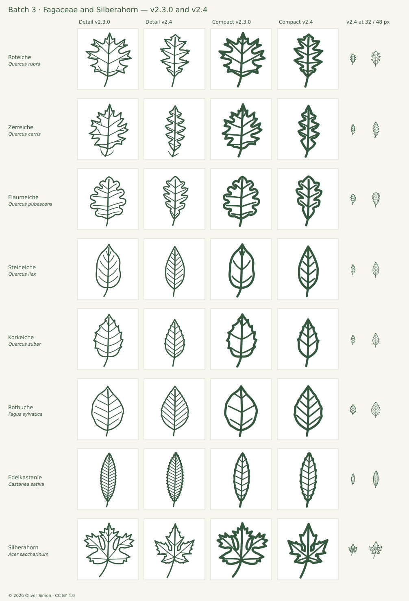
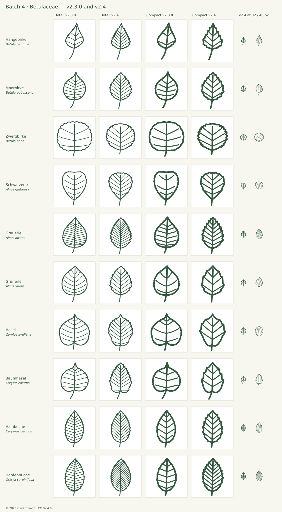
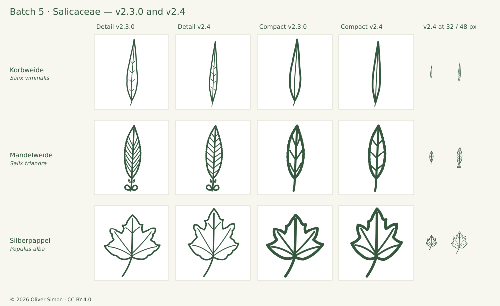
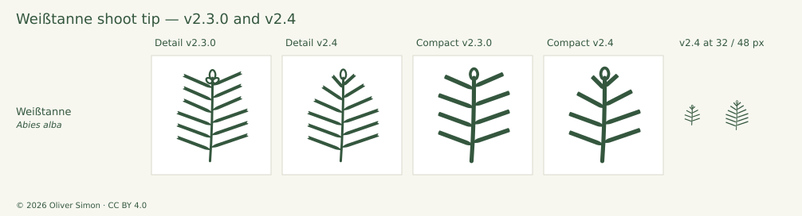

# Botanical review and revision · v2.4.0

2026-10-15 · 34 taxa re-reviewed in this release · 44 SVGs revised · baseline v2.3.0

v2.4.0 continues the source-guided batch re-review begun in [v2.3.0](AUDIT-2.3.md). Batch 3 covers the Fagaceae (seven oaks, beech, sweet chestnut) and, at the user's request, Silberahorn ahead of the maple batch; batch 4 the Betulaceae, including a second pass after user review that found the birch-family margin and vein-to-tooth relation unrepresented; batch 5 the Salicaceae; batch 6 a follow-up correction of the Weißtanne shoot tip after user review. Including v2.3.0 (22 gymnosperms reviewed, 25 taxa added), 80 of 200 taxa now carry a v2.3-or-later review; the other 120 keep their v2.2.3 record, marked `carried-over (review pending)`, until a later batch reaches them. Each reviewed taxon is compared with at least three foliage photographs inspected at full size, the primary treatment and independent descriptions; blade proportions are measured on the icons and on segmented leaf scans. Revisions pass the full geometry and raster suite, enlarged and target-size inspection on light and dark grounds, neighbor boards and a final before/after comparison. All records are in [audit-2.4.json](audit-2.4.json). Not independent botanical certification.

## Method

- **Photographs:** at least three close-ups of leaf, needle or shoot per taxon, from Wikimedia Commons, Oregon State University Landscape Plants, iNaturalist (research-grade or curated taxon photos, exact-name lookup) and Info Flora. Only photos inspected at full size are listed; habit, bark and cone-only images are not counted. Photos are linked, never traced or redistributed.
- **Descriptions:** the primary treatment from `src/icons.json` plus at least one independent description (Gymnosperm Database, university extension, national flora). Contradictions are reported, not averaged.
- **Drawing:** Detail and Compact at 700 px on an 8-unit grid and at 24/32/48/64/96 px on light and dark grounds. Filled needles are measured: length from the farthest contour-point pair, transverse width at 10 % steps along it.
- **Leaf scans:** photographs of single leaves on a plain background are segmented automatically; blade length : width is taken along the principal axis with the petiole trimmed (parts narrower than 12 % of the maximum width). Icons are measured along the midrib with the outline including lobes and teeth.
- **Revision:** needle and sheath shapes are rebuilt along the original centrelines where the composition is sound, so only the criticised character changes; recompositions are drawn from the photographs. Each revision passes `npm test` and a before/after board; optional refinements that harm legibility or blur neighbors are declined and recorded.
- **Neighbors:** related taxa side by side in both variants.

### Verdicts

| Code | Meaning                                                                    |
| ---- | -------------------------------------------------------------------------- |
| A    | Misrepresents a diagnostic character; must be redrawn.                     |
| B    | Clear, source-supported improvement.                                       |
| C    | Minor or optional refinement.                                              |
| R    | Retain; the drawing agrees with the evidence within documented reductions. |

A taxon's headline verdict is the stricter of its two variants; the verdict describes the v2.3.0 drawing before revision.

## Batch 3 · Fagaceae, with Silberahorn (user request) (10 taxa)

### Collection finding · oak-proportions (A/B)

Several oak icons were systematically too broad. Blade length : width was measured on the icons (midrib axis, outline incl. lobes) and on segmented leaf scans with plain backgrounds (OSU, Commons; petiole trimmed).

| Taxon        | Natural (scans / floras)                    | v2.3.0 Detail            | v2.4 Detail |
| ------------ | ------------------------------------------- | ------------------------ | ----------- |
| Roteiche     | 1.52 (Commons scan); FH 10–20 cm, 4–6 lobes | 0.95 (= Sumpfeiche 0.96) | 1.45        |
| Zerreiche    | 1.7–2.5 (OSU scan, 4 leaves)                | 1.15                     | 2.24        |
| Flaumeiche   | 1.5–1.9 (photos, EUFORGEN plate)            | 1.19                     | 1.75        |
| Steineiche   | 2.0–2.8 (OSU scan, 6 leaves)                | 1.79                     | 2.30        |
| Korkeiche    | 2.0–2.3 (OSU scan)                          | 1.45                     | 1.91        |
| Rotbuche     | 1.72–1.73 (OSU scans)                       | 1.39                     | 1.60        |
| Stieleiche   | 1.72–1.76 (OSU scan)                        | 1.60                     | unchanged   |
| Traubeneiche | ≈ 1.6–2.5 (OSU scan)                        | 1.81                     | unchanged   |

Redraw the four lobed outlines and the two evergreen oaks to the measured proportions; keep Stieleiche (within range, approved contour) and Traubeneiche.

**Implemented:** Roteiche, Zerreiche, Flaumeiche, Steineiche, Korkeiche and Rotbuche redrawn; ratios in the table.

### Per-taxon findings

| Taxon                            | Verdict D / C | Finding                                                                                                                                                                                                                                                                                                                                                                                                                                                        | Artwork                    | Primary source                                                            |
| -------------------------------- | ------------- | -------------------------------------------------------------------------------------------------------------------------------------------------------------------------------------------------------------------------------------------------------------------------------------------------------------------------------------------------------------------------------------------------------------------------------------------------------------- | -------------------------- | ------------------------------------------------------------------------- |
| Stieleiche · _Quercus robur_     | R / R         | Obovate blade with unequal rounded ascending lobes, small basal auricles and a very short petiole matches Flora Helvetica ("5–7 meist stumpfe Abschnitte, Stiel meist < 7 mm, am Grund mit Öhrchen") and the OSU leaf-base photograph. Nine Detail veins end in lobes and two intercalary veins in sinuses — the contrast with Traubeneiche stated by Flora Helvetica (verified on the drawing).                                                               | D: Unchanged; C: Unchanged | [Treatment](https://www.infoflora.ch/de/flora/quercus-robur.html)         |
| Traubeneiche · _Quercus petraea_ | R / R         | Elongated blade with shallow regular lobes, cuneate base without auricles and a long petiole agrees with Flora Helvetica ("Blattstiele 10–25 mm, ohne Öhrchen, keilförmig; Nerven nur in die Abschnitte"). All ten Detail veins end in lobes (verified).                                                                                                                                                                                                       | D: Unchanged; C: Unchanged | [Treatment](https://www.infoflora.ch/de/flora/quercus-petraea.html)       |
| Rotbuche · _Fagus sylvatica_     | B / B         | Undulate entire blade and short petiole are right, but the blade was too broad (1.39; OSU scans 1.72–1.73) and only five vein pairs spread at 51–65°; the OSU leaf shows about seven straight parallel pairs at ≈ 45°, each ending in a small marginal wave.                                                                                                                                                                                                   | D: Revised; C: Revised     | [Treatment](https://www.infoflora.ch/de/flora/fagus-sylvatica.html)       |
| Edelkastanie · _Castanea sativa_ | B / C         | Lanceolate outline (≈ 3 : 1) and 18 / 9 vein-to-tooth pairs agree with the sources, but the teeth were only ≈ 0.6 units deep in Detail and disappeared under the outline stroke; Flora Helvetica: "stachelig gezähnt"; photographs show coarse, forward, bristle-pointed teeth.                                                                                                                                                                                | D: Revised; C: Revised     | [Treatment](https://www.infoflora.ch/de/flora/castanea-sativa.html)       |
| Roteiche · _Quercus rubra_       | A / A         | Drawn wider than long (L/W 0.95), with lobes spreading horizontally like a maple — the same proportion as the new Sumpfeiche (0.96), whose broad outline and near-midrib sinuses are exactly what distinguishes it from Q. rubra. The Commons scan measures 1.52; lower lobes spread almost at right angles, upper lobes point forward; sinuses U-shaped, reaching to 31–45 % of the lobe reach; lobes end in 2–3 bristle-tipped teeth.                        | D: Revised; C: Revised     | [Treatment](https://www.infoflora.ch/de/flora/quercus-rubra.html)         |
| Flaumeiche · _Quercus pubescens_ | B / B         | Drawn nearly round (L/W 1.19) with shallow wavy lobes and unequal, partly horizontal veins; Flora Helvetica: leaves like Q. robur, petiole < 2 cm; photographs and the EUFORGEN plate show obovate leaves 1.5–1.9× as long as wide with lobes cut about half-way.                                                                                                                                                                                              | D: Revised; C: Revised     | [Treatment](https://www.infoflora.ch/de/flora/quercus-pubescens.html)     |
| Zerreiche · _Quercus cerris_     | A / A         | The catalog names a "längliche Spreite", but the drawing was broadly ovate (L/W 1.15) like a red oak. OSU leaf scans measure 1.7–2.5; Flora Helvetica: "8–15 cm, unregelmässig fiederteilig, Abschnitte ungleich grob gezähnt, mit knorpeliger Spitze … fadenförmige, bleibende Nebenblätter". The stipules were drawn as two arcs hugging the blade base like a cup.                                                                                          | D: Revised; C: Revised     | [Treatment](https://www.infoflora.ch/de/flora/quercus-cerris.html)        |
| Silberahorn · _Acer saccharinum_ | B / B         | Five deep lobes and coarse outer teeth are right, but the blade was wider than long (0.83; photographs ≈ 1.0–1.1), the sinuses beside the central lobe were narrow parallel-walled slots that read as holes, the basal lobes formed a broad flat "skirt", and the upper lateral lobes spread almost horizontally. OSU: "deeply lobed (5–7 lobes), coarse, sharp, irregular teeth; petiole 8–12 cm"; Info Flora: "5-lappig, Lappen länglich-eiförmig, gezähnt". | D: Revised; C: Revised     | [Treatment](https://www.infoflora.ch/de/flora/acer-saccharinum.html)      |
| Steineiche · _Quercus ilex_      | B / B         | Selected entire adult form is supported, but the blade was too broad and widest low (L/W 1.79, max at 0.33) and the veins were arched like a fishbone with a forked vein at the apex. OSU scan: L/W 2.0–2.8, widest near the middle, 7–10 nearly straight vein pairs at ≈ 45–55°.                                                                                                                                                                              | D: Revised; C: Revised     | [Treatment](https://www.infoflora.ch/de/flora/quercus-ilex.html)          |
| Korkeiche · _Quercus suber_      | B / B         | Ovate shape, rounded base and short teeth agree with OSU, but the blade was too broad (1.45; OSU scan 2.0–2.3), the teeth were coarse steps, the veins arched, and the Compact basal vein pair formed a U-shaped loop.                                                                                                                                                                                                                                         | D: Revised; C: Revised     | [Treatment](https://landscapeplants.oregonstate.edu/plants/quercus-suber) |

### Revisions and evidence

#### Stieleiche · _Quercus robur_

- C: blade slightly broader than the OSU scan (1.60 vs 1.72–1.76) — within natural variation; declined to preserve the approved v1.0.1 contour.

Measured (v2.3.0 and references): Detail L/W 1.60, max. width at 0.63; veins 5 + 6 (9 to lobes, 2 to sinuses).

Descriptions: [Primary treatment](https://www.infoflora.ch/de/flora/quercus-robur.html) · [Oregon State University Landscape Plants](https://landscapeplants.oregonstate.edu/plants/quercus-robur)

Photographs: [leaves](https://landscapeplants.oregonstate.edu/sites/plantid7/files/plantimage/quro7254.jpg) (Oregon State University, linked reference, not redistributed) · [leaves, upper and lower side](https://landscapeplants.oregonstate.edu/sites/plantid7/files/plantimage/quro7270.jpg) (Oregon State University, linked reference, not redistributed) · [leaf bases with auricles](https://landscapeplants.oregonstate.edu/sites/plantid7/files/plantimage/quro7273.jpg) (Oregon State University, linked reference, not redistributed) · [leaf](https://imgproxy.infoflora.ch/ek_u-Aba5ZfTwtJqbOTKMw/rs:fit:1000:800:1/g:ce/aHR0cHM6Ly93d3cuaW5mb2Zsb3JhLmNoL2RlLy9hc3NldHMvZGJfZG9jL3NwZWNpZXMvdGF4YV9pbWFnZXMvMjAxMi8wNi8xOS8yMDEyMDYxOTIzMTIzOS01NDhmNWE0My5qcGc.jpg) (K. Lauber (Flora Helvetica), linked reference, not redistributed)

#### Traubeneiche · _Quercus petraea_

- No change recommended.

Measured (v2.3.0 and references): Detail L/W 1.81; 5 + 5 veins, all to lobes; petiole ≈ 15 % of the blade.

Note: OSU "foliage" (qupet6578A) shows a laciniate cultivar and was not used.

Descriptions: [Primary treatment](https://www.infoflora.ch/de/flora/quercus-petraea.html) · [Oregon State University Landscape Plants](https://landscapeplants.oregonstate.edu/plants/quercus-petraea)

Photographs: [leaves with scale](https://landscapeplants.oregonstate.edu/sites/plantid7/files/plantimage/qupet6590A.jpg) (Oregon State University, linked reference, not redistributed) · [leaves and acorns](https://imgproxy.infoflora.ch/Rj1N40pwo9YTkY1iydo3HQ/rs:fit:1000:800:1/g:ce/aHR0cHM6Ly9pbWFnZS5pbmZvZmxvcmEuY2gvZmlsZXMvYXRsYXNGbG9yZVZhdWRvaXNlLzIwMjMwMzIxX2ltcG9ydF9BdGxhc0Zsb3JlVmF1ZG9pc2VfQ0hCL1F1ZXJjdXMtcGV0cmFlYV9Cb3JuYW5kLUNocmlzdG9waGVfMjAwNS0wOS0wOV82OTIyLmpwZw.jpg) (Christophe Bornand (Atlas Flore Vaudoise), linked reference, not redistributed) · [shoot with leaves](https://imgproxy.infoflora.ch/_Jf7FmU50FeqQ9XvetU4ug/rs:fit:1000:800:1/g:ce/aHR0cHM6Ly9pbWFnZS5pbmZvZmxvcmEuY2gvZmlsZXMvYXRsYXNGbG9yZVZhdWRvaXNlLzIwMjMwMzIxX2ltcG9ydF9BdGxhc0Zsb3JlVmF1ZG9pc2VfQ0hCL1F1ZXJjdXMtcGV0cmFlYV9Cb3JuYW5kLUNocmlzdG9waGVfMjAwNC0wOS0xM18xOTg2Ni5qcGc.jpg) (Christophe Bornand (Atlas Flore Vaudoise), linked reference, not redistributed) · [foliage](https://imgproxy.infoflora.ch/d-bjkZqrdEnMjpCIb8a9YQ/rs:fit:1000:800:1/g:ce/aHR0cHM6Ly9pbWFnZS5pbmZvZmxvcmEuY2gvZmlsZXMvRnJhbmNvaXNlQWxzYWtlci9mcmFuY29pc2VhbHNha2VyX0JPVF9JTkZPRkxPUkFfQVVTV0FITC8zMzJfRkEyNTM5NC5qcGc.jpg) (Françoise Alsaker, linked reference, not redistributed)

#### Rotbuche · _Fagus sylvatica_

- B: elliptic-ovate ≈ 1.6 : 1 with rounded base and short acumen.
- B: seven (Detail) / four (Compact) straight parallel vein pairs at ≈ 45–50°, small waves at the vein ends.

**Revised:** Redrawn: elliptic-ovate blade (L/W 1.60) with rounded base and short tip; seven (Detail) / four (Compact) straight parallel vein pairs at 47–54°, each ending at a small marginal wave.

Limits: Marginal hairs and higher vein orders omitted; shade leaves are broader.

Measured (v2.3.0 and references): v2.3.0 Detail L/W 1.39, 5 pairs at 51–65°; OSU scans L/W 1.72–1.73; ≈ 7 visible pairs at ≈ 45°.

Descriptions: [Primary treatment](https://www.infoflora.ch/de/flora/fagus-sylvatica.html) · [Oregon State University Landscape Plants](https://landscapeplants.oregonstate.edu/plants/fagus-sylvatica)

Photographs: [leaf](https://landscapeplants.oregonstate.edu/sites/plantid7/files/plantimage/fasy4532.jpg) (Oregon State University, linked reference, not redistributed) · [leaf and ciliate margin, comparison with F. grandifolia](https://landscapeplants.oregonstate.edu/sites/plantid7/files/plantimage/fagr-sy3.jpg) (Oregon State University, linked reference, not redistributed) · [leaves, comparison](https://landscapeplants.oregonstate.edu/sites/plantid7/files/plantimage/fagr-sy9.jpg) (Oregon State University, linked reference, not redistributed) · [leaves](https://landscapeplants.oregonstate.edu/sites/plantid7/files/plantimage/fasy47.jpg) (Oregon State University, linked reference, not redistributed)

#### Edelkastanie · _Castanea sativa_

- B (Detail) / C (Compact): deepen each tooth (apex moved ≈ 1 unit outward and slightly forward); veins follow their apices.

**Revised:** Each tooth apex moved ≈ 1 unit outward (0.7 in Compact) and slightly forward; the 18 / 9 veins follow their apices. Outline, counts and proportions otherwise unchanged.

Limits: Eighteen vein-tooth pairs in Detail, nine in Compact; awn-like tooth tips are shortened.

Measured (v2.3.0 and references): v2.3.0 Detail tooth depth ≈ 0.6 units (outline stroke 1.9).

Descriptions: [Primary treatment](https://www.infoflora.ch/de/flora/castanea-sativa.html) · [Oregon State University Landscape Plants](https://landscapeplants.oregonstate.edu/plants/castanea-sativa)

Photographs: [leaves](https://landscapeplants.oregonstate.edu/sites/plantid7/files/plantimage/casat1464.jpg) (Oregon State University, linked reference, not redistributed) · [leaves](https://landscapeplants.oregonstate.edu/sites/plantid7/files/plantimage/casat9085A.jpg) (Oregon State University, linked reference, not redistributed) · [leaves and fruit](https://imgproxy.infoflora.ch/TVMaKvzqstnXqelCkvxrfg/rs:fit:1000:800:1/g:ce/aHR0cHM6Ly9pbWFnZS5pbmZvZmxvcmEuY2gvZmlsZXMvYXRsYXNGbG9yZVZhdWRvaXNlLzIwMjMwMzIxX2ltcG9ydF9BdGxhc0Zsb3JlVmF1ZG9pc2VfQ0hCL0Nhc3RhbmVhLXNhdGl2YV9Cb3JuYW5kLUNocmlzdG9waGVfMjAwNC0wOS0xMl8xOTc5Ny5qcGc.jpg) (Christophe Bornand (Atlas Flore Vaudoise), linked reference, not redistributed)

#### Roteiche · _Quercus rubra_

- A: oblong-obovate blade ≈ 1.5 : 1; four lobe pairs and terminal lobe; lower lobes ≈ perpendicular, upper forward.
- B: U-shaped sinuses about half-way; broad lobes ending in bristle-tipped teeth (Detail), pointed lobes (Compact); cuneate base.

**Revised:** Redrawn: oblong-obovate blade (L/W 1.45 Detail / 1.51 Compact), four lobe pairs plus terminal lobe; lower lobes nearly perpendicular, upper lobes forward; U-shaped sinuses about half-way; broad lobes ending in 2–3 bristle-tipped teeth (Detail), pointed lobes (Compact); cuneate base; veins along the lobe axes.

Limits: Bristles are shortened; sun leaves are more deeply cut. Petiole reduced to ≈ 1/4 of the blade.

Measured (v2.3.0 and references): v2.3.0 Detail L/W 0.95; Commons scan L/W 1.52, sinus depth 55–69 % of lobe reach, lobe length ≈ 2.6 × half base width.

Descriptions: [Primary treatment](https://www.infoflora.ch/de/flora/quercus-rubra.html) · [Oregon State University Landscape Plants](https://landscapeplants.oregonstate.edu/plants/quercus-rubra)

Photographs: [leaf scan](<https://commons.wikimedia.org/wiki/File:Quercus_rubra-(EU).jpg>) (Ed Uebel, CC BY-SA 3.0) · [leaves](https://landscapeplants.oregonstate.edu/sites/plantid7/files/plantimage/quru83.jpg) (Oregon State University, linked reference, not redistributed) · [leaf tips with bristles](https://landscapeplants.oregonstate.edu/sites/plantid7/files/plantimage/quru4464.jpg) (Oregon State University, linked reference, not redistributed) · [leaves](https://landscapeplants.oregonstate.edu/sites/plantid7/files/plantimage/quru4472.jpg) (Oregon State University, linked reference, not redistributed) · [leaf](https://commons.wikimedia.org/wiki/File:Quercus_rubra_leaf_20060624.jpg) (Mark Wagner, CC BY 2.5)

#### Flaumeiche · _Quercus pubescens_

- B: obovate blade ≈ 1.6–1.8 : 1, five rounded ascending lobes per side (four in Compact), sinuses about half-way.
- B: veins ascending into the lobes; cuneate base without auricles; short but visible petiole (contrast with Stieleiche).

**Revised:** Redrawn: obovate blade (L/W 1.75 / 1.71) with five / four rounded ascending lobes per side, sinuses about half-way, cuneate base without auricles, short visible petiole; veins into the lobes.

Limits: The decisive grey stellate hairs cannot be shown; the outline overlaps with Stieleiche, Traubeneiche and hybrids.

Measured (v2.3.0 and references): v2.3.0 Detail L/W 1.19, veins at 53–89° incl. horizontal pairs; photographs L/W 1.47 (EUFORGEN), ≈ 1.6–1.9 (Kenraiz, Nàydenov).

Descriptions: [Primary treatment](https://www.infoflora.ch/de/flora/quercus-pubescens.html) · [EUFORGEN Quercus pubescens](https://www.euforgen.org/species/quercus-pubescens/)

Photographs: [Quercus pubescens leaves kz.jpg](https://commons.wikimedia.org/wiki/File:Quercus_pubescens_leaves_kz.jpg) (Kenraiz, Public domain) · [Quercus pubescens leaves kz2.jpg](https://commons.wikimedia.org/wiki/File:Quercus_pubescens_leaves_kz2.jpg) (Kenraiz, Public domain) · [leaf illustration](https://commons.wikimedia.org/wiki/File:Quercus_pubescens_leaf_illustration.jpg) (G. Bernetti / EUFORGEN, CC BY-SA 4.0) · [leaves and acorns](https://commons.wikimedia.org/wiki/File:%D0%9A%D0%BE%D1%81%D0%BC%D0%B0%D1%82_%D0%B4%D1%8A%D0%B1_%E2%80%93_%D0%BB%D0%B8%D1%81%D1%82%D0%B0_%D0%B8_%D0%B6%D1%8A%D0%BB%D1%8A%D0%B4%D0%B8.jpg) (Dimìtar Nàydenov, CC BY-SA 4.0) · [shoot with leaves and acorns](https://imgproxy.infoflora.ch/MS-X59RHFgUBGnJ7GX6sdw/rs:fit:1000:800:1/g:ce/aHR0cHM6Ly9pbWFnZS5pbmZvZmxvcmEuY2gvZmlsZXMvRnJhbmNvaXNDbG90L1F1ZXJjdXMgcHViZXNjZW5zLmpwZw.jpg) (François Clot, linked reference, not redistributed)

#### Zerreiche · _Quercus cerris_

- A: narrow-oblong blade ≈ 2.2 : 1 with irregular triangular, pointed lobes (fiederteilig: sinuses beyond half-way).
- C: stipules as straight diverging filaments at the petiole base.

**Revised:** Redrawn: narrow-oblong blade (L/W 2.24) with five (Detail) / four (Compact) irregular triangular lobes per side, sinuses beyond half-way, a secondary tooth on one Detail lobe, cuneate base; veins to the lobe tips; straight filiform stipules at the petiole base (Detail).

Limits: Lobe number and depth vary strongly (OSU scan: 5–8 per side); stellate hairs and cartilaginous lobe tips not encoded. Compact omits stipules.

Measured (v2.3.0 and references): v2.3.0 Detail L/W 1.15; OSU scan (4 leaves) 1.76, 1.73, 2.53, 2.32.

Descriptions: [Primary treatment](https://www.infoflora.ch/de/flora/quercus-cerris.html) · [Oregon State University Landscape Plants](https://landscapeplants.oregonstate.edu/plants/quercus-cerris)

Photographs: [leaves, variation](https://landscapeplants.oregonstate.edu/sites/plantid7/files/plantimage/qucer6156A_0.jpg) (Oregon State University, linked reference, not redistributed) · [leaves with coin for scale](https://landscapeplants.oregonstate.edu/sites/plantid7/files/plantimage/qucer0453.jpg) (Oregon State University, linked reference, not redistributed) · [leaves](https://landscapeplants.oregonstate.edu/sites/plantid7/files/plantimage/qucer5524A.jpg) (Oregon State University, linked reference, not redistributed) · [foliage](https://landscapeplants.oregonstate.edu/sites/plantid7/files/plantimage/qucer0451.jpg) (Oregon State University, linked reference, not redistributed) · [shoot, Monte Generoso](https://imgproxy.infoflora.ch/IGaHop6_JVvwtEDlqNSHuQ/rs:fit:1000:800:1/g:ce/aHR0cHM6Ly9pbWFnZS5pbmZvZmxvcmEuY2gvZmlsZXMvTWljaGFlbEp1dHppL0ZhbWlseV9GYWdhY2VhZS9Nb250ZUdlbmVyb3NvXzIwMTQwNzEwXzRfUXVlcmN1c19jZXJyaXMuSlBH.jpg) (Michael Jutzi, linked reference, not redistributed)

#### Silberahorn · _Acer saccharinum_

- B: blade ≈ 1 : 1; upper lateral lobes at ≈ 50° from the midline, small basal lobes.
- B: deep U-shaped sinuses that open outward between diverging lobes; central lobe narrowed at its base and widening into a three-pointed upper part; coarse sharp teeth on the outer halves.

**Revised:** Redrawn with a palmate construction: blade ≈ 1 : 1, central lobe narrowed at its base with two large side teeth, upper lateral lobes at ≈ 50°, small basal lobes, U-shaped sinuses opening outward, coarse sharp teeth on the outer lobe halves (Detail 5 per lateral lobe, Compact 2); five primary veins and, in Detail, branches to the large teeth.

Limits: Petiole shortened to ≈ 45 % of the blade (naturally 70–90 %); silver underside and cultivar variation absent.

Measured (v2.3.0 and references): v2.3.0 Detail L/W 0.83.

Note: Reviewed ahead of the maple batch at the user's request.

Descriptions: [Primary treatment](https://www.infoflora.ch/de/flora/acer-saccharinum.html) · [Oregon State University Landscape Plants](https://landscapeplants.oregonstate.edu/plants/acer-saccharinum)

Photographs: [leaves, upper and lower side](https://landscapeplants.oregonstate.edu/sites/plantid7/files/plantimage/acsri6.jpg) (Oregon State University, linked reference, not redistributed) · [leafy shoot](https://landscapeplants.oregonstate.edu/sites/plantid7/files/plantimage/acsri342C.jpg) (Oregon State University, linked reference, not redistributed) · [leaves](https://landscapeplants.oregonstate.edu/sites/plantid7/files/plantimage/acsri709A.jpg) (Oregon State University, linked reference, not redistributed)

#### Steineiche · _Quercus ilex_

- B: elliptic-oblong blade ≈ 2.2 : 1, rounded base, acute apex.
- B: 7 / 4 nearly straight vein pairs; remove the apical vein fork.

**Revised:** Redrawn: elliptic-oblong blade (L/W 2.30) with rounded base and acute apex; seven (Detail) / four (Compact) nearly straight vein pairs at 44–55°; no apical vein fork.

Limits: Selected entire adult form; spiny juvenile leaves not shown. Underside felt omitted; similar to other entire evergreen leaves (Lorbeer).

Measured (v2.3.0 and references): v2.3.0 Detail L/W 1.79; OSU scan (6 leaves) 2.01–2.76.

Descriptions: [Primary treatment](https://www.infoflora.ch/de/flora/quercus-ilex.html) · [Oregon State University Landscape Plants](https://landscapeplants.oregonstate.edu/plants/quercus-ilex)

Photographs: [leaves](https://landscapeplants.oregonstate.edu/sites/plantid7/files/plantimage/quilex9.jpg) (Oregon State University, linked reference, not redistributed) · [leaves with scale, adult and juvenile](https://landscapeplants.oregonstate.edu/sites/plantid7/files/plantimage/quilex6217A.jpg) (Oregon State University, linked reference, not redistributed) · [leaf, upper and lower side](https://landscapeplants.oregonstate.edu/sites/plantid7/files/plantimage/quilex910.jpg) (Oregon State University, linked reference, not redistributed) · [shoot, Caslano](https://imgproxy.infoflora.ch/jz1-5IzYFF3SAMLmw2aHdQ/rs:fit:1000:800:1/g:ce/aHR0cHM6Ly9pbWFnZS5pbmZvZmxvcmEuY2gvZmlsZXMvc3BlY2llcy8yMDIzLzAyLzIzLzIwMDkwMzIxXzE0NDMzN19jYXNsYW5vLmpwZw.jpg) (Info Flora contributor, linked reference, not redistributed)

#### Korkeiche · _Quercus suber_

- B: ovate-oblong ≈ 2 : 1, widest below the middle, rounded base, petiole ≈ 1/5 of the blade.
- B: short forward mucronate teeth on the upper two thirds, each receiving a straight vein.

**Revised:** Redrawn: ovate-oblong blade (L/W 1.91), rounded base, five (Detail) / three (Compact) short forward mucronate teeth per side on the upper two thirds, each with a straight vein; one basal vein pair in Detail; petiole ≈ 1/5 of the blade.

Limits: Leaves vary from entire to toothed; cork bark and underside felt omitted.

Measured (v2.3.0 and references): v2.3.0 Detail L/W 1.45; OSU scan 2.04–2.32 (petiole 16–28 % of blade).

Descriptions: [Primary treatment](https://landscapeplants.oregonstate.edu/plants/quercus-suber)

Photographs: [leaves with scale, upper and lower side](https://landscapeplants.oregonstate.edu/sites/plantid7/files/plantimage/qusu3828.jpg) (Oregon State University, linked reference, not redistributed) · [leaves on shoot](https://landscapeplants.oregonstate.edu/sites/plantid7/files/plantimage/qusu795B.jpg) (Oregon State University, linked reference, not redistributed) · [foliage](https://landscapeplants.oregonstate.edu/sites/plantid7/files/plantimage/qusu3821.jpg) (Oregon State University, linked reference, not redistributed) · [leaves](https://landscapeplants.oregonstate.edu/sites/plantid7/files/plantimage/qusu794B.jpg) (Oregon State University, linked reference, not redistributed)

## Batch 4 · Betulaceae (10 taxa)

### Collection finding · betulaceae-vein-angle (B)

In birches, alders, hazels, hornbeam and hop-hornbeam the straight, parallel secondary veins leave the midrib at a steep angle and run obliquely forward to the teeth; every leaf photograph of the batch shows roughly 40–55°. Most v2.3.0 icons drew them at 70–85° — nearly perpendicular, which reads as elm or lime rather than the birch family — and several as arcs. Angles were measured on the icons between the midrib chord and each vein chord.

| Taxon       | v2.3.0 Detail (lowest → highest pair)       | v2.4 Detail            | Pairs D / C                |
| ----------- | ------------------------------------------- | ---------------------- | -------------------------- |
| Hängebirke  | 58–72°, 3 curved pairs                      | 50–42°                 | 6 / 3 (was 3 / 2)          |
| Moorbirke   | 85–53°                                      | 56–44°                 | 7 / 4                      |
| Zwergbirke  | 84–65°                                      | 62–50°                 | 3 / 3                      |
| Schwarzerle | 56–69° chord, 64–88° at the origin (arched) | 56–46°, straight       | 5 / 3                      |
| Grauerle    | 80–56°                                      | 50–40°                 | 12 / 6                     |
| Grünerle    | 73–27°, arched                              | 50–40°                 | 6 / 3                      |
| Hasel       | 75–50°, arched                              | 84° basal pair, 60–44° | 7 / 4 (was 6 / 4)          |
| Baumhasel   | 86–40°                                      | 88° basal pair, 57–44° | 8 / 4 (was 6 / 3)          |
| Hainbuche   | 70–73°                                      | 50–40°                 | 10 / 5 (Compact unchanged) |
| Hopfenbuche | 70–98°                                      | 54–44°                 | 16 / 7                     |

Rebuild the lateral veins as straight lines at the photographed angle, keeping each outline, midrib and selected count; where veins end at teeth (hop-hornbeam, hornbeam, grey and green alder, birches), each vein is snapped to its own tooth apex.

**Implemented:** All ten taxa re-veined (Hainbuche Compact already correct).

### Collection finding · betulaceae-second-pass (B)

A second pass after user review found that re-veining alone left two diagnostic characters of the birch family unrepresented in five taxa: (1) the secondary veins end IN the primary teeth (craspedodromous venation) — the icons had veins stopping short of a fine, uniform margin; (2) the margin is coarsely doubly serrate (alders, hazels) or crenate-dentate (dwarf birch), with a primary tooth at every vein end and smaller teeth between — the icons had evenly scalloped or finely wavy margins. Outlines were also checked against seven Schwarzerle and six Hasel herbarium scans (Makeev 2020, measured half-width profiles).

| Taxon       | Missed detail                                                                                 | v2.4 (second pass)                                                                                         |
| ----------- | --------------------------------------------------------------------------------------------- | ---------------------------------------------------------------------------------------------------------- |
| Grauerle    | coarsely doubly serrate, nearly lobulate margin; veins into teeth                             | vein-first construction: 12 / 6 veins each ending in a primary tooth, one (Detail) secondary tooth between |
| Schwarzerle | cuneate base, broad truncate-retuse apex; veins into teeth; doubly serrate                    | L/W 1.12 (scans 1.04–1.13), retuse apex, 6 / 4 veins into teeth                                            |
| Zwergbirke  | broader than long; blunt teeth at the vein ends                                               | L/W 0.91, crenate-dentate margin with a crest at every vein end                                            |
| Hasel       | L/W 1.35 (scans 1.21–1.49), not circular; shallowly cordate; coarse double teeth; abrupt cusp | outline from the measured profile (L/W 1.29), two secondary teeth per primary in Detail                    |
| Baumhasel   | deeply cordate rounded basal lobes; coarse double teeth                                       | rounded basal lobes below the junction, two secondary teeth per primary in Detail                          |

Rebuild these five with a vein-first margin: veins at the photographed angles define where the primary teeth sit. Re-check the rest of the family for the same omission.

**Implemented:** Grauerle, Schwarzerle, Zwergbirke, Hasel and Baumhasel redrawn. The follow-up check found the same fine, uniform margin in Hängebirke, Moorbirke, Grünerle, Hainbuche and Hopfenbuche; they were redrawn the same way (teeth continue down toward the base, smaller near it). A regression checks for all ten that each vein ends in its own tooth.

### Per-taxon findings

| Taxon                               | Verdict D / C | Finding                                                                                                                                                                                                                                                                                                                                                                                              | Artwork                | Primary source                                                          |
| ----------------------------------- | ------------- | ---------------------------------------------------------------------------------------------------------------------------------------------------------------------------------------------------------------------------------------------------------------------------------------------------------------------------------------------------------------------------------------------------- | ---------------------- | ----------------------------------------------------------------------- |
| Hängebirke · _Betula pendula_       | B / B         | Triangular-rhombic, long-acuminate, doubly serrate outline with a long petiole matches Flora Helvetica ("rautenförmig bis 3eckig, lang zugespitzt, doppelt gezähnt") and the OSU leaves. Only three curved vein pairs (two in Compact), the lower ones bending outward like a palmate leaf; photographs show six to seven straight pairs at ≈ 45°.                                                   | D: Revised; C: Revised | [Treatment](https://www.infoflora.ch/de/flora/betula-pendula.html)      |
| Schwarzerle · _Alnus glutinosa_     | B / B         | Obovate blade with a broad, shallowly notched apex and cuneate base matches Flora Helvetica ("vorn stumpf oder ausgerandet, mit 4–7 Paaren von Seitennerven") and the OSU leaves. The veins were arcs leaving the midrib almost at right angles; the photographs show straight, parallel veins at ≈ 45–55°.                                                                                          | D: Revised; C: Revised | [Treatment](https://www.infoflora.ch/de/flora/alnus-glutinosa.html)     |
| Hainbuche · _Carpinus betulus_      | B / B         | Ovate-oblong, doubly serrate blade with a slightly unequal base and ten Detail vein pairs agrees with Flora Helvetica ("eiförmig-länglich, doppelt gezähnt, am Grund meist asymmetrisch, meist höchstens 14 Paare") and the OSU photographs. In Detail the veins stood at 70–73°; the photographs show the characteristic close, straight, parallel veins at ≈ 45°. Compact (40–60°) already agrees. | D: Revised; C: Revised | [Treatment](https://www.infoflora.ch/de/flora/carpinus-betulus.html)    |
| Hasel · _Corylus avellana_          | B / B         | Cordate, shortly cuspidate, doubly toothed blade agrees with Flora Helvetica ("oval, rundlich oder herzförmig, doppelt gezähnt"), but the outline was almost circular (L/W 1.02). The veins were arched and left the midrib almost perpendicularly; the photographs show straight veins at ≈ 45–55° and a basal pair running out into the cordate lobes.                                             | D: Revised; C: Revised | [Treatment](https://www.infoflora.ch/de/flora/corylus-avellana.html)    |
| Moorbirke · _Betula pubescens_      | B / B         | Ovate blade with rounded base and short tip agrees with Flora Helvetica ("mehr eiförmig, Zähne 1. Ordnung ohne feine, eingebogene Spitze") and the OSU pubescens/pendula comparison. The seven vein pairs were nearly horizontal at the base (85°).                                                                                                                                                  | D: Revised; C: Revised | [Treatment](https://www.infoflora.ch/de/flora/betula-pubescens.html)    |
| Grauerle · _Alnus incana_           | B / B         | Flora Helvetica: "eiförmig, spitz, grösste Breite meist unterhalb der Mitte, mit (8–)10–15 Paaren von Seitennerven". The twelve pairs and acute tip are right, but the veins stood at 56–80° and the blade was broad (L/W 1.24); the Commons photographs show straight veins at ≈ 45° and leaves ≈ 1.4–1.6 × as long as wide.                                                                        | D: Revised; C: Revised | [Treatment](https://www.infoflora.ch/de/flora/alnus-incana.html)        |
| Baumhasel · _Corylus colurna_       | B / B         | Drawn as round as the common hazel (L/W 1.04). Info Flora: "Blätter 70–120 mm lang, mit 1,5–3 cm langen Blattstielen; eiförmig, herzförmig, spitz, doppelt gezähnt bis flach unregelmässig gelappt"; OSU: "ovate to obovate, acuminate tip, base cordate". The OSU leaf photographs measure 1.46–1.56 and show a deeper cordate base, coarser double teeth and straight veins at ≈ 45–55°.           | D: Revised; C: Revised | [Treatment](https://www.infoflora.ch/de/flora/corylus-colurna.html)     |
| Hopfenbuche · _Ostrya carpinifolia_ | B / B         | Ovate, acuminate, doubly serrate blade with many vein pairs (Flora Helvetica: "meist mit mehr als 14 Seitennervenpaaren, 3–10 mm lang gestielt") is right, but the veins stood at 70–80° (the basal Detail pair even pointed backward at 98°); the Info Flora photographs show straight veins at ≈ 45–50°.                                                                                           | D: Revised; C: Revised | [Treatment](https://www.infoflora.ch/de/flora/ostrya-carpinifolia.html) |
| Zwergbirke · _Betula nana_          | B / B         | Round, broader-than-long crenate blade with a very short petiole broadly matches Flora Helvetica ("rundlich, oft breiter als lang, mit stumpfen Zähnen") and the OSU leaves. The three vein pairs ran almost horizontally (84–65°); photographs show them ascending at ≈ 50–60°.                                                                                                                     | D: Revised; C: Revised | [Treatment](https://www.infoflora.ch/de/flora/betula-nana.html)         |
| Grünerle · _Alnus viridis_          | B / B         | Flora Helvetica: "eiförmig, spitz, doppelt gezähnt, mit 5–7(–9) Paaren von Seitennerven". Alpine photographs (Trentino, Vorarlberg, Dolomites) show ovate, acute leaves ≈ 1.3–1.5 × as long as wide with straight veins at ≈ 45°; the icon was broad (1.15) with arched veins sweeping into the apex.                                                                                                | D: Revised; C: Revised | [Treatment](https://www.infoflora.ch/de/flora/alnus-viridis.html)       |

### Revisions and evidence

#### Hängebirke · _Betula pendula_

- B: six (Detail) / three (Compact) straight vein pairs at ≈ 42–50°, each ending at a primary tooth.
- B (follow-up): doubly serrate margin (two secondary teeth per primary in Detail) and a straighter broadly cuneate base; the margin was a fine uniform wave.

**Revised:** Redrawn (follow-up): triangular-rhombic blade (L/W 1.34) with a straighter broadly cuneate base and long acuminate tip; doubly serrate margin (two secondary teeth per primary in Detail) continued toward the base; six / three straight veins at 54–44° ending in primary teeth.

Limits: The fine incurved tips of the primary teeth (Flora Helvetica) are not drawable; Compact uses single teeth.

Measured (v2.3.0 and references): Detail L/W 1.37, max. width at 0.33; veins 3 + 3 at 42–72°.

Descriptions: [Primary treatment](https://www.infoflora.ch/de/flora/betula-pendula.html) · [Oregon State University Landscape Plants](https://landscapeplants.oregonstate.edu/plants/betula-pendula)

Photographs: [leafy shoot](https://landscapeplants.oregonstate.edu/sites/plantid7/files/plantimage/bepe74.jpg) (Oregon State University, linked reference, not redistributed) · [leaves, upper and lower side](https://landscapeplants.oregonstate.edu/sites/plantid7/files/plantimage/bepe987A.jpg) (Oregon State University, linked reference, not redistributed) · [shoot with leaves and catkins](https://imgproxy.infoflora.ch/p0zyN4AkeOfNUaCW-8CNEA/rs:fit:1000:800:1/g:ce/aHR0cHM6Ly9pbWFnZS5pbmZvZmxvcmEuY2gvZmlsZXMvc3BlY2llcy90YXhhX2ltYWdlcy8yMDEyLzA2LzIwLzIwMTIwNjIwMjM1OTAwLWMzMTA2ZWZlLmpwZw.jpg) (Info Flora, linked reference, not redistributed)

#### Schwarzerle · _Alnus glutinosa_

- C: five (Detail) / three (Compact) straight veins at ≈ 46–56°.
- B (second pass): veins ending in primary teeth of a doubly serrate margin; cuneate base and broad retuse apex as in the herbarium scans (L/W 1.04–1.13).

**Revised:** Redrawn (second pass): broadly obovate blade (L/W 1.12) with straight cuneate lower part, broad truncate apex with a shallow notch, six / four straight veins ending in primary teeth of a doubly serrate margin; lowest pair steeper so that it diverges from the cuneate base.

Limits: Hair tufts in the vein axils and sticky young leaves not shown.

Measured (v2.3.0 and references): Detail L/W 1.17; veins 5 + 5, chord 56–69°, 64–88° at their origin.

Descriptions: [Primary treatment](https://www.infoflora.ch/de/flora/alnus-glutinosa.html) · [Oregon State University Landscape Plants](https://landscapeplants.oregonstate.edu/plants/alnus-glutinosa)

Photographs: [leaves, upper and lower side](https://landscapeplants.oregonstate.edu/sites/plantid7/files/plantimage/alglu520A.jpg) (Oregon State University, linked reference, not redistributed) · [leaves](https://landscapeplants.oregonstate.edu/sites/plantid7/files/plantimage/alglu1006.jpg) (Oregon State University, linked reference, not redistributed) · [leaves](https://landscapeplants.oregonstate.edu/sites/plantid7/files/plantimage/alglu1007_0.jpg) (Oregon State University, linked reference, not redistributed) · [herbarium leaf](https://commons.wikimedia.org/wiki/File:2020_year._Herbarium._Alnus_glutinosa._img-014.jpg) (Dmitry Makeev, CC BY-SA 4.0) · [herbarium leaf](https://commons.wikimedia.org/wiki/File:2020_year._Herbarium._Alnus_glutinosa._img-016.jpg) (Dmitry Makeev, CC BY-SA 4.0) · [herbarium leaf](https://commons.wikimedia.org/wiki/File:2020_year._Herbarium._Alnus_glutinosa._img-010.jpg) (Dmitry Makeev, CC BY-SA 4.0)

#### Hainbuche · _Carpinus betulus_

- B (Detail): veins at ≈ 40–50°, each ending at a primary tooth.
- B (follow-up, both sizes): finely doubly serrate margin with a primary tooth at every vein end; Compact basal veins no longer hook backward.

**Revised:** Redrawn (follow-up): ovate-oblong blade (L/W 1.63) with rounded, slightly unequal base; finely doubly serrate margin, ten / five close parallel veins at 52–42° ending in primary teeth.

Limits: Ten / five pairs reduce the natural 10–14.

Measured (v2.3.0 and references): Detail L/W 1.68; veins 10 + 10 at 70–73°. Compact 5 + 5 at 40–60°.

Descriptions: [Primary treatment](https://www.infoflora.ch/de/flora/carpinus-betulus.html) · [Oregon State University Landscape Plants](https://landscapeplants.oregonstate.edu/plants/carpinus-betulus)

Photographs: [leaves](https://landscapeplants.oregonstate.edu/sites/plantid7/files/plantimage/cabe96.jpg) (Oregon State University, linked reference, not redistributed) · [leaves and fruit clusters](https://landscapeplants.oregonstate.edu/sites/plantid7/files/plantimage/cabe13.jpg) (Oregon State University, linked reference, not redistributed) · [leaves and fruit, comparison with C. caroliniana](https://landscapeplants.oregonstate.edu/sites/plantid7/files/plantimage/carpi8.jpg) (Oregon State University, linked reference, not redistributed) · [shoot with fruit](https://imgproxy.infoflora.ch/yhH1Z1Xzy6S4P169sVjsQw/rs:fit:1000:800:1/g:ce/aHR0cHM6Ly9pbWFnZS5pbmZvZmxvcmEuY2gvZmlsZXMvYXRsYXNGbG9yZVZhdWRvaXNlLzIwMjMwMzIxX2ltcG9ydF9BdGxhc0Zsb3JlVmF1ZG9pc2VfQ0hCL0NhcnBpbnVzLWJldHVsdXNfQm9ybmFuZC1DaHJpc3RvcGhlXzIwMDQtMDUtMjhfMTUxNDUuanBn.jpg) (Christophe Bornand (Atlas Flore Vaudoise), linked reference, not redistributed)

#### Hasel · _Corylus avellana_

- C: basal pair at ≈ 80–85° into the basal lobes; six (Detail) / three (Compact) further straight pairs at ≈ 44–60°.
- B (second pass): outline too circular (L/W 1.02); six herbarium scans give 1.21–1.49 (mean 1.35) with the maximum width at the middle, a shallowly cordate base and an abrupt cusp; coarse double teeth with veins ending in them.

**Revised:** Redrawn (second pass) from the mean herbarium profile: broadly ovate-obovate blade (L/W 1.29), widest at the middle, shallowly cordate rounded base, abrupt short cusp, coarse doubly serrate margin (two secondary teeth per primary in Detail); basal pair at 74° plus six straight pairs (Compact three pairs, no basal pair) ending in the primary teeth.

Limits: Hairs and the small lobulation near the apex of some leaves omitted.

Measured (v2.3.0 and references): Detail L/W 1.02; veins 6 + 6, chord 75–50°, 80° at their origin.

Descriptions: [Primary treatment](https://www.infoflora.ch/de/flora/corylus-avellana.html) · [Oregon State University Landscape Plants](https://landscapeplants.oregonstate.edu/plants/corylus-avellana)

Photographs: [leaves, upper and lower side](https://landscapeplants.oregonstate.edu/sites/plantid7/files/plantimage/coav60.jpg) (Oregon State University, linked reference, not redistributed) · [leaves and developing fruit](https://landscapeplants.oregonstate.edu/sites/plantid7/files/plantimage/coav31.jpg) (Oregon State University, linked reference, not redistributed) · [leaves](https://imgproxy.infoflora.ch/viadiuwtnEpWjzcO-RUryA/rs:fit:1000:800:1/g:ce/aHR0cHM6Ly9pbWFnZS5pbmZvZmxvcmEuY2gvZmlsZXMvUGF0cmlja1ZleWEvQ29yeWx1cyBhdmVsbGFuYV9TVUkxNjk3MS5KUEc.jpg) (Patrick Veya, linked reference, not redistributed) · [herbarium leaf](https://commons.wikimedia.org/wiki/File:2020_year._Herbarium._Corylus_avellana._img-009.jpg) (Dmitry Makeev, CC BY-SA 4.0) · [herbarium leaf](https://commons.wikimedia.org/wiki/File:2020_year._Herbarium._Corylus_avellana._img-001.jpg) (Dmitry Makeev, CC BY-SA 4.0) · [herbarium leaf](https://commons.wikimedia.org/wiki/File:2020_year._Herbarium._Corylus_avellana._img-023.jpg) (Dmitry Makeev, CC BY-SA 4.0)

#### Moorbirke · _Betula pubescens_

- B: straight veins at ≈ 44–56°.
- B (follow-up): coarser teeth with a primary tooth at each vein end; the margin was a fine uniform wave.

**Revised:** Redrawn (follow-up): ovate blade (L/W 1.27), coarser teeth with one secondary tooth per primary in Detail, seven / four straight veins at 58–45° ending in primary teeth.

Limits: Underside hairs in the vein axils and the hybrid swarm with B. pendula are not shown.

Measured (v2.3.0 and references): Detail L/W 1.25; veins 7 + 7 at 85–53°.

Descriptions: [Primary treatment](https://www.infoflora.ch/de/flora/betula-pubescens.html) · [Oregon State University Landscape Plants](https://landscapeplants.oregonstate.edu/plants/betula-pubescens)

Photographs: [leaves](https://landscapeplants.oregonstate.edu/sites/plantid7/files/plantimage/bepub5610B.jpg) (Oregon State University, linked reference, not redistributed) · [leaves on shoot](https://landscapeplants.oregonstate.edu/sites/plantid7/files/plantimage/bepub5619A_0.jpg) (Oregon State University, linked reference, not redistributed) · [leaf, comparison with B. pendula](https://landscapeplants.oregonstate.edu/sites/plantid7/files/plantimage/be-pub-pe1A_0.jpg) (Oregon State University, linked reference, not redistributed) · [shoot with leaves](https://imgproxy.infoflora.ch/-VIHJPvODxxYNXfVREBQcQ/rs:fit:1000:800:1/g:ce/aHR0cHM6Ly9pbWFnZS5pbmZvZmxvcmEuY2gvZmlsZXMvYXRsYXNGbG9yZVZhdWRvaXNlLzIwMjMwMzIxX2ltcG9ydF9BdGxhc0Zsb3JlVmF1ZG9pc2VfQ0hCL0JldHVsYS1wdWJlc2NlbnNfQm9ybmFuZC1DaHJpc3RvcGhlXzIwMjItMDUtMjZfNDE3Mi5qcGc.jpg) (Christophe Bornand (Atlas Flore Vaudoise), linked reference, not redistributed)

#### Grauerle · _Alnus incana_

- B: narrow the outline to ≈ 1.4 : 1 and set the veins at ≈ 40–50°, ending at primary teeth.
- B (second pass): coarsely doubly serrate margin with one primary tooth per vein end.

**Revised:** Redrawn (second pass) with a vein-first margin: ovate blade (L/W 1.42), twelve / six straight veins at 64–43°, each ending in a primary tooth; one secondary tooth per primary in Detail; entire margin below the lowest vein.

Limits: Grey underside hairs omitted; similar in outline to Grünerle, separated by the vein count and the doubly serrate margin.

Measured (v2.3.0 and references): Detail L/W 1.24; veins 12 + 12 at 80–56°.

Descriptions: [Primary treatment](https://www.infoflora.ch/de/flora/alnus-incana.html)

Photographs: [leaf](https://commons.wikimedia.org/wiki/File:Alnus_incana_010701.jpg) (Vassil, Public domain) · [leaf](https://commons.wikimedia.org/wiki/File:Alnus_incana_sl1.jpg) (Stefan Lefnaer, CC BY-SA 4.0) · [leaf](https://commons.wikimedia.org/wiki/File:Alnus_incana_sl26.jpg) (Stefan Lefnaer, CC BY-SA 4.0) · [shoot with catkins](https://imgproxy.infoflora.ch/q8Nj046Ya6V6BW3pN3_LSw/rs:fit:1000:800:1/g:ce/aHR0cHM6Ly9pbWFnZS5pbmZvZmxvcmEuY2gvZmlsZXMvc3BlY2llcy90YXhhX2ltYWdlcy8yMDEzLzEyLzIzLzIwMTMxMjIzMTQxNjM5LWM2ZDk2ZDlkLmpwZw.jpg) (Info Flora, linked reference, not redistributed)

#### Baumhasel · _Corylus colurna_

- B: ovate ≈ 1.35–1.45 : 1 with deeply cordate base and gradually acuminate tip; coarse double teeth.
- B: basal pair into the lobes plus seven (Detail) / three (Compact) straight pairs.
- B (second pass): rounded basal lobes reaching below the petiole junction; veins ending in primary teeth.

**Revised:** Redrawn (second pass): ovate blade (L/W 1.36) with rounded basal lobes reaching below the junction, gradually acuminate tip and coarse double teeth; basal pair plus seven straight pairs ending in primary teeth (Compact three pairs).

Limits: Teeth reduced in Compact; leaf size (7–12 cm) not conveyed.

Measured (v2.3.0 and references): Detail L/W 1.04; OSU leaf scans 1.46 and 1.56.

Source conflict: Info Flora mentions "5–6 paarig behaarte Adern" (hairy vein pairs below); the OSU photographs show at least eight vein pairs. The icon follows the photographs (basal pair + seven).

Descriptions: [Primary treatment](https://www.infoflora.ch/de/flora/corylus-colurna.html) · [Oregon State University Landscape Plants](https://landscapeplants.oregonstate.edu/plants/corylus-colurna)

Photographs: [leaf](https://landscapeplants.oregonstate.edu/sites/plantid7/files/plantimage/cocolur4966A.jpg) (Oregon State University, linked reference, not redistributed) · [leaf, upper side and shoot](https://landscapeplants.oregonstate.edu/sites/plantid7/files/plantimage/cocolur150.jpg) (Oregon State University, linked reference, not redistributed) · [leaves and fruit](https://landscapeplants.oregonstate.edu/sites/plantid7/files/plantimage/cocolur4968.jpg) (Oregon State University, linked reference, not redistributed)

#### Hopfenbuche · _Ostrya carpinifolia_

- B: sixteen (Detail) / seven (Compact) straight pairs at ≈ 44–54°, each ending at its own tooth apex.
- B (follow-up): sharply doubly serrate margin; the drawn teeth were uniform.

**Revised:** Redrawn (follow-up): ovate, acuminate blade (L/W 1.61), sharply doubly serrate margin, sixteen / seven straight veins at 55–43° ending in primary teeth.

Limits: Upper-side hairs between the veins not shown; outline similar to Hainbuche — vein count and coarser double teeth carry the difference.

Measured (v2.3.0 and references): Detail L/W 1.66; veins 16 + 16 at 70–98°; Compact 7 + 7 at 70–79°.

Descriptions: [Primary treatment](https://www.infoflora.ch/de/flora/ostrya-carpinifolia.html)

Photographs: [shoot with fruit clusters, Lago di Garda](https://imgproxy.infoflora.ch/V0DMZkDYVh2ErKv7IoVwBg/rs:fit:1000:800:1/g:ce/aHR0cHM6Ly9pbWFnZS5pbmZvZmxvcmEuY2gvZmlsZXMvc3BlY2llcy8yMDIyLzEyLzIxL0lNR18wMTI4IE9zdHJ5YSBjYXJwaW5pZm9saWEgU2NvcC4gTWFsY2VzaW5lIDMgTGFnbyBkaSBHYXJkYS5KUEc.jpg) (Info Flora contributor, linked reference, not redistributed) · [shoot with fruit clusters](https://imgproxy.infoflora.ch/Wi_6nmKGvJtIGsWVZ_kgDg/rs:fit:1000:800:1/g:ce/aHR0cHM6Ly9pbWFnZS5pbmZvZmxvcmEuY2gvZmlsZXMvYXRsYXNGbG9yZVZhdWRvaXNlLzIwMjMwMzIxX2ltcG9ydF9BdGxhc0Zsb3JlVmF1ZG9pc2VfQ0hCL09zdHJ5YS1jYXJwaW5pZm9saWFfQm9ybmFuZC1DaHJpc3RvcGhlXzIwMTEtMDYtMjlfNjUxOC5qcGc.jpg) (Christophe Bornand (Atlas Flore Vaudoise), linked reference, not redistributed) · [leaves and fruit cluster](https://imgproxy.infoflora.ch/os2MQ5jpdJU3W44T_-VJqg/rs:fit:1000:800:1/g:ce/aHR0cHM6Ly9pbWFnZS5pbmZvZmxvcmEuY2gvZmlsZXMvYXRsYXNGbG9yZVZhdWRvaXNlLzIwMjMwMzIxX2ltcG9ydF9BdGxhc0Zsb3JlVmF1ZG9pc2VfQ0hCL09zdHJ5YS1jYXJwaW5pZm9saWFfQm9ybmFuZC1DaHJpc3RvcGhlXzIwMTEtMDYtMjlfNjUxNC5qcGc.jpg) (Christophe Bornand (Atlas Flore Vaudoise), linked reference, not redistributed) · [catkins and fruit clusters](https://imgproxy.infoflora.ch/woHiT-NP4Sl1zTtyNLa4KQ/rs:fit:1000:800:1/g:ce/aHR0cHM6Ly93d3cuaW5mb2Zsb3JhLmNoL2RlLy9hc3NldHMvZGJfZG9jL3NwZWNpZXMvdGF4YV9pbWFnZXMvMjAxMi8wNi8xOS8yMDEyMDYxOTIzMTMwNi1lOGMwMjQzYy5qcGc.jpg) (K. Lauber (Flora Helvetica), linked reference, not redistributed)

#### Zwergbirke · _Betula nana_

- C: veins at ≈ 50–62°.
- B (second pass): crenate-dentate margin with a blunt tooth at every vein end; broader than long.

**Revised:** Redrawn (second pass): round blade broader than long (L/W 0.91), crenate-dentate margin with a blunt crest at every vein end and one smaller crenation between; four / three veins at 63–50°.

Limits: Absolute leaf size (4–12 mm) is not conveyed by an icon.

Measured (v2.3.0 and references): Detail L/W 0.84; veins 3 + 3 at 84–65°.

Descriptions: [Primary treatment](https://www.infoflora.ch/de/flora/betula-nana.html) · [Oregon State University Landscape Plants](https://landscapeplants.oregonstate.edu/plants/betula-nana)

Photographs: [leaves](https://landscapeplants.oregonstate.edu/sites/plantid7/files/plantimage/benan8370A_0.jpg) (Oregon State University, linked reference, not redistributed) · [branch and leaves](https://landscapeplants.oregonstate.edu/sites/plantid7/files/plantimage/benan8369A_0.jpg) (Oregon State University, linked reference, not redistributed) · [leaf, upper and lower side](https://landscapeplants.oregonstate.edu/sites/plantid7/files/plantimage/benan976B_0.jpg) (Oregon State University, linked reference, not redistributed) · [shoots with catkins](https://imgproxy.infoflora.ch/llaszV297dXO3dEZwuToog/rs:fit:1000:800:1/g:ce/aHR0cHM6Ly9pbWFnZS5pbmZvZmxvcmEuY2gvZmlsZXMvYXRsYXNGbG9yZVZhdWRvaXNlLzIwMjMwMzIxX2ltcG9ydF9BdGxhc0Zsb3JlVmF1ZG9pc2VfQ0hCL0JldHVsYS1uYW5hX0Jvcm5hbmQtQ2hyaXN0b3BoZV8yMDAyX2RpYTIwMDJfMTgwOF8xLmpwZw.jpg) (Christophe Bornand (Atlas Flore Vaudoise), linked reference, not redistributed)

#### Grünerle · _Alnus viridis_

- B: narrow to ≈ 1.35 : 1; six / three straight vein pairs at ≈ 40–50°.
- B (follow-up): sharply doubly serrate margin with the veins ending in the primary teeth.

**Revised:** Redrawn (follow-up): ovate, acute blade (L/W 1.32), sharply doubly serrate margin, six / three straight veins at 57–43° ending in primary teeth.

Limits: Represents subsp. alnobetula of the Alps; Compact uses single teeth.

Measured (v2.3.0 and references): Detail L/W 1.15; veins 6 + 6 arched, chord 73–27°.

Note: North American photographs of Alnus viridis subsp. crispa/sinuata on Commons were not used; the Alpine subspecies was selected via iNaturalist observations in the Alps.

Descriptions: [Primary treatment](https://www.infoflora.ch/de/flora/alnus-viridis.html)

Photographs: [shoot with cones, Trentino](https://www.inaturalist.org/observations/31619826) (Luca Boscain, CC BY-NC) · [shoot, Vorarlberg](https://www.inaturalist.org/observations/180342170) (Cosimo Costanzia di Costigliole, CC BY-NC) · [shoot, Dolomites](https://www.inaturalist.org/observations/132398417) (Fabio Cianferoni, CC BY-NC) · [shoot](https://imgproxy.infoflora.ch/yHtlLzbIemRr4zB8sdsV9A/rs:fit:1000:800:1/g:ce/aHR0cHM6Ly9pbWFnZS5pbmZvZmxvcmEuY2gvZmlsZXMvc3BlY2llcy90YXhhX2ltYWdlcy8yMDEyLzA2LzIwLzIwMTIwNjIwMjMyNDEwLTcwMWZlODcxLmpwZw.jpg) (Info Flora, linked reference, not redistributed)

## Batch 5 · Salicaceae (13 taxa)

### Collection finding · willow-proportions (B)

Willow leaf proportions are the main visual key in this genus. Measured blade length : width of the icons against Flora Helvetica ratios. Only Korbweide falls outside its range — drawn as broad as Silberweide, so the two narrow riverside willows were indistinguishable.

| Taxon                         | Flora Helvetica L : W           | v2.3.0 Detail      | v2.4 Detail |
| ----------------------------- | ------------------------------- | ------------------ | ----------- |
| Silberweide                   | 4–6                             | 5.4                | unchanged   |
| Purpurweide                   | 3–10, widest in front third     | 4.2 (max. at 0.68) | unchanged   |
| Korbweide                     | like S. elaeagnos: 6–20         | 5.8                | 8.2         |
| Lavendelweide (v2.3 addition) | 6–20                            | 9.9                | unchanged   |
| Mandelweide                   | 3–5                             | 3.3                | unchanged   |
| Lorbeerweide                  | 2–4                             | 2.1                | unchanged   |
| Grauweide                     | 2–4, widest in/above middle     | 2.1 (max. at 0.57) | unchanged   |
| Salweide                      | 1.5–2.5, widest in/below middle | 1.5 (max. at 0.42) | unchanged   |
| Ohrweide                      | ≤ 2, obovate                    | 1.3 (max. at 0.63) | unchanged   |

Narrow Korbweide to ≈ 8–9 : 1; keep the other ratios.

**Implemented:** Korbweide redrawn (8.2 : 1).

### Per-taxon findings

| Taxon                                   | Verdict D / C | Finding                                                                                                                                                                                                                                                                                                                                                      | Artwork                    | Primary source                                                       |
| --------------------------------------- | ------------- | ------------------------------------------------------------------------------------------------------------------------------------------------------------------------------------------------------------------------------------------------------------------------------------------------------------------------------------------------------------ | -------------------------- | -------------------------------------------------------------------- |
| Schwarzpappel · _Populus nigra_         | R / R         | Triangular-ovate to rhombic blade with convex flanks, long tip, finely crenate margin and long petiole (the v1.0.2 redraw) agrees with Flora Helvetica ("3eckig-eiförmig, zugespitzt, regelmässig fein gezähnt, ohne Drüsen an der Basis") and the photographs.                                                                                              | D: Unchanged; C: Unchanged | [Treatment](https://www.infoflora.ch/de/flora/populus-nigra.html)    |
| Espe · Zitterpappel · _Populus tremula_ | C / C         | Round short-shoot leaf with coarse sinuate teeth and a long petiole matches Flora Helvetica ("rundlich, ausgeschweift-eckig gezähnt, Stiel seitlich zusammengedrückt") and herbarium scans (L/W 0.97–1.25).                                                                                                                                                  | D: Unchanged; C: Unchanged | [Treatment](https://www.infoflora.ch/de/flora/populus-tremula.html)  |
| Salweide · _Salix caprea_               | R / R         | Broad elliptic blade (L/W 1.47, widest just below the middle) with a short twisted tip, wavy, nearly entire margin and arched ascending veins agrees with Flora Helvetica ("oval bis rundlich, 1,5–2,5mal so lang wie breit, grösste Breite in oder unterhalb der Mitte, Rand unregelmässig gezähnt bis fast ganzrandig, oft wellig") and the photographs.   | D: Unchanged; C: Unchanged | [Treatment](https://www.infoflora.ch/de/flora/salix-caprea.html)     |
| Silberweide · _Salix alba_              | R / R         | Lanceolate blade, gradually narrowed to both ends (L/W 5.4) with fine teeth in Detail agrees with Flora Helvetica ("lanzettlich, 4–6mal so lang wie breit, gegen Spitze und Basis allmählich verschmälert") and the photographs. The three short Detail vein pairs are a strong reduction of the many faint veins, accepted for legibility.                  | D: Unchanged; C: Unchanged | [Treatment](https://www.infoflora.ch/de/flora/salix-alba.html)       |
| Silberpappel · _Populus alba_           | B / B         | The selected lobed long-shoot leaf is supported (Flora Helvetica: "buchtig gelappt, an den Stockausschlägen handförmig 3–9lappig"), but the blade was much wider than long (L/W 0.81) with lateral lobes spreading like a maple; herbarium scans of lobed leaves measure 1.02–1.09, with a longer central lobe and lateral lobes directed obliquely forward. | D: Revised; C: Revised     | [Treatment](https://www.infoflora.ch/de/flora/populus-alba.html)     |
| Purpurweide · _Salix purpurea_          | R / R         | Narrow oblanceolate blade widest in the front third (max. width at 0.68) with teeth only on the upper two thirds and no stipules matches Flora Helvetica ("meist im vorderen Drittel am breitesten, Rand nur in den vorderen 2/3 mit feinen Zähnchen, Nebenblätter fehlend") and the photographs.                                                            | D: Unchanged; C: Unchanged | [Treatment](https://www.infoflora.ch/de/flora/salix-purpurea.html)   |
| Korbweide · _Salix viminalis_           | B / B         | Drawn only 5.8 × as long as wide — no narrower than Silberweide (5.4) — and with kinked rather than wavy margins. Flora Helvetica describes S. viminalis as "ähnlich wie S. elaeagnos" (6–20 × as long as wide); the photographs show very narrow, long-acuminate, entire, slightly wavy leaves.                                                             | D: Revised; C: Revised     | [Treatment](https://www.floraweb.de/php/artenhome.php?suchnr=5206)   |
| Ohrweide · _Salix aurita_               | R / R         | Broadly obovate blade (L/W 1.3, widest at 0.63) with a short oblique tip, wavy margin, short petiole and conspicuous ear-shaped stipules matches Flora Helvetica ("breit verkehrt-eiförmig, höchstens 2mal so lang wie breit, Rand wellig gezähnt") and the photographs; the looping Detail veins suggest the impressed network.                             | D: Unchanged; C: Unchanged | [Treatment](https://www.infoflora.ch/de/flora/salix-aurita.html)     |
| Grauweide · _Salix cinerea_             | R / R         | Oblong-obovate blade (L/W 2.1, widest just above the middle) with short tip and stipules in Detail agrees with Flora Helvetica ("2–4mal so lang wie breit, grösste Breite in oder über der Mitte") and the photographs.                                                                                                                                      | D: Unchanged; C: Unchanged | [Treatment](https://www.infoflora.ch/de/flora/salix-cinerea.html)    |
| Mandelweide · _Salix triandra_          | C / C         | Lanceolate, finely and regularly toothed blade (L/W 3.3) with stipules and petiolar glands in Detail agrees with Flora Helvetica ("3–5mal so lang wie breit, fein und regelmässig gezähnt"). The veins ran steeply forward (21–37°); the photographs show ≈ 45–55°.                                                                                          | D: Revised; C: Revised     | [Treatment](https://www.infoflora.ch/de/flora/salix-triandra.html)   |
| Lorbeerweide · _Salix pentandra_        | R / R         | Broad-lanceolate, finely gland-toothed blade (L/W 2.1) with an acuminate tip agrees with Flora Helvetica ("breitlanzettlich, 2–4mal so lang wie breit, dicht und fein drüsig gezähnt") and the glossy leaves in the photographs.                                                                                                                             | D: Unchanged; C: Unchanged | [Treatment](https://www.infoflora.ch/de/flora/salix-pentandra.html)  |
| Netzweide · _Salix reticulata_          | R / R         | Broad-elliptic, entire blade with blunt tip, long petiole and an impressed vein network matches Flora Helvetica ("breit-oval bis kreisrund, mit eingesenktem Nervennetz, ohne Zähne") and the photographs.                                                                                                                                                   | D: Unchanged; C: Unchanged | [Treatment](https://www.infoflora.ch/de/flora/salix-reticulata.html) |
| Krautweide · _Salix herbacea_           | R / R         | Round, finely toothed blade (L/W 1.04) with short petiole agrees with Flora Helvetica ("rund bis oval, Rand fein gezähnt") and the photographs. The two long basal vein pairs curving upward are a deliberate simplification of the arched lower veins.                                                                                                      | D: Unchanged; C: Unchanged | [Treatment](https://www.infoflora.ch/de/flora/salix-herbacea.html)   |

### Revisions and evidence

#### Schwarzpappel · _Populus nigra_

- No change recommended.

Measured (v2.3.0 and references): Detail L/W 1.08; photograph ≈ 1.1–1.3.

Descriptions: [Primary treatment](https://www.infoflora.ch/de/flora/populus-nigra.html)

Photographs: [leaves](https://imgproxy.infoflora.ch/redcp4UuLFlLRawwTYI9yg/rs:fit:1000:800:1/g:ce/aHR0cHM6Ly9pbWFnZS5pbmZvZmxvcmEuY2gvZmlsZXMvYXRsYXNGbG9yZVZhdWRvaXNlLzIwMjMwMzIxX2ltcG9ydF9BdGxhc0Zsb3JlVmF1ZG9pc2VfQ0hCL1BvcHVsdXMtbmlncmFfQm9ybmFuZC1DaHJpc3RvcGhlXzIwMjEtMDktMjdfUDkyNzAwMzMuanBn.jpg) (Christophe Bornand (Atlas Flore Vaudoise), linked reference, not redistributed) · [leaves](https://imgproxy.infoflora.ch/aX1p3pmFE2B_lgtbfSmYeA/rs:fit:1000:800:1/g:ce/aHR0cHM6Ly9pbWFnZS5pbmZvZmxvcmEuY2gvZmlsZXMvYXRsYXNGbG9yZVZhdWRvaXNlLzIwMjMwMzIxX2ltcG9ydF9BdGxhc0Zsb3JlVmF1ZG9pc2VfQ0hCL1BvcHVsdXMtbmlncmFfQm9ybmFuZC1DaHJpc3RvcGhlXzIwMjEtMDktMjdfUDkyNzAwMjUuanBn.jpg) (Christophe Bornand (Atlas Flore Vaudoise), linked reference, not redistributed) · [shoot, subsp. nigra](https://imgproxy.infoflora.ch/hQSJYU_3KvrBZJ8w_Xh8gQ/rs:fit:1000:800:1/g:ce/aHR0cHM6Ly9pbWFnZS5pbmZvZmxvcmEuY2gvZmlsZXMvRnJhbmNvaXNDbG90L1BvcHVsdXMgbmlncmEgc3NwLiBuaWdyYS5qcGc.jpg) (François Clot, linked reference, not redistributed)

#### Espe · Zitterpappel · _Populus tremula_

- C (follow-up check): the margin is drawn as deep, evenly rounded scallops; Flora Helvetica and the scans show coarse, shallow, sinuate-angular teeth ("ausgeschweift-eckig"). A vein-first redraw was trialled twice and declined: with the broad truncate base the lowest veins ran parallel to the lower margin and the leaf read less clearly at 24–48 px than the current outline.

**Declined:** Sinuate-angular tooth redraw trialled and declined (base legibility); round short-shoot outline, coarse teeth and long petiole retained.

Limits: Tooth shape simplified to rounded scallops; the laterally flattened petiole is a source fact, not visible anatomy.

Measured (v2.3.0 and references): Detail L/W 0.95; herbarium scans 0.97 and 1.25.

Descriptions: [Primary treatment](https://www.infoflora.ch/de/flora/populus-tremula.html) · [Oregon State University Landscape Plants](https://landscapeplants.oregonstate.edu/plants/populus-tremula)

Photographs: [leaves](https://landscapeplants.oregonstate.edu/sites/plantid7/files/plantimage/potrmua333.jpg) (Oregon State University, linked reference, not redistributed) · [herbarium leaf](https://commons.wikimedia.org/wiki/File:2020_year._Herbarium._Populus_tremula._img-017.jpg) (Dmitry Makeev, CC BY-SA 4.0) · [herbarium leaf](https://commons.wikimedia.org/wiki/File:2020_year._Herbarium._Populus_tremula._img-053.jpg) (Dmitry Makeev, CC BY-SA 4.0) · [autumn shoot](https://imgproxy.infoflora.ch/BMj8Cod9OzJTKiHnwgXp8A/rs:fit:1000:800:1/g:ce/aHR0cHM6Ly9pbWFnZS5pbmZvZmxvcmEuY2gvZmlsZXMvc3BlY2llcy90YXhhX2ltYWdlcy8yMDEyLzA2LzIwLzIwMTIwNjIwMjMzNDIwLWY1MzEzNTlmLmpwZw.jpg) (Info Flora, linked reference, not redistributed)

#### Salweide · _Salix caprea_

- No change recommended.

Measured (v2.3.0 and references): Detail L/W 1.47; 5 + 5 veins at 50–64°.

Descriptions: [Primary treatment](https://www.infoflora.ch/de/flora/salix-caprea.html)

Photographs: [shoot with catkins and young leaves](https://imgproxy.infoflora.ch/-lM9v__ry_8nLr044tIfVA/rs:fit:1000:800:1/g:ce/aHR0cHM6Ly9pbWFnZS5pbmZvZmxvcmEuY2gvZmlsZXMvc3BlY2llcy90YXhhX2ltYWdlcy8yMDEyLzA2LzIwLzIwMTIwNjIwMjM0MjIyLWFhODUyOTMzLmpwZw.jpg) (Info Flora, linked reference, not redistributed) · [leaves](https://imgproxy.infoflora.ch/xXKmClfgRLos7U7h9hBuEA/rs:fit:1000:800:1/g:ce/aHR0cHM6Ly9pbWFnZS5pbmZvZmxvcmEuY2gvZmlsZXMvc3BlY2llcy90YXhhX2ltYWdlcy8yMDEyLzA2LzIwLzIwMTIwNjIwMjM0MjI0LTY5NjgwZGFlLmpwZw.jpg) (Info Flora, linked reference, not redistributed) · [shoot](https://imgproxy.infoflora.ch/ZYrKmhR9NqRuOY7mH-77sA/rs:fit:1000:800:1/g:ce/aHR0cHM6Ly9pbWFnZS5pbmZvZmxvcmEuY2gvZmlsZXMvYXRsYXNGbG9yZVZhdWRvaXNlLzIwMjMwMzIxX2ltcG9ydF9BdGxhc0Zsb3JlVmF1ZG9pc2VfQ0hCL1NhbGl4LWNhcHJlYV9Cb3JuYW5kLUNocmlzdG9waGVfMjAyMi0wNS0yNF80MTEzLmpwZw.jpg) (Christophe Bornand (Atlas Flore Vaudoise), linked reference, not redistributed)

#### Silberweide · _Salix alba_

- C: more vein pairs — declined; they would crowd the narrow blade at 48–64 px.

Measured (v2.3.0 and references): Detail L/W 5.4; 3 + 3 veins at 24–28°.

Descriptions: [Primary treatment](https://www.infoflora.ch/de/flora/salix-alba.html)

Photographs: [hanging shoot with leaves and catkins](https://imgproxy.infoflora.ch/-RCfcty_FMY_zLASVa5gmw/rs:fit:1000:800:1/g:ce/aHR0cHM6Ly9pbWFnZS5pbmZvZmxvcmEuY2gvZmlsZXMvYXRsYXNGbG9yZVZhdWRvaXNlLzIwMjMwMzIxX2ltcG9ydF9BdGxhc0Zsb3JlVmF1ZG9pc2VfQ0hCL1NhbGl4LWFsYmFfQm9ybmFuZC1DaHJpc3RvcGhlXzIwMjEtMDYtMjhfUDYyODI5OTUuanBn.jpg) (Christophe Bornand (Atlas Flore Vaudoise), linked reference, not redistributed) · [leaves](https://imgproxy.infoflora.ch/1dWsuhIjDX-ft0slx2tzEw/rs:fit:1000:800:1/g:ce/aHR0cHM6Ly9pbWFnZS5pbmZvZmxvcmEuY2gvZmlsZXMvYXRsYXNGbG9yZVZhdWRvaXNlLzIwMjMwMzIxX2ltcG9ydF9BdGxhc0Zsb3JlVmF1ZG9pc2VfQ0hCL1NhbGl4LWFsYmFfQm9ybmFuZC1DaHJpc3RvcGhlXzIwMjEtMDYtMjhfUDYyODI5OTkuanBn.jpg) (Christophe Bornand (Atlas Flore Vaudoise), linked reference, not redistributed) · [shoot with catkins](https://imgproxy.infoflora.ch/1f4p2umJpZjxqiL8Ed80Uw/rs:fit:1000:800:1/g:ce/aHR0cHM6Ly9pbWFnZS5pbmZvZmxvcmEuY2gvZmlsZXMvYXRsYXNGbG9yZVZhdWRvaXNlLzIwMjMwMzIxX2ltcG9ydF9BdGxhc0Zsb3JlVmF1ZG9pc2VfQ0hCL1NhbGl4LWFsYmFfQm9ybmFuZC1DaHJpc3RvcGhlXzIwMjItMDQtMTJfUDQxMjA4NDYuanBn.jpg) (Christophe Bornand (Atlas Flore Vaudoise), linked reference, not redistributed)

#### Silberpappel · _Populus alba_

- B: blade ≈ 1 : 1 — narrower lateral spread, longer central lobe.

**Revised:** Blade, midrib and veins rescaled about the petiole junction (width × 0.9, length × 1.15): L/W 1.03 with a longer central lobe and forward-directed lateral lobes; petiole unchanged.

Limits: Selected lobed long-shoot leaf; short-shoot leaves are ovate and only sinuate-toothed. White felt not shown.

Measured (v2.3.0 and references): v2.3.0 Detail L/W 0.81; herbarium scans 1.06, 1.02, 1.09.

Descriptions: [Primary treatment](https://www.infoflora.ch/de/flora/populus-alba.html) · [Oregon State University Landscape Plants](https://landscapeplants.oregonstate.edu/plants/populus-alba)

Photographs: [herbarium leaf, lobed](https://commons.wikimedia.org/wiki/File:2020_year._Herbarium._Populus_alba._img-019.jpg) (Dmitry Makeev, CC BY-SA 4.0) · [herbarium leaf, lobed, underside](https://commons.wikimedia.org/wiki/File:2020_year._Herbarium._Populus_alba._img-016.jpg) (Dmitry Makeev, CC BY-SA 4.0) · [herbarium leaf, lobed, underside](https://commons.wikimedia.org/wiki/File:2020_year._Herbarium._Populus_alba._img-024.jpg) (Dmitry Makeev, CC BY-SA 4.0) · [short-shoot leaves](https://landscapeplants.oregonstate.edu/sites/plantid7/files/plantimage/poalba72.jpg) (Oregon State University, linked reference, not redistributed) · [short-shoot leaves, underside](https://landscapeplants.oregonstate.edu/sites/plantid7/files/plantimage/poalba73.jpg) (Oregon State University, linked reference, not redistributed)

#### Purpurweide · _Salix purpurea_

- No change recommended.

Measured (v2.3.0 and references): Detail L/W 4.2, max. width at 0.68.

Descriptions: [Primary treatment](https://www.infoflora.ch/de/flora/salix-purpurea.html)

Photographs: [shoot with leaves and catkins](https://imgproxy.infoflora.ch/oXvRDCHpy5pHhqVHejTBlg/rs:fit:1000:800:1/g:ce/aHR0cHM6Ly9pbWFnZS5pbmZvZmxvcmEuY2gvZmlsZXMvYXRsYXNGbG9yZVZhdWRvaXNlLzIwMjMwMzIxX2ltcG9ydF9BdGxhc0Zsb3JlVmF1ZG9pc2VfQ0hCL1NhbGl4LXB1cnB1cmVhX0Jvcm5hbmQtQ2hyaXN0b3BoZV8yMDA4LTA3LTE2XzQ4MTIuanBn.jpg) (Christophe Bornand (Atlas Flore Vaudoise), linked reference, not redistributed) · [male shoot](https://imgproxy.infoflora.ch/UslB4lWnZOgkuu4kxQychw/rs:fit:1000:800:1/g:ce/aHR0cHM6Ly9pbWFnZS5pbmZvZmxvcmEuY2gvZmlsZXMvRnJhbmNvaXNDbG90L1NhbGl4IHB1cnB1cmVhIG1hbGUuanBn.jpg) (François Clot, linked reference, not redistributed) · [female shoot](https://imgproxy.infoflora.ch/Mw4mrzVs-njcEOGhFnt0XA/rs:fit:1000:800:1/g:ce/aHR0cHM6Ly9pbWFnZS5pbmZvZmxvcmEuY2gvZmlsZXMvRnJhbmNvaXNDbG90L1NhbGl4IHB1cnB1cmVhIGZlbWVsbGUuanBn.jpg) (François Clot, linked reference, not redistributed)

#### Korbweide · _Salix viminalis_

- B: linear-lanceolate blade ≈ 8–9 : 1, widest below the middle, long-acuminate, entire, gently wavy margin.

**Revised:** Redrawn: linear-lanceolate blade (L/W 8.2) widest below the middle, long-acuminate, entire with a gently wavy margin; five short vein pairs at ≈ 50° in Detail; narrow-leaf stroke weights retained.

Limits: Silky underside and revolute margin are not drawable; outline overlaps with Lavendelweide (parallel-sided, toothed in front).

Measured (v2.3.0 and references): v2.3.0 Detail L/W 5.8, max. width at 0.38.

Descriptions: [Primary treatment](https://www.floraweb.de/php/artenhome.php?suchnr=5206) · [Info Flora (Flora Helvetica 2018 text)](https://www.infoflora.ch/de/flora/salix-viminalis.html) · [Info Flora (Flora Helvetica 2018 text)](https://www.infoflora.ch/de/flora/salix-elaeagnos.html)

Photographs: [shoot with leaves](https://imgproxy.infoflora.ch/KeLgzkdfd_eRVI03NC9GhQ/rs:fit:1000:800:1/g:ce/aHR0cHM6Ly9pbWFnZS5pbmZvZmxvcmEuY2gvZmlsZXMvYXRsYXNGbG9yZVZhdWRvaXNlLzIwMjMwMzIxX2ltcG9ydF9BdGxhc0Zsb3JlVmF1ZG9pc2VfQ0hCL1NhbGl4LXZpbWluYWxpc19Cb3JuYW5kLUNocmlzdG9waGVfMjAwOC0wNy0xOV80OTMwLmpwZw.jpg) (Christophe Bornand (Atlas Flore Vaudoise), linked reference, not redistributed) · [shoot with leaves and catkins](https://imgproxy.infoflora.ch/3ShbPtqUw-lpHwoPQLhOKw/rs:fit:1000:800:1/g:ce/aHR0cHM6Ly9pbWFnZS5pbmZvZmxvcmEuY2gvZmlsZXMvRnJhbmNvaXNDbG90L1NhbGl4IHZpbWluYWxpcy5qcGc.jpg) (François Clot, linked reference, not redistributed) · [leaves and catkins](https://imgproxy.infoflora.ch/QM5cma2ccnXtPDZ7y8OjyQ/rs:fit:1000:800:1/g:ce/aHR0cHM6Ly93d3cuaW5mb2Zsb3JhLmNoL2RlLy9hc3NldHMvZGJfZG9jL3NwZWNpZXMvdGF4YV9pbWFnZXMvMjAxMi8wNi8xOS8yMDEyMDYxOTIzMzcyNC1iYWFkYzQ5OC5qcGc.jpg) (K. Lauber (Flora Helvetica), linked reference, not redistributed)

#### Ohrweide · _Salix aurita_

- No change recommended.

Measured (v2.3.0 and references): Detail L/W 1.33, max. width at 0.63.

Descriptions: [Primary treatment](https://www.infoflora.ch/de/flora/salix-aurita.html)

Photographs: [shoot with leaves](https://imgproxy.infoflora.ch/dRRGe0IxGTekQUmepRzpRw/rs:fit:1000:800:1/g:ce/aHR0cHM6Ly9pbWFnZS5pbmZvZmxvcmEuY2gvZmlsZXMvYXRsYXNGbG9yZVZhdWRvaXNlLzIwMjMwMzIxX2ltcG9ydF9BdGxhc0Zsb3JlVmF1ZG9pc2VfQ0hCL1NhbGl4LWF1cml0YV9Cb3JuYW5kLUNocmlzdG9waGVfMjAwOS0wNy0yMV8wMzg4LmpwZw.jpg) (Christophe Bornand (Atlas Flore Vaudoise), linked reference, not redistributed) · [shoot with leaves and stipules](https://imgproxy.infoflora.ch/NABZO4aY199skUp7QhK6FQ/rs:fit:1000:800:1/g:ce/aHR0cHM6Ly9pbWFnZS5pbmZvZmxvcmEuY2gvZmlsZXMvYXRsYXNGbG9yZVZhdWRvaXNlLzIwMjMwMzIxX2ltcG9ydF9BdGxhc0Zsb3JlVmF1ZG9pc2VfQ0hCL1NhbGl4LWF1cml0YV9Cb3JuYW5kLUNocmlzdG9waGVfMjAwOS0wNy0yMV8wMzg3LmpwZw.jpg) (Christophe Bornand (Atlas Flore Vaudoise), linked reference, not redistributed) · [leaves](https://imgproxy.infoflora.ch/q1mBa_ueqduD3sf9Fp3pQQ/rs:fit:1000:800:1/g:ce/aHR0cHM6Ly9pbWFnZS5pbmZvZmxvcmEuY2gvZmlsZXMvYXRsYXNGbG9yZVZhdWRvaXNlLzIwMjMwMzIxX2ltcG9ydF9BdGxhc0Zsb3JlVmF1ZG9pc2VfQ0hCL1NhbGl4LWF1cml0YV9Cb3JuYW5kLUNocmlzdG9waGVfMjAxMC0wOC0wNF8zNTM1LmpwZw.jpg) (Christophe Bornand (Atlas Flore Vaudoise), linked reference, not redistributed)

#### Grauweide · _Salix cinerea_

- No change recommended.

Measured (v2.3.0 and references): Detail L/W 2.12, max. width at 0.57.

Descriptions: [Primary treatment](https://www.infoflora.ch/de/flora/salix-cinerea.html)

Photographs: [shoot with leaves](https://imgproxy.infoflora.ch/ZBf1q-KJBC9HFNs160HZ0A/rs:fit:1000:800:1/g:ce/aHR0cHM6Ly9pbWFnZS5pbmZvZmxvcmEuY2gvZmlsZXMvYXRsYXNGbG9yZVZhdWRvaXNlLzIwMjMwMzIxX2ltcG9ydF9BdGxhc0Zsb3JlVmF1ZG9pc2VfQ0hCL1NhbGl4LWNpbmVyZWFfQm9ybmFuZC1DaHJpc3RvcGhlXzIwMTAtMDYtMjZfMjM0OS5qcGc.jpg) (Christophe Bornand (Atlas Flore Vaudoise), linked reference, not redistributed) · [shoot with leaves](https://imgproxy.infoflora.ch/Ad0xioak2imAEfrW1O4SPw/rs:fit:1000:800:1/g:ce/aHR0cHM6Ly9pbWFnZS5pbmZvZmxvcmEuY2gvZmlsZXMvYXRsYXNGbG9yZVZhdWRvaXNlLzIwMjMwMzIxX2ltcG9ydF9BdGxhc0Zsb3JlVmF1ZG9pc2VfQ0hCL1NhbGl4LWNpbmVyZWFfQm9ybmFuZC1DaHJpc3RvcGhlXzIwMDJfZGlhMjAwMl8yMzE3XzEuanBn.jpg) (Christophe Bornand (Atlas Flore Vaudoise), linked reference, not redistributed) · [shoot](https://imgproxy.infoflora.ch/X46bbb30KZdTH_RigRLbwA/rs:fit:1000:800:1/g:ce/aHR0cHM6Ly9pbWFnZS5pbmZvZmxvcmEuY2gvZmlsZXMvRnJhbmNvaXNDbG90L1NhbGl4IGNpbmVyZWEuanBn.jpg) (François Clot, linked reference, not redistributed)

#### Mandelweide · _Salix triandra_

- C: veins at ≈ 42–52°; Detail eight pairs ending at teeth.

**Revised:** Lateral veins rebuilt: eight (Detail) / three (Compact) pairs at 52–42°, Detail veins ending at teeth; outline, stipules and glands unchanged.

Limits: Peeling bark and three stamens (the name-giving characters) are not leaf features.

Measured (v2.3.0 and references): Detail L/W 3.27; 7 + 7 veins at 21–37°.

Descriptions: [Primary treatment](https://www.infoflora.ch/de/flora/salix-triandra.html)

Photographs: [leaves](https://imgproxy.infoflora.ch/_CL2zUXzBiSzklfQXgp1LQ/rs:fit:1000:800:1/g:ce/aHR0cHM6Ly9pbWFnZS5pbmZvZmxvcmEuY2gvZmlsZXMvYXRsYXNGbG9yZVZhdWRvaXNlLzIwMjMwMzIxX2ltcG9ydF9BdGxhc0Zsb3JlVmF1ZG9pc2VfQ0hCL1NhbGl4LXRyaWFuZHJhX0Jvcm5hbmQtQ2hyaXN0b3BoZV8yMDIxLTA2LTE4X1A2MTgyNjE4LmpwZw.jpg) (Christophe Bornand (Atlas Flore Vaudoise), linked reference, not redistributed) · [shoot with leaves](https://imgproxy.infoflora.ch/j3Z8Ekv57Rg11dqJXEOu2w/rs:fit:1000:800:1/g:ce/aHR0cHM6Ly9pbWFnZS5pbmZvZmxvcmEuY2gvZmlsZXMvYXRsYXNGbG9yZVZhdWRvaXNlLzIwMjMwMzIxX2ltcG9ydF9BdGxhc0Zsb3JlVmF1ZG9pc2VfQ0hCL1NhbGl4LXRyaWFuZHJhX0Jvcm5hbmQtQ2hyaXN0b3BoZV8yMDIxLTA2LTE4X1A2MTgyNjA0LmpwZw.jpg) (Christophe Bornand (Atlas Flore Vaudoise), linked reference, not redistributed) · [shoot with leaves](https://imgproxy.infoflora.ch/mtYbm4A2WVvxw9BRipfdow/rs:fit:1000:800:1/g:ce/aHR0cHM6Ly9pbWFnZS5pbmZvZmxvcmEuY2gvZmlsZXMvYXRsYXNGbG9yZVZhdWRvaXNlLzIwMjMwMzIxX2ltcG9ydF9BdGxhc0Zsb3JlVmF1ZG9pc2VfQ0hCL1NhbGl4LXRyaWFuZHJhX0Jvcm5hbmQtQ2hyaXN0b3BoZV8yMDIxLTA2LTE4X1A2MTgyNjAxLmpwZw.jpg) (Christophe Bornand (Atlas Flore Vaudoise), linked reference, not redistributed)

#### Lorbeerweide · _Salix pentandra_

- No change recommended.

Measured (v2.3.0 and references): Detail L/W 2.08; 8 + 8 veins at 29–53°.

Descriptions: [Primary treatment](https://www.infoflora.ch/de/flora/salix-pentandra.html)

Photographs: [shoot with leaves and catkins](https://imgproxy.infoflora.ch/PVhtQVGJsC5-rsHgNxPvYg/rs:fit:1000:800:1/g:ce/aHR0cHM6Ly9pbWFnZS5pbmZvZmxvcmEuY2gvZmlsZXMvYXRsYXNGbG9yZVZhdWRvaXNlLzIwMjMwMzIxX2ltcG9ydF9BdGxhc0Zsb3JlVmF1ZG9pc2VfQ0hCL1NhbGl4LXBlbnRhbmRyYV9Cb3JuYW5kLUNocmlzdG9waGVfMjAwOC0wNy0xNl80ODA0LmpwZw.jpg) (Christophe Bornand (Atlas Flore Vaudoise), linked reference, not redistributed) · [shoot with leaves and catkin](https://imgproxy.infoflora.ch/prkgwgoMc42kaEfQmSuflg/rs:fit:1000:800:1/g:ce/aHR0cHM6Ly9pbWFnZS5pbmZvZmxvcmEuY2gvZmlsZXMvRnJhbmNvaXNDbG90L1NhbGl4IHBlbnRhbmRyYS5qcGc.jpg) (François Clot, linked reference, not redistributed) · [leaves](https://imgproxy.infoflora.ch/OrLj627lmYyCMHeIntp7PQ/rs:fit:1000:800:1/g:ce/aHR0cHM6Ly93d3cuaW5mb2Zsb3JhLmNoL2RlLy9hc3NldHMvZGJfZG9jL3NwZWNpZXMvdGF4YV9pbWFnZXMvMjAxMi8wNi8xOS8yMDEyMDYxOTIzMzYwNy1jMzIwMDU0OS5qcGc.jpg) (K. Lauber (Flora Helvetica), linked reference, not redistributed)

#### Netzweide · _Salix reticulata_

- No change recommended.

Measured (v2.3.0 and references): Detail L/W 1.17.

Descriptions: [Primary treatment](https://www.infoflora.ch/de/flora/salix-reticulata.html)

Photographs: [plant with catkins](https://imgproxy.infoflora.ch/VDxoah2ckBDfMxpf2XradQ/rs:fit:1000:800:1/g:ce/aHR0cHM6Ly9pbWFnZS5pbmZvZmxvcmEuY2gvZmlsZXMvc3BlY2llcy90YXhhX2ltYWdlcy8yMDEyLzA2LzIwLzIwMTIwNjIwMjM0MjI1LTM0YWJiOTNmLmpwZw.jpg) (Info Flora, linked reference, not redistributed) · [leaves and catkins](https://imgproxy.infoflora.ch/aPBsuprnZGMgYaMFewM1rQ/rs:fit:1000:800:1/g:ce/aHR0cHM6Ly9pbWFnZS5pbmZvZmxvcmEuY2gvZmlsZXMvc3BlY2llcy90YXhhX2ltYWdlcy8yMDEyLzA2LzIwLzIwMTIwNjIwMjM0MjI2LTAyYzQyZGZhLmpwZw.jpg) (Info Flora, linked reference, not redistributed) · [leaves](https://imgproxy.infoflora.ch/0fdDHBebjdrt-AvmpRcr_Q/rs:fit:1000:800:1/g:ce/aHR0cHM6Ly9pbWFnZS5pbmZvZmxvcmEuY2gvZmlsZXMvc3BlY2llcy90YXhhX2ltYWdlcy8yMDEyLzA2LzIwLzIwMTIwNjIwMjM0MjI3LWM0YzhjZTcxLmpwZw.jpg) (Info Flora, linked reference, not redistributed)

#### Krautweide · _Salix herbacea_

- C: pinnate re-veining — trialled and declined: the result became indistinguishable from Zwergbirke (round, crenate, straight veins).

Measured (v2.3.0 and references): Detail L/W 1.04.

Descriptions: [Primary treatment](https://www.infoflora.ch/de/flora/salix-herbacea.html)

Photographs: [plants with catkins](https://imgproxy.infoflora.ch/oe0CVXk1a-M_k4AP1j7XuQ/rs:fit:1000:800:1/g:ce/aHR0cHM6Ly9pbWFnZS5pbmZvZmxvcmEuY2gvZmlsZXMvYXRsYXNGbG9yZVZhdWRvaXNlLzIwMjMwMzIxX2ltcG9ydF9BdGxhc0Zsb3JlVmF1ZG9pc2VfQ0hCL1NhbGl4LWhlcmJhY2VhX0Jvcm5hbmQtQ2hyaXN0b3BoZV8yMDA2LTA3LTIzXzEyMTcuanBn.jpg) (Christophe Bornand (Atlas Flore Vaudoise), linked reference, not redistributed) · [leaves and catkins](https://imgproxy.infoflora.ch/6Zy0zsm_cBEULyMMnpz65A/rs:fit:1000:800:1/g:ce/aHR0cHM6Ly9pbWFnZS5pbmZvZmxvcmEuY2gvZmlsZXMvRnJhbmNvaXNDbG90L1NhbGl4IGhlcmJhY2VhLmpwZw.jpg) (François Clot, linked reference, not redistributed) · [plants](https://imgproxy.infoflora.ch/0aXWuoEYPJGZnzZ8eUl5GQ/rs:fit:1000:800:1/g:ce/aHR0cHM6Ly9pbWFnZS5pbmZvZmxvcmEuY2gvZmlsZXMvRnJhbmNvaXNlQWxzYWtlci9mcmFuY29pc2VhbHNha2VyX0JPVF9JTkZPRkxPUkFfQVVTV0FITC83NDFfRkE0MDU2NF9BLmpwZw.jpg) (Françoise Alsaker, linked reference, not redistributed)

## Batch 6 · Follow-up correction after user review (1 taxa)

### Per-taxon findings

| Taxon                    | Verdict D / C | Finding                                                                                                                                                                                                                                                                                                                                                                                                                                   | Artwork                | Primary source                                                 |
| ------------------------ | ------------- | ----------------------------------------------------------------------------------------------------------------------------------------------------------------------------------------------------------------------------------------------------------------------------------------------------------------------------------------------------------------------------------------------------------------------------------------- | ---------------------- | -------------------------------------------------------------- |
| Weißtanne · _Abies alba_ | B / C         | User review questioned the shoot tip. In v2.3.0 the three outlined buds of Detail (terminal bud plus two round lateral loops at ≈ 52°) merged into a trefoil-like knot, and the last needle pair was as long and as widely spread as the pairs below, so the buds sat inside the foliage. The OSU branchlet photographs show the distal needles becoming shorter and pointing forward, with the ovoid bud cluster projecting beyond them. | D: Revised; C: Revised | [Treatment](https://www.infoflora.ch/de/flora/abies-alba.html) |

### Revisions and evidence

#### Weißtanne · _Abies alba_

- B: shorten the two distal needle pairs (≈ 50 % and 78 % of the lower length) and direct them forward, so that the terminal bud projects.
- B: replace the trefoil with one clear ovoid, obtuse terminal bud; lateral buds were re-tried at 36–46° and declined because at 48–64 px they still read as a knot or a bow.

**Revised:** Distal needle pairs shortened (50 % / 78 %) and turned forward by 22° / 9° (Compact 55 % / 82 %, 20° / 8°); single ovoid, obtuse terminal bud projecting beyond them in both sizes. Lower needles unchanged.

**Declined:** Two lateral buds (the natural bud trio) trialled at 36°, 40° and 46° and declined: at icon sizes they merged with the terminal bud into a knot.

Limits: Lateral buds of the terminal bud cluster omitted; two-ranked shade shoot with sparse needles; underside stomatal bands omitted.

Measured (v2.3.0 and references): v2.3.0 Detail: distal needles ≈ 26 units (as long as the lower ones); bud cluster 3 outlines within 6 × 8 units.

Descriptions: [Primary treatment](https://www.infoflora.ch/de/flora/abies-alba.html) · [Gymnosperm Database](https://www.conifers.org/pi/Abies_alba.php) · [Oregon State University Landscape Plants](https://landscapeplants.oregonstate.edu/plants/abies-alba)

Photographs: [branchlet with terminal bud cluster](https://landscapeplants.oregonstate.edu/sites/plantid7/files/plantimage/abab8880A.jpg) (Oregon State University, linked reference, not redistributed) · [branchlet, underside, buds](https://landscapeplants.oregonstate.edu/sites/plantid7/files/plantimage/abab8881A.jpg) (Oregon State University, linked reference, not redistributed) · [branches with shoot tips](https://landscapeplants.oregonstate.edu/sites/plantid7/files/plantimage/abalb8879.jpg) (Oregon State University, linked reference, not redistributed)

## Limits

The photographs show individual specimens; shade, juvenile, long-shoot and cultivar foliage can differ. Measured ratios describe the drawings, not specimens; natural ratios are derived from published length and width ranges. Counts in the icons are optical reductions. This review compares stylized drawings with references; it is not a measured specimen study or an independent specialist determination.
