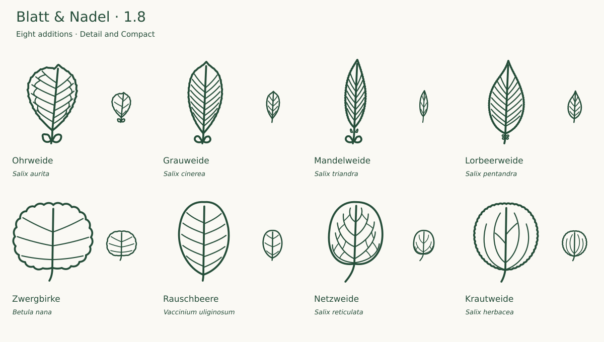

# Expansion plan and review — 1.8

This bounded release extends riparian willows and alpine/moorland dwarf shrubs after a fresh review of the existing core. The goal is useful species coverage with explicit drawing limits, not a larger count for its own sake.

## Round one: riparian willows

| Addition                         | Selected form and review                                                                                                                                                                                                                                                                            | Sources                                                                                                                                                                                                                                                                                                                                                                                       |
| -------------------------------- | --------------------------------------------------------------------------------------------------------------------------------------------------------------------------------------------------------------------------------------------------------------------------------------------------- | --------------------------------------------------------------------------------------------------------------------------------------------------------------------------------------------------------------------------------------------------------------------------------------------------------------------------------------------------------------------------------------------- |
| Ohrweide · _Salix aurita_        | Broad obovate blade, short oblique apex, irregular crenate edge and conspicuous paired stipules compared with InfoFlora foliage and FloraWeb. Both sizes retain the stipules; Detail adds sparse vein interlinks. Reduced overcurved lateral veins after the first visual review.                   | [Primary](https://www.infoflora.ch/de/flora/salix-aurita.html) [Additional 1](https://www.floraweb.de/php/artenhome.php?name-use-id=5156)                                                                                                                                                                                                                                                     |
| Grauweide · _Salix cinerea_      | Elongated obovate blade, greatest width above the middle, short straight apex and shallow crenations compared with InfoFlora, FloraWeb and FNA. Broadened the upper shoulders to shorten the initial draft apex. Preserved natural overlap with other broad-leaved willows.                         | [Primary](https://www.infoflora.ch/de/flora/salix-cinerea.html) [Additional 1](https://www.floraweb.de/php/artenhome.php?suchnr=5162) [Additional 2](https://floranorthamerica.org/Salix_cinerea)                                                                                                                                                                                             |
| Mandelweide · _Salix triandra_   | Narrow lanceolate blade, long point, fine regular teeth, conspicuous petiole and Detail pin-shaped glands/stipules compared with InfoFlora and FloraWeb. The regional selected blade is about 3.27:1; longer cultivated New Zealand forms were considered without replacing the regional reference. | [Primary](https://www.infoflora.ch/de/flora/salix-triandra.html) [Additional 1](https://floraweb.de/php/artenhome.php?suchnr=5205) [Additional 2](https://www.nzflora.info/factsheet/Taxon/Salix-triandra.html)                                                                                                                                                                               |
| Lorbeerweide · _Salix pentandra_ | Broad lanceolate-ovate blade, elongated point, dense fine teeth and upper-petiole glands checked against InfoFlora, FloraWeb and FNA/FoC. Kept a regional narrowed/rounded basal transition; the broader truncate-based cultivated New Zealand description is not treated as universal.             | [Primary](https://www.infoflora.ch/de/flora/salix-pentandra.html) [Additional 1](https://www.floraweb.de/php/artenhome.php?suchnr=5186) [Additional 2](https://efloras.org/florataxon.aspx?flora_id=1&taxon_id=200005957) [Additional 3](https://www.efloras.org/florataxon.aspx?flora_id=2&taxon_id=200005957) [Additional 4](https://www.nzflora.info/factsheet/Taxon/Salix-pentandra.html) |

The group was reviewed before choosing round two. The first visual pass reduced excessive vein curvature and shortened the Grauweide apex. Ohrweide retains conspicuous stipules in both sizes; the other new willows omit small appendages in Compact. Enlarged photographs, target sizes on both backgrounds and full SVG geometry checks supported acceptance.

## Round two: dwarf shrubs

Zwergbirke and Rauschbeere extend moorland foliage; Netzweide and Krautweide add contrasting entire and toothed alpine willow leaves. Their outlines can overlap naturally, so distinctness was not created through invented anatomy.

| Addition                             | Selected form and review                                                                                                                                                                                                                                                                                                     | Sources                                                                                                                                                                                                                             |
| ------------------------------------ | ---------------------------------------------------------------------------------------------------------------------------------------------------------------------------------------------------------------------------------------------------------------------------------------------------------------------------- | ----------------------------------------------------------------------------------------------------------------------------------------------------------------------------------------------------------------------------------- |
| Zwergbirke · _Betula nana_           | Rounded blade broader than long, blunt crenate teeth, rounded apex and short stalk compared with InfoFlora photographs and the Vienna natural-history museum description. Three vein pairs in both sizes fall within the described two to four pairs. No pointed tree-birch apex was introduced.                             | [Primary](https://www.infoflora.ch/de/flora/betula-nana.html) [Additional 1](https://flora.nhm-wien.ac.at/Seiten-Arten/Betula-nana.htm)                                                                                             |
| Rauschbeere · _Vaccinium uliginosum_ | Entire oval blade with blunt rounded tip and very short petiole compared with InfoFlora foliage and the FloraWeb description of Vaccinium uliginosum s. str. The broader Central European taxon is selected explicitly; the related V. gaultherioides is not silently included.                                              | [Primary](https://www.infoflora.ch/de/flora/vaccinium-uliginosum.html) [Additional 1](https://www.floraweb.de/php/artenhome.php?name-use-id=7417)                                                                                   |
| Netzweide · _Salix reticulata_       | Broad elliptic blunt blade, entire edge, distinct stalk and reticulate venation checked against InfoFlora, FloraWeb and FNA. Two near-basal vein pairs are retained. Replaced an overly regular ornamental draft network with ascending veins and sparse irregular crosslinks, then repeated enlarged and small-size review. | [Primary](https://www.infoflora.ch/de/flora/salix-reticulata.html) [Additional 1](https://www.floraweb.de/php/artenhome.php?name-use-id=5195) [Additional 2](https://www.efloras.org/florataxon.aspx?flora_id=1&taxon_id=242445852) |
| Krautweide · _Salix herbacea_        | Rounded oval blade, fine crenate-serrate margin, short stalk and two near-basal ascending vein pairs checked against InfoFlora, FloraWeb and FNA foliage descriptions. Kept a rounded basal form supported by the reference range and photos. Compared directly with the entire-margined Net-leaved willow.                  | [Primary](https://www.infoflora.ch/de/flora/salix-herbacea.html) [Additional 1](https://www.floraweb.de/php/artenhome.php?suchnr=5175) [Additional 2](https://www.efloras.org/florataxon.aspx?flora_id=1&taxon_id=242445736)        |

The Netzweide draft network initially looked too regular and ornamental. It was redrawn with ascending secondary veins and a limited, less regular set of thinner crosslinks. The two near-basal vein pairs were checked separately against the FNA descriptions for both dwarf willows. Both variants were then inspected enlarged with photographs, at target sizes and next to related leaves.

## Final review and next scope

The [full collection audit](AUDIT-1.8.md) covers every one of the 268 source SVGs. All 252 previous SVGs are preserved byte for byte. Reference photographs were consulted, not traced or redistributed; the preview contains only original artwork.

The 134-taxon collection is a substantial maintained core. A later module should follow an actual website content gap. Candidate topics are the brittle-willow complex (resolve the taxonomic concept before drawing), further regional alpine willows, or specifically requested evergreen garden trees. These are candidates, not reviewed or promised additions. Independent botanical feedback and use at real interface sizes are the next quality priorities. See [SCOPE.md](SCOPE.md).
