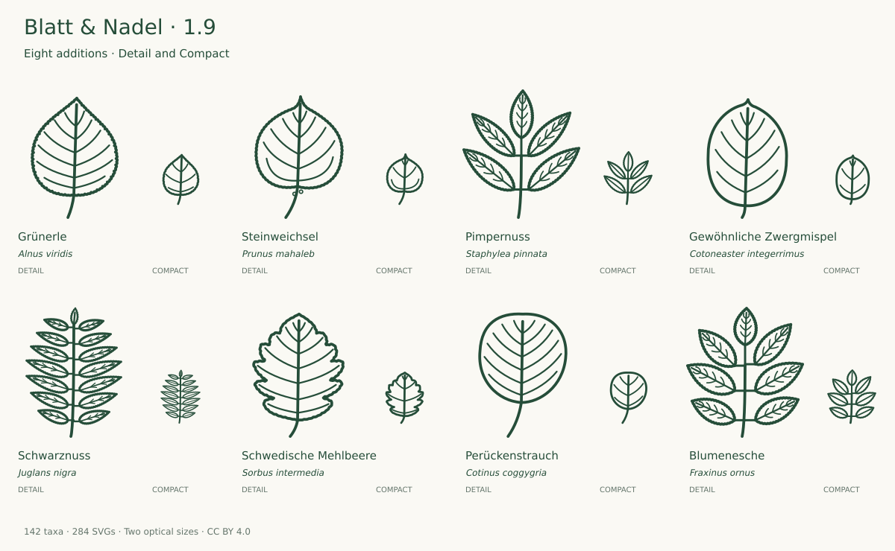

# Expansion plan and review · v1.9.0

**134 → 142 taxa · 268 → 284 source SVGs**

The release adds eight woody taxa in two bounded rounds. Each round passed photograph, source, enlarged-drawing, target-size and geometry review before acceptance. Existing artwork was reviewed first and preserved.

## Round one: native shrubs and regional foliage

Grünerle extends the alder comparison; Steinweichsel adds another native Prunus; Pimpernuss adds its characteristic stalked compound leaf; Gewöhnliche Zwergmispel adds an entire small shrub leaf. The first round exposed protruding Pimpernuss vein ends, which were corrected before the second group was selected.

| Addition                                             | Reference basis                                                                                                                                                                                                       |
| ---------------------------------------------------- | --------------------------------------------------------------------------------------------------------------------------------------------------------------------------------------------------------------------- |
| Grünerle · _Alnus viridis_                           | [Primary](https://www.infoflora.ch/de/flora/alnus-viridis.html) [Additional 1](https://flora.nhm-wien.ac.at/Seiten-Arten/Alnus-alnobetula.htm) [Additional 2](https://www.floraweb.de/php/artenhome.php?suchnr=11767) |
| Steinweichsel · _Prunus mahaleb_                     | [Primary](https://www.infoflora.ch/de/flora/prunus-mahaleb.html) [Additional 1](https://www.treesandshrubsonline.org/articles/prunus/prunus-mahaleb/)                                                                 |
| Pimpernuss · _Staphylea pinnata_                     | [Primary](https://www.infoflora.ch/de/flora/staphylea-pinnata.html) [Additional 1](https://www.floraweb.de/php/artenhome.php?name-use-id=5768)                                                                        |
| Gewöhnliche Zwergmispel · _Cotoneaster integerrimus_ | [Primary](https://www.infoflora.ch/de/flora/cotoneaster-integerrimus.html) [Additional 1](https://efloras.org/florataxon.aspx?flora_id=2&taxon_id=200010749)                                                          |

## Round two: planted trees and southern European foliage

Schwarznuss complements Walnuss, Schwedische Mehlbeere complements the existing Sorbus group, Perückenstrauch adds a blunt entire broad leaf, and Blumenesche complements Gemeine Esche. The compound drafts needed additional painted clearance between leaflets, which was resolved before final review.

| Addition                                    | Reference basis                                                                                                                                                                                                                            |
| ------------------------------------------- | ------------------------------------------------------------------------------------------------------------------------------------------------------------------------------------------------------------------------------------------ |
| Schwarznuss · _Juglans nigra_               | [Primary](https://www.infoflora.ch/de/flora/juglans-nigra.html) [Additional 1](https://www.efloras.org/florataxon.aspx?flora_id=1&taxon_id=233500721) [Additional 2](https://landscapeplants.oregonstate.edu/plants/juglans-nigra)         |
| Schwedische Mehlbeere · _Sorbus intermedia_ | [Primary](https://www.floraweb.de/php/artenhome.php?suchnr=5705) [Additional 1](https://www.treesandshrubsonline.org/articles/scandosorbus/scandosorbus-intermedia/)                                                                       |
| Perückenstrauch · _Cotinus coggygria_       | [Primary](https://www.infoflora.ch/de/flora/cotinus-coggygria.html) [Additional 1](https://landscapeplants.oregonstate.edu/plants/cotinus-coggygria) [Additional 2](https://www.efloras.org/florataxon.aspx?flora_id=2&taxon_id=200012683) |
| Blumenesche · _Fraxinus ornus_              | [Primary](https://www.infoflora.ch/de/flora/fraxinus-ornus.html) [Additional 1](https://www.floraweb.de/php/artenhome.php?suchnr=2478) [Additional 2](https://landscapeplants.oregonstate.edu/plants/fraxinus-ornus)                       |

## Names and selected forms

The Grünerle catalog name follows InfoFlora (Alnus viridis); FloraWeb and NHM Vienna use Alnus alnobetula. The drawing selects the European form, not every member of a worldwide green-alder complex. Schwedische Mehlbeere follows FloraWeb (Sorbus intermedia); the International Dendrology Society uses Scandosorbus intermedia. These are explicitly linked taxonomic treatments, not duplicate icons.

The [botanical table](BOTANY.md) lists deliberate omissions and optical reductions. Each addition has a [per-variant audit record](audit-1.9.json), with sources, foliage URLs and comparison species. No reference photographs are included in the repository.

## Next priorities

Maintain this 142-taxon core and gather specialist feedback before expanding merely to raise the count. A next module should follow actual website gaps. Potential candidates are specifically needed mycorrhizal host trees; these are not yet researched or promised icons. Regional willows and evergreen garden trees remain separate possible topics. See [SCOPE.md](SCOPE.md).
