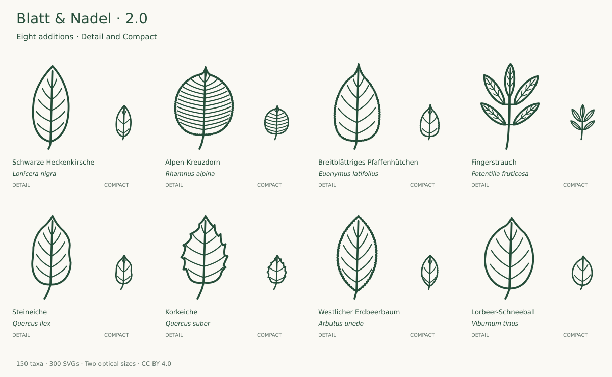

# Expansion and review · v2.0.0

**142 → 150 taxa · 284 → 300 source SVGs**

The existing collection was reviewed first; two known outline/proportion issues were corrected before the additions. Two bounded groups extend regional shrubs and Mediterranean evergreen foliage. The major version follows the project owner’s requested milestone; stable icon IDs, paths and viewBoxes remain compatible.

## Round one: regional shrub gaps

| Addition                                               | Selected form and limits                                                                                                                                                                                                                                                                                               | References                                                                                                                                                                                                                                     |
| ------------------------------------------------------ | ---------------------------------------------------------------------------------------------------------------------------------------------------------------------------------------------------------------------------------------------------------------------------------------------------------------------- | ---------------------------------------------------------------------------------------------------------------------------------------------------------------------------------------------------------------------------------------------- |
| Schwarze Heckenkirsche · _Lonicera nigra_              | Five lateral vein pairs in Detail, three in Compact. Entire lanceolate blade (drawn oriented ratio about 2.1) and very short petiole retained; hairs, opposite arrangement and fruit colour omitted.                                                                                                                   | [Primary](https://www.infoflora.ch/de/flora/lonicera-nigra.html)                                                                                                                                                                               |
| Alpen-Kreuzdorn · _Rhamnus alpina_                     | Fourteen nearly straight vein pairs in Detail, seven in Compact, within the flora's 9–20 range only for Detail. Fine serration reduced; leaf arrangement is not represented by an isolated blade.                                                                                                                      | [Primary](https://www.infoflora.ch/de/flora/rhamnus-alpina.html)                                                                                                                                                                               |
| Breitblättriges Pfaffenhütchen · _Euonymus latifolius_ | Five vein pairs in Detail, three in Compact; small serration reduced. Bud length, fruit wings and absolute leaf size, useful species distinctions, are omitted.                                                                                                                                                        | [Primary](https://www.infoflora.ch/de/flora/euonymus-latifolius.html) [Additional 1](https://powo.science.kew.org/taxon/urn%3Alsid%3Aipni.org%3Anames%3A160962-1/general-information)                                                          |
| Fingerstrauch · _Potentilla fruticosa_                 | Selected five-leaflet pinnate form within the 3–7 range; entire margins and close upper trio retained. Fine hairs, stipules, exact upper-base decurrency and revolute edge are not resolved. Broad regional Potentilla fruticosa concept follows InfoFlora, synonym Dasiphora fruticosa; no cultivar identity claimed. | [Primary](https://www.infoflora.ch/de/flora/potentilla-fruticosa.html) [Additional 1](https://www.efloras.org/florataxon.aspx?flora_id=2&taxon_id=242341052) [Additional 2](https://efloras.org/florataxon.aspx?flora_id=1&taxon_id=242316895) |

## Round two: Mediterranean evergreen foliage

| Addition                                 | Selected form and limits                                                                                                                                                                                                                         | References                                                                                                                                     |
| ---------------------------------------- | ------------------------------------------------------------------------------------------------------------------------------------------------------------------------------------------------------------------------------------------------ | ---------------------------------------------------------------------------------------------------------------------------------------------- |
| Steineiche · _Quercus ilex_              | Selected mature, essentially entire oval-lanceolate leaf with a rounded base and short stalk. Juvenile spiny-toothed and other adult forms also occur. Five vein pairs in Detail, three in Compact; underside felt and leathery texture omitted. | [Primary](https://www.infoflora.ch/de/flora/quercus-ilex.html) [Additional 1](https://landscapeplants.oregonstate.edu/plants/quercus-ilex)     |
| Korkeiche · _Quercus suber_              | Selected oval-oblong blade with rounded base, acute tip and five short teeth per side, within the OSU four-to-five description. Five vein pairs in Detail, three in Compact. Cork bark and underside felt are omitted.                           | [Primary](https://landscapeplants.oregonstate.edu/plants/quercus-suber)                                                                        |
| Westlicher Erdbeerbaum · _Arbutus unedo_ | Selected elliptic-oblong blade, acute tip, cuneate base and very short stalk. Fine serration is reduced in Compact; five vein pairs in Detail and three in Compact. Evergreen texture, flowers and fruits omitted.                               | [Primary](https://landscapeplants.oregonstate.edu/plants/arbutus-unedo)                                                                        |
| Lorbeer-Schneeball · _Viburnum tinus_    | Selected entire ovate-oblong blade with short apex, rounded base and short stalk. Four lateral vein pairs in Detail, two in Compact. Opposite arrangement, leathery surface and underside hair tufts omitted.                                    | [Primary](https://www.infoflora.ch/de/flora/viburnum-tinus.html) [Additional 1](https://landscapeplants.oregonstate.edu/plants/viburnum-tinus) |

Each group passed description/photo comparison, enlarged and target-size review, similar-species comparison and geometry/stroke checks before acceptance. The first group required wider upper Fingerstrauch blades; the second required shorter Korkeiche vein endpoints.

## Names and variation

Fingerstrauch follows the regional InfoFlora concept Potentilla fruticosa (also treated as Dasiphora fruticosa). No cultivar identity is implied. Steineiche and Korkeiche are added as selected Mediterranean evergreen taxa useful in planted contexts, not as newly claimed native Central European species. Their leaf forms vary and overlap. Entire Steineiche and toothed Korkeiche are selected illustrations, not universal species-separating rules.

## Next priorities

Freeze this 150-taxon core for use and specialist feedback. A future bounded module could cover Mediterranean mycorrhizal hosts, beginning with Pinus pinea, Pinus halepensis, Cistus salviifolius and Cistus monspeliensis if the species portraits need them. These are candidates, not researched or released assets. Each must pass primary-source/photograph comparison before drawing, then individual and neighbor QC before the next batch. Finishing a useful set means maintaining a declared scope and resolving defects, not reaching every woody taxon.

See [SCOPE.md](SCOPE.md) and [AUDIT-2.0.md](AUDIT-2.0.md).
