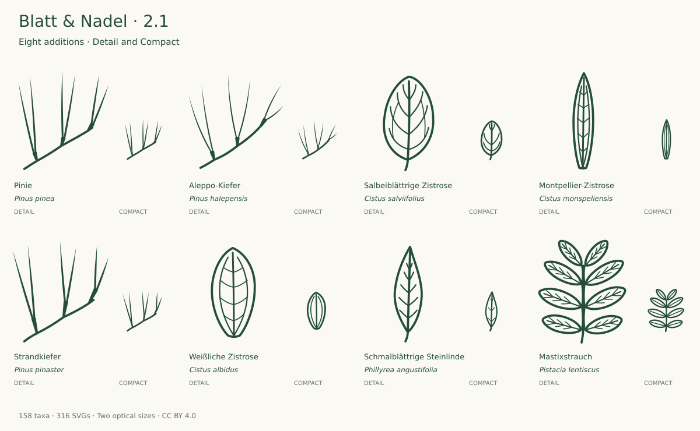

# Expansion and review · v2.1.0

**150 → 158 taxa · 300 → 316 source SVGs**

The existing collection was reviewed before expansion. The previous roadmap's Mediterranean module is developed in two bounded groups. These additions represent Mediterranean vegetation and selected planted contexts; they are not presented as newly native Central European taxa. Existing icon IDs, paths, viewBoxes and licensing remain compatible.

## Round one: two-needle pines and contrasting rockrose foliage

| Addition                                         | Selected form and limits                                                                                                                                                                                                                                                                                                                                    | References                                                                                                                                                                             |
| ------------------------------------------------ | ----------------------------------------------------------------------------------------------------------------------------------------------------------------------------------------------------------------------------------------------------------------------------------------------------------------------------------------------------------- | -------------------------------------------------------------------------------------------------------------------------------------------------------------------------------------- |
| Pinie · _Pinus pinea_                            | Adult foliage: three selected fascicles of two stiff long needles. Shared persistent sheaths are drawn; needle density, minute teeth, stomatal bands and cross-section are omitted. Size normalization prevents reliable separation from other two-needle pines by length alone.                                                                            | [Primary](https://landscapeplants.oregonstate.edu/plants/pinus-pinea)                                                                                                                  |
| Aleppo-Kiefer · _Pinus halepensis_               | Three selected two-needle fascicles with slender gently curved needles and persistent sheaths. Occasional three-needle fascicles are not selected. Density, microscopic serration, colour and absolute length are omitted; cone/bark characters are needed for identification.                                                                              | [Primary](https://landscapeplants.oregonstate.edu/plants/pinus-halepensis) [Additional 1](https://plantnet.rbgsyd.nsw.gov.au/cgi-bin/NSWfl.pl?lvl=sp&name=Pinus~halepensis&page=nswfl) |
| Salbeiblättrige Zistrose · _Cistus salviifolius_ | Selected short-petiolate oval blade with one basal midvein, pinnate lateral veins and four selected mesh links in Detail. Compact retains fewer main nerves without the network. Opposite leaf arrangement, stellate hairs and full rugose texture are omitted.                                                                                             | [Primary](https://www.infoflora.ch/de/flora/cistus-salviifolius.html) [Additional 1](https://www.efloras.org/florataxon.aspx?flora_id=1&taxon_id=250101211)                            |
| Montpellier-Zistrose · _Cistus monspeliensis_    | Isolated sessile narrow lanceolate-linear blade, without an invented petiole, with three basal main veins. Detail includes selected transverse connections; Compact omits them and uses thinner interior lines. Revolute margin, sticky hairs and opposite shoot insertion are not represented. Prefer at least 32 px for reading the three-vein structure. | [Primary](https://www.snv.jussieu.fr/bmedia/arbres/ciste_montpellier.htm) [Additional 1](https://www.efloras.org/florataxon.aspx?flora_id=1&taxon_id=250101214)                        |

## Round two: Mediterranean evergreen forms

| Addition                                              | Selected form and limits                                                                                                                                                                                                                                                                                                                   | References                                                                                                                                                                                                      |
| ----------------------------------------------------- | ------------------------------------------------------------------------------------------------------------------------------------------------------------------------------------------------------------------------------------------------------------------------------------------------------------------------------------------ | --------------------------------------------------------------------------------------------------------------------------------------------------------------------------------------------------------------- |
| Strandkiefer · _Pinus pinaster_                       | Three selected adult two-needle fascicles; stiff long needles and conspicuously long persistent sheaths. Fine teeth, stomatal lines and natural crowded shoot density omitted. Absolute needle length is normalized and cannot identify the species alone.                                                                                 | [Primary](https://landscapeplants.oregonstate.edu/plants/pinus-pinaster)                                                                                                                                        |
| Weißliche Zistrose · _Cistus albidus_                 | Selected sessile oblong-elliptic, entire blade with broad insertion, midrib and two basal longitudinal side nerves. Detail shows selected cross-connections, not the complete rugose network. Compact retains only the three main nerves. Stellate hairs, whitish felt, opposite arrangement and revolute edge are omitted.                | [Primary](https://jardinbotanico.uma.es/jb-e3-03/) [Additional 1](https://www.uv.es/itineraris/Itinerario%20I/Cistus_Albidus.html)                                                                              |
| Schmalblättrige Steinlinde · _Phillyrea angustifolia_ | Short-petiolate entire lanceolate leaf; five weak ascending vein pairs in Detail, three optically reduced pairs in Compact. Opposite shoot arrangement, leathery texture and subtle tertiary venation omitted. The selected outline overlaps Olea and other evergreen shrubs.                                                              | [Primary](https://flora.uniud.it/scheda.php?id=1209) [Additional 1](https://www.mitra-nature.uevora.pt/Especies-e-habitats/Plantas/Lenhosas/Arbustos-e-Lianas/Oleaceae/Phillyrea-angustifolia)                  |
| Mastixstrauch · _Pistacia lentiscus_                  | Selected four-pair even-pinnate mature leaf with eight entire elliptic leaflets and a narrow continuous winged rachis. No terminal leaflet. Detail includes three selected vein pairs per leaflet; Compact retains midribs only. Number, leaflet symmetry and wing width vary naturally; texture and slight marginal revoluteness omitted. | [Primary](https://apps.cals.arizona.edu/arboretum/taxon.aspx?id=216) [Additional 1](https://www.mitra-nature.uevora.pt/Especies-e-habitats/Plantas/Lenhosas/Arbustos-e-Lianas/Anacardiaceae/Pistacia-lentiscus) |

Round one was accepted after closing tiny draft needle/sheath gaps and improving narrow Compact rockrose line weights. Only then was round two selected. Round two refined Steinlinde upper veins and retained a true winged, even-pinnate Mastixstrauch axis. Both groups passed enlarged photo comparison, small-size light/dark review, comparison with two neighboring taxa per addition, and geometry/stroke checks before acceptance.

## Similarity and naming

The three added pines all select two adult needles per fascicle. Needle length is normalized; distinguishing the trees also requires cones, bark and other characters. Minute serration and stomatal bands are omitted. No artificial needle-count distinction was introduced.

Cistus salviifolius retains a short petiole and pinnate venation. C. monspeliensis and C. albidus select sessile blades with three basal longitudinal nerves. The broad versus narrow blades help orientation, while hairs, stickiness and most surface texture remain outside a monochrome icon. Prefer at least 32 px for the three main nerves in the narrow Montpellier form. Mastixstrauch retains paired leaflets without a terminal leaflet; its winged axis is represented by a closed narrow membrane.

## Next priorities

Maintain this 158-taxon core and collect feedback from real usage before another expansion. A future content-driven module could consider Judasbaum (Cercis siliquastrum), Terpentin-Pistazie (Pistacia terebinthus) and Breitblättrige Steinlinde (Phillyrea latifolia), which are absent from the current catalog. First reference leads are the Oregon State Cercis treatment and University of Udine Pistacia and Phillyrea treatments; full drawing-specific research is still required. These are candidates, not reviewed or released icons. Apply the same reference, morphology, neighbor, optical and preservation gates before adding them.

The set is complete for a declared site scope when its needed taxa are covered and remaining defects are resolved; a growing species count alone is not a quality measure. Independent botanical assessment remains the next step before making identification-grade claims. See [SCOPE.md](SCOPE.md) and [AUDIT-2.1.md](AUDIT-2.1.md).
