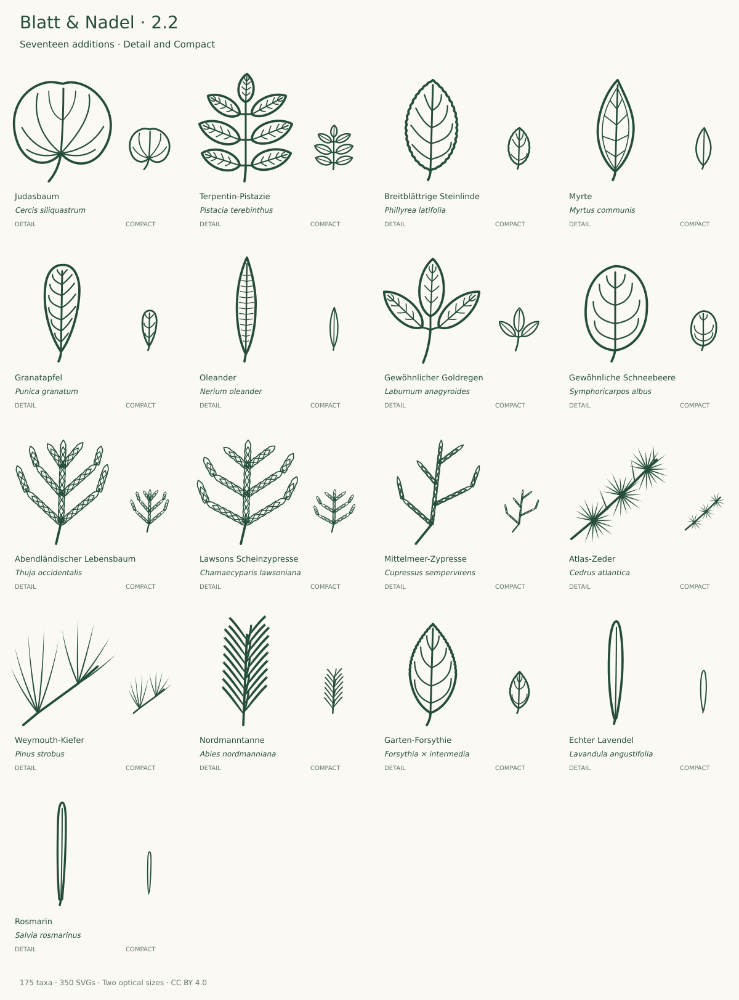

# Expansion and review · v2.2.0

**158 → 175 taxa · 316 → 350 source SVGs**

The existing collection was reviewed first. This expansion adds Mediterranean and familiar garden foliage, then common planted conifers and three woody shrubs/subshrubs. It does not imply that every addition is native to Central Europe. Existing IDs, paths, viewBoxes and licensing remain compatible.

## Round one: eight contrasting broadleaf forms

| Addition                                          | Selected form and limits                                                                                                                                                                                                                                                                      | References                                                                                                                                                                         |
| ------------------------------------------------- | --------------------------------------------------------------------------------------------------------------------------------------------------------------------------------------------------------------------------------------------------------------------------------------------- | ---------------------------------------------------------------------------------------------------------------------------------------------------------------------------------- |
| Judasbaum · _Cercis siliquastrum_                 | Broad rounded entire mature blade with a shallow terminal indentation, cordate base and long petiole. Seven basal nerves in Detail, five in Compact; higher-order venation and hairs omitted. The shallow notch is a selected common form, not mandatory on every leaf.                       | [Primary](https://landscapeplants.oregonstate.edu/plants/cercis-siliquastrum)                                                                                                      |
| Terpentin-Pistazie · _Pistacia terebinthus_       | Selected odd-pinnate seven-leaflet form: three lateral pairs and a terminal leaflet, elliptic entire blades and an unwinged rachis. Short petiolules maintain visible separation. Compact reduces secondary veins; individual specimen counts vary (the primary treatment gives 3–9).         | [Primary](https://flora.uniud.it/scheda.php?id=504)                                                                                                                                |
| Breitblättrige Steinlinde · _Phillyrea latifolia_ | Broad ovate mature blade, short petiole and weak fine marginal teeth. Four lateral pairs in Detail, three in Compact. Variable entire and toothed leaves occur; this is a mildly toothed form. Leaf texture and most vein orders omitted.                                                     | [Primary](https://dryades.units.it/stagnisardi/index.php?id=3987&num=3501&procedure=taxon_page) [Additional 1](https://landscapeplants.oregonstate.edu/plants/phillyrea-latifolia) |
| Myrte · _Myrtus communis_                         | Entire ovate-lanceolate blade, acute apex and short petiole. Detail includes a collecting vein near the margin and sparse lateral connections. Compact keeps the outline and midrib. Oil-gland dots, translucency, texture and leaf arrangement are not represented by this single-leaf view. | [Primary](https://landscapeplants.oregonstate.edu/plants/myrtus-communis)                                                                                                          |
| Granatapfel · _Punica granatum_                   | Oblong to obovate entire mature leaf, blunt apex and tapering base with short petiole. Seven lateral pairs in Detail, three in Compact with the basal pair moved away from the narrow insertion. Gloss, variation in leaf arrangement and fine reticulation omitted.                          | [Primary](https://landscapeplants.oregonstate.edu/plants/punica-granatum)                                                                                                          |
| Oleander · _Nerium oleander_                      | Long narrow entire lanceolate blade with short petiole. Detail selects thirteen nearly transverse vein pairs from the much denser real venation; Compact keeps only the midrib. Texture, underside stomatal pits and three-leaf whorls are outside this single-blade view.                    | [Primary](https://landscapeplants.oregonstate.edu/plants/nerium-oleander) [Additional 1](https://www.nzflora.info/factsheet/Taxon/Nerium-oleander.html)                            |
| Gewöhnlicher Goldregen · _Laburnum anagyroides_   | Three entire broad lanceolate leaflets on a shared long petiole. Short individual petiolules separate the blades; the terminal blade is larger. Compact reduces venation. The silvery underside hairs and leaf arrangement are omitted.                                                       | [Primary](https://www.infoflora.ch/de/flora/laburnum-anagyroides.html)                                                                                                             |
| Gewöhnliche Schneebeere · _Symphoricarpos albus_  | Selected mature unlobed broad ovate to elliptic entire blade with blunt apex and short petiole. Four lateral pairs in Detail, three in Compact. Lobed vigorous-shoot leaves, opposite arrangement and hairs are not represented.                                                              | [Primary](https://www.infoflora.ch/de/flora/symphoricarpos-albus.html)                                                                                                             |

## Round two: six conifers and three garden shrubs/subshrubs

| Addition                                            | Selected form and limits                                                                                                                                                                                                                                                                                                                                                                                       | References                                                                                                                                                       |
| --------------------------------------------------- | -------------------------------------------------------------------------------------------------------------------------------------------------------------------------------------------------------------------------------------------------------------------------------------------------------------------------------------------------------------------------------------------------------------- | ---------------------------------------------------------------------------------------------------------------------------------------------------------------- |
| Abendländischer Lebensbaum · _Thuja occidentalis_   | Flattened adult spray with overlapping appressed scale foliage. Continuous scalloped outer contours represent lateral scales; internal overlapping lozenges represent facial scales. Compact reduces the number of rows. Branches and scale spacing are schematic; glands, exact decussate insertion and three-dimensional overlaps are not individually resolved. No underside butterfly marking is invented. | [Primary](https://landscapeplants.oregonstate.edu/plants/thuja-occidentalis)                                                                                     |
| Lawsons Scheinzypresse · _Chamaecyparis lawsoniana_ | Selected flattened adult spray with small pointed overlapping scale leaves. Lateral scallops and internal facial scales are enlarged; Compact reduces scale rows. Projected branch arrangement is simplified; glands, underside white X marks and individual decussate insertions are omitted. Similarity to Thuja is retained; the icon alone cannot establish identity.                                      | [Primary](https://landscapeplants.oregonstate.edu/plants/chamaecyparis-lawsoniana)                                                                               |
| Mittelmeer-Zypresse · _Cupressus sempervirens_      | Adult rounded shoots represented by narrow scale-covered branchlets in a staggered projection. Rhombic appressed scales are simplified into an outer contour and internal overlapping rows. Compact retains fewer rows. Three-dimensional circumference, exact scale counts and stomata are not resolved; this is not a flat Thuja spray.                                                                      | [Primary](https://landscapeplants.oregonstate.edu/plants/cupressus-sempervirens)                                                                                 |
| Atlas-Zeder · _Cedrus atlantica_                    | Three selected short-shoot rosettes with sixteen stiff pointed needles each in Detail and ten in Compact; three solitary long-shoot needles in Detail only. The treatment gives 10–20 clustered needles. Rosettes are projected radially, density and needle cross-section reduced; normalizing length prevents absolute size comparison.                                                                      | [Primary](https://landscapeplants.oregonstate.edu/plants/cedrus-atlantica) [Additional 1](https://powo.science.kew.org/taxon/urn:lsid:ipni.org:names:50881822-1) |
| Weymouth-Kiefer · _Pinus strobus_                   | Two selected mature fascicles, each containing exactly five slender curved needles in both variants. The deciduous basal sheath is absent in this mature form. Fascicle density, minute serrations, stomatal lines and section omitted. Needle length is normalized and must not be read as an absolute comparison with other pines.                                                                           | [Primary](https://landscapeplants.oregonstate.edu/plants/pinus-strobus)                                                                                          |
| Nordmanntanne · _Abies nordmanniana_                | Selected forward-pointing shoot with flattened blunt, shallowly notched needles. Detail shows twenty lateral and five frontal needles; Compact fourteen lateral and four frontal needles. Spiral origins are shown as a thinned projection, not a literal two-ranked phyllotactic diagram. Underside bands, twisting at insertion and full density are omitted.                                                | [Primary](https://landscapeplants.oregonstate.edu/plants/abies-nordmanniana)                                                                                     |
| Garten-Forsythie · _Forsythia × intermedia_         | Selected simple ovate-lanceolate hybrid leaf with an entire lower half and a finely toothed upper half. Four lateral pairs in Detail, three in Compact. Compound or lobed variable leaves, opposite arrangement and cultivar differences are outside this selected form.                                                                                                                                       | [Primary](https://landscapeplants.oregonstate.edu/plants/forsythia-intermedia)                                                                                   |
| Echter Lavendel · _Lavandula angustifolia_          | Narrow entire lanceolate leaf of a woody subshrub with a blunt tip and very short petiole. Detail retains the midrib; Compact omits it to leave an open narrow interior. Revolute margins in section, stellate hairs, grey colour and opposite arrangement are omitted. Prefer at least 32 px when the narrow contour matters.                                                                                 | [Primary](https://www.infoflora.ch/de/flora/lavandula-angustifolia.html)                                                                                         |
| Rosmarin · _Salvia rosmarinus_                      | Very narrow linear-lanceolate entire leaf of an evergreen shrub with nearly parallel sides, blunt tip and very short petiole. Detail keeps the midrib; Compact deliberately omits it. Rolled margin section, white underside hairs and opposite arrangement are omitted. Prefer 32 px or larger; a 24 px silhouette cannot carry these diagnostic characters.                                                  | [Primary](https://www.infoflora.ch/de/flora/rosmarinus-officinalis.html) [Additional 1](https://powo.science.kew.org/taxon/urn:lsid:ipni.org:names:457138-1)     |

Both rounds received primary-description and foliage comparison, enlarged and target-size light/dark review, geometry checks, and a final neighbor comparison. Round one corrected compound-leaf outline contacts. Round two redrew scale contours, moved the cedar clear of the canvas edge and omitted the narrow herbs' Compact midribs. Final acceptance covers the exact hashes in the audit.

## Naming and representation

Kew accepts Cedrus atlantica at species rank and Salvia rosmarinus as the name for rosemary; the InfoFlora morphology remains linked under Rosmarinus officinalis. Garden Forsythia is explicitly the hybrid Forsythia × intermedia. Lavandula angustifolia is a woody subshrub and rosemary a shrub, so both fit the declared woody-plant scope.

The three scale conifers select adult foliage, with scales enlarged relative to the spray. The projection simplifies actual decussate arrangement; underside markings and glands are not depicted. Weymouth pine retains five needles per fascicle, not an arbitrary grass tuft. Its similarity to Swiss stone pine is legitimate; length normalization and omitted cones limit visual identification. The single leaves of Lavendel, Rosmarin and Oleander do not show opposite/whorled arrangement. All reductions are explicit above.

## Next priorities

Keep this 175-taxon core stable while collecting use feedback and independent botanical review. Content-driven candidates currently absent from the catalog include Magnolia kobus, Magnolia grandiflora, Ribes sanguineum and Hibiscus syriacus. They would add useful garden-tree and shrub coverage. These are a proposed backlog only: full source and specimen research, naming checks, drawing and both variant reviews remain required before adding them. Do not enlarge the collection solely to meet another number.

The collection is complete for a declared website scope when its needed taxa are covered, known defects are addressed and its documented checks are satisfied. It is not a complete regional flora. See [SCOPE.md](SCOPE.md).
