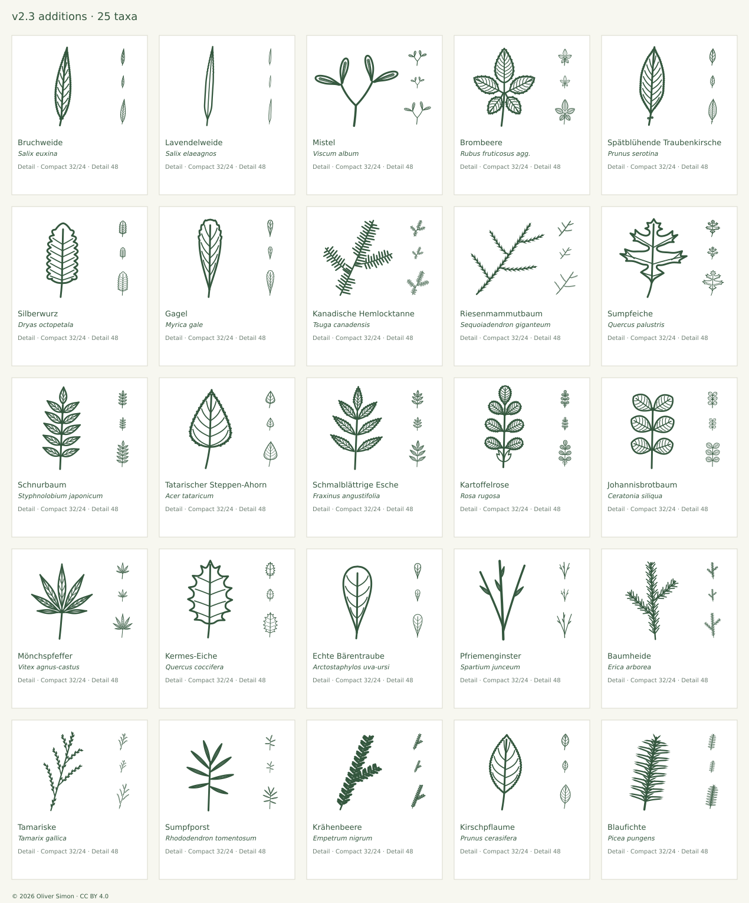

# Expansion and review · v2.3.0

**175 → 200 taxa · 350 → 400 source SVGs**

Additions are chosen by the rules in [SCOPE.md](SCOPE.md): a real content gap, a woody plant and a source-backed leaf form that differs from existing icons. Each addition was researched from at least three foliage photographs inspected at full size and at least one primary description, drawn in both optical sizes, passed the full geometry, raster and connectivity suite, and was compared enlarged, at target sizes on light and dark grounds and beside its nearest neighbors. A final counter-review then compared the finished Detail icon with a fresh photograph not used while drawing. Existing IDs, paths, viewBoxes and licensing remain compatible.

## Group A: Riparian, bog, alpine and parasitic woody plants; one garden conifer

| Addition                                        | Selected form and limits                                                                                                                                                                                                                                                                                                                                                                                                                                                                                                                                                                                                                                                                                                                                                    | Counter-review                                                                                                                                                                                                                         | References                                                                                                                                                                                                                                                 |
| ----------------------------------------------- | --------------------------------------------------------------------------------------------------------------------------------------------------------------------------------------------------------------------------------------------------------------------------------------------------------------------------------------------------------------------------------------------------------------------------------------------------------------------------------------------------------------------------------------------------------------------------------------------------------------------------------------------------------------------------------------------------------------------------------------------------------------------------- | -------------------------------------------------------------------------------------------------------------------------------------------------------------------------------------------------------------------------------------- | ---------------------------------------------------------------------------------------------------------------------------------------------------------------------------------------------------------------------------------------------------------- |
| Bruchweide · _Salix euxina_                     | Selected mature lanceolate leaf (L/W ≈ 4.8) widest at ≈ 38 %, rounded-cuneate base, long gradually drawn-out slightly oblique apex; Detail shows 30 fine forward teeth per side, seven ascending secondary pairs and the pair of glands at the petiole top; Compact keeps an entire outline with three vein pairs. Glandular tooth tips, cartilaginous margin, gloss, the rounded base of some leaves and the dense reticulation are not resolved. The common hybrid Salix × fragilis (S. alba × S. euxina) and pure S. euxina cannot be separated by this outline; the icon stands for the crack willow group, named after the Info Flora species.                                                                                                                         | Confirmed against a fresh photograph (iNaturalist 110927816, Patrick Hacker, CC BY): lanceolate leaves widest below the middle with long acuminate tips and fine regular serration.                                                    | [Primary](https://www.infoflora.ch/de/flora/salix-euxina.html) [Additional 1](https://floranorthamerica.org/Salix_euxina)                                                                                                                                  |
| Lavendelweide · _Salix elaeagnos_               | Selected linear leaf (L/W ≈ 10) with nearly parallel margins from ≈ 20 % to 50 %, cuneate base and long attenuate apex; Detail shows eight fine teeth per side in the distal third and the midrib only (laterals are hidden by the felt beneath and faint above); Compact keeps an entire outline and a thin midrib with thinner strokes so the interior stays open. Revolute margin, white tomentum and gloss cannot be shown in monochrome line art. Leaf width varies 3–10 mm; this is a mid-range form. Similar to Korbweide (broader, lanceolate in this collection) and Purpurweide (oblanceolate); prefer 32 px or larger.                                                                                                                                           | Confirmed against iNaturalist 346642413 (Oscar Dove, CC BY): linear, nearly parallel-sided leaves; the photographed specimen is narrower (L/W ≈ 15), within the published 6–20.                                                        | [Primary](https://www.infoflora.ch/de/flora/salix-elaeagnos.html) [Additional 1](https://floraseries.landcareresearch.co.nz/taxa/5d508bca-1fa6-41a9-9170-c05844e70464) [Additional 2](https://floranorthamerica.org/Salix%20elaeagnos)                     |
| Mistel · _Viscum album_                         | Selected sprig: one jointed internode forking into two, each terminal node with an opposite V-shaped pair of oblong-obovate leaves (L/W ≈ 3.6, widest beyond the middle, obtuse rounded apex, narrowed sessile base, slightly falcate). Detail shows the midrib and two longitudinal nerves; Compact the midrib only. Paired leaf bases sit on either flank of the node so the blades stay separate. Flowers, white berries, swollen nodes, the yellow-green colour and the globular whole-plant habit are not shown. Leaf proportions of subsp. album (< 4× as long as broad); the narrower conifer-host subspecies differ. Leaves are often twisted in life; the icon flattens them.                                                                                      | Confirmed against iNaturalist 62920322 (Patrick Hacker, CC BY): repeatedly forked jointed shoots ending in opposite pairs of oblong obtuse leaves.                                                                                     | [Primary](https://www.infoflora.ch/de/flora/viscum-album.html) [Additional 1](https://turkiyebitkileri.com/fotoğraf-galerisi/santalaceae-guvelekgiller/viscum-okseotu/viscum-album.html) [Additional 2](https://pmc.ncbi.nlm.nih.gov/articles/PMC10030978) |
| Brombeere · _Rubus fruticosus agg._             | Selected five-foliolate primocane leaf (Info Flora: 3–5(–7)-foliolate, lower two leaflets 1–12 mm stalked). Terminal leaflet ovate with a rounded base and acuminate tip on a petiolule ≈ 1/3 of its blade (Flora NZ: 1/3–3/8); lateral and basal leaflets elliptic with cuneate-rounded bases, the basal pair arising from the lateral stalks (pedate). Detail: double serration and 5–7 straight secondary pairs per leaflet; Compact: simple coarse teeth and midribs. An aggregate of several hundred apomictic microspecies; leaflet number, shape, hairiness and prickle form vary. Prickles on petiole and midrib, white or grey underside tomentum and stipules are not shown. Lateral petiolules are lengthened slightly to keep the five blades visibly separate. | Confirmed against iNaturalist 611174285 (naturewatchwidow, CC BY): pedate leaves with a long-stalked terminal leaflet; this specimen has broader, less acuminate leaflets, illustrating the documented variability of the aggregate.   | [Primary](https://www.infoflora.ch/de/flora/rubus-fruticosus-aggr.html) [Additional 1](https://floraseries.landcareresearch.co.nz/taxa/c7ca5661-0668-4a84-ae10-3cce36d6b9f6)                                                                               |
| Spätblühende Traubenkirsche · _Prunus serotina_ | Selected mature oblong-lanceolate leaf (L/W ≈ 2.8) widest just below the middle, cuneate base and acuminate tip; Detail shows 30 fine incurved teeth per side, eight arching secondary pairs and two glands at the petiole top; Compact keeps fewer teeth and three vein pairs. Clearly narrower and more wedge-based than the elliptic, densely veined Traubenkirsche. Gloss, leathery texture, the rusty hairs along the lower midrib and the almond scent are not shown; glands may be 1–4 or absent and sit on the petiole or blade base. Shade leaves are broader.                                                                                                                                                                                                     | Confirmed against iNaturalist 280477342 (CC0): glossy acuminate leaves with fine incurved serration and a wedge base.                                                                                                                  | [Primary](https://www.infoflora.ch/de/flora/prunus-serotina.html) [Additional 1](https://landscapeplants.oregonstate.edu/plants/prunus-serotina)                                                                                                           |
| Silberwurz · _Dryas octopetala_                 | Selected mature leaf (L/W ≈ 2.2) with truncate base, obtuse apex and eight (Detail) / six (Compact) deep rounded crenations per side, each fed by a straight secondary vein; distinct petiole. Photos show 8–11 crenations per side; counts are optical. The white-felted underside, revolute margin, impressed upper surface and glandular hairs are not shown. Not a scale comparison: the natural leaf is only 1–2.5 cm. Clearly separated from the irregularly lobed Stieleiche by its regular crenation.                                                                                                                                                                                                                                                               | Checked against iNaturalist 218934399 (My-Lan Le, CC BY), a North American plant with narrower oblong-lanceolate crenate leaves; the icon keeps the broader Alpine form documented by the Central European photographs and Info Flora. | [Primary](https://www.infoflora.ch/de/flora/dryas-octopetala.html)                                                                                                                                                                                         |
| Gagel · _Myrica gale_                           | Selected mature leaf (L/W ≈ 3.2) widest at ≈ 70 % with a long, slightly concave wedge base and a broadly rounded apex carrying four (Detail) / three (Compact) small teeth per side only on the apical curve; faint ascending secondaries. Separated from the oblanceolate Purpurweide by the rounded, apically toothed tip. Yellow resin dots, grey-green colour, aromatic scent and catkins are not shown. The common Central European primary treatment (Info Flora) has no entry because the species is absent from Switzerland; OSU serves as primary description.                                                                                                                                                                                                     | Confirmed against iNaturalist 392596797 (stephen, CC BY): obovate leaves with a cuneate base and teeth confined to the rounded apex; this specimen is slightly broader (L/W ≈ 2.6).                                                    | [Primary](https://landscapeplants.oregonstate.edu/plants/myrica-gale)                                                                                                                                                                                      |
| Kanadische Hemlocktanne · _Tsuga canadensis_    | Selected flat spray: a main axis with two alternate side branchlets carrying two-ranked short needles of unequal length (pattern of long and short), each with a narrowed twisted stalk and a slightly tapering obtuse tip; Detail adds five small needles lying forward along the upper side of the main twig (the "upside-down" row). Branch axils kept clear for legibility. White stomatal bands beneath, fine marginal teeth, the pubescent twig and small cones are not shown. Natural needles are 8–15 mm; densities and counts are optical. The appressed upper needles are reduced to five in Detail and omitted in Compact.                                                                                                                                       | Confirmed against iNaturalist 326275942 (Tom Scavo, CC BY): flat sprays of short, unequal two-ranked needles with obtuse tips.                                                                                                         | [Primary](https://landscapeplants.oregonstate.edu/plants/tsuga-canadensis) [Additional 1](https://www.conifers.org/pi/Tsuga_canadensis.php)                                                                                                                |

Gap addressed: **Bruchweide** — Commonest riparian tree willow of Central European floodplains (with its hybrid S. × fragilis); named in SCOPE as a willow gap. **Lavendelweide** — Characteristic shrub willow of Alpine and pre-Alpine gravel rivers; the only Central European willow with linear, revolute, white-felted leaves. **Mistel** — Frequently requested on nature websites (hemiparasite of orchard and woodland trees); no evergreen opposite-leaved shoot of this form in the collection. **Brombeere** — The commonest woody plant of hedges and clearings; Kratzbeere is explicitly not an aggregate icon for brambles. **Spätblühende Traubenkirsche** — Invasive neophyte in Central European pine and oak woods; needed beside the native Traubenkirsche for invasive-species pages. **Silberwurz** — Key dwarf shrub of Alpine limestone grassland and late-glacial (Dryas) vegetation; no crenate alpine leaf in the collection. **Gagel** — Characteristic aromatic shrub of Atlantic bogs and heath margins in north-west Germany and the Low Countries; bog habitats are otherwise represented only by heaths and willows. **Kanadische Hemlocktanne** — Widely planted park and forestry conifer; no Tsuga in the collection, and its short unequal needles differ from fir and yew.

Photographs inspected: Bruchweide: [mature leaves on a twig](https://www.infoflora.ch/de/flora/salix-euxina.html) (Christophe Bornand, linked reference, not redistributed), [petiole, stipule and toothed margin](https://www.infoflora.ch/de/flora/salix-euxina.html) (Christophe Bornand, linked reference, not redistributed), [Salix fragilis (s. str.) sl11.jpg](<https://commons.wikimedia.org/wiki/File:Salix_fragilis_(s._str.)_sl11.jpg>) (Stefan.lefnaer, CC BY-SA 4.0), [Salix fragilis (s. str.) sl52.jpg](<https://commons.wikimedia.org/wiki/File:Salix_fragilis_(s._str.)_sl52.jpg>) (Stefan.lefnaer, CC BY-SA 4.0), [Salix fragilis (s. str.) sl54.jpg](<https://commons.wikimedia.org/wiki/File:Salix_fragilis_(s._str.)_sl54.jpg>) (Stefan.lefnaer, CC BY-SA 4.0), [Salix fragilis (s. str.) sl50.jpg](<https://commons.wikimedia.org/wiki/File:Salix_fragilis_(s._str.)_sl50.jpg>) (Stefan.lefnaer, CC BY-SA 4.0), [Salix fragilis 001.jpg](https://commons.wikimedia.org/wiki/File:Salix_fragilis_001.jpg) (Willow, CC BY 2.5), [young spring shoot (not used for the mature form)](https://www.inaturalist.org/photos/37924544) (Nikolay Panasenko, CC BY-NC). Lavendelweide: [leafy twig](https://www.infoflora.ch/de/flora/salix-elaeagnos.html) (Françoise Alsaker, linked reference, not redistributed), [branch with linear leaves](https://www.infoflora.ch/de/flora/salix-elaeagnos.html) (Françoise Alsaker, linked reference, not redistributed), [felted underside with rolled margin](https://www.infoflora.ch/de/flora/salix-elaeagnos.html) (Françoise Alsaker, linked reference, not redistributed), [leaves and catkins plate](https://www.infoflora.ch/de/flora/salix-elaeagnos.html) (K. Lauber / Flora Helvetica, linked reference, not redistributed), [shrub foliage](https://www.inaturalist.org/photos/103659562) (Patrick Hacker, CC BY), [shoot on river gravel](https://www.inaturalist.org/photos/88830599) (Gabriel Mayrhofer, CC BY). Mistel: [Viscum album sprigs. A Mistletoe shrub with leaves and berries.jpg](https://commons.wikimedia.org/wiki/File:Viscum_album_sprigs._A_Mistletoe_shrub_with_leaves_and_berries.jpg) (Rosser1954, CC BY-SA 4.0), [Viscum album Jemioła pospolita 2015-04-26 Sołtysowice 18.jpg](https://commons.wikimedia.org/wiki/File:Viscum_album_Jemio%C5%82a_pospolita_2015-04-26_So%C5%82tysowice_18.jpg) (Agnieszka Kwiecień, Nova, CC BY-SA 4.0), [Viscum album Jemioła pospolita 2015-04-26 Sołtysowice 13.jpg](https://commons.wikimedia.org/wiki/File:Viscum_album_Jemio%C5%82a_pospolita_2015-04-26_So%C5%82tysowice_13.jpg) (Agnieszka Kwiecień, Nova, CC BY-SA 4.0), [leafy shoots with berries](https://www.inaturalist.org/photos/61458098) (Patrick Hacker, CC BY), [berries and leaf pairs](https://www.inaturalist.org/photos/61458108) (Patrick Hacker, CC BY). Brombeere: [five-foliolate leaf from above](https://www.inaturalist.org/photos/56950577) (David Earl, CC BY-NC), [pedate primocane leaves](https://www.inaturalist.org/photos/169157156) (Kenraiz, CC BY-SA), [arching primocane with leaves](https://www.inaturalist.org/photos/169158870) (Krzysztof Ziarnek, Kenraiz, CC BY-SA), [botanical plate](https://www.inaturalist.org/photos/169158873) (C. A. M. Lindman (Bilder ur Nordens Flora), public domain), [leaves, flowers and fruit plate](https://www.infoflora.ch/de/flora/rubus-fruticosus-aggr.html) (Konrad Lauber / Flora Helvetica, linked reference, not redistributed). Spätblühende Traubenkirsche: [leaves](https://landscapeplants.oregonstate.edu/sites/plantid7/files/plantimage/prsero1228.jpg) (Oregon State University, linked reference, not redistributed), [leaf](https://landscapeplants.oregonstate.edu/sites/plantid7/files/plantimage/prsero3509.jpg) (Oregon State University, linked reference, not redistributed), [hanging leaves](https://www.infoflora.ch/de/flora/prunus-serotina.html) (Brigitte Marazzi, linked reference, not redistributed), [shoot with leaves and young fruit](https://www.infoflora.ch/de/flora/prunus-serotina.html) (Christophe Bornand, linked reference, not redistributed), [leaves with fruit racemes](https://www.inaturalist.org/photos/22732777) (allysonv, CC BY-NC). Silberwurz: [Dryas octopetala 2016-05-31 2118.jpg](https://commons.wikimedia.org/wiki/File:Dryas_octopetala_2016-05-31_2118.jpg) (Salicyna, CC BY-SA 4.0), [Dryas octopetala 2016-05-31 2119.jpg](https://commons.wikimedia.org/wiki/File:Dryas_octopetala_2016-05-31_2119.jpg) (Salicyna, CC BY-SA 4.0), [Dryas octopetala 2016-05-31 2120.jpg](https://commons.wikimedia.org/wiki/File:Dryas_octopetala_2016-05-31_2120.jpg) (Salicyna, CC BY-SA 4.0), [flower with leaf rosettes on rock](https://www.infoflora.ch/de/flora/dryas-octopetala.html) (Françoise Alsaker, linked reference, not redistributed), [leaf mat with fruiting heads](https://www.infoflora.ch/de/flora/dryas-octopetala.html) (Françoise Alsaker, linked reference, not redistributed), [flowers and leaves plate](https://www.infoflora.ch/de/flora/dryas-octopetala.html) (K. Lauber / Flora Helvetica, linked reference, not redistributed). Gagel: [shoots, leaves](https://landscapeplants.oregonstate.edu/sites/plantid7/files/plantimage/mygale231.jpg) (Oregon State University, linked reference, not redistributed), [leaves](https://landscapeplants.oregonstate.edu/sites/plantid7/files/plantimage/mygale335.jpg) (Oregon State University, linked reference, not redistributed), [leaf rosette from above](https://www.inaturalist.org/photos/92015224) (Michele Grabke, CC BY-NC), [apical teeth and resin dots, close-up](https://www.inaturalist.org/photos/565370097) (Douglas Goldman, CC BY-SA), [leafy shoot with catkins](https://www.inaturalist.org/photos/84068802) (Susan Fawcett, CC BY-NC). Kanadische Hemlocktanne: [branchlets](https://landscapeplants.oregonstate.edu/sites/plantid7/files/plantimage/tsca70.jpg) (Oregon State University, linked reference, not redistributed), [branchlets and needles](https://landscapeplants.oregonstate.edu/sites/plantid7/files/plantimage/tsca952.jpg) (Oregon State University, linked reference, not redistributed), [branchlets and needles, underside](https://landscapeplants.oregonstate.edu/sites/plantid7/files/plantimage/tsca942.jpg) (Oregon State University, linked reference, not redistributed), [branchlets, comparison with T. heterophylla](https://landscapeplants.oregonstate.edu/sites/plantid7/files/plantimage/ts-he-ca8.jpg) (Oregon State University, linked reference, not redistributed).

## Group B: Planted park and street trees, Pannonian and Mediterranean woody plants

| Addition                                        | Selected form and limits                                                                                                                                                                                                                                                                                                                                                                                                                                                                                                                                                                                                                                                                                                                   | Counter-review                                                                                                                                                                                                                                                                                                                                     | References                                                                                                                                                         |
| ----------------------------------------------- | ------------------------------------------------------------------------------------------------------------------------------------------------------------------------------------------------------------------------------------------------------------------------------------------------------------------------------------------------------------------------------------------------------------------------------------------------------------------------------------------------------------------------------------------------------------------------------------------------------------------------------------------------------------------------------------------------------------------------------------------ | -------------------------------------------------------------------------------------------------------------------------------------------------------------------------------------------------------------------------------------------------------------------------------------------------------------------------------------------------- | ------------------------------------------------------------------------------------------------------------------------------------------------------------------ |
| Riesenmammutbaum · _Sequoiadendron giganteum_   | Selected adult foliage: a main shoot with four alternate cord-like branchlets, each clothed in spirally set, overlapping awl-shaped scale leaves (decurrent base, straight sides, sharp tip) pointing forward at ≈ 30°; a terminal awl continues each axis. Compact enlarges the scales and reduces their number. Natural scales are 3–6 mm and closely appressed; the icon spreads them for legibility. Blue-green colour, stomata and three-dimensional spiral overlap are not shown; cones omitted. Distinct from Mittelmeer-Zypresse (rounded scale-covered branchlets) and Wacholder (free needles in whorls of three).                                                                                                               | Confirmed against Wikimedia Commons “Parc Fenestre (Sequoiadendron giganteum foliage)” (Tangopaso, public domain): cord-like branchlets densely clothed in forward-pointing awl-shaped scales.                                                                                                                                                     | [Primary](https://www.infoflora.ch/de/flora/sequoiadendron-giganteum.html) [Additional 1](https://landscapeplants.oregonstate.edu/plants/sequoiadendron-giganteum) |
| Sumpfeiche · _Quercus palustris_                | Hand-placed outline after OSU leaf photographs: basal lobe pair short, middle pair longest and spreading almost at right angles, upper pair shorter and forward-directed, terminal lobe toothed; wide U-shaped sinuses reach to within ≈ 4 units of the midrib; every lobe ends in two to three bristle-tipped teeth; V-shaped cuneate base and long slender petiole. Detail: one vein to each lobe tip plus a branch to the upper tooth of the main lobes; Compact: the three main lobe veins per side. Leaf lobing varies; this is a typical sun leaf. Bristle tips are enlarged; the tufts of hairs in the vein axils beneath, the gloss and the autumn colour are not shown. Similar to the North American scarlet oak (not included). | Confirmed against iNaturalist 266953650 (CC0): deep wide sinuses and bristle-tipped lobe teeth.                                                                                                                                                                                                                                                    | [Primary](https://www.infoflora.ch/de/flora/quercus-palustris.html) [Additional 1](https://landscapeplants.oregonstate.edu/plants/quercus-palustris)               |
| Schnurbaum · _Styphnolobium japonicum_          | Selected odd-pinnate leaf with five (Detail) / four (Compact) opposite pairs plus a terminal leaflet (OSU: 7–17 leaflets). Leaflets ovate-lanceolate (L/W ≈ 2.6), widest below the middle, acute, entire, on short petiolules, angled forward; long bare petiole section. Detail shows leaflet midribs and three secondary pairs. Glaucous underside, the swollen petiole base enclosing the bud, green twigs and the constricted pods are not shown. No spines (unlike Robinie, which has stipular spines but rounded leaflets). Leaflet count is a selected form.                                                                                                                                                                        | Checked against iNaturalist 655673111 (CC0): this specimen has broader ovate leaflets (L/W ≈ 2) with less acute tips than the selected OSU form; the icon sits at the narrow end of the natural range, documented as a selected form.                                                                                                              | [Primary](https://landscapeplants.oregonstate.edu/plants/styphnolobium-japonicum)                                                                                  |
| Tatarischer Steppen-Ahorn · _Acer tataricum_    | Selected mature unlobed leaf (L/W ≈ 1.4) widest at ≈ 25 %, truncate base with a strong basal vein pair, convex flanks and a concave drawn-out tip; Detail irregularly double serrate with four lateral pairs, Compact simply serrate with two. Clearly separated from the lobed native maples and from Hainbuche (no basal vein pair, many parallel veins). Represents subsp. tataricum. Young or vigorous shoots may carry 3–5-lobed leaves (OSU), and the deeply lobed Amur maple (subsp. ginnala), included in the species by some databases, is not represented. Opposite arrangement, red petiole and the parallel-winged samaras are omitted.                                                                                        | Fresh iNaturalist 386227086 (Loïc Mathieu, CC BY) shows a deeply three-lobed, sharply toothed leaf typical of the Amur maple (A. tataricum subsp. ginnala), which iNaturalist includes in the species. The icon deliberately represents the unlobed Central European subsp. tataricum described by OSU; the record now names the subspecies limit. | [Primary](https://landscapeplants.oregonstate.edu/plants/acer-tataricum)                                                                                           |
| Schmalblättrige Esche · _Fraxinus angustifolia_ | Selected seven-foliolate leaf (HortFlora: leaflets 7, rarely 5–11). Leaflets sessile, lanceolate (L/W ≈ 4), widest near the middle, acuminate, with coarse sharp forward teeth roughly matching the number of lateral veins (seven per side in Detail, four in Compact); terminal leaflet short-stalked. Separated from Gemeine Esche (nine finely serrate leaflets) by fewer, narrower, sessile leaflets and coarser teeth. The decisive brown (not black) winter buds, the occasional whorled leaves and the hairs at the midrib base of subsp. oxycarpa cannot be shown in a leaf icon. Leaflet number and width vary.                                                                                                                  | Confirmed against iNaturalist 246031417 (Genevieve Early, CC BY): narrow sessile coarsely toothed leaflets; this specimen carries more leaflets (≈ 11), within the published range.                                                                                                                                                                | [Primary](https://hortflora.rbg.vic.gov.au/taxon/ada20a7e-5340-11e7-b82b-005056b0018f) [Additional 1](https://treelib.ca/species/179/fraxinus_angustifolia)        |
| Kartoffelrose · _Rosa rugosa_                   | Selected seven-foliolate leaf (Info Flora and OSU: 5–9). Leaflets elliptic to obovate (L/W ≈ 1.8) with rounded apex, serrate from the lower third, short petiolules; Detail shows six closely spaced secondary pairs per leaflet to suggest the deeply impressed rugose venation, Compact two. Paired adnate stipules at the base, broader than in Hundsrose. Rugosity, gloss, the felted underside and the dense bristly prickles of the stem are not literally representable; vein density is the chosen cue. Leaflet number varies.                                                                                                                                                                                                     | Confirmed against iNaturalist 88837362 (CC0): strongly rugose leaflet surface with impressed veins and serrate margin.                                                                                                                                                                                                                             | [Primary](https://www.infoflora.ch/de/flora/rosa-rugosa.html) [Additional 1](https://landscapeplants.oregonstate.edu/plants/rosa-rugosa)                           |
| Johannisbrotbaum · _Ceratonia siliqua_          | Selected even-pinnate leaf with three opposite pairs (OSU: 2–5 pairs, terminal leaflet may be absent). Leaflets broad elliptic-obovate (L/W ≈ 1.4), rounded to slightly retuse apex, entire, on short petiolules; Detail shows five secondary pairs. Separated from Gleditschie (many small leaflets) and Pistazien (winged or unwinged odd-pinnate) by few, very broad leaflets. Leathery gloss, undulate margin and the cauliflorous flowers and pods are not shown; pair number varies.                                                                                                                                                                                                                                                 | Confirmed against iNaturalist 91490205 (Rafael Medina, CC BY): paired broad rounded leathery leaflets without a terminal leaflet.                                                                                                                                                                                                                  | [Primary](https://landscapeplants.oregonstate.edu/plants/ceratonia-siliqua)                                                                                        |
| Mönchspfeffer · _Vitex agnus-castus_            | Selected seven-foliolate leaf (OSU: 5–7(9)). Leaflets narrow lanceolate (L/W ≈ 6), tapering to both ends, entire, decreasing in length outward and spreading through ≈ 170°, each on a short stalk from the petiole tip; Detail shows four secondary pairs on the three longest leaflets. Grey underside, aromatic oil glands, opposite arrangement and flower spikes are not shown. The palmate narrow-leaflet outline resembles a hemp leaf; the entire (not serrate) margins are the botanical difference and are deliberately kept.                                                                                                                                                                                                    | Confirmed against iNaturalist 313920433 (Juan José de Haro, CC BY-SA): palmate leaves of narrow entire leaflets tapering to both ends.                                                                                                                                                                                                             | [Primary](https://landscapeplants.oregonstate.edu/plants/vitex-agnus-castus)                                                                                       |

Gap addressed: **Riesenmammutbaum** — One of the most frequently planted park conifers in Central Europe; its awl-shaped spiral scale leaves differ from the flattened sprays of Thuja and Chamaecyparis and the rounded Cupressus shoots. **Sumpfeiche** — Common street and park oak; Info Flora separates it from the already included Roteiche by more deeply cut leaves with toothed lobes. **Schnurbaum** — Frequent late-flowering street and park tree in Central European cities; its acute entire leaflets distinguish it from the rounded leaflets of Robinie. **Tatarischer Steppen-Ahorn** — Native maple of the Pannonian region (eastern Austria, Hungary) and planted as a small street tree; the only Central European maple with normally unlobed leaves. **Schmalblättrige Esche** — Floodplain ash of the Pannonian and Mediterranean region (Danube and March floodplains, subsp. danubialis/oxycarpa) and increasingly planted; needed beside the Gemeine Esche because of ash dieback management. **Kartoffelrose** — Invasive shrub of North Sea and Baltic coastal dunes and common hedge plant; its rugose leaflets clearly differ from the native Hundsrose. **Johannisbrotbaum** — Characteristic evergreen tree of the Mediterranean region (pods sold as carob); the only even-pinnate leaf with broad rounded leaflets in the collection. **Mönchspfeffer** — Mediterranean riverside shrub and frequent garden plant; the only palmately compound leaf with narrow entire leaflets in the collection.

Photographs inspected: Riesenmammutbaum: [foliage](https://landscapeplants.oregonstate.edu/sites/plantid7/files/plantimage/segi4686_0.jpg) (Oregon State University, linked reference, not redistributed), [branchlets](https://landscapeplants.oregonstate.edu/sites/plantid7/files/plantimage/segi004.jpg) (Oregon State University, linked reference, not redistributed), [branchlets](https://landscapeplants.oregonstate.edu/sites/plantid7/files/plantimage/segi005.jpg) (Oregon State University, linked reference, not redistributed), [scale-like leaves on cm scale](https://landscapeplants.oregonstate.edu/sites/plantid7/files/plantimage/segi8160_0.jpg) (Oregon State University, linked reference, not redistributed), [foliage with cone](https://www.inaturalist.org/photos/84769948) (sean dreilinger, CC BY-NC-SA). Sumpfeiche: [leaf](https://landscapeplants.oregonstate.edu/sites/plantid7/files/plantimage/qupa7210.jpg) (Oregon State University, linked reference, not redistributed), [leaf, underside](https://landscapeplants.oregonstate.edu/sites/plantid7/files/plantimage/qupa7211.jpg) (Oregon State University, linked reference, not redistributed), [leaves](https://landscapeplants.oregonstate.edu/sites/plantid7/files/plantimage/qupa7213.jpg) (Oregon State University, linked reference, not redistributed), [bristle-tipped lobe, close-up](https://www.inaturalist.org/photos/379647565) (Douglas Goldman, CC BY-SA), [autumn leaf](https://www.inaturalist.org/photos/334083974) (Elena S, CC BY-NC). Schnurbaum: [pinnately compound leaf](https://landscapeplants.oregonstate.edu/sites/plantid7/files/plantimage/soja29.jpg) (Oregon State University, linked reference, not redistributed), [leaves and fruit, upper and lower side](https://landscapeplants.oregonstate.edu/sites/plantid7/files/plantimage/soja89.jpg) (Oregon State University, linked reference, not redistributed), [leaves and fruit](https://landscapeplants.oregonstate.edu/sites/plantid7/files/plantimage/soja389.jpg) (Oregon State University, linked reference, not redistributed), [leaves and flowers](https://www.inaturalist.org/photos/21952068) (Michael Ellis, CC BY), [foliage](https://www.inaturalist.org/photos/322952530) (drchancey, CC BY-NC), [glaucous leaflet undersides and swollen petiole bases](https://www.inaturalist.org/photos/212841355) (matthew_wills, CC BY-NC). Tatarischer Steppen-Ahorn: [leaf](https://landscapeplants.oregonstate.edu/sites/plantid7/files/plantimage/acta29.jpg) (Oregon State University, linked reference, not redistributed), [leaves and flower buds](https://landscapeplants.oregonstate.edu/sites/plantid7/files/plantimage/acta97.jpg) (Oregon State University, linked reference, not redistributed), [fruit and leaf](https://landscapeplants.oregonstate.edu/sites/plantid7/files/plantimage/acta207.jpg) (Oregon State University, linked reference, not redistributed), [leaves and samaras](https://www.inaturalist.org/photos/210350409) (Alexander Baransky, CC BY-NC), [leaves and samaras](https://www.inaturalist.org/photos/198815808) (Alexey P. Seregin, CC BY-NC), [single leaf](https://www.inaturalist.org/photos/278750169) (Sebastian J. Dunkl, CC BY-NC). Schmalblättrige Esche: [leaves with coarse toothed leaflets](https://www.inaturalist.org/photos/90059017) (Montserrat Díaz, CC BY-NC), [Fraxinus oxycarpa - underside of a leaf.JPG](https://commons.wikimedia.org/wiki/File:Fraxinus_oxycarpa_-_underside_of_a_leaf.JPG) (Dimitar Naydenov, CC BY-SA 4.0), [hanging foliage](https://www.inaturalist.org/photos/69804233) (Karim Haddad, CC BY), [leafy branch](https://www.inaturalist.org/photos/465784493) (zebedeugalinha, CC BY), [brown winter bud](https://www.inaturalist.org/photos/242568094) (Patrick Hacker, CC BY). Kartoffelrose: [leaf](https://landscapeplants.oregonstate.edu/sites/plantid7/files/plantimage/roru472A.jpg) (Oregon State University, linked reference, not redistributed), [leaf, wrinkled (rugose) surface](https://landscapeplants.oregonstate.edu/sites/plantid7/files/plantimage/roru24.jpg) (Oregon State University, linked reference, not redistributed), [flower and leaves](https://landscapeplants.oregonstate.edu/sites/plantid7/files/plantimage/roru33_0.jpg) (Oregon State University, linked reference, not redistributed). Johannisbrotbaum: [leaf](https://landscapeplants.oregonstate.edu/sites/plantid7/files/plantimage/cesiliq2951.jpg) (Oregon State University, linked reference, not redistributed), [leaves](https://landscapeplants.oregonstate.edu/sites/plantid7/files/plantimage/cesiliq3697A.jpg) (Oregon State University, linked reference, not redistributed), [branches](https://landscapeplants.oregonstate.edu/sites/plantid7/files/plantimage/cesiliq2950.JPG) (Oregon State University, linked reference, not redistributed). Mönchspfeffer: [leaves](https://landscapeplants.oregonstate.edu/sites/plantid7/files/plantimage/viagnus7159.jpg) (Oregon State University, linked reference, not redistributed), [leaf](https://landscapeplants.oregonstate.edu/sites/plantid7/files/plantimage/viagnus60.jpg) (Oregon State University, linked reference, not redistributed), [stem and leaflet](https://landscapeplants.oregonstate.edu/sites/plantid7/files/plantimage/viagnus7160.jpg) (Oregon State University, linked reference, not redistributed), [leaves](https://landscapeplants.oregonstate.edu/sites/plantid7/files/plantimage/viagnus917.jpg) (Oregon State University, linked reference, not redistributed).

## Group C: Mediterranean scrub, dwarf shrubs of heath and bog, and two planted trees

| Addition                                      | Selected form and limits                                                                                                                                                                                                                                                                                                                                                                                                                                                                                                                                                                                                                                    | Counter-review                                                                                                                                                                                                                                                                                     | References                                                                                                                                                                     |
| --------------------------------------------- | ----------------------------------------------------------------------------------------------------------------------------------------------------------------------------------------------------------------------------------------------------------------------------------------------------------------------------------------------------------------------------------------------------------------------------------------------------------------------------------------------------------------------------------------------------------------------------------------------------------------------------------------------------------- | -------------------------------------------------------------------------------------------------------------------------------------------------------------------------------------------------------------------------------------------------------------------------------------------------- | ------------------------------------------------------------------------------------------------------------------------------------------------------------------------------ |
| Kermes-Eiche · _Quercus coccifera_            | Hand-placed outline after iNaturalist leaf photographs: oval-oblong (L/W ≈ 1.6), rounded subcordate base, five spines per side projecting outward-forward with shallow concave margin between them, spine-tipped apex; Detail with four vein pairs ending in the spines, Compact two. HortFlora: 3–5 short-spined teeth per side, base cordate or rounded, 4–8 vein pairs. Natural leaves are only 1–5 cm; gloss and the spiny acorn cups are not shown. The holly-like outline overlaps naturally with Stechpalme, which has fewer, longer spines on a larger, more strongly undulate blade. Tree forms (subsp. calliprinos) can have entire adult leaves. | Confirmed against iNaturalist 223660744 (CC0): small stiff spiny-toothed leaves with undulate margins.                                                                                                                                                                                             | [Primary](https://hortflora.rbg.vic.gov.au/taxon/426f1dd8-5385-4e25-9f4b-afd663079cb9) [Additional 1](https://floraofgibraltar.myspecies.info/taxonomy/term/190/descriptions)  |
| Echte Bärentraube · _Arctostaphylos uva-ursi_ | Selected mature leaf (L/W ≈ 2.4), widest at ≈ 70 %, broadly rounded entire apex, long wedge-shaped base and very short petiole; Detail with four faint ascending vein pairs, Compact two. Separated from Preiselbeere (oval, widest at the middle, notched apex, revolute margin) by the spatulate outline and flat, unnotched tip. The fine raised net venation, gloss and the lack of dots beneath (Preiselbeere has dark glands) are not shown; natural leaves are 1–3 cm.                                                                                                                                                                               | Checked against iNaturalist 696128832 (John Brew, CC BY): this population has broader obovate leaves (L/W ≈ 1.7); the OSU photograph shows both broad and narrow spatulate leaves. The icon keeps the narrower form, which separates it more clearly from Preiselbeere; recorded as selected form. | [Primary](https://www.infoflora.ch/de/flora/arctostaphylos-uva-ursi.html) [Additional 1](https://landscapeplants.oregonstate.edu/plants/arctostaphylos-uva-ursi)               |
| Pfriemenginster · _Spartium junceum_          | Selected shoot: three slender terete green stems branching from the base, carrying four (Detail) / three (Compact) small simple linear-lanceolate leaves on the upper parts (Info Flora: “stachelloser, langästiger Strauch mit wenigen, ungeteilten Blättern”). Separated from Besenginster (trifoliate leaves on angled stems) by the rush-like stems and simple leaves. Leaves are short-lived and often absent; flowers and pods are the usual identification cues and are not shown.                                                                                                                                                                   | Confirmed against iNaturalist 174406385 (Thomas Gyselinck, CC BY): smooth, terete, rush-like green stems, leafless at this stage.                                                                                                                                                                  | [Primary](https://www.infoflora.ch/de/flora/spartium-junceum.html)                                                                                                             |
| Baumheide · _Erica arborea_                   | Selected branched shoot with whorls of three short linear leaves (Flora NZ: whorls of 3–4, 3–7 mm; Cretan Flora: (3–)4, erecto-patent) ascending at ≈ 40–50°, one leaf of each whorl foreshortened; two side shoots. Separated from Schneeheide (longer leaves in whorls of four on an unbranched shoot) by branching, shorter ascending leaves and the three-leaf whorl. The revolute margins concealing the underside, the echinate hairs on young shoots and the dense white flower panicles are not shown. Whorls of four also occur; three are selected.                                                                                               | Confirmed against iNaturalist 5180833 (Drepanostoma, CC BY): fine short ascending leaves on densely branched shoots.                                                                                                                                                                               | [Primary](https://www.nzflora.info/factsheet/Taxon/Erica-arborea.html) [Additional 1](https://cretanflora.com/erica_arborea_text.html)                                         |
| Tamariske · _Tamarix gallica_                 | Selected spray: a main branchlet with five slender alternate side branchlets, all clothed in minute pointed scale leaves lying close to the axis, alternately left and right (Virginia Tech: alternate, very small, ≈ 1.6 mm, scale-like). Scales are drawn as tiny separate blades. Separated from Riesenmammutbaum (stiff, forward-pointing awl scales on cord-like branchlets) by the finer, softer spray and appressed scales. Scale leaves are enlarged ≈ 3–5×; salt glands, pink flower spikes and the deciduous shedding of whole branchlets are not shown. Tamarix species are hard to separate without flowers.                                    | Confirmed against iNaturalist 87256122 (CC0): feathery sprays of slender branchlets with minute appressed scales.                                                                                                                                                                                  | [Primary](https://dendro.cnre.vt.edu/dendrology/syllabus/factsheet.cfm?ID=400) [Additional 1](https://data.environment.sa.gov.au/Content/Publications/FSA_Tamaricaceae_01.pdf) |
| Sumpfporst · _Rhododendron tomentosum_        | Selected shoot: bare lower stem, eight (Detail) / five (Compact) very narrow linear leaves (L/W ≈ 9) alternately inserted and crowded toward the tip, the lower ones spreading to drooping, the upper ones ascending into a loose terminal rosette (iNaturalist photographs). Detail shows the midrib groove. Separated from Rosmarin (opposite pairs along the whole stem) by alternate tip-crowded insertion and drooping lower leaves. Rusty wool beneath, revolute margins and the white flower umbels are not shown; leaf width varies (2–12 mm).                                                                                                      | Confirmed against iNaturalist 510110200 (Bartosz Czołczyński, CC BY): very narrow linear leaves radiating below the terminal flower umbel.                                                                                                                                                         | [Primary](https://flora.kadel.cz/ce/kvCard19803.html) [Additional 1](https://treesandshrubsonline.org/articles/rhododendron/rhododendron-tomentosum/)                          |
| Krähenbeere · _Empetrum nigrum_               | Selected shoot with a short side branch, densely set with short (Info Flora 4–5 mm), blunt, oblong rolled leaves spreading at varied angles and slightly recurved, crowded and overlapping toward the tips. Separated from Schneeheide and Baumheide by the blunt, thick, crowded leaves without whorls. The white line of the concealed underside, the red flowers and black fruits are not shown; Empetrum nigrum s. lat. (incl. subsp. hermaphroditum).                                                                                                                                                                                                  | Confirmed against iNaturalist 669751133 (Patrice Dupont, CC BY): blunt, thick, oblong rolled leaves crowded on the shoot.                                                                                                                                                                          | [Primary](https://www.infoflora.ch/de/flora/empetrum-nigrum.html) [Additional 1](https://flora-burren.linnaeus.naturalis.nl/linnaeus_ng/app/views/species/taxon.php?id=37911)  |
| Kirschpflaume · _Prunus cerasifera_           | Selected mature leaf (L/W ≈ 1.9) widest at ≈ 45 %, rounded-cuneate base, short acute tip, finely crenate-serrate (22 teeth per side in Detail, 12 in Compact), five arching vein pairs (OSU: usually fewer than six). Natural similarity to Pflaume and Schlehe is retained; the more pointed tip and fewer veins are the documented cues. Leaf colour (green or red cultivars), the glabrous young twigs and occasional petiolar glands are not shown.                                                                                                                                                                                                     | Confirmed against iNaturalist 233273770 (CC0): elliptic, finely crenate-serrate leaves with short acute tips.                                                                                                                                                                                      | [Primary](https://www.infoflora.ch/de/flora/prunus-cerasifera.html) [Additional 1](https://landscapeplants.oregonstate.edu/plants/prunus-cerasifera)                           |
| Blaufichte · _Picea pungens_                  | Selected shoot: stiff needles spreading at ≈ 70–75° on both sides and curving slightly forward, front and back needles foreshortened, each Detail needle on a short peg; long sharp spine tip (Gymnosperm DB: 1.6–3 cm, rigid, apex spine-tipped). Denser and more perpendicular than Fichte, whose needles lie forward. Blue-grey colour (only in var. glauca cultivars), four-angled section and stomata on all faces are not shown.                                                                                                                                                                                                                      | Confirmed against iNaturalist 27404138 (CK2AZ, CC BY): stiff needles spreading on all sides of stout shoots (glauca form).                                                                                                                                                                         | [Primary](https://landscapeplants.oregonstate.edu/plants/picea-pungens) [Additional 1](https://www.conifers.org/pi/Picea_pungens.php)                                          |

Gap addressed: **Kermes-Eiche** — Dominant shrub of Mediterranean garrigue; completes the evergreen Mediterranean oaks beside Stein- and Korkeiche. **Echte Bärentraube** — Evergreen dwarf shrub of dry pine woods, alpine heaths and North Sea dunes; Info Flora explicitly separates it from the included Preiselbeere. **Pfriemenginster** — Characteristic Mediterranean roadside shrub, widely planted; its almost leafless photosynthetic stems are a distinct foliage type absent from the collection. **Baumheide** — Dominant shrub of Mediterranean maquis and Macaronesian laurel forest (briar-root pipes); complements the two Central European heaths. **Tamariske** — Planted on coasts and in gardens and naturalised along Mediterranean rivers; the only scale-leaved broadleaf in the collection. **Sumpfporst** — Protected aromatic dwarf shrub of raised bogs in northern Germany, Poland and the Baltic; only bog Ericaceae besides Rauschbeere and the heaths. **Krähenbeere** — Dwarf shrub of bogs, dunes and alpine heaths; its blunt rolled leaves are a heath-like form not yet shown. **Kirschpflaume** — Common hedge and street tree (including red-leaved cultivars) that flowers before most other Prunus; frequently asked about in spring. **Blaufichte** — One of the most frequently planted garden and Christmas-tree conifers; its stiff, spreading, pungent needles contrast with the forward-lying Fichte needles.

Photographs inspected: Kermes-Eiche: [spiny leaves with acorn](https://www.inaturalist.org/photos/2820193) (skyrk, CC BY-NC), [spiny leaves](https://www.inaturalist.org/photos/8962850) (junjadores, CC BY-NC), [leaves and acorn](https://www.inaturalist.org/photos/6085633) (Steve Daniels, CC BY-NC). Echte Bärentraube: [leaves, from three selections](https://landscapeplants.oregonstate.edu/sites/plantid7/files/plantimage/aruv16.jpg) (Oregon State University, linked reference, not redistributed), [leaves and fruit](https://landscapeplants.oregonstate.edu/sites/plantid7/files/plantimage/aruv2975.jpg) (Oregon State University, linked reference, not redistributed), [shoot](https://www.inaturalist.org/photos/341201715) (Remington Tengs Jackson, CC BY-NC), [leaves and flowers](https://www.inaturalist.org/photos/62779404) (Ian Cruickshank, CC BY-NC), [leaves and flowers](https://www.inaturalist.org/photos/169983619) (kaleid, CC BY-NC). Pfriemenginster: [rush-like stems](https://www.inaturalist.org/photos/158311409) (Amelia Tauber, CC BY), [flowering stem](https://www.inaturalist.org/photos/341631480) (Wolfgang Bittermann, CC BY-NC), [stems with pods](https://www.inaturalist.org/photos/15290820) (Tony Rebelo, CC BY-SA). Baumheide: [Erica arborea RF.jpg](https://commons.wikimedia.org/wiki/File:Erica_arborea_RF.jpg) (Robert Flogaus-Faust, CC BY 4.0), [Erica arborea kz03.jpg](https://commons.wikimedia.org/wiki/File:Erica_arborea_kz03.jpg) (Krzysztof Ziarnek, Kenraiz, CC BY-SA 4.0), [flowering shoot with whorled leaves](https://www.inaturalist.org/photos/111120624) (fotis-samaritakis, CC BY-NC). Tamariske: [scale-leaved branchlets](https://www.inaturalist.org/photos/159263813) (Patrick Hacker, CC BY), [branchlets with flower spikes](https://www.inaturalist.org/photos/27485301) (Bernd Bäumler, CC BY-NC), [feathery sprays](https://www.inaturalist.org/photos/516851595) (cccrll, CC BY-NC). Sumpfporst: [leafy shoot with buds](https://www.inaturalist.org/photos/142910458) (Степанова Ксения, CC BY-NC), [shoot-tip rosettes](https://www.inaturalist.org/photos/442975017) (ocanire, CC BY-NC), [dense shrub](https://www.inaturalist.org/photos/221764373) (Rafael R. Völtz, CC BY-NC), [leaves with rusty underside](https://www.inaturalist.org/photos/179496406) (Andrey Efremov, CC BY-NC). Krähenbeere: [shoot tip with young fruit](https://www.inaturalist.org/photos/315564382) (stefan-allgaeu, CC BY-NC), [flowering shoot](https://www.inaturalist.org/photos/152035591) (Adam Schneider, CC BY-NC), [crowded blunt leaves](https://www.inaturalist.org/photos/152035609) (Adam Schneider, CC BY-NC), [fruits and leaves](https://www.inaturalist.org/photos/402343822) (Ramunė Vakarė, CC BY-NC-SA). Kirschpflaume: [leaves and fruit](https://www.inaturalist.org/photos/114710496) (Maja Dumat, CC BY), [branch with leaves and fruit](https://www.inaturalist.org/photos/50812984) (mallaliev, CC BY-NC), [leaves](https://www.inaturalist.org/photos/209087500) (Diana V. Tretyakova, CC BY-NC). Blaufichte: [branchlets, needles on cm scale](https://landscapeplants.oregonstate.edu/sites/plantid7/files/plantimage/pipu8804.jpg) (Oregon State University, linked reference, not redistributed), [branchlets, green and glauca forms](https://landscapeplants.oregonstate.edu/sites/plantid7/files/plantimage/pipu-g5941_0.jpg) (Oregon State University, linked reference, not redistributed), [needles, stomatal bands on all sides](https://landscapeplants.oregonstate.edu/sites/plantid7/files/plantimage/pipu888.jpg) (Oregon State University, linked reference, not redistributed).

## Naming and representation

Bruchweide is named after the Info Flora species _Salix euxina_; the common hybrid _Salix × fragilis_ cannot be separated by leaf outline. Brombeere represents the apomictic aggregate _Rubus fruticosus_ agg. (Info Flora treatment); Kratzbeere remains a separate species icon. Gagel and the Kanadische Hemlocktanne use Oregon State University as primary description because Info Flora has no treatment for these taxa.
